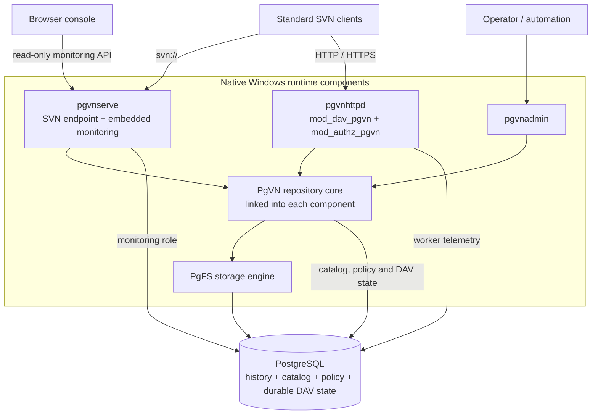

<div align="center">

# PgVN

**Subversion protocols · PostgreSQL storage · No per-repository directories**

A PostgreSQL-backed Subversion server for Windows and Linux, offering native SVN/DAV access, centralized repository administration, and an embedded monitoring console.

[](#project-status)
[](LICENSE)
[](docs/pgvn/linux.zh-CN.md)
[](#quick-start)
[](#prerequisites)
[](#prerequisites)

**English** · [简体中文](README.zh-CN.md)

[Overview](#product-overview) · [Quick start](#quick-start) · [GUI Manager](#windows-configuration-gui) · [Polarion migration](#polarion-gui-migration) · [Web console](#web-console) · [Architecture](#architecture) · [Usage](#use-pgvn) · [Documentation](#documentation)

</div>


*The embedded monitoring console, captured from a recorded local validation run. [Explore the console](#web-console).*

> [!IMPORTANT]
> **First usable preview for Windows.** On 2026-10-17, the project owner confirmed that their local Polarion instance is running successfully with PgVN; see the [local operation record](docs/pgvn/progress.zh-CN.md#first-usable-preview). Milestones M0–M5 have recorded local acceptance runs, while M6 compatibility, fault-injection, and performance validation remains in progress. Clean-machine installation, reboot recovery, cross-host failover, and full Polarion application acceptance remain pending. This preview release is intended for internal evaluation.

Linux x86_64 development snapshots now include native SVN, Apache DAV, the monitor, CLI, supervised Hooks, packaging and offline recovery. See the [Linux build and deployment guide](docs/pgvn/linux.zh-CN.md). Release and sanitizer integration, real-browser flows, and a real Ubuntu VM with systemd, reboot, upgrade/rollback and recovery have passed. See the [delivery evidence](docs/pgvn/linux-delivery.zh-CN.md). Windows acceptance remains deferred.

## Start here

| Your goal | Start with |
| --- | --- |
| Understand the product and implementation | [Product overview](#product-overview), [features](#features), and [architecture](#architecture) |
| Try a deployment on a fresh Windows host | [Quick start](#quick-start) (from database preparation to running services) or [Windows configuration GUI](#windows-configuration-gui) |
| Replace single-host Polarion SVN with the GUI | [Windows migration rehearsal, validation, and rollback](#polarion-gui-migration) |
| Connect clients or migrate existing history | [Usage](#use-pgvn) and [administration and migration](#administration-and-migration) |
| Develop PgVN or assess validation coverage | [Build from source](#build-from-source) and [project status](#project-status) |

## Product overview

PgVN stores SVN repository history, configuration, and durable protocol state directly in PostgreSQL. Standard SVN clients continue to connect over `svn://`, HTTP, or HTTPS, while operators manage repositories through `pgvnadmin` (or the Windows GUI) and inspect runtime status through an embedded web console.

PgVN is built for teams that want to preserve standard SVN client workflows while consolidating repository storage, access policy, and operational state into a unified PostgreSQL backend. The runtime consists of a dedicated SVN service (`pgvnserve`), Apache DAV/authorization modules (`mod_dav_pgvn` and `mod_authz_pgvn`), and a command-line administration tool (`pgvnadmin`), all linked against a shared repository core.

The earlier PgFS filesystem-plugin PoC serves as the underlying storage engine, whereas deployments use the complete PgVN runtime. Local Polarion operation with PgVN has been confirmed by the project owner; broader scenario-by-scenario application acceptance continues under the [validation roadmap](docs/pgvn/progress.zh-CN.md#first-usable-preview).

## Features

| Capability | What PgVN provides |
| --- | --- |
| Standard client access | `svn://` via `pgvnserve`; HTTP/HTTPS via `mod_dav_pgvn` and `mod_authz_pgvn`. |
| Database-backed repositories | Opens repositories by internal ID and resolves URLs through catalog routes—no per-repository `repo`, `conf`, or `activities.d` directories on disk. |
| Native administration | `pgvnadmin` creates repositories, publishes versioned authz/hook policies, imports/exports standard SVN dumps, verifies history, and manages credentials. |
| Unified durable state | Repository history, locks, configuration, and persistent DAV transaction state all reside in PostgreSQL. |
| Operations console | Embedded read-only web console for service health, repositories, database activity, nodes, Apache workers, and request errors. |
| Windows deployment & GUI | Self-contained x64 runtime, PowerShell deployment scripts, `LocalService` Windows services, integrity checks, backup/restore automation, and the native **PgVN Manager** desktop GUI. |

## Web console

The monitoring console is embedded directly in `pgvnserve.exe`—no Node.js, Python, or separate frontend service is required at runtime. It features a Chinese UI with light and dark themes, responsive desktop and narrow layouts, keyboard navigation, and automatic refresh with pause controls.

| View | What you can inspect |
| --- | --- |
| Overview | Service readiness, writable-primary status, sample freshness, request trends, and process resource usage. |
| Nodes | Node heartbeats and service instances, with expandable Apache worker telemetry. |
| Repositories | Search and pagination, repository identity, `HEAD` revision, configuration generation, active transactions, and locks. |
| Database | Connection usage, SQL activity, wait events, and sampling status within the monitoring role's visibility. |
| Requests & errors | SVN command outcomes, effective session capacity of the current instance, DAV method counts, and correlated request errors. |

Console access is protected by expiring, revocable `monitor:read` tokens. Tokens are held only in browser memory; all repository, user, and policy changes are performed through `pgvnadmin` or PgVN Manager. See [Web console and tokens](#web-console-and-tokens) for token commands.

<details>
<summary>More screenshots: requests and errors · narrow node view</summary>


<p align="center">
  
</p>

*These screenshots and the overview image above come from the same recorded [working-copy browser validation](docs/pgvn/M6-network-wc-workflows.zh-CN.md#冻结构建与完整回归). They show isolated test data; displayed numbers are not performance benchmarks.*

</details>

## Architecture



| Component | Responsibility |
| --- | --- |
| `pgvnserve.exe` | Native SVN protocol endpoint, Windows service lifecycle, health probes, monitoring API, and embedded web assets. |
| `pgvnhttpd.exe` + `mod_dav_pgvn.so` | Custom Apache host and Subversion DAV protocol module; manages persistent activities, transactions, and commit receipts. |
| `mod_authz_pgvn.so` | Database-backed path authorization module for DAV requests. |
| `pgvnadmin.exe` | CLI for repository lifecycle, policy publication, credentials, dump/load, verification, and maintenance. |
| PgVN core + PgFS | Repository resolution, authorization/hook policy enforcement, and PostgreSQL-backed versioned storage, linked into each binary above. |

A repository request follows three steps:

1. **Resolve the repository.** The protocol endpoint maps the incoming URL route to an internal repository ID. Internal IDs are separate from the client-visible SVN UUID, allowing a single database to host multiple repositories and routes.
2. **Enforce policy.** The shared core loads the published access configuration and evaluates path authorization and hook rules.
3. **Read or write history.** PgFS reads or writes versioned data in PostgreSQL. Revision publication and authorization-generation rechecks happen atomically within the same database transaction.

Because the shared core is linked directly into each service process, deployments require no separate repository RPC daemon. The web console reads operational metrics through the monitoring API, while administrative changes go through `pgvnadmin` or PgVN Manager.

| Database schema | Stored state |
| --- | --- |
| `pgfs` | Repository history, versioned directory trees, file contents, properties, transactions, and locks. |
| `pgvn` | Repository catalog, URL routes, versioned policies, SVN credentials, monitor token hashes, and durable DAV state. |
| `pgvn_monitor` | Node heartbeats, bounded metric samples, and read-only monitoring views. |

**Filesystem boundary.** Each node still maintains local binaries, global configuration, protected keys, TLS certificates, logs, temporary files, and external hook executables. "No per-repository directories" means repositories and per-repository state do not rely on local folders (`repo`, `conf`, `activities.d`), though node-level deployment files remain on disk.

**High availability boundary.** Multiple service processes can share the same PostgreSQL backend. Database replication, primary election, fencing, and connection routing are the responsibility of the PostgreSQL deployment. PgVN does not perform database leader election, and local multi-process tests do not constitute acceptance of cross-host high availability or distributed multi-primary writes.

## Windows configuration GUI


[PgVN Manager](tools/pgvn-manager/README.zh-CN.md) is a native Windows desktop application (C# / WPF on .NET Framework 4.8) for configuring and maintaining a PgVN node. It provides a guided workflow to test PostgreSQL connectivity, provision a dedicated database and five non-superuser roles, initialize schemas and keys, save node configuration, install and control PgVN / DAV Windows services, and manage repositories, users, and access rules. Routine maintenance features include health checks, full history verification, SVN dump import/export, full backups, and log inspection. When publishing access rules, Manager verifies the configuration generation loaded for editing so concurrent administrator updates are never silently overwritten.

On a Windows x64 machine with .NET Framework 4.8 installed, run `manager\PgVNManager.exe` from the combined bundle, load the runtime directory, and follow the first-time setup workflow in the Chinese UI. PostgreSQL Server must be installed separately, and configuration or Windows service operations require administrator privileges. Full database/node restoration continues to use the PowerShell restore script. Local Polarion operation has been confirmed by the project owner; full application acceptance and cross-host HA validation remain pending.

The **combined bundle** is a single ZIP archive that packages the complete PgVN runtime together with PgVN Manager: `pgvnserve`, Apache / DAV modules, `pgvnadmin`, matching DLLs, client tools, deployment scripts, and the `manager` directory. For this iteration, the recorded local build artifact is `runtime/pgvn-manager-bundle-9dce96de.zip` (approx. 23 MiB) with a companion `.zip.sha256` checksum file; see the [delivery record](docs/pgvn/manager-validation.zh-CN.md#交付与使用). Because binary bundles are local build outputs distributed separately from Git source, copy both the ZIP and `.sha256` file to the target machine, verify the checksum, and extract the archive. The extracted root directly contains `bin`, `apache`, `deploy`, `tools`, and `manager`—launch `manager\PgVNManager.exe` from there. By contrast, `pgvn-manager.zip` is a standalone GUI add-on that requires a separate complete runtime package. Neither archive includes the PostgreSQL Server installer, .NET Framework, or Polarion software and data.

To build PgVN Manager from source, run:

```powershell
powershell.exe -NoProfile -ExecutionPolicy Bypass -File .\tools\pgvn-manager\Build-PgVNManager.ps1
```

Build outputs are written to `runtime/pgvn-manager`. Pass `-RuntimePackageZip <verified-runtime.zip>` to produce the combined runtime + GUI bundle. PgVN Manager records its own build manifest (`manager-manifest.json`). See the [Manager guide](tools/pgvn-manager/README.zh-CN.md) for usage details, test scripts, and restore boundaries, and the [local validation record](docs/pgvn/manager-validation.zh-CN.md) for verification evidence.

<a id="polarion-gui-migration"></a>

## Migrate single-host Polarion SVN with the GUI on Windows

This procedure covers an **isolated Polarion evaluation copy on the same Windows host**: migrating its default SVN repository history into PostgreSQL and switching Polarion to access PgVN over HTTP and SVN. PgVN Manager handles database initialization, dump import, and routine maintenance, while source repository export, `polarion.properties` updates, and application-level verification are performed manually. While the project owner has [confirmed local Polarion operation](docs/pgvn/progress.zh-CN.md#first-usable-preview), each item in the full application checklist below still requires dedicated acceptance records.

### 1. Prepare the runtime and rollback point

Work strictly against an isolated Polarion test copy. Every `C:\Polarion` path below refers to that isolated copy—never share a data directory with a running production or primary instance. Prepare the [combined runtime and GUI bundle](#windows-configuration-gui), .NET Framework 4.8, and a running PostgreSQL instance. Extract the bundle to `C:\PgVN-PolarionEval` while keeping the original Polarion installation and FSFS repository intact. Record the existing Windows service names, startup types, repository UUID and `HEAD` revision, authentication mode, authorization rules, active locks, and hooks. Back up all configuration and application data, and take a final consistent backup after freezing writes right before exporting.

Example migration parameters (adjust the database port to match your PostgreSQL instance):

| Item | Example value |
| --- | --- |
| Source repository / legacy DAV URL | `C:\Polarion\data\svn\repo` / `http://localhost:80/repo/` |
| PgVN database / new role prefix | `pgvn_polarion_eval` / `pgvn_pol_eval` (both must be unused) |
| Target repository name / route | `polarion` / `/svn/polarion` |
| Target HTTP / SVN URLs | `http://127.0.0.1:14980/svn/polarion/` / `svn://127.0.0.1:14690/svn/polarion` |
| Monitor port / new Windows services | `14691` / `PgVN-PolarionEval`, `PgVNDAV-PolarionEval` |

### 2. Initialize the target with Manager

Run `C:\PgVN-PolarionEval\manager\PgVNManager.exe` as Administrator and load `C:\PgVN-PolarionEval`. Under **初始化与连接** (Initialization and Connection), enter the PostgreSQL host, port, new database name, and role prefix, and set the SVN / monitor / HTTP ports to `14690 / 14691 / 14980`. Click **测试 DBA 连接** (Test DBA Connection), re-enter the DBA password (which clears after testing), and click **创建数据库并初始化** (Create Database and Initialize). PgVN uses its own dedicated database; leave Polarion's existing internal SQL / index database configuration untouched.

Under **仓库与用户** (Repositories and Users), create the repository `polarion` with route `/svn/polarion`. Keep target services stopped and do not commit test files: GUI dump import only accepts an empty `r0` repository. If any port is already in use, adjust it in Manager and update all corresponding URLs in the steps below.

### 3. Freeze source writes, export, and import history

Enter a maintenance window for the Polarion test copy. Stop the Polarion application service along with every HTTP / SVN service, scheduled job, and integration endpoint capable of writing to the source repository or modifying revision properties. Following the maintenance guide for your Polarion version, take a consistent backup covering at least `polarion.properties`, the original Apache SVN configuration, the FSFS repository, authentication/authorization files, hooks, and the matching application data/index rollback point. Stopping the Polarion web UI alone does not prevent background or direct SVN writes.

In an elevated PowerShell session, create a restricted staging directory (`D:\Polarion-migration`), adjust paths to match your environment, and export the source repository. The bundled `svnadmin dump` supports `--file`, which preserves exact binary stream output:

```powershell
$SourceSvn = 'C:\Polarion\bundled\svn\bin'
$SourceRepo = 'C:\Polarion\data\svn\repo'
$Dump = 'D:\Polarion-migration\polarion-final.dump'
if (Test-Path -LiteralPath $Dump) { throw 'Choose a new export filename' }
& "$SourceSvn\svnadmin.exe" verify $SourceRepo
if ($LASTEXITCODE) { throw 'Source verification failed' }
$SourceHead = & "$SourceSvn\svnlook.exe" youngest $SourceRepo
if ($LASTEXITCODE) { throw 'Cannot read source HEAD' }
$SourceUuid = & "$SourceSvn\svnlook.exe" uuid $SourceRepo
if ($LASTEXITCODE) { throw 'Cannot read source UUID' }
& "$SourceSvn\svnadmin.exe" dump $SourceRepo -r "0:$SourceHead" --file $Dump
if ($LASTEXITCODE) { throw 'Source export failed' }
$SourceHead; $SourceUuid
Get-FileHash -LiteralPath $Dump -Algorithm SHA256
```

Record `$SourceHead`, `$SourceUuid`, and the SHA-256 hash of the dump file. If another SVN distribution does not support `dump --file`, redirect `stdout` in **cmd.exe** (`svnadmin dump ... > file.dump`); never use Windows PowerShell 5.1 text pipelines or `>` redirection on binary dump streams, and do not use Manager's "Export current repository" button to export a legacy FSFS repository.

In Manager, select `polarion`, open **备份与维护** (Backup and Maintenance), and click **导入到当前空仓库** (Import into Current Empty Repository) to load the dump file. Manager disables the repository before importing and leaves it disabled afterward. Run **校验当前仓库历史** (Verify Current Repository History) and confirm that the reported `HEAD` matches `$SourceHead`. If the import fails, preserve the logs and retry into a newly created empty repository rather than appending to a partially imported one.

### 4. Migrate credentials, effective permissions, and hooks

Under **仓库与用户** (Repositories and Users), create credentials for the Polarion system account specified by `login` in `polarion.properties`, using the password matching its `password` setting, and check **同步 DAV / HTTP Basic 凭据** (Synchronize DAV / HTTP Basic Credentials). The example below uses `polarion`; substitute your actual system username if different. Create matching accounts and credentials for any evaluation users participating in testing. Note that SVN / DAV accounts are completely separate from PostgreSQL database roles.

Click **读取当前规则** (Load Current Rules), edit the `authz` rules to match your source system's effective path permissions, and publish them. The minimal bootstrap rule below is only suitable for single-administrator startup on an isolated test copy—it does not migrate multi-user or project-level permissions:

```ini
[/]
polarion = rw
* =
```

In the inspected default Polarion configuration, `/repo` uses DBD (or optional LDAP) authentication and reads path authorization from `/.polarion/access` inside the SVN repository; inspect your own installation to confirm its exact setup. PgVN's deployment template instead uses a dedicated DAV password file and versioned policies stored in PostgreSQL. **Having `/.polarion/access` inside an imported dump does not cause PgVN to enforce it automatically.** Furthermore, PgVN Manager does not automatically sync user creation, password changes, groups, or permission updates made inside Polarion. Before starting multi-user testing, migrate your effective `authz` rules and groups, set up ongoing synchronization and authentication adaptation for your environment, and verify both allowed and denied paths. Until then, restrict testing to fixed accounts. For CLI management of groups and policies, see the [Administration guide](docs/pgvn/M2-admin.zh-CN.md#配置和授权).

Standard SVN dumps also exclude source hook scripts, server configuration, and active locks; handle these separately per the [Subversion migration FAQ](https://subversion.apache.org/faq). Adapt any Polarion-required hooks to PgVN's global `hooks` directory and database hook policy: PgVN invokes `.exe` hook binaries and passes JSON event payloads over `stdin` (see [External hooks](docs/pgvn/M3-serve.zh-CN.md#外部-hooks)). Verify hook arguments and Polarion notification behavior—legacy batch/shell scripts or hooks that inspect local FSFS filesystem paths cannot be copied verbatim. Do not proceed to cutover if required authentication, authorization, hook, or lock handling remains unresolved.

### 5. Start PgVN and verify both protocols

Once history verification and access policies are ready, enable the `polarion` repository under **仓库与用户** (Repositories and Users). Open **服务管理** (Service Management), enter the two distinct service names (`PgVN-PolarionEval` and `PgVNDAV-PolarionEval`), check **同时安装 HTTP / DAV 服务** (Also install HTTP / DAV service), and run **安装服务** (Install), **启动** (Start), and **运行健康检查** (Run Health Check). Then verify both protocol endpoints using the system account (enter the password when prompted):

```powershell
$PgRoot = 'C:\PgVN-PolarionEval'
& "$PgRoot\tools\svn\svn.exe" info 'http://127.0.0.1:14980/svn/polarion/' --username polarion --no-auth-cache
& "$PgRoot\tools\svn\svn.exe" info 'svn://127.0.0.1:14690/svn/polarion' --username polarion --no-auth-cache
```

Confirm that both endpoints return the exact `$SourceUuid` and `$SourceHead` recorded prior to export. Spot-check historical revisions, project directories, attachments, and versioned properties, and verify that restricted users are denied access as expected. Passing the service health check alone does not prove Polarion compatibility. Always use a fresh working-copy checkout for initial rehearsals rather than reusing working copies bound to legacy URLs.

### 6. Switch Polarion repository URLs manually

With the Polarion application still stopped, back up and edit `C:\Polarion\polarion\configuration\polarion.properties`. Update the repository endpoints in place (modify existing lines rather than adding duplicate keys):

```properties
repo=http://127.0.0.1:14980/svn/polarion/
repoSystem=svn://127.0.0.1:14690/svn/polarion
```

Here, `repo` is the primary repository endpoint, while `repoSystem` is an optional system read-only endpoint that must resolve to the same repository UUID. For an initial test, you may comment out `repoSystem` so system reads also use `repo`; ensure any legacy `file://` or old SVN URLs are updated or commented out. Keep `login` and `password` aligned with the credentials configured in PgVN Manager, and preserve `base.url`, Tomcat settings, and Polarion's internal database settings. Consult the version-specific *Deployment and Maintenance Guide* on the [Siemens documentation portal](https://support.industrysoftware.automation.siemens.com/docs_general/polarion/manuals/) for any version-specific requirements.

Before starting Polarion's bundled Apache server for the web UI, fence off legacy repository write locations (such as `/repo` and `/installrepo`) in the backed-up Apache configuration—for example, replace the existing authorization directives inside each matching `<Location>` block with `Require all denied`, test the Apache configuration syntax, and then start Apache. Simply appending a deny rule alongside existing allow rules is not sufficient. Keep all other legacy SVN services and write tasks stopped so the old FSFS repository cannot accept writes. Start services in order: **PostgreSQL → PgVN / DAV ready → Polarion application**. Note that services installed by PgVN Manager default to Manual startup; configure automatic startup and service dependencies separately if testing host reboots.

The `127.0.0.1` URLs above are strictly for same-host evaluation. Remote SVN clients or browsers require a reachable HTTPS endpoint, valid TLS certificates, and matching URL settings—`127.0.0.1` on a client machine will not reach the server.

### 7. Validate the application and roll back if needed

Log in to Polarion and verify project listings, work-item reads and writes, LiveDocs, attachments, history and baselines, locks, path restrictions for non-admin users, and synchronization of user/group/password/permission changes. Run indexing and reindexing according to your Polarion version's maintenance guide, verify that new commits land exclusively in PgVN while the old FSFS repository `HEAD` stays frozen, and take a full backup in PgVN Manager. Record all findings before expanding the evaluation scope. Although local Polarion startup and operation have been confirmed by the project owner, each scenario in this checklist still requires formal verification before production use.

To **roll back**: first stop Polarion and all write sources, then stop the `PgVN-PolarionEval` and `PgVNDAV-PolarionEval` services in Manager.
- **If no new writes occurred in PgVN:** restore the backed-up `polarion.properties`, Apache configuration, and matching application data/index rollback point, then restart the original SVN and Polarion services in their normal order.
- **If new commits or revision-property edits occurred in PgVN:** first take a complete PgVN backup and export the new history, then have an administrator migrate the updated repository back to a separate FSFS directory and verify it. Do not simply re-enable the old FSFS repository at its pre-cutover `HEAD`, as doing so will lose all post-cutover changes.

## Quick start

Run steps 1–5 in a single elevated PowerShell session. Deploy the PostgreSQL server separately; the PgVN runtime package includes PostgreSQL and SVN client binaries.

| Step | Action | Expected result |
| --- | --- | --- |
| [1. Package](#1-verify-and-extract-the-package) | Verify the SHA-256 checksum, extract the runtime package, and run the package integrity check. | `Test-PgVNPackage.ps1` succeeds. |
| [2. Database](#2-prepare-the-database-and-configuration) | Create the database and roles, generate node configuration, and populate the protected password files. | Admin and runtime connection profiles point to the target database. |
| [3. Repository](#3-initialize-permissions-credentials-and-a-repository) | Initialize the schema, grant role permissions, create a credential key, and add a user and repository. | `db check` succeeds and `repo create` returns the new repository. |
| [4. Services](#4-publish-policy-and-start-services) | Publish an `authz` policy, install the Windows services, and test both protocol endpoints. | `alice` has write access; SVN and DAV report the same repository UUID. |
| [5. Monitor](#5-check-health-and-open-the-console) | Query the health probes, issue a read-only token, and open the embedded web console. | Both services are `Running`, `/health/ready` returns `true`, and the console accepts the token. |

### Prerequisites

| Item | Requirement |
| --- | --- |
| Service host | Windows x64 supporting per-process UTF-8 code page manifests (Windows 10 version 1903 or later); run the package check on the target host. |
| Shell | Elevated Windows PowerShell 5.1 or PowerShell 7+ (for Windows service installation and NTFS ACL management). |
| Database | A separately deployed UTF-8 PostgreSQL instance; the pinned build targets PostgreSQL **18.6**. |
| Runtime | One complete, matching runtime package. The target host needs no Python, Node.js, compiler, SDK, or existing Polarion installation. |
| Clients | Standard SVN clients; the package bundles the pinned SVN CLI under `tools\svn`. |

The pinned build stack uses Subversion **1.14.5**, Apache HTTP Server **2.4.68**, APR **1.7.6**, and APR-util **1.6.3**. These versions represent the tested build baseline rather than a cross-version compatibility matrix.

### 1. Verify and extract the package

Always deploy a **complete, matching Windows x64 runtime package** containing the executables, DLLs, custom Apache host, DAV modules, and deployment scripts. Obtain the ZIP archive and `.sha256` file from a trusted build output, verify the checksum, and extract the archive. Simply copying two DLLs into an existing Subversion or Apache directory is not supported.

In an elevated PowerShell session, replace `PACKAGE_ID` with your actual package identifier:

```powershell
$zip = 'C:\Transfer\PgVN-M5-windows-x64-PACKAGE_ID.zip'
$expected = (Get-Content -LiteralPath ($zip + '.sha256') -Raw).Split(' ')[0]
if ((Get-FileHash -LiteralPath $zip -Algorithm SHA256).Hash -ine $expected) {
    throw 'ZIP checksum mismatch'
}
Expand-Archive -LiteralPath $zip -DestinationPath 'C:\Deploy'
$root = Join-Path 'C:\Deploy' ([IO.Path]::GetFileNameWithoutExtension($zip))
& "$root\deploy\windows\Test-PgVNPackage.ps1"
```

The archive extracts into a top-level folder matching the ZIP base name (`$root`), containing `bin`, `apache`, `deploy`, and `tools`. `Test-PgVNPackage.ps1` verifies file hashes, x64 PE dependencies, and UTF-8 process startup (`process_code_page=65001`). To build a package locally, see [Build from source](#build-from-source); for package layout and verification details, see the [Packaging guide](docs/pgvn/M7-package-local.zh-CN.md).

### 2. Prepare the database and configuration

As a PostgreSQL DBA, create a dedicated UTF-8 database and five non-superuser roles:

```sql
CREATE ROLE pgvn_migrate LOGIN NOSUPERUSER NOCREATEDB NOCREATEROLE NOINHERIT;
CREATE ROLE pgvn_admin LOGIN NOSUPERUSER NOCREATEDB NOCREATEROLE NOINHERIT;
CREATE ROLE pgvn_service LOGIN NOSUPERUSER NOCREATEDB NOCREATEROLE NOINHERIT;
CREATE ROLE pgvn_monitor LOGIN NOSUPERUSER NOCREATEDB NOCREATEROLE NOINHERIT;
CREATE ROLE pgvn_restore LOGIN NOSUPERUSER NOCREATEDB NOCREATEROLE NOINHERIT;
CREATE DATABASE pgvn OWNER pgvn_migrate ENCODING 'UTF8' TEMPLATE template0;
```

Set passwords for each role interactively using `\password` in `psql`, and configure network access (`pg_hba.conf`). The command below targets local port **5432** (note that destructive fault-injection tests in this repository use a separate isolated cluster on port **16432**):

```powershell
& "$root\deploy\windows\Initialize-PgVNConfiguration.ps1" `
    -DatabaseHost '127.0.0.1' -DatabasePort 5432 -DatabaseName pgvn `
    -NodeId node-1 -SvnPort 14690 -MonitorPort 14691 -HttpPort 14980
```

Populate the generated password files—`admin\secrets\pgpass.conf` for migration/admin roles and `secrets\runtime.pgpass.conf` for service/monitor roles—while preserving their restricted NTFS ACLs. `pgvn_migrate` owns the database schemas, while administration, client request handling, monitoring, and isolated restores run under their respective least-privilege roles. When connecting to a remote PostgreSQL server, configure CA trust and hostname-verified TLS (`verify-full`) as documented in the [Windows deployment guide](deploy/windows/README.zh-CN.md). Re-running `Initialize-PgVNConfiguration.ps1` preserves existing configuration files rather than overwriting them with new parameters.

<details>
<summary>Installation layout and local configuration</summary>

```text
PgVN-M5-windows-x64-PACKAGE_ID/
├─ bin/                 pgvnserve, pgvnadmin, and matching runtime DLLs
├─ apache/              Custom Apache host (pgvnhttpd) and DAV/authz modules
├─ deploy/windows/      Installation, verification, user, and backup/restore scripts
├─ tools/               Pinned SVN and PostgreSQL client binaries
├─ config.local/        Node service configuration (generated during initialization)
├─ admin/               Admin configuration, pgpass file, and service registry (generated)
├─ secrets/             Runtime pgpass file and credential encryption keys (populated after init)
├─ hooks/               Global directory for external hook executables (generated)
└─ logs/, state/        Node logs, temporary files, and runtime state (generated)
```

SVN service settings reside in `config.local\pgvnserve.ini`, while DAV settings reside in `config.local\pgvn-apache.ini` and `config.local\httpd.conf`. These are node-local deployment files; all repository history and per-repository policies reside in PostgreSQL.

</details>

### 3. Initialize permissions, credentials, and a repository

```powershell
$admin = "$root\deploy\windows\Invoke-PgVNAdmin.ps1"
& $admin -Profile Migrate -Arguments @('db','init','--json')
if ($LASTEXITCODE) { throw 'Database initialization failed' }
& $admin -Profile Migrate -Arguments @('db','check','--json')
& $admin -Profile Migrate -Arguments @('db','grant','--admin-role','pgvn_admin','--service-role','pgvn_service','--monitor-role','pgvn_monitor','--json')
& $admin -Arguments @('key','create',"$root\secrets\credentials-v1.key",'deployment-v1')

$password = Read-Host 'Password for SVN/DAV user alice' -AsSecureString
& "$root\deploy\windows\Set-PgVNUser.ps1" -UserName alice -Password $password -AlsoDav
& $admin -Arguments @('repo','create','demo','--route','/svn/demo','--json')
```

Passing `-AlsoDav` provisions both the encrypted SVN credential in PostgreSQL and the entry in Apache's HTTP Basic password file. Both protocols authenticate against their respective credential stores and enforce the same database-backed path authorization policy.

### 4. Publish policy and start services

Newly created repositories deny all access by default. Write `admin\demo.authz` encoded as UTF-8 **without BOM**, publish the policy, and install and verify the Windows services:

```powershell
$authz = @'
[demo:/]
alice = rw
* =
'@
[IO.File]::WriteAllText("$root\admin\demo.authz", $authz, [Text.UTF8Encoding]::new($false))
& $admin -Arguments @('config','show','name:demo','--json')
# Generation 1 applies only to a newly created, unmodified repository.
# For an existing repository, pass the actual generation returned by `config show`.
& $admin -Arguments @('config','publish','name:demo','--expected-generation','1','--authz',"$root\admin\demo.authz",'--json')
& $admin -Arguments @('authz','check','name:demo','alice','/','write','--json')
& "$root\deploy\windows\Install-PgVNServices.ps1"
& "$root\deploy\windows\Test-PgVNDeployment.ps1" `
    -RepositoryRoute /svn/demo -UserName alice -Password $password
```

`Install-PgVNServices.ps1` registers the `PgVN` and `PgVNDAV` Windows services under the `NT AUTHORITY\LocalService` account. By default, all listeners bind to `127.0.0.1`:

| Endpoint | Default loopback address |
| --- | --- |
| SVN | `svn://127.0.0.1:14690/svn/demo` |
| DAV | `http://127.0.0.1:14980/svn/demo` |
| Web console | `http://127.0.0.1:14691/monitor/` |
| Health probes | `http://127.0.0.1:14691/health/live` and `/health/ready` |

Before exposing services to remote clients, configure HTTPS with trusted certificates and appropriate firewall rules. Because CRAM-MD5 authenticates `svn://` without encrypting wire traffic, route remote `svn://` connections through a trusted tunnel. PostgreSQL connections must preserve session-level state; do not place a transaction-mode connection pooler between PgVN and PostgreSQL.

### 5. Check health and open the console

```powershell
Get-Service -Name PgVN, PgVNDAV
Invoke-RestMethod -Uri 'http://127.0.0.1:14691/health/live'
Invoke-RestMethod -Uri 'http://127.0.0.1:14691/health/ready'
```

Both Windows services should report `Running`, and the health endpoints should return `live: true` and `ready: true`. `Test-PgVNDeployment.ps1` also verifies that the embedded console is reachable and that both `svn://` and `http://` report the same repository UUID. Next, follow [Web console and tokens](#web-console-and-tokens) to mint a read-only token and sign in at `http://127.0.0.1:14691/monitor/`.

## Use PgVN

### Standard SVN clients

Use the bundled SVN CLI (or any standard SVN client). The commands below continue in the same PowerShell session with the `alice` account created during setup:

```powershell
$svn = "$root\tools\svn\svn.exe"
& $svn checkout svn://127.0.0.1:14690/svn/demo demo --username alice
Set-Content -LiteralPath .\demo\hello.txt -Value 'Hello from PgVN' -Encoding UTF8
& $svn add .\demo\hello.txt
& $svn commit .\demo -m 'Initial commit' --username alice
& $svn update .\demo --username alice
& $svn log svn://127.0.0.1:14690/svn/demo --username alice
& $svn ls http://127.0.0.1:14980/svn/demo --username alice
& $svn cat http://127.0.0.1:14980/svn/demo/hello.txt --username alice
```

The final `svn cat` command reads `Hello from PgVN` over HTTP/DAV immediately after it was committed over `svn://`. Combined with the matching repository UUIDs verified during deployment, this confirms that both protocols operate on the same underlying PostgreSQL repository. You can also inspect the updated `HEAD` revision in the web console's **Repositories** view.

### Administration and migration

Always invoke `pgvnadmin` through the `Invoke-PgVNAdmin.ps1` wrapper so it loads the protected `libpq` configuration and matching runtime DLLs:

```powershell
& $admin -Arguments @('repo','list','--json')
& $admin -Arguments @('repo','show','name:demo','--json')
& $admin -Arguments @('verify','name:demo')
& $admin -Arguments @('dump','name:demo','--file','D:\Backup\demo.dump','--deltas')
```

To migrate history from an existing SVN repository, export a standard SVN dump file and load it into a **new, empty target repository**:

```powershell
& $admin -Arguments @('repo','create','imported','--route','/svn/imported','--json')
& $admin -Arguments @('repo','disable','name:imported','--json')
& $admin -Arguments @('load','name:imported','--file','C:\Transfer\existing.dump')
& $admin -Arguments @('verify','name:imported')
& $admin -Arguments @('config','show','name:imported','--json')
```

After verification succeeds, prepare the `authz` file for `imported` (using `[imported:/]` for repository-qualified sections), publish it with the generation number returned by `config show`, and enable the repository with `repo enable name:imported`. Always pass `--file` rather than piping dump streams through Windows PowerShell text redirection. Note that `dump`/`load` migrates versioned history only—user credentials, access policies, and hooks must be configured separately. See the [Administration guide](docs/pgvn/M2-admin.zh-CN.md) for full details.

### Web console and tokens

```powershell
& $admin -Arguments @('monitor-token','create','--label','local-ops','--expires-in','3600')
# Open http://127.0.0.1:14691/monitor/ and paste the returned secret token.
& $admin -Arguments @('monitor-token','list','--json')
# Replace TOKEN_ID with the token ID from `list`, not the raw secret value.
& $admin -Arguments @('monitor-token','revoke','TOKEN_ID','--json')
```

The raw secret token is displayed only once upon creation and grants `monitor:read` permissions exclusively; never embed it in URLs. Because tokens are kept only in browser page memory, reloading the page prompts for authentication again, and token expiration or revocation immediately disconnects the session and clears displayed operational data.

### Node configuration

After initialization, you can adjust the SVN listener address and session concurrency limit in `config.local\pgvnserve.ini` (preserve the generated database connection and key settings in the file):

```ini
[pgvn]
node-id = node-1
listen-host = 127.0.0.1
listen-port = 14690
max-connections = 64
```

`max-connections` defaults to **64** (valid range: **1–64**) and takes effect after restarting the `PgVN` service. It caps concurrent `svn://` protocol connections on the node; note that a single SVN client command may open multiple parallel connections. The web console, monitoring API, and Prometheus endpoint report the active `max-connections` ceiling of the running instance.

Business-database connection leases are capped separately at **32** per process; neither limit should be interpreted as a guaranteed concurrent user count or throughput target. In multi-node deployments, assign each node a unique `node-id` and coordinate credential keys, hook executables, and node configurations across hosts. See the [SVN service guide](docs/pgvn/M3-serve.zh-CN.md#服务与访问设置) for details.

### Backup, restore, and upgrades

```powershell
& "$root\deploy\windows\Backup-PgVN.ps1" -Destination 'D:\PgVN-backups\snapshot-01'
```

`Backup-PgVN.ps1` captures a consistent logical database backup alongside protected node configuration files, keys, DAV password files, and global hooks. To restore, run `Restore-PgVN.ps1` against an **empty, separate PostgreSQL database**, then verify configuration and repository history before starting services. The current control schema version is **6**. Because schema downgrade migrations are not supported, rolling back an upgrade requires restoring the matching database backup, keys, and configuration files.

In multi-node deployments, coordinate key rotation, hook binaries, and configuration versions across all nodes—a database snapshot alone does not back up node-local files on peer hosts. Follow the [Windows deployment guide](deploy/windows/README.zh-CN.md#5-备份和恢复到空数据库) for complete backup, restore, and upgrade procedures.

## Troubleshooting

| Symptom | What to check first |
| --- | --- |
| Service fails to start | Run `Test-PgVNPackage.ps1`; verify runtime completeness, service configuration syntax, key files, and NTFS permissions for `LocalService`. |
| `/health/live` succeeds, `/health/ready` returns `503` | Check PostgreSQL reachability, service/monitor role grants, schema version, writable primary status, and repository route configuration. |
| Authentication succeeds, but repository read/write is denied | New repositories deny access by default. Check the published `authz` rules, repository name, and active generation via `config show`. |
| `svn://` works, but HTTP/DAV returns `401` | SVN credentials and Apache HTTP Basic passwords use separate stores; ensure the user was provisioned with `Set-PgVNUser.ps1 -AlsoDav`. |
| Repository URL cannot be opened | Check the repository route and `enabled` status using `repo list` and `repo show`, and verify the exact URL passed to the SVN client. |
| New `svn://` connections drop under load | Compare active sessions against the node's effective `max-connections`. One client operation can open multiple sessions, and the 32 database leases are metered separately. |
| Web console prompts for the token again after page reload | Expected behavior: tokens live only in page memory. Reloading, expiration, or revocation requires re-entering a valid token. |
| Re-running initialization does not change ports | `Initialize-PgVNConfiguration.ps1` preserves existing configuration files. Update `config.local` and `admin\deployment.json` per the deployment guide and restart the services. |

Node logs are written to `$root\logs` (default DAV logs are `apache-error.log` and `apache-access.log`). See the [Windows deployment guide](deploy/windows/README.zh-CN.md) for detailed diagnostics.

## Frequently asked questions

<details>
<summary>Can I deploy PgVN simply by copying two SVN DLLs to a target machine?</summary>

No. Always deploy a complete, matching runtime package containing the dedicated services (`pgvnserve`, `pgvnhttpd`), `pgvnadmin`, Apache modules, matching DLLs, configuration templates, and deployment scripts. Follow the [Quick start](#quick-start) or use [PgVN Manager](#windows-configuration-gui) to initialize the database, configuration, and keys before installing services.

</details>

<details>
<summary>Does "no per-repository directories" mean zero local files on the server?</summary>

No. Repository history, per-repository configuration, and durable DAV state live in PostgreSQL, eliminating per-repository `repo`, `conf`, and `activities.d` folders. However, binaries, node-level configuration, encryption keys, TLS certificates, logs, temporary files, and external hook executables remain on the node filesystem, and client working copies remain on client machines.

</details>

<details>
<summary>Does PgVN provide built-in distributed HA and multi-primary writes?</summary>

Multiple PgVN service processes can connect to a shared PostgreSQL backend, but database replication, primary election, fencing, and connection routing must be provided by your PostgreSQL infrastructure. Cross-host failover, RPO/RTO targets, and representative production performance remain under validation, and distributed multi-primary writes are not supported. See [Architecture](#architecture) and [Project status](#project-status).

</details>

<details>
<summary>Can I replace Polarion's production SVN backend right now?</summary>

The first usable preview has been confirmed running with a local Polarion instance and is ready for internal evaluation on isolated test copies. However, full Polarion application scenario sign-off, clean-machine installation, reboot recovery, and cross-host failover validation are still in progress; see the milestone table in [Project status](#project-status).

</details>

## Build from source

Building from source requires Python 3, LLVM-MinGW, and the pinned upstream source trees and SDKs. Copy `config/build.example.json` to `config/build.local.json` (which is Git-ignored) and configure your local paths. External SDKs and any local Polarion installation are treated strictly as read-only inputs.

```powershell
Copy-Item -LiteralPath config/build.example.json -Destination config/build.local.json
# Edit config/build.local.json with your local SDK and upstream source paths.
python scripts/pgvn/fetch_httpd.py
python scripts/pgvn/build.py --config config/build.local.json --configuration Release
python scripts/pgvn/package.py --development
```

`fetch_httpd.py` explicitly downloads and verifies checksum-pinned Apache HTTP Server sources. For offline builds, pre-stage those archives and point `apache_source` to the local directory (see [Windows UTF-8 build notes](docs/pgvn/Windows-UTF8.zh-CN.md)); `build.py` never accesses the network implicitly. Compiled binaries are placed in `runtime/pgvn`, build provenance in `artifacts/pgvn/build/manifest.json`, and distributable archives in `runtime/pgvn/packages`.

Product and dependency versions, schemas, and capabilities now share `src/pgvn/version.json`. New runtime metadata, package manifests, and generated GUI version attributes use this source; freezing a build checks the actual APR/APR-util/libpq versions. The rebuilt GUI requires a matching runtime package and checks its version, API, schemas, and capabilities. Previously documented bundles retain their original build identity.

The first Linux development prerequisite can run without SDKs:

```sh
python scripts/pgvn/build.py --metadata-only --target linux --configuration Release
python -m unittest discover -s tests/pgvn -p test_build_metadata.py -v
```

`--metadata-only` prepares the version header and source/migration inventories under `build/pgvn/metadata/linux/`; it does not build Linux server or module binaries. See the [execution checkpoint](docs/plans/2026-10-17-pgvn-linux-bypass-performance.zh-CN.md#p0-version-metadata) for package pairing, remaining Windows validation, and the implementation sequence.

The earlier Linux component checkpoint introduced the foundations: catalog schema 7 adds native-SVN-only bypass settings, and the shared context and protocol I/O use POSIX counter, cancellation, and monotonic-clock interfaces. Components were checked on Ubuntu 24.04 with an isolated PostgreSQL 18.6 server. Windows acceptance is deferred as requested. Complete Linux hosts and protocol integration are now covered by the [Linux delivery record](docs/pgvn/linux-delivery.zh-CN.md). A pinned Linux FS SDK and ELF development build are now available for isolated validation and content-transfer experiments (see the next checkpoint). Historical runtime packages do not support the new setting. See the [execution record and reproduction entry point](docs/plans/2026-10-17-pgvn-linux-bypass-performance.zh-CN.md#linux-bypass-components).

The [Linux FS build and performance checkpoint](docs/plans/2026-10-17-pgvn-linux-bypass-performance.zh-CN.md#linux-fs-performance) documents the pinned SDK, ELF checks, reproduction commands, and limits of the binary-content experiment. That earlier checkpoint covered FS artifacts; complete products are now documented in the Linux delivery record.

Linux credential components now use OpenSSL EVP and descriptor-based key-file checks. Release and ASan/UBSan probes passed vector, permission, real SQL and rotation checks. The [credential checkpoint](docs/plans/2026-10-17-pgvn-linux-bypass-performance.zh-CN.md#linux-credentials) documents the owner-only key policy, artifacts and remaining cross-OS validation; complete Linux admin/server hosts and restored-key authentication are now covered by the Linux delivery record.

Catalog schema 8 adds versioned logical Hook declarations and node-local filename mappings. The [Hook configuration checkpoint](docs/plans/2026-10-17-pgvn-linux-bypass-performance.zh-CN.md#linux-hook-config) records compatibility, missing-implementation rejection, and native component checks; POSIX process execution and escaped descendant cleanup are now covered by the Linux delivery record.

Run test gates via `scripts/pgvn` and `tests/pgvn`. Full M5 validation requires real-browser evidence, a configured JDK + SVNKit environment, and the dedicated test PostgreSQL cluster; see [Browser and test prerequisites](docs/pgvn/M4-monitor.zh-CN.md#验证与性能口径) and the [M5 development notes](docs/pgvn/M5-development.zh-CN.md). Because test gates provision isolated databases, register temporary services, and occasionally restart the **test** PostgreSQL cluster, never point test scripts at a deployment database. Legacy PgFS scripts and test outputs are retained as historical references only and do not represent current PgVN acceptance.

<details>
<summary>Repository layout</summary>

```text
src/pgvn/             Native SVN server, shared repository core, CLI admin tool, and Apache DAV/authz modules
src/libsvn_fs_pg/     PgFS PostgreSQL-backed Subversion storage engine
web/pgvn-monitor/     Embedded monitoring console HTML, CSS, and JavaScript
tools/pgvn-manager/   Native Windows configuration and maintenance GUI (C# / WPF)
sql/                  Versioned PostgreSQL schema migrations
scripts/pgvn/         Build orchestration, dependency preparation, and packaging scripts
tests/pgvn/           Milestone verification gates and upstream SVN compatibility fixtures
deploy/windows/       Windows PowerShell configuration, service, and backup/restore scripts
docs/pgvn/            Architecture specs, operational guides, and validation evidence
```

</details>

## Project status

**First usable preview — Windows (2026-10-17).** The project owner confirmed successful local Polarion operation with PgVN; see the [operation record](docs/pgvn/progress.zh-CN.md#first-usable-preview) for scope details. All previously recorded compatibility results and remaining milestone requirements remain in effect.

| Milestone | Scope | Status |
| --- | --- | --- |
| M0–M2 | Runtime contracts, shared repository core, and `pgvnadmin` CLI | Local acceptance recorded |
| M3 | Native `svn://` service, encrypted credentials, and external hooks | Local acceptance recorded |
| M4–M5 | Embedded web console, Apache DAV, authorization, and worker telemetry | Local acceptance recorded (bound to specific builds) |
| M6 | Full upstream SVN compatibility, fault injection, and representative performance | In progress |
| M7 | Clean Windows deployment, host reboot recovery, and full Polarion acceptance | Local package checks and user-confirmed Polarion preview recorded; clean-host, reboot, and full scenario acceptance pending |

Recent validation records are summarized below. Each record applies strictly to the build hash identified in its report; completing a test run does not imply full upstream compatibility or production readiness.

| Validation record | Scope and recorded outcome |
| --- | --- |
| [First usable preview](docs/pgvn/progress.zh-CN.md#first-usable-preview) | Local Polarion operation confirmed by the project owner on 2026-10-17; full scenario-by-scenario application acceptance is tracked separately. |
| [Complete merge and patch matrix](docs/pgvn/M6-network-merge-patch-matrix.zh-CN.md) | All 45 test groups completed across SVN, HTTP, and HTTPS. Overall matrix status remains **FAIL**, retaining upstream `patch` failures reproduced on both FSFS and PgVN plus one strict diagnostic ordering difference. |
| [Enabled shelf profiles](docs/pgvn/M6-network-shelf-enabled.zh-CN.md) | 63 upstream test functions executed across three protocols: 330 `PASS`, 48 upstream `XFAIL`, and 0 `SKIP`. Two state-tree print-order differences keep the strict diagnostic audit at **FAIL**; `XFAIL` cases are not counted as passed. |
| [Real-history roundtrip](docs/pgvn/M6-history-frozen.zh-CN.md) | Full `verify` across all 638 revisions of a real repository history, matching changed paths, binary revprops, and five full tree snapshots against FSFS, plus a standard `dump`/`load` roundtrip. |
| [Stateful backup and restore](docs/pgvn/M6-backup-frozen.zh-CN.md) | Synthetic SVN/DAV state restored into an isolated database, verifying row/sequence ledgers across 30 tables, credentials, locks, commit receipts, and resumption of an in-flight DAV transaction. |
| [Commit-reply loss](docs/pgvn/M6-receipt-fault-frozen.zh-CN.md) | Simulated loss of a PostgreSQL `COMMIT` reply verified that a repository-core retry publishes exactly one revision and confirms via receipt. Client acknowledgment loss over SVN/DAV and database failover remain separate test items. |

<details>
<summary>Additional compatibility records and coverage</summary>

- **[Working-copy upgrade acceptance](docs/pgvn/M6-network-upgrade-fixtures.zh-CN.md):** Covers 36 upstream functions across SVN, HTTP, and HTTPS (all 216 FSFS/PgVN outcomes passed) plus 21 offline fixture checks.
- **[Properties, inheritance, and externals acceptance](docs/pgvn/M6-network-client-properties.zh-CN.md):** Covers 280 upstream functions across ten complete test suites. Each report is bound to its specific build manifest rather than merged into a single cross-build claim.
- **[Upstream coverage ledger](docs/pgvn/M6-network-coverage.zh-CN.md):** Catalogs all 62 upstream suites (1,984 test functions). On the earlier frozen build, 568 functions have matching three-protocol results, while historical runs and remaining functions are tracked separately. Upstream `SKIP` and `XFAIL` outcomes are preserved explicitly, and client-only tests are not counted as backend storage verification.
- **Earlier suite records:** [Working-copy state](docs/pgvn/M6-network-wc-state.zh-CN.md), [working-copy workflows](docs/pgvn/M6-network-wc-workflows.zh-CN.md), [repository workflows](docs/pgvn/M6-network-workflows.zh-CN.md), [authorization](docs/pgvn/M6-network-authz.zh-CN.md), [commit/update](docs/pgvn/M6-network-commit-update.zh-CN.md), [copy/prop](docs/pgvn/M6-network-copy-prop.zh-CN.md), and [log/diff](docs/pgvn/M6-network-log-diff.zh-CN.md). See the [upstream network validation overview](docs/pgvn/M6-upstream-network.zh-CN.md) for methodology and remaining scope.

</details>

**Known client boundaries:** SVNKit 1.10.1 double-encodes non-ASCII repository URLs when modifying revision properties, and the pinned `svnmucc` binary exhibits a non-ASCII username disconnect that also reproduces against stock `svnserve` + FSFS. Use ASCII repository routes when supporting SVNKit 1.10.1 clients. See [DAV compatibility](docs/pgvn/M5-DAV.zh-CN.md) and [Windows UTF-8 validation](docs/pgvn/Windows-UTF8.zh-CN.md) for details.

## Documentation

Both the English and Chinese READMEs cover the product overview, Polarion GUI migration, and quick-start workflows. Detailed engineering and operational guides are currently maintained in Chinese:

| Guide | Contents |
| --- | --- |
| [Windows deployment guide](deploy/windows/README.zh-CN.md) | Installation, database roles, Windows services, TLS, backup, restore, and upgrades |
| [PgVN Manager GUI guide](tools/pgvn-manager/README.zh-CN.md) | Desktop GUI workflow, service management, maintenance actions, and restore boundaries |
| [GUI validation & delivery record](docs/pgvn/manager-validation.zh-CN.md) | Combined runtime + GUI bundle details, checksums, and local integration evidence |
| [Packaging and local checks](docs/pgvn/M7-package-local.zh-CN.md) | Development snapshots, runtime package layout, and integrity verification |
| [Administration guide](docs/pgvn/M2-admin.zh-CN.md) | Repository selectors, dump/load, history verification, and policy publication |
| [SVN service guide](docs/pgvn/M3-serve.zh-CN.md) | Credentials, `pgvnserve.ini` configuration, external hooks, and service lifecycle |
| [Monitoring guide](docs/pgvn/M4-monitor.zh-CN.md) | Monitoring API, `monitor:read` tokens, background sampling, and console behavior |
| [Apache DAV guide](docs/pgvn/M5-DAV.zh-CN.md) | HTTP/HTTPS setup, path authorization, transaction recovery, and worker telemetry |
| [Schema design](docs/pgvn/schema-design.zh-CN.md) | PostgreSQL schemas (`pgfs`, `pgvn`, `pgvn_monitor`) and storage/control boundaries |
| [Compatibility validation](docs/pgvn/M6-upstream-network.zh-CN.md) | Upstream SVN test suites, FSFS parity methodology, and three-protocol results |
| [Working-copy upgrades](docs/pgvn/M6-network-upgrade-fixtures.zh-CN.md) | Legacy working-copy upgrade fixtures and three-protocol acceptance |
| [First usable preview](docs/pgvn/progress.zh-CN.md#first-usable-preview) | Record of local Polarion operation confirmed on 2026-10-17 and remaining validation scope |
| [Merge and patch matrix](docs/pgvn/M6-network-merge-patch-matrix.zh-CN.md) | All 45 test groups, retained upstream failures, and strict diagnostic comparisons |
| [Enabled shelf profiles](docs/pgvn/M6-network-shelf-enabled.zh-CN.md) | Upstream `shelf2`/`shelf3` execution, `XFAIL` analysis, and state-tree print-order audit |
| [Real-history validation](docs/pgvn/M6-history-frozen.zh-CN.md) | 638-revision verification, FSFS snapshot comparisons, and `dump`/`load` roundtrip |
| [Stateful backup and restore](docs/pgvn/M6-backup-frozen.zh-CN.md) | Isolated-database restore, table/sequence ledgers, permissions, and durable DAV state |
| [Commit-reply loss](docs/pgvn/M6-receipt-fault-frozen.zh-CN.md) | Repository-core retry behavior, commit receipts, and revision-count verification |
| [Coverage ledger](docs/pgvn/M6-network-coverage.zh-CN.md) | Per-function current, historical, and pending status across all 62 upstream suites |
| [Progress and evidence](docs/pgvn/progress.zh-CN.md) | Chronological milestone log, build hashes, and open items |
| [Linux build and deployment](docs/pgvn/linux.zh-CN.md) | Native build, installation, systemd, backup and recovery |
| [Linux delivery evidence](docs/pgvn/linux-delivery.zh-CN.md) | Release/sanitizer/VM results and cache performance decision |
| [Next iteration plan](docs/plans/2026-10-17-pgvn-linux-bypass-performance.zh-CN.md) | Linux delivery, remaining Windows/Linux parity, native SVN authz bypass, and performance work |
| [Implementation plan](docs/plans/2026-10-15-pgvn-implementation-plan.zh-CN.md) | Milestone definitions and acceptance criteria |

## License

Original PgVN source code and documentation are licensed under the [Apache License, Version 2.0](LICENSE) (`Apache-2.0`). See [NOTICE](NOTICE) for attribution details. Third-party dependencies retain their respective licenses; runtime packages include their license texts under `licenses/`, including the Phosphor Icons MIT notice also embedded in the monitoring console HTML.
