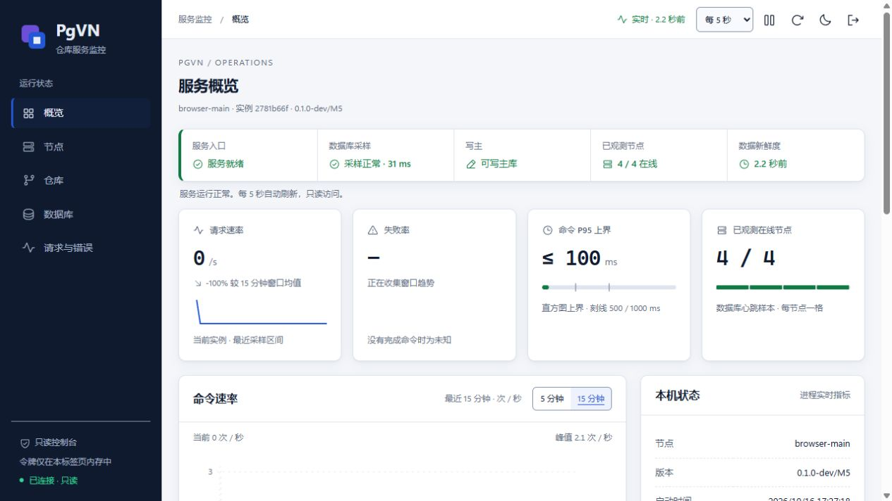
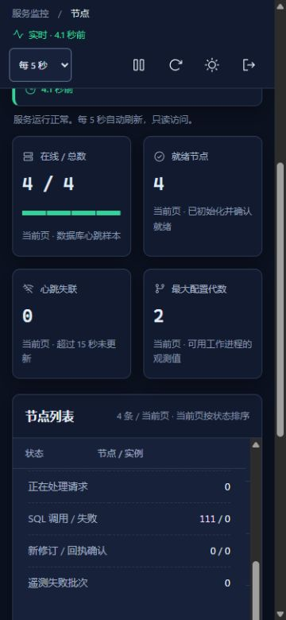
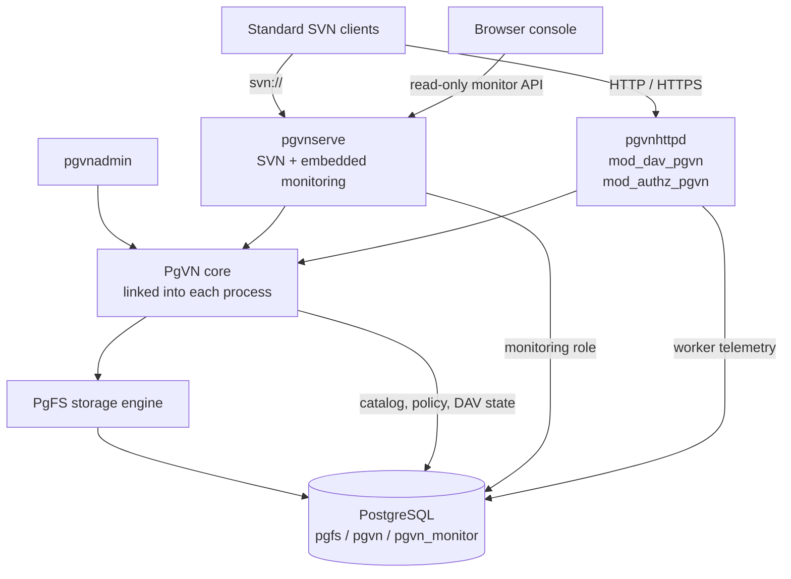

<div align="center">

# PgVN

**Subversion protocols. PostgreSQL storage. No per-repository directories.**

A PostgreSQL-backed Subversion server for Windows, with native SVN/DAV access, centralized repository administration and an embedded monitoring console.

[](#project-status)
[](#quick-start)
[](#prerequisites)
[](#prerequisites)

**English** · [简体中文](README.zh-CN.md)

[Features](#features) · [Web console](#web-console) · [Architecture](#architecture) · [Deploy](#quick-start) · [Usage](#use-pgvn) · [Build](#build-from-source) · [Status](#project-status) · [Docs](#documentation)

</div>

<picture>
  <source media="(prefers-color-scheme: dark)" srcset="docs/pgvn/images/monitor-night-ops-dark.jpg">
  <source media="(prefers-color-scheme: light)" srcset="docs/pgvn/images/m6-copy-prop-overview.jpg">
  
</picture>

*Actual Chinese-language console from an isolated local test environment; the screenshot contains test data.*

> **Development status:** M0–M5 have recorded local acceptance runs. M6 compatibility, failure and performance validation is in progress. Clean-machine installation, reboot recovery, cross-host failover and Polarion application acceptance remain pending. Deployment packages are development snapshots. See [validation progress](docs/pgvn/progress.zh-CN.md) for the scope and build identity of each result.

## Features

PgVN brings SVN repository history, configuration and durable protocol state into PostgreSQL. Standard SVN clients continue to use `svn://`, HTTP or HTTPS; operators manage repositories through `pgvnadmin` and inspect the service through its web console.

The product consists of a dedicated server, Apache modules and an administration tool. Its shared repository core runs inside those components. The earlier PgFS filesystem-plugin PoC is the storage foundation; use the complete PgVN runtime for deployment. Polarion is a target integration and still requires application-level acceptance.

| Capability | What PgVN provides |
| --- | --- |
| Standard clients | `svn://` through `pgvnserve`; HTTP/HTTPS through `mod_dav_pgvn` and `mod_authz_pgvn`. |
| Database repositories | Open repositories by internal ID and resolve URLs through catalog routes; no per-repository `repo`, `conf` or `activities.d` directories. |
| Native administration | `pgvnadmin` creates repositories, publishes versioned authz/hook policies, imports/exports SVN dumps, verifies history and manages credentials. |
| Shared state | History, locks, configuration and persistent DAV transaction state live in PostgreSQL. |
| Operations console | Embedded read-only monitoring for service health, repositories, database activity, nodes, Apache workers and request errors. |
| Windows deployment | A complete x64 runtime, PowerShell installation tools, LocalService services, integrity checks and backup/restore scripts. |

## Web console

The console is embedded in `pgvnserve.exe`; running it requires no Node.js, Python or separate frontend service. It currently uses Chinese UI text and supports light/dark themes, narrow layouts and keyboard navigation.

- A health strip brings readiness, database sampling, writable-primary status, node visibility and sample freshness together.
- Five views cover overview, nodes, repositories, database, and requests/errors. Repository lists support search, pagination and details; charts summarize request activity and recent failures.
- Expand an Apache worker to inspect method counts, active requests and errors correlated with `X-PgVN-Request-Id`.
- Access uses expiring, revocable `monitor:read` tokens, held in the current browser page's memory.

<details>
<summary>Light theme and mobile node details</summary>



<p align="center">
  
</p>

*The light overview and narrow node details come from the latest recorded [copy/prop browser validation](docs/pgvn/M6-network-copy-prop.zh-CN.md#监控输入清理与完整浏览器验收). Screenshots illustrate the interface; their sample values are not performance benchmarks.*

</details>

## Architecture



| Component | Responsibility |
| --- | --- |
| `pgvnserve.exe` | Native SVN endpoint, Windows service lifecycle, health probes, monitoring API and embedded web assets. |
| `pgvnhttpd.exe` + `mod_dav_pgvn.so` | Apache host and Subversion DAV protocol; persistent activities, transactions and commit receipts. |
| `mod_authz_pgvn.so` | Database-managed path authorization for DAV requests. |
| `pgvnadmin.exe` | Repository lifecycle, policy publication, credentials, dump/load, verification and maintenance. |
| PgVN core + PgFS | Repository lookup, authorization/hook policy and PostgreSQL-backed versioned storage; linked into the components above. |

A request resolves its URL route to an internal repository ID, applies the published policy and accesses history through PgFS. Internal IDs are distinct from public SVN UUIDs. One database can contain multiple repositories and URL routes. Revision publication and authorization-policy rechecks occur in the same PostgreSQL transaction. The shared core is an in-process library; deployment requires no separate repository RPC service.

| Database schema | Stored state |
| --- | --- |
| `pgfs` | Repository history, versioned trees, file content, properties, transactions and locks. |
| `pgvn` | Repository catalog, URL routes, versioned policies, SVN credentials, monitor token hashes and durable DAV state. |
| `pgvn_monitor` | Node heartbeats, bounded metric samples and read-only monitoring views. |

**Filesystem boundary.** Nodes still need programs, global configuration, protected keys, certificates, logs, temporary files and external hook executables. Eliminating per-repository directories does not eliminate these deployment files.

**High availability.** Multiple service processes can use the same PostgreSQL backend. Replication, primary election, fencing and connection routing belong to the database deployment. PgVN does not elect a primary; local multi-process tests do not establish cross-host high availability or distributed multi-primary writes.

## Quick start

### Prerequisites

| Item | Requirement |
| --- | --- |
| Service host | Windows x64 supporting the process UTF-8 manifest mechanism introduced in Windows 10 1903; run the package check on the target OS. |
| Installer | Elevated Windows PowerShell 5.1 or PowerShell for service installation and NTFS permissions. |
| Database | A separately deployed UTF-8 PostgreSQL database; the pinned build uses PostgreSQL **18.6**. |
| Runtime | One complete, matching package. The target machine needs no Python, Node.js, compiler, SDK or existing Polarion installation. |
| Clients | Standard SVN clients; the package includes the pinned SVN CLI. |

The pinned build also uses Subversion **1.14.5**, Apache **2.4.68**, APR **1.7.6** and APR-util **1.6.3**. This is the tested build stack, rather than a compatibility matrix for other versions.

### 1. Verify and extract the package

Use a **complete, matching Windows x64 package**, including DLLs, Apache host, modules and deployment scripts. Obtain the ZIP and SHA-256 file from your build output, compare the checksum and extract it. This does not imply a published production release. Copying two DLLs into another SVN/Apache installation is insufficient.

In an elevated PowerShell, replace `PACKAGE_ID` with the actual package ID. Obtain the package and checksum through a trusted channel:

```powershell
$zip = 'C:\Transfer\PgVN-M5-windows-x64-PACKAGE_ID.zip'
$expected = (Get-Content -LiteralPath ($zip + '.sha256') -Raw).Split(' ')[0]
if ((Get-FileHash -LiteralPath $zip -Algorithm SHA256).Hash -ine $expected) {
    throw 'ZIP checksum mismatch'
}
Expand-Archive -LiteralPath $zip -DestinationPath 'C:\Deploy'
$root = 'C:\Deploy\PgVN-M5-windows-x64-PACKAGE_ID'
& "$root\deploy\windows\Test-PgVNPackage.ps1"
```

The ZIP contains a top-level directory. Set `$root` to that directory, which contains `bin`, `apache` and `deploy`; the package check validates file hashes, x64 dependencies and program startup.

### 2. Prepare the database and configuration

As a DBA, create a dedicated UTF-8 database and non-superuser roles:

```sql
CREATE ROLE pgvn_migrate LOGIN NOSUPERUSER NOCREATEDB NOCREATEROLE NOINHERIT;
CREATE ROLE pgvn_admin LOGIN NOSUPERUSER NOCREATEDB NOCREATEROLE NOINHERIT;
CREATE ROLE pgvn_service LOGIN NOSUPERUSER NOCREATEDB NOCREATEROLE NOINHERIT;
CREATE ROLE pgvn_monitor LOGIN NOSUPERUSER NOCREATEDB NOCREATEROLE NOINHERIT;
CREATE ROLE pgvn_restore LOGIN NOSUPERUSER NOCREATEDB NOCREATEROLE NOINHERIT;
CREATE DATABASE pgvn OWNER pgvn_migrate ENCODING 'UTF8' TEMPLATE template0;
```

Set role passwords interactively with psql `\password`, and configure database access. This example uses local port **5432**; destructive project tests use a **separate** cluster on **16432**.

```powershell
& "$root\deploy\windows\Initialize-PgVNConfiguration.ps1" `
    -DatabaseHost '127.0.0.1' -DatabasePort 5432 -DatabaseName pgvn `
    -NodeId node-1 -SvnPort 14690 -MonitorPort 14691 -HttpPort 14980
```

Fill in `admin\secrets\pgpass.conf` for administration and `secrets\runtime.pgpass.conf` for service/monitor access. Keep their protected NTFS permissions. For a remote database, configure its CA and hostname-verified TLS using the [deployment guide](deploy/windows/README.zh-CN.md). Re-running initialization preserves existing configuration; new parameters do not overwrite it.

<details>
<summary>Installation layout and local configuration</summary>

```text
PgVN-M5-windows-x64-PACKAGE_ID/
├─ bin/                 pgvnserve, pgvnadmin and matching DLLs
├─ apache/              Apache host, DAV and authorization modules
├─ deploy/windows/      Install, check, user and backup/restore scripts
├─ tools/               Pinned SVN and PostgreSQL clients
├─ config.local/        Node service configuration (generated)
├─ admin/               Admin configuration, password file and install records (generated)
├─ secrets/             Service/monitor password file and deployment keys (fill/create after init)
├─ hooks/               Global external-hook directory (generated)
└─ logs/, state/        Node logs, temporary files and service state (generated)
```

Service configuration lives in `config.local\pgvnserve.ini`; DAV configuration lives in `config.local\pgvn-apache.ini` and `config.local\httpd.conf`. These are node deployment files. Repository history and per-repository configuration live in PostgreSQL.

</details>

### 3. Initialize permissions, credentials and a repository

```powershell
$admin = "$root\deploy\windows\Invoke-PgVNAdmin.ps1"
& $admin -Profile Migrate -Arguments @('db','init','--json')
if ($LASTEXITCODE) { throw 'Database initialization failed' }
& $admin -Profile Migrate -Arguments @('db','check','--json')
& $admin -Profile Migrate -Arguments @('db','grant','--admin-role','pgvn_admin','--service-role','pgvn_service','--monitor-role','pgvn_monitor','--json')
& $admin -Arguments @('key','create',"$root\secrets\credentials-v1.key",'deployment-v1')

$password = Read-Host 'Password for SVN/DAV user alice' -AsSecureString
& "$root\deploy\windows\Set-PgVNUser.ps1" -UserName alice -Password $password -AlsoDav
& $admin -Arguments @('repo','create','demo','--route','/svn/demo','--json')
```

`-AlsoDav` configures both the SVN account and Apache's password file. The protocols use separate authentication sources and the same database path-authorization policy.

### 4. Publish policy and start services

A new repository denies access by default. Save `admin\demo.authz` as UTF-8 **without BOM**:

```ini
[demo:/]
alice = rw
* =
```

```powershell
& $admin -Arguments @('config','show','name:demo','--json')
# Generation 1 applies only to this newly created, unchanged repository.
# For an existing repository, use the generation returned above.
& $admin -Arguments @('config','publish','name:demo','--expected-generation','1','--authz',"$root\admin\demo.authz",'--json')
& $admin -Arguments @('authz','check','name:demo','alice','/','write','--json')
& "$root\deploy\windows\Install-PgVNServices.ps1"
& "$root\deploy\windows\Test-PgVNDeployment.ps1" `
    -RepositoryRoute /svn/demo -UserName alice -Password $password
```

The scripts install `PgVN` and `PgVNDAV` as LocalService services. Default endpoints bind to loopback:

| Endpoint | Default address |
| --- | --- |
| SVN | `svn://127.0.0.1:14690/svn/demo` |
| DAV | `http://127.0.0.1:14980/svn/demo` |
| Web console | `http://127.0.0.1:14691/monitor/` |
| Health | `http://127.0.0.1:14691/health/live` and `/health/ready` |

For remote clients, configure trusted HTTPS and network access. CRAM-MD5 does not encrypt SVN traffic; use a trusted tunnel for remote `svn://` access. Database connections must retain PostgreSQL session semantics; transaction pooling is unsuitable.

### 5. Check health and open the console

```powershell
Get-Service -Name PgVN, PgVNDAV
Invoke-RestMethod -Uri 'http://127.0.0.1:14691/health/live'
Invoke-RestMethod -Uri 'http://127.0.0.1:14691/health/ready'
```

The default services should be `Running`; the probes return `live: true` and `ready: true`. The deployment check above also verifies the embedded page and that SVN/DAV resolve to the same public repository UUID. Next, follow the [monitor-token instructions](#web-console-and-tokens) to issue a read-only token and open `http://127.0.0.1:14691/monitor/` in your browser.

## Use PgVN

### Standard SVN clients

Use the bundled CLI below, or substitute your installed SVN client. Commands assume the same PowerShell session and `alice` account used during setup; SVN prompts for the password.

```powershell
$svn = "$root\tools\svn\svn.exe"
& $svn checkout svn://127.0.0.1:14690/svn/demo demo --username alice
Set-Content -LiteralPath .\demo\hello.txt -Value 'Hello from PgVN' -Encoding UTF8
& $svn add .\demo\hello.txt
& $svn commit .\demo -m 'Initial commit' --username alice
& $svn update .\demo --username alice
& $svn log svn://127.0.0.1:14690/svn/demo --username alice
& $svn ls http://127.0.0.1:14980/svn/demo --username alice
```

### Administration and migration

Use the deployment wrapper to select the protected libpq configuration and matching runtime:

```powershell
& $admin -Arguments @('repo','list','--json')
& $admin -Arguments @('repo','show','name:demo','--json')
& $admin -Arguments @('verify','name:demo')
& $admin -Arguments @('dump','name:demo','--file','D:\Backup\demo.dump','--deltas')
```

To migrate existing SVN history, produce a standard dump and import it into a **separate, empty target**:

```powershell
& $admin -Arguments @('repo','create','imported','--route','/svn/imported','--json')
& $admin -Arguments @('repo','disable','name:imported','--json')
& $admin -Arguments @('load','name:imported','--file','C:\Transfer\existing.dump')
& $admin -Arguments @('verify','name:imported')
& $admin -Arguments @('config','show','name:imported','--json')
```

Prepare the imported repository's authz policy, publish it using the actual generation returned above, then run `repo enable name:imported`. Repository-specific sections must use `[imported:/]`. Use `--file` instead of Windows PowerShell text pipelines for binary dump data. Dump/load moves history; configure users, access policy and hooks separately. See [administration](docs/pgvn/M2-admin.zh-CN.md).

### Web console and tokens

```powershell
& $admin -Arguments @('monitor-token','create','--label','local-ops','--expires-in','3600')
# Open http://127.0.0.1:14691/monitor/ and enter the returned token.
& $admin -Arguments @('monitor-token','list','--json')
# Replace TOKEN_ID with the ID from the list, not the secret token value.
& $admin -Arguments @('monitor-token','revoke','TOKEN_ID','--json')
```

The secret token is shown once and grants only `monitor:read`. Keep it out of URLs. Reloading the page requires authentication again; expiry or revocation disconnects the console and clears displayed business data. This is a read-only console; repository and user changes use `pgvnadmin`.

### Backup, restore and upgrades

```powershell
& "$root\deploy\windows\Backup-PgVN.ps1" -Destination 'D:\PgVN-backups\snapshot-01'
```

Backup includes database data and protected deployment files. Restore into an **empty, separate database** using `Restore-PgVN.ps1`, then verify configuration and history before starting services. Current control schema is **6**. Rollback requires a matching database backup, keys and configuration; there is no schema downgrade migration.

For a multi-node deployment, coordinate keys, hook programs and configuration versions across nodes. Database consistency alone does not back up those external files. Follow the [deployment guide](deploy/windows/README.zh-CN.md#5-备份和恢复到空数据库) for the full restore and upgrade procedure.

## Build from source

Development requires Python 3, LLVM-MinGW and pinned source trees/SDKs. Copy `config/build.example.json` to the ignored `config/build.local.json` and fill in your paths. SDKs and existing Polarion installations remain read-only inputs.

```powershell
Copy-Item -LiteralPath config/build.example.json -Destination config/build.local.json
# Edit config/build.local.json with the actual local SDK/source paths.
python scripts/pgvn/fetch_httpd.py
python scripts/pgvn/build.py --config config/build.local.json --configuration Release
python scripts/pgvn/package.py --development
```

`fetch_httpd.py` explicitly fetches checksum-pinned Apache host sources. Offline builds can supply those files and configure `apache_source`; see [UTF-8 build notes](docs/pgvn/Windows-UTF8.zh-CN.md). The builder does not fetch implicitly. Products are in `runtime/pgvn`, build identity in `artifacts/pgvn/build/manifest.json`, and packages in `runtime/pgvn/packages`.

Use `scripts/pgvn` and `tests/pgvn` for testing. Full M5 requires matching real-browser evidence, a configured JDK/SVNKit and the dedicated test cluster; see [browser/test prerequisites](docs/pgvn/M4-monitor.zh-CN.md#验证与性能口径) and the [M5 development notes](docs/pgvn/M5-development.zh-CN.md). Gates create isolated databases and temporary services; some restart the **test** database. Do not target a deployment database. Legacy PgFS scripts/results are historical references, not current PgVN acceptance.

## Project status

| Milestone | Scope | Status |
| --- | --- | --- |
| M0–M2 | Runtime contracts, repository core and administration | Local acceptance recorded |
| M3 | Native SVN service, credentials and hooks | Local acceptance recorded |
| M4–M5 | Console, DAV, authorization and worker telemetry | Local acceptance recorded; results bind to specific builds |
| M6 | Full upstream compatibility, failure scenarios and representative performance | In progress |
| M7 | Clean Windows deployment, reboot and Polarion acceptance | Local package checks recorded; independent environment pending |

Recorded compatibility work includes original Subversion network suites with FSFS comparisons over SVN, HTTP and HTTPS; see the [upstream suite entry](docs/pgvn/M6-upstream-network.zh-CN.md), [authorization results](docs/pgvn/M6-network-authz.zh-CN.md), [commit/update results](docs/pgvn/M6-network-commit-update.zh-CN.md) and [copy/prop results](docs/pgvn/M6-network-copy-prop.zh-CN.md). These results bind to the builds identified in each report; they do not establish complete SVN compatibility or representative production performance.

Known client boundaries include SVNKit 1.10.1 revision-property changes on Unicode repository URLs and a pinned `svnmucc` Unicode-user issue reproduced against stock FSFS. Use ASCII repository routes for this SVNKit version. See [DAV compatibility](docs/pgvn/M5-DAV.zh-CN.md) and [Windows UTF-8 validation](docs/pgvn/Windows-UTF8.zh-CN.md).

## Documentation

Detailed guides currently use Chinese; both README editions cover the same introduction and quick start.

| Guide | Contents |
| --- | --- |
| [Windows deployment](deploy/windows/README.zh-CN.md) | Installation, roles, services, TLS, backup, restore and upgrade |
| [Administration](docs/pgvn/M2-admin.zh-CN.md) | Selectors, dump/load, verification and policy publication |
| [SVN service](docs/pgvn/M3-serve.zh-CN.md) | Credentials, configuration, hooks and service lifecycle |
| [Monitoring](docs/pgvn/M4-monitor.zh-CN.md) | API, tokens, sampling and console behavior |
| [Apache DAV](docs/pgvn/M5-DAV.zh-CN.md) | HTTP/HTTPS, authorization, recovery and worker telemetry |
| [Schema design](docs/pgvn/schema-design.zh-CN.md) | Database structures and storage/control boundaries |
| [Compatibility validation](docs/pgvn/M6-upstream-network.zh-CN.md) | Original SVN suites, FSFS comparisons and three-protocol results |
| [Progress and evidence](docs/pgvn/progress.zh-CN.md) | Accepted builds, results and outstanding work |
| [Implementation plan](docs/plans/2026-10-15-pgvn-implementation-plan.zh-CN.md) | Milestones and acceptance requirements |
