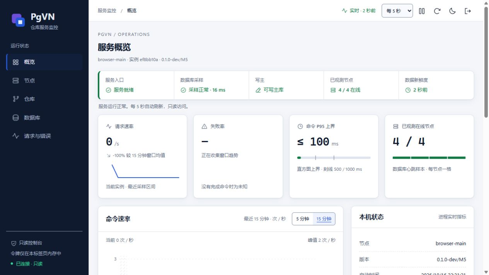
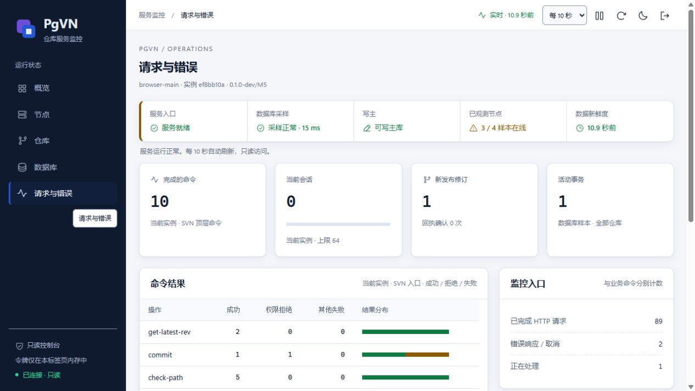
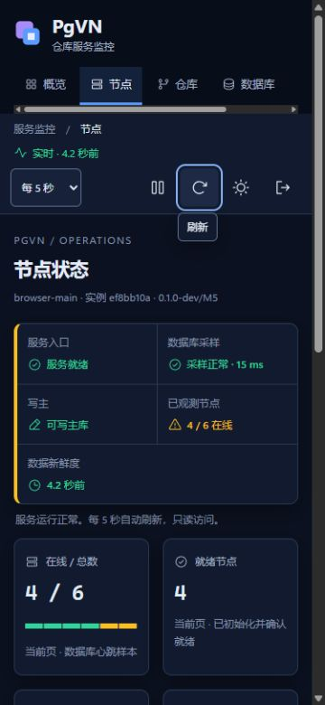
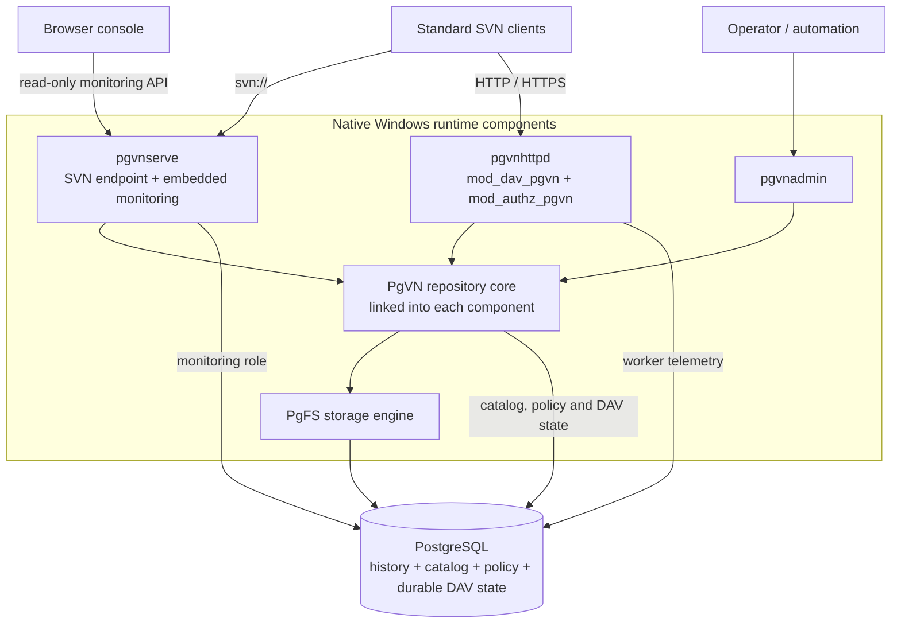
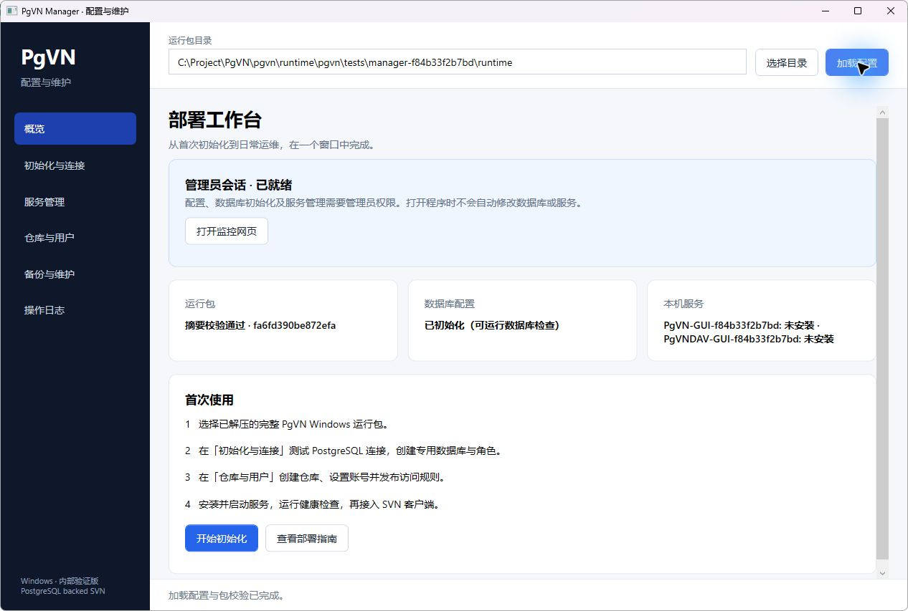

<div align="center">

# PgVN

**Subversion protocols. PostgreSQL storage. No per-repository directories.**

A PostgreSQL-backed Subversion server for Windows, with native SVN/DAV access, centralized repository administration and an embedded monitoring console.

[](#project-status)
[](#quick-start)
[](#prerequisites)
[](#prerequisites)

**English** · [简体中文](README.zh-CN.md)

[Overview](#product-overview) · [Quick start](#quick-start) · [Web console](#web-console) · [Architecture](#architecture) · [Usage](#use-pgvn) · [Documentation](#documentation)

</div>



*The embedded monitoring console, captured from a recorded local validation run. [Explore the console](#web-console).*

> [!IMPORTANT]
> **Development snapshot.** M0–M5 have recorded local acceptance runs. M6 compatibility, failure and performance validation is in progress. Clean-machine installation, reboot recovery, cross-host failover and Polarion application acceptance remain pending. See [validation progress](docs/pgvn/progress.zh-CN.md) for the scope and build identity of each result.

## Start here

| Your goal | Start with |
| --- | --- |
| Understand the product and implementation | [Product overview](#product-overview), [features](#features) and [architecture](#architecture) |
| Try a deployment on a fresh Windows host | [Quick start](#quick-start), from database preparation to running services |
| Connect clients or migrate history | [Usage](#use-pgvn) and [migration steps](#administration-and-migration) |
| Develop PgVN or assess validation coverage | [Build from source](#build-from-source) and [project status](#project-status) |

## Product overview

PgVN brings SVN repository history, configuration and durable protocol state into PostgreSQL. Standard SVN clients continue to use `svn://`, HTTP or HTTPS; operators manage repositories through `pgvnadmin` and inspect the service through its web console.

It is designed for teams that want to retain SVN client workflows while managing repository storage and policy through a common PostgreSQL backend. The product consists of a dedicated server, Apache modules and an administration tool, with the shared repository core linked into each component.

The earlier PgFS filesystem-plugin PoC is the storage foundation; deployment uses the complete PgVN runtime. Polarion is a target integration and still requires application-level acceptance.

## Features

| Capability | What PgVN provides |
| --- | --- |
| Standard clients | `svn://` through `pgvnserve`; HTTP/HTTPS through `mod_dav_pgvn` and `mod_authz_pgvn`. |
| Database repositories | Open repositories by internal ID and resolve URLs through catalog routes; no per-repository `repo`, `conf` or `activities.d` directories. |
| Native administration | `pgvnadmin` creates repositories, publishes versioned authz/hook policies, imports/exports SVN dumps, verifies history and manages credentials. |
| Shared state | History, locks, configuration and persistent DAV transaction state live in PostgreSQL. |
| Operations console | Embedded read-only monitoring for service health, repositories, database activity, nodes, Apache workers and request errors. |
| Windows deployment | A complete x64 runtime, PowerShell installation tools, LocalService services, integrity checks and backup/restore scripts. |

## Web console

The console is embedded in `pgvnserve.exe`: no Node.js, Python or separate frontend service is required at runtime. It uses Chinese UI text and supports light/dark themes, desktop and narrow layouts, keyboard navigation, automatic refresh and pause.

| View | What you can inspect |
| --- | --- |
| Overview | Service readiness, writable-primary status, sample freshness, request trends and process resources. |
| Nodes | Heartbeats and service instances, with expandable Apache worker telemetry. |
| Repositories | Search and pagination, repository identity, HEAD revision, configuration generation, transactions and locks. |
| Database | Connection usage, SQL activity, waits and sampling status within the monitoring role's visibility. |
| Requests & errors | SVN command results, the instance's effective session capacity, DAV method counts and correlated request errors. |

Access uses expiring, revocable `monitor:read` tokens. The page keeps a token only in memory; repository, user and policy changes use `pgvnadmin`. See [console access](#web-console-and-tokens) for the commands.

<details>
<summary>More screenshots: requests and errors · narrow node view</summary>



<p align="center">
  
</p>

*These screenshots and the overview above come from the same recorded [working-copy browser validation](docs/pgvn/M6-network-wc-workflows.zh-CN.md#冻结构建与完整回归). They contain isolated test data; displayed samples are not performance benchmarks.*

</details>

## Architecture



| Component | Responsibility |
| --- | --- |
| `pgvnserve.exe` | Native SVN endpoint, Windows service lifecycle, health probes, monitoring API and embedded web assets. |
| `pgvnhttpd.exe` + `mod_dav_pgvn.so` | Apache host and Subversion DAV protocol; persistent activities, transactions and commit receipts. |
| `mod_authz_pgvn.so` | Database-managed path authorization for DAV requests. |
| `pgvnadmin.exe` | Repository lifecycle, policy publication, credentials, dump/load, verification and maintenance. |
| PgVN core + PgFS | Repository lookup, authorization/hook policy and PostgreSQL-backed versioned storage; linked into the components above. |

A repository request follows this path:

1. **Resolve the repository.** The protocol endpoint maps the URL route to an internal repository ID. Internal IDs are distinct from the SVN UUIDs clients see; one database can hold multiple repositories and routes.
2. **Apply policy.** The shared core reads the published access configuration and enforces path authorization and hook policy.
3. **Access history.** PgFS reads or writes versioned data in PostgreSQL. Revision publication and authorization-policy rechecks occur in the same database transaction.

The shared core is linked into each service process; deployment requires no separate repository RPC service. The web console reads status through the monitoring API; repository and policy changes use the administration tool.

| Database schema | Stored state |
| --- | --- |
| `pgfs` | Repository history, versioned trees, file content, properties, transactions and locks. |
| `pgvn` | Repository catalog, URL routes, versioned policies, SVN credentials, monitor token hashes and durable DAV state. |
| `pgvn_monitor` | Node heartbeats, bounded metric samples and read-only monitoring views. |

**Filesystem boundary.** Nodes still need programs, global configuration, protected keys, certificates, logs, temporary files and external hook executables. Eliminating per-repository directories does not eliminate these deployment files.

**High availability.** Multiple service processes can use the same PostgreSQL backend. Replication, primary election, fencing and connection routing belong to the database deployment. PgVN does not elect a primary; local multi-process tests do not establish cross-host high availability or distributed multi-primary writes.

## Windows configuration GUI



[PgVN Manager](tools/pgvn-manager/README.zh-CN.md) is a native Windows configuration and maintenance app. It tests PostgreSQL connections, creates a dedicated database and five non-superuser roles, initializes the schema and key, saves configuration, installs and controls PgVN / DAV services, and manages repositories, users and access rules. Maintenance includes health checks, history verification, SVN dump import/export, full backups and log viewing. Access-rule publication checks the generation loaded for editing to prevent overwriting another administrator's changes.

With .NET Framework 4.8 installed, run `manager\PgVNManager.exe` from the combined bundle, load the runtime directory and follow the first-use steps in the Chinese UI. PostgreSQL must be installed separately; configuration and service operations require administrator privileges. Full restore uses the existing scripts. Cross-host HA and Polarion acceptance remain pending.

Build with `powershell.exe -NoProfile -ExecutionPolicy Bypass -File .\tools\pgvn-manager\Build-PgVNManager.ps1`; outputs go to `runtime/pgvn-manager`. Add `-RuntimePackageZip <verified-runtime.zip>` to create a combined runtime and GUI archive. The GUI records its own build manifest. See the [Manager guide](tools/pgvn-manager/README.zh-CN.md) for usage, tests and restore limitations, and the [local validation record](docs/pgvn/manager-validation.zh-CN.md) for this build.

## Quick start

Follow steps 1–5 in the same elevated PowerShell session. Deploy PostgreSQL separately; the PgVN package includes database client tools.

| Step | What you do | Result to check |
| --- | --- | --- |
| [1. Package](#1-verify-and-extract-the-package) | Verify the checksum, extract the complete runtime and check its dependencies. | `Test-PgVNPackage.ps1` succeeds. |
| [2. Database](#2-prepare-the-database-and-configuration) | Create the database and roles, generate configuration and fill the protected password files. | Administration and runtime connections point to the intended database. |
| [3. Repository](#3-initialize-permissions-credentials-and-a-repository) | Initialize the schema, grant permissions, create a key and add a user and repository. | `db check` succeeds and `repo create` returns the new repository. |
| [4. Services](#4-publish-policy-and-start-services) | Publish an access policy, install the services and check both protocol endpoints. | `alice` has write permission; SVN and DAV report the same repository UUID. |
| [5. Monitor](#5-check-health-and-open-the-console) | Check health, issue a read-only token and open the embedded page. | Both services run, the readiness probe succeeds and the console accepts the token. |

### Prerequisites

| Item | Requirement |
| --- | --- |
| Service host | Windows x64 supporting the process UTF-8 manifest mechanism introduced in Windows 10 1903; run the package check on the target OS. |
| Installer | Elevated Windows PowerShell 5.1 or PowerShell for service installation and NTFS permissions. |
| Database | A separately deployed UTF-8 PostgreSQL database; the pinned build uses PostgreSQL **18.6**. |
| Runtime | One complete, matching package. The target machine needs no Python, Node.js, compiler, SDK or existing Polarion installation. |
| Clients | Standard SVN clients; the package includes the pinned SVN CLI. |

The pinned build also uses Subversion **1.14.5**, Apache **2.4.68**, APR **1.7.6** and APR-util **1.6.3**. This is the tested build stack, rather than a compatibility matrix for other versions.

### 1. Verify and extract the package

Use a **complete, matching Windows x64 package**, including DLLs, Apache host, modules and deployment scripts. Obtain the ZIP and SHA-256 file from your build output, compare the checksum and extract it. This does not imply a published production release. Copying two DLLs into another SVN/Apache installation is insufficient.

In an elevated PowerShell, replace `PACKAGE_ID` with the actual package ID. Obtain the package and checksum through a trusted channel:

```powershell
$zip = 'C:\Transfer\PgVN-M5-windows-x64-PACKAGE_ID.zip'
$expected = (Get-Content -LiteralPath ($zip + '.sha256') -Raw).Split(' ')[0]
if ((Get-FileHash -LiteralPath $zip -Algorithm SHA256).Hash -ine $expected) {
    throw 'ZIP checksum mismatch'
}
Expand-Archive -LiteralPath $zip -DestinationPath 'C:\Deploy'
$root = Join-Path 'C:\Deploy' ([IO.Path]::GetFileNameWithoutExtension($zip))
& "$root\deploy\windows\Test-PgVNPackage.ps1"
```

The ZIP contains a top-level directory matching the archive's base name. `$root` points to that directory, which contains `bin`, `apache` and `deploy`; the package check validates file hashes, x64 dependencies and program startup. To create a snapshot locally, follow [build from source](#build-from-source); package contents and local checks are described in the [packaging guide](docs/pgvn/M7-package-local.zh-CN.md).

### 2. Prepare the database and configuration

As a DBA, create a dedicated UTF-8 database and non-superuser roles:

```sql
CREATE ROLE pgvn_migrate LOGIN NOSUPERUSER NOCREATEDB NOCREATEROLE NOINHERIT;
CREATE ROLE pgvn_admin LOGIN NOSUPERUSER NOCREATEDB NOCREATEROLE NOINHERIT;
CREATE ROLE pgvn_service LOGIN NOSUPERUSER NOCREATEDB NOCREATEROLE NOINHERIT;
CREATE ROLE pgvn_monitor LOGIN NOSUPERUSER NOCREATEDB NOCREATEROLE NOINHERIT;
CREATE ROLE pgvn_restore LOGIN NOSUPERUSER NOCREATEDB NOCREATEROLE NOINHERIT;
CREATE DATABASE pgvn OWNER pgvn_migrate ENCODING 'UTF8' TEMPLATE template0;
```

Set role passwords interactively with psql `\password`, and configure database access. This example uses local port **5432**; destructive project tests use a **separate** cluster on **16432**.

```powershell
& "$root\deploy\windows\Initialize-PgVNConfiguration.ps1" `
    -DatabaseHost '127.0.0.1' -DatabasePort 5432 -DatabaseName pgvn `
    -NodeId node-1 -SvnPort 14690 -MonitorPort 14691 -HttpPort 14980
```

Fill in `admin\secrets\pgpass.conf` for administration and `secrets\runtime.pgpass.conf` for service/monitor access. Keep their protected NTFS permissions. The migration role owns the schema; administration, request handling, monitoring and isolated restore use their respective roles. For a remote database, configure its CA and hostname-verified TLS using the [deployment guide](deploy/windows/README.zh-CN.md). Re-running initialization preserves existing configuration; new parameters do not overwrite it.

<details>
<summary>Installation layout and local configuration</summary>

```text
PgVN-M5-windows-x64-PACKAGE_ID/
├─ bin/                 pgvnserve, pgvnadmin and matching DLLs
├─ apache/              Apache host, DAV and authorization modules
├─ deploy/windows/      Install, check, user and backup/restore scripts
├─ tools/               Pinned SVN and PostgreSQL clients
├─ config.local/        Node service configuration (generated)
├─ admin/               Admin configuration, password file and install records (generated)
├─ secrets/             Service/monitor password file and deployment keys (fill/create after init)
├─ hooks/               Global external-hook directory (generated)
└─ logs/, state/        Node logs, temporary files and service state (generated)
```

Service configuration lives in `config.local\pgvnserve.ini`; DAV configuration lives in `config.local\pgvn-apache.ini` and `config.local\httpd.conf`. These are node deployment files. Repository history and per-repository configuration live in PostgreSQL.

</details>

### 3. Initialize permissions, credentials and a repository

```powershell
$admin = "$root\deploy\windows\Invoke-PgVNAdmin.ps1"
& $admin -Profile Migrate -Arguments @('db','init','--json')
if ($LASTEXITCODE) { throw 'Database initialization failed' }
& $admin -Profile Migrate -Arguments @('db','check','--json')
& $admin -Profile Migrate -Arguments @('db','grant','--admin-role','pgvn_admin','--service-role','pgvn_service','--monitor-role','pgvn_monitor','--json')
& $admin -Arguments @('key','create',"$root\secrets\credentials-v1.key",'deployment-v1')

$password = Read-Host 'Password for SVN/DAV user alice' -AsSecureString
& "$root\deploy\windows\Set-PgVNUser.ps1" -UserName alice -Password $password -AlsoDav
& $admin -Arguments @('repo','create','demo','--route','/svn/demo','--json')
```

`-AlsoDav` configures both the SVN account and Apache's password file. The protocols use separate authentication sources and the same database path-authorization policy.

### 4. Publish policy and start services

A new repository denies access by default. Create `admin\demo.authz` as UTF-8 **without BOM**, then publish the access policy:

```powershell
$authz = @'
[demo:/]
alice = rw
* =
'@
[IO.File]::WriteAllText("$root\admin\demo.authz", $authz, [Text.UTF8Encoding]::new($false))
& $admin -Arguments @('config','show','name:demo','--json')
# Generation 1 applies only to this newly created, unchanged repository.
# For an existing repository, use the generation returned above.
& $admin -Arguments @('config','publish','name:demo','--expected-generation','1','--authz',"$root\admin\demo.authz",'--json')
& $admin -Arguments @('authz','check','name:demo','alice','/','write','--json')
& "$root\deploy\windows\Install-PgVNServices.ps1"
& "$root\deploy\windows\Test-PgVNDeployment.ps1" `
    -RepositoryRoute /svn/demo -UserName alice -Password $password
```

The scripts install `PgVN` and `PgVNDAV` as LocalService services. Default endpoints bind to loopback:

| Endpoint | Default address |
| --- | --- |
| SVN | `svn://127.0.0.1:14690/svn/demo` |
| DAV | `http://127.0.0.1:14980/svn/demo` |
| Web console | `http://127.0.0.1:14691/monitor/` |
| Health | `http://127.0.0.1:14691/health/live` and `/health/ready` |

For remote clients, configure trusted HTTPS and network access. CRAM-MD5 does not encrypt SVN traffic; use a trusted tunnel for remote `svn://` access. Database connections must retain PostgreSQL session semantics; transaction pooling is unsuitable.

### 5. Check health and open the console

```powershell
Get-Service -Name PgVN, PgVNDAV
Invoke-RestMethod -Uri 'http://127.0.0.1:14691/health/live'
Invoke-RestMethod -Uri 'http://127.0.0.1:14691/health/ready'
```

The default services should be `Running`; the probes return `live: true` and `ready: true`. The deployment check above also verifies the embedded page and that SVN/DAV resolve to the same public repository UUID. Next, follow the [monitor-token instructions](#web-console-and-tokens) to issue a read-only token and open `http://127.0.0.1:14691/monitor/` in your browser.

## Use PgVN

### Standard SVN clients

Use the bundled CLI below, or substitute your installed SVN client. Commands assume the same PowerShell session and `alice` account used during setup; SVN prompts for the password.

```powershell
$svn = "$root\tools\svn\svn.exe"
& $svn checkout svn://127.0.0.1:14690/svn/demo demo --username alice
Set-Content -LiteralPath .\demo\hello.txt -Value 'Hello from PgVN' -Encoding UTF8
& $svn add .\demo\hello.txt
& $svn commit .\demo -m 'Initial commit' --username alice
& $svn update .\demo --username alice
& $svn log svn://127.0.0.1:14690/svn/demo --username alice
& $svn ls http://127.0.0.1:14980/svn/demo --username alice
& $svn cat http://127.0.0.1:14980/svn/demo/hello.txt --username alice
```

The last command should read `Hello from PgVN` through DAV after the SVN commit. Together with the matching repository UUIDs returned by the deployment check, this confirms both endpoints access the same repository. You can also inspect its status in the console’s repository view.

### Administration and migration

Use the deployment wrapper to select the protected libpq configuration and matching runtime:

```powershell
& $admin -Arguments @('repo','list','--json')
& $admin -Arguments @('repo','show','name:demo','--json')
& $admin -Arguments @('verify','name:demo')
& $admin -Arguments @('dump','name:demo','--file','D:\Backup\demo.dump','--deltas')
```

To migrate existing SVN history, produce a standard dump and import it into a **separate, empty target**:

```powershell
& $admin -Arguments @('repo','create','imported','--route','/svn/imported','--json')
& $admin -Arguments @('repo','disable','name:imported','--json')
& $admin -Arguments @('load','name:imported','--file','C:\Transfer\existing.dump')
& $admin -Arguments @('verify','name:imported')
& $admin -Arguments @('config','show','name:imported','--json')
```

Prepare the imported repository's authz policy, publish it using the actual generation returned above, then run `repo enable name:imported`. Repository-specific sections must use `[imported:/]`. Use `--file` instead of Windows PowerShell text pipelines for binary dump data. Dump/load moves history; configure users, access policy and hooks separately. See [administration](docs/pgvn/M2-admin.zh-CN.md).

### Web console and tokens

```powershell
& $admin -Arguments @('monitor-token','create','--label','local-ops','--expires-in','3600')
# Open http://127.0.0.1:14691/monitor/ and enter the returned token.
& $admin -Arguments @('monitor-token','list','--json')
# Replace TOKEN_ID with the ID from the list, not the secret token value.
& $admin -Arguments @('monitor-token','revoke','TOKEN_ID','--json')
```

The secret token is shown once and grants only `monitor:read`. Keep it out of URLs. Reloading the page requires authentication again; expiry or revocation disconnects the console and clears displayed business data. This is a read-only console; repository and user changes use `pgvnadmin`.

### Node configuration

After initialization, edit the existing `config.local\pgvnserve.ini` to configure the SVN endpoint and session limit. This is an excerpt; keep the generated database connections and key settings:

```ini
[pgvn]
node-id = node-1
listen-host = 127.0.0.1
listen-port = 14690
max-connections = 64
```

`max-connections` defaults to **64** and accepts **1–64**. Restart the service after changing it. It limits simultaneous SVN protocol connections; a single client operation may use several connections. The console, monitoring API and Prometheus report the running instance's effective value.

The **32** business-database connection leases are a separate limit; neither value is a client-count or throughput guarantee. For multiple nodes, assign distinct node IDs and coordinate keys, hook programs and configuration. See the [SVN service guide](docs/pgvn/M3-serve.zh-CN.md#服务与访问设置) for configuration and restart behavior.

### Backup, restore and upgrades

```powershell
& "$root\deploy\windows\Backup-PgVN.ps1" -Destination 'D:\PgVN-backups\snapshot-01'
```

Backup includes database data and protected deployment files. Restore into an **empty, separate database** using `Restore-PgVN.ps1`, then verify configuration and history before starting services. Current control schema is **6**. Rollback requires a matching database backup, keys and configuration; there is no schema downgrade migration.

For a multi-node deployment, coordinate keys, hook programs and configuration versions across nodes. Database consistency alone does not back up those external files. Follow the [deployment guide](deploy/windows/README.zh-CN.md#5-备份和恢复到空数据库) for the full restore and upgrade procedure.

## Troubleshooting

| Symptom | Check first |
| --- | --- |
| A service will not start | Run `Test-PgVNPackage.ps1`; check the complete runtime, service configuration, keys and file permissions for the service account. |
| Liveness succeeds but readiness returns 503 | Check PostgreSQL connectivity, service/monitor role permissions, schema version, writable primary and repository configuration; follow the deployment guide, then check again. |
| Authentication succeeds but repository access is denied | New repositories deny access by default. Check the published authz, repository name and generation returned by `config show`. |
| SVN works but DAV returns 401 | SVN credentials and Apache's password file are maintained separately. Ensure the user was created with `Set-PgVNUser.ps1 -AlsoDav`. |
| A repository URL cannot be opened | Check the route and enabled state with `repo list` and `repo show`, then verify the full client URL. |
| New SVN connections close under load | Compare active sessions with the instance's effective `max-connections`. One client can hold several connections; database leases have a separate limit. |
| The console asks for a token after reloading | This is expected: tokens stay in page memory. Expired or revoked tokens require authentication again. |
| Reinitializing does not change the ports | Initialization preserves existing files. Check `config.local` and `admin\deployment.json`; follow the deployment guide to update configuration and restart the affected services. |

Deployment logs are under `$root\logs`; the default DAV logs are `apache-error.log` and `apache-access.log`. See the [Windows deployment guide](deploy/windows/README.zh-CN.md) for complete procedures.

## Frequently asked questions

<details>
<summary>Can I deploy by copying two SVN DLLs to a new machine?</summary>

Use one complete, matching runtime package, including the dedicated services, administration tool, Apache host/modules, DLLs, templates and scripts. Follow the [quick start](#quick-start) to initialize the database, configuration and keys before installing services.

</details>

<details>
<summary>Does eliminating per-repository directories eliminate all local files?</summary>

Repository history, per-repository configuration and durable DAV state live in PostgreSQL. Programs, node configuration, keys, certificates, logs, temporary files and external hook executables remain deployment files. Client working copies remain on clients.

</details>

<details>
<summary>Does PgVN already provide distributed HA and multi-primary writes?</summary>

Multiple service processes can share one PostgreSQL backend. PostgreSQL deployment must provide replication, primary election, fencing and connection routing. Cross-host failover, RPO/RTO and representative performance still require validation. Distributed multi-primary writes have no acceptance result; see [architecture](#architecture) and [project status](#project-status).

</details>

<details>
<summary>Can I replace Polarion's production SVN backend now?</summary>

PgVN is still in development and isolated validation. Standard SVN protocol checks have recorded results; Polarion application integration, clean-machine installation and reboot exercises remain pending. Evaluate in an isolated environment until those acceptance steps are complete.

</details>

## Build from source

Development requires Python 3, LLVM-MinGW and pinned source trees/SDKs. Copy `config/build.example.json` to the ignored `config/build.local.json` and fill in your paths. SDKs and existing Polarion installations remain read-only inputs.

```powershell
Copy-Item -LiteralPath config/build.example.json -Destination config/build.local.json
# Edit config/build.local.json with the actual local SDK/source paths.
python scripts/pgvn/fetch_httpd.py
python scripts/pgvn/build.py --config config/build.local.json --configuration Release
python scripts/pgvn/package.py --development
```

`fetch_httpd.py` explicitly fetches checksum-pinned Apache host sources. Offline builds can supply those files and configure `apache_source`; see [UTF-8 build notes](docs/pgvn/Windows-UTF8.zh-CN.md). The builder does not fetch implicitly. Products are in `runtime/pgvn`, build identity in `artifacts/pgvn/build/manifest.json`, and packages in `runtime/pgvn/packages`.

Use `scripts/pgvn` and `tests/pgvn` for testing. Full M5 requires matching real-browser evidence, a configured JDK/SVNKit and the dedicated test cluster; see [browser/test prerequisites](docs/pgvn/M4-monitor.zh-CN.md#验证与性能口径) and the [M5 development notes](docs/pgvn/M5-development.zh-CN.md). Gates create isolated databases and temporary services; some restart the **test** database. Do not target a deployment database. Legacy PgFS scripts/results are historical references, not current PgVN acceptance.

<details>
<summary>Repository layout</summary>

```text
src/pgvn/             Native server, shared core, administration and Apache modules
src/libsvn_fs_pg/     PostgreSQL-backed SVN storage engine
web/pgvn-monitor/     Embedded HTML, CSS and JavaScript
sql/                  Versioned database migrations
scripts/pgvn/         Build, dependency preparation and packaging
tests/pgvn/           Milestone gates and upstream compatibility fixtures
deploy/windows/       Windows configuration and operations scripts
docs/pgvn/            Architecture, guides and validation evidence
```

</details>

## Project status

| Milestone | Scope | Status |
| --- | --- | --- |
| M0–M2 | Runtime contracts, repository core and administration | Local acceptance recorded |
| M3 | Native SVN service, credentials and hooks | Local acceptance recorded |
| M4–M5 | Console, DAV, authorization and worker telemetry | Local acceptance recorded; results bind to specific builds |
| M6 | Full upstream compatibility, failure scenarios and representative performance | In progress |
| M7 | Clean Windows deployment, reboot and Polarion acceptance | Local package checks recorded; independent environment pending |

Recent validation records are listed below. Each result binds to the build identified in its report; completion of a test run does not establish full compatibility or production readiness.

| Record | Recorded scope and result |
| --- | --- |
| [Complete merge and patch matrix](docs/pgvn/M6-network-merge-patch-matrix.zh-CN.md) | All 45 groups completed across SVN, HTTP and HTTPS. The matrix remains **FAIL**, retaining the original patch failures on both backends and a strict diagnostic difference. |
| [Enabled shelf profiles](docs/pgvn/M6-network-shelf-enabled.zh-CN.md) | 63 original functions: 330 PASS, 48 original XFAIL and zero SKIP. Two printed-order differences keep the strict diagnostic audit at **FAIL**; XFAILs remain unaccepted. |
| [Real-history roundtrip](docs/pgvn/M6-history-frozen.zh-CN.md) | All 638 revisions verified, with changed paths and binary revision properties compared to FSFS, five complete snapshots matched, and a standard dump/load roundtrip checked. |
| [Stateful backup and restore](docs/pgvn/M6-backup-frozen.zh-CN.md) | Synthetic SVN/DAV state restored into a separate database, with full row/sequence ledgers, credentials, locks, receipts and a resumed DAV transaction checked. |
| [Commit-reply loss](docs/pgvn/M6-receipt-fault-frozen.zh-CN.md) | A repository-core retry after a lost PostgreSQL COMMIT reply retained one published revision. SVN/DAV client acknowledgment loss and database failover remain separate requirements. |

<details>
<summary>Additional compatibility records and coverage</summary>

Recorded [working-copy upgrade acceptance](docs/pgvn/M6-network-upgrade-fixtures.zh-CN.md) covers 36 original functions over SVN, HTTP and HTTPS: all 216 FSFS/PgVN outcomes passed, alongside 21 offline fixture checks. The [properties, inheritance and externals acceptance](docs/pgvn/M6-network-client-properties.zh-CN.md) covers 280 original functions in ten complete suites. Each report identifies its tested build; these results are not combined into a single-build acceptance claim.

The [coverage ledger](docs/pgvn/M6-network-coverage.zh-CN.md) catalogs all 62 suites and 1,984 functions. Its earlier frozen build has matching three-protocol results for 568 functions; historical results and outstanding functions are listed separately. These counts belong to the build identified in that report; later builds need matching evidence. Original SKIP and XFAIL remain explicit; client-only cases do not establish backend I/O.

Earlier recorded work includes [working-copy state](docs/pgvn/M6-network-wc-state.zh-CN.md), [working-copy semantics](docs/pgvn/M6-network-wc-workflows.zh-CN.md), [repository workflows](docs/pgvn/M6-network-workflows.zh-CN.md), [authorization](docs/pgvn/M6-network-authz.zh-CN.md), [commit/update](docs/pgvn/M6-network-commit-update.zh-CN.md), [copy/prop](docs/pgvn/M6-network-copy-prop.zh-CN.md) and [log/diff](docs/pgvn/M6-network-log-diff.zh-CN.md). Each report binds to its identified build; these results do not establish complete SVN compatibility or representative production performance. See the [upstream suite entry](docs/pgvn/M6-upstream-network.zh-CN.md) for the validation method and remaining scope.

</details>

Known client boundaries include SVNKit 1.10.1 revision-property changes on Unicode repository URLs and a pinned `svnmucc` Unicode-user issue reproduced against stock FSFS. Use ASCII repository routes for this SVNKit version. See [DAV compatibility](docs/pgvn/M5-DAV.zh-CN.md) and [Windows UTF-8 validation](docs/pgvn/Windows-UTF8.zh-CN.md).

## Documentation

Detailed guides currently use Chinese; both README editions cover the same introduction and quick start.

| Guide | Contents |
| --- | --- |
| [Windows deployment](deploy/windows/README.zh-CN.md) | Installation, roles, services, TLS, backup, restore and upgrade |
| [Packaging and local checks](docs/pgvn/M7-package-local.zh-CN.md) | Development snapshots, runtime contents and package verification |
| [Administration](docs/pgvn/M2-admin.zh-CN.md) | Selectors, dump/load, verification and policy publication |
| [SVN service](docs/pgvn/M3-serve.zh-CN.md) | Credentials, configuration, hooks and service lifecycle |
| [Monitoring](docs/pgvn/M4-monitor.zh-CN.md) | API, tokens, sampling and console behavior |
| [Apache DAV](docs/pgvn/M5-DAV.zh-CN.md) | HTTP/HTTPS, authorization, recovery and worker telemetry |
| [Schema design](docs/pgvn/schema-design.zh-CN.md) | Database structures and storage/control boundaries |
| [Compatibility validation](docs/pgvn/M6-upstream-network.zh-CN.md) | Original SVN suites, FSFS comparisons and three-protocol results |
| [Working-copy upgrades](docs/pgvn/M6-network-upgrade-fixtures.zh-CN.md) | Legacy client working-copy fixtures and three-protocol acceptance |
| [Merge and patch matrix](docs/pgvn/M6-network-merge-patch-matrix.zh-CN.md) | All 45 groups, retained original failures and strict diagnostic differences |
| [Enabled shelf profiles](docs/pgvn/M6-network-shelf-enabled.zh-CN.md) | Original shelf2/shelf3 execution, XFAILs and printed-order review |
| [Real-history validation](docs/pgvn/M6-history-frozen.zh-CN.md) | All 638 revisions, FSFS comparisons and standard dump/load roundtrip |
| [Stateful backup and restore](docs/pgvn/M6-backup-frozen.zh-CN.md) | Separate-database restore, logical data, permissions and durable DAV state |
| [Commit-reply loss](docs/pgvn/M6-receipt-fault-frozen.zh-CN.md) | Repository-core retry, receipt and revision-count verification |
| [Coverage ledger](docs/pgvn/M6-network-coverage.zh-CN.md) | Per-function current, historical and pending results across all 62 suites |
| [Progress and evidence](docs/pgvn/progress.zh-CN.md) | Accepted builds, results and outstanding work |
| [Implementation plan](docs/plans/2026-10-15-pgvn-implementation-plan.zh-CN.md) | Milestones and acceptance requirements |
