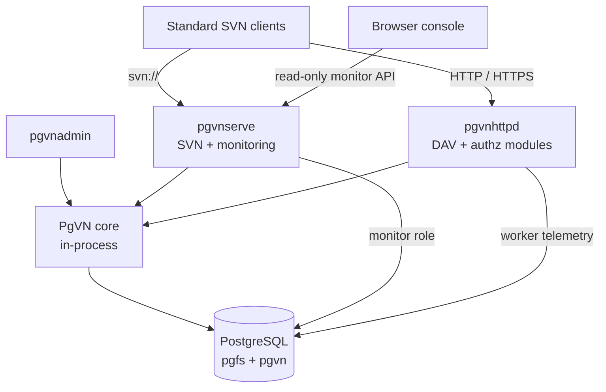

<div align="center">

# PgVN

**Subversion protocols. PostgreSQL storage. No per-repository directories.**

A native Windows Subversion server with database-managed repositories and a built-in operations console.


**English** · [简体中文](README.zh-CN.md)

[Features](#features) · [Web console](#web-console) · [Architecture](#architecture) · [Quick start](#quick-start) · [Documentation](#documentation)

</div>

<picture>
  <source media="(prefers-color-scheme: dark)" srcset="docs/pgvn/images/monitor-night-ops-dark.jpg">
  <source media="(prefers-color-scheme: light)" srcset="docs/pgvn/images/monitor-night-ops-light.jpg">
  
</picture>

*Actual Chinese-language console from an isolated local test environment; the screenshot contains test data.*

> **Development status:** M0–M5 have recorded local acceptance runs. M6 compatibility, failure and performance validation is in progress. Clean-machine installation, reboot recovery, cross-host failover and Polarion application acceptance remain pending. Deployment packages are development snapshots. See [validation progress](docs/pgvn/progress.zh-CN.md) for the scope and build identity of each result.

## Features

PgVN stores repository content and control state in PostgreSQL while exposing standard Subversion network protocols. It is being developed toward use as a Polarion repository backend; that integration still requires application-level acceptance.

| Capability | What PgVN provides |
| --- | --- |
| Standard clients | `svn://` through `pgvnserve`; HTTP/HTTPS through `mod_dav_pgvn` and `mod_authz_pgvn`. |
| Database repositories | Open repositories by internal ID and resolve URLs through catalog routes; no per-repository `repo`, `conf` or `activities.d` directories. |
| Native administration | `pgvnadmin` creates repositories, publishes versioned authz/hook policies, imports/exports SVN dumps, verifies history and manages credentials. |
| Shared state | History, locks, configuration and persistent DAV transaction state live in PostgreSQL. |
| Operations console | Embedded read-only monitoring for service health, repositories, database activity, nodes, Apache workers and request errors. |
| Windows deployment | A complete x64 runtime, PowerShell installation tools, LocalService services, integrity checks and backup/restore scripts. |

## Web console

The console is embedded in `pgvnserve.exe`; running it requires no Node.js, Python or separate frontend service. It currently uses Chinese UI text and supports light/dark themes, narrow layouts and keyboard navigation.

- A health strip brings readiness, database sampling, writable-primary status, node visibility and sample freshness together.
- Charts and tables show request activity, repository state, database sessions and recent failures.
- Expand an Apache worker to inspect method counts, active requests and errors correlated with `X-PgVN-Request-Id`.
- Access uses expiring, revocable `monitor:read` tokens, held in the current browser page's memory.

<details>
<summary>Light theme preview</summary>


</details>

## Architecture



The repository core is compiled into the relevant processes and modules, with no separate repository RPC service. Internal repository IDs are distinct from public SVN UUIDs. One database can contain multiple repositories and their URL routes.

The `pgfs` schema stores content, revisions and locks; `pgvn` stores catalog routes, policies, DAV state and telemetry.

**Filesystem boundary.** Nodes still need programs, global configuration, protected keys, certificates, logs, temporary files and external hook executables. Eliminating per-repository directories does not eliminate these deployment files.

**High availability.** Multiple service processes can use the same PostgreSQL backend. Replication, primary election, fencing and connection routing belong to the database deployment. PgVN does not elect a primary; local multi-process tests do not establish cross-host high availability or distributed multi-primary writes.

## Quick start

### 1. Prepare the runtime and database

Use a **complete, matching Windows x64 package**, including DLLs, Apache host, modules and deployment scripts. Obtain the ZIP and SHA-256 file from your build output, compare the checksum and extract it. This does not imply a published production release. Copying two DLLs into another SVN/Apache installation is insufficient.

The pinned stack is Subversion **1.14.5**, Apache **2.4.68**, APR **1.7.6**, APR-util **1.6.3** and PostgreSQL **18.6**. PostgreSQL client tools are bundled; provide the database server separately. Windows must support the process UTF-8 manifest mechanism introduced in Windows 10 1903. Run the package check on the target OS.

In an elevated PowerShell, set `$root` to the extracted directory containing `bin`, `apache` and `deploy`:

```powershell
$root = 'C:\PgVN'
& "$root\deploy\windows\Test-PgVNPackage.ps1"
```

As a DBA, create a dedicated UTF-8 database and non-superuser roles:

```sql
CREATE ROLE pgvn_migrate LOGIN NOSUPERUSER NOCREATEDB NOCREATEROLE NOINHERIT;
CREATE ROLE pgvn_admin LOGIN NOSUPERUSER NOCREATEDB NOCREATEROLE NOINHERIT;
CREATE ROLE pgvn_service LOGIN NOSUPERUSER NOCREATEDB NOCREATEROLE NOINHERIT;
CREATE ROLE pgvn_monitor LOGIN NOSUPERUSER NOCREATEDB NOCREATEROLE NOINHERIT;
CREATE ROLE pgvn_restore LOGIN NOSUPERUSER NOCREATEDB NOCREATEROLE NOINHERIT;
CREATE DATABASE pgvn OWNER pgvn_migrate ENCODING 'UTF8' TEMPLATE template0;
```

Set role passwords interactively with psql `\password`, and configure database access. This example uses local port **5432**; destructive project tests use a **separate** cluster on **16432**.

### 2. Initialize configuration and permissions

```powershell
& "$root\deploy\windows\Initialize-PgVNConfiguration.ps1" `
    -DatabaseHost '127.0.0.1' -DatabasePort 5432 -DatabaseName pgvn `
    -NodeId node-1 -SvnPort 14690 -MonitorPort 14691 -HttpPort 14980
```

Fill in `admin\secrets\pgpass.conf` for administration and `secrets\runtime.pgpass.conf` for service/monitor access. Keep their protected NTFS permissions. For a remote database, configure its CA and hostname-verified TLS using the [deployment guide](deploy/windows/README.zh-CN.md).

```powershell
$admin = "$root\deploy\windows\Invoke-PgVNAdmin.ps1"
& $admin -Profile Migrate -Arguments @('db','init','--json')
& $admin -Profile Migrate -Arguments @('db','check','--json')
& $admin -Profile Migrate -Arguments @('db','grant','--admin-role','pgvn_admin','--service-role','pgvn_service','--monitor-role','pgvn_monitor','--json')
& $admin -Arguments @('key','create',"$root\secrets\credentials-v1.key",'deployment-v1')

$password = Read-Host 'Password for SVN/DAV user alice' -AsSecureString
& "$root\deploy\windows\Set-PgVNUser.ps1" -UserName alice -Password $password -AlsoDav
& $admin -Arguments @('repo','create','demo','--route','/svn/demo','--json')
```

`-AlsoDav` configures both the SVN account and Apache's password file. The protocols use separate authentication sources and the same database path-authorization policy.

### 3. Publish policy and start services

A new repository denies access by default. Save `admin\demo.authz` as UTF-8 **without BOM**:

```ini
[demo:/]
alice = rw
* =
```

```powershell
# Generation 1 applies only to this newly created, unchanged repository.
& $admin -Arguments @('config','publish','name:demo','--expected-generation','1','--authz',"$root\admin\demo.authz",'--json')
& "$root\deploy\windows\Install-PgVNServices.ps1"
& "$root\deploy\windows\Test-PgVNDeployment.ps1" `
    -RepositoryRoute /svn/demo -UserName alice -Password $password
```

The scripts install `PgVN` and `PgVNDAV` as LocalService services. Default endpoints bind to loopback:

| Endpoint | Default address |
| --- | --- |
| SVN | `svn://127.0.0.1:14690/svn/demo` |
| DAV | `http://127.0.0.1:14980/svn/demo` |
| Web console | `http://127.0.0.1:14691/monitor/` |
| Health | `http://127.0.0.1:14691/health/live` and `/health/ready` |

For remote clients, configure trusted HTTPS and network access. CRAM-MD5 does not encrypt SVN traffic; use a trusted tunnel for remote `svn://` access. Database connections must retain PostgreSQL session semantics; transaction pooling is unsuitable.

## Use PgVN

### Standard SVN clients

```powershell
svn checkout svn://127.0.0.1:14690/svn/demo demo --username alice
Set-Content -LiteralPath .\demo\hello.txt -Value 'Hello from PgVN' -Encoding UTF8
svn add .\demo\hello.txt
svn commit .\demo -m 'Initial commit' --username alice
svn log svn://127.0.0.1:14690/svn/demo --username alice
svn ls http://127.0.0.1:14980/svn/demo --username alice
```

### Administration and migration

```powershell
& $admin -Arguments @('repo','list','--json')
& $admin -Arguments @('repo','show','name:demo','--json')
& $admin -Arguments @('verify','name:demo')
& $admin -Arguments @('dump','name:demo','--file','D:\Backup\demo.dump','--deltas')
```

To migrate existing SVN history, produce a standard dump, create a separate target repository, **disable** it, run `load --file`, verify history, publish policy and enable it. Use `--file` instead of Windows PowerShell text pipelines for binary dump data. See [administration](docs/pgvn/M2-admin.zh-CN.md).

### Monitoring and backup

```powershell
& $admin -Arguments @('monitor-token','create','--label','local-ops','--expires-in','3600')
# Open http://127.0.0.1:14691/monitor/ and enter the returned token.
& "$root\deploy\windows\Backup-PgVN.ps1" -Destination 'D:\PgVN-backups\snapshot-01'
```

The token is shown once; do not put it in a URL. Backup includes database data and protected deployment files. Restore into an **empty, separate database** using `Restore-PgVN.ps1`, then verify configuration and history before starting services. Current control schema is **6**. Rollback requires a matching database backup, keys and configuration; there is no schema downgrade migration.

## Build from source

Development requires Python 3, LLVM-MinGW and pinned source trees/SDKs. Copy `config/build.example.json` to the ignored `config/build.local.json` and fill in your paths. SDKs and existing Polarion installations remain read-only inputs.

```powershell
python scripts/pgvn/fetch_httpd.py
python scripts/pgvn/build.py --config config/build.local.json --configuration Release
python scripts/pgvn/package.py --development
```

`fetch_httpd.py` explicitly fetches checksum-pinned Apache host sources. Offline builds can supply those files and configure `apache_source`; see [UTF-8 build notes](docs/pgvn/Windows-UTF8.zh-CN.md). The builder does not fetch implicitly. Products are in `runtime/pgvn`, build identity in `artifacts/pgvn/build/manifest.json`, and packages in `runtime/pgvn/packages`.

Use `scripts/pgvn` and `tests/pgvn` for testing. Full M5 requires matching real-browser evidence, a configured JDK/SVNKit and the dedicated test cluster; see [browser/test prerequisites](docs/pgvn/M4-monitor.zh-CN.md#验证与性能口径) and the [M5 development notes](docs/pgvn/M5-development.zh-CN.md). Gates create isolated databases and temporary services; some restart the **test** database. Do not target a deployment database. Legacy PgFS scripts/results are historical references, not current PgVN acceptance.

## Project status

| Milestone | Scope | Status |
| --- | --- | --- |
| M0–M2 | Runtime contracts, repository core and administration | Local acceptance recorded |
| M3 | Native SVN service, credentials and hooks | Local acceptance recorded |
| M4–M5 | Console, DAV, authorization and worker telemetry | Local acceptance recorded; results bind to specific builds |
| M6 | Full upstream compatibility, failure scenarios and representative performance | In progress |
| M7 | Clean Windows deployment, reboot and Polarion acceptance | Local package checks recorded; independent environment pending |

Known client boundaries include SVNKit 1.10.1 revision-property changes on Unicode repository URLs and a pinned `svnmucc` Unicode-user issue reproduced against stock FSFS. Use ASCII repository routes for this SVNKit version. See [DAV compatibility](docs/pgvn/M5-DAV.zh-CN.md) and [Windows UTF-8 validation](docs/pgvn/Windows-UTF8.zh-CN.md).

## Documentation

Detailed guides currently use Chinese; both README editions cover the same introduction and quick start.

| Guide | Contents |
| --- | --- |
| [Windows deployment](deploy/windows/README.zh-CN.md) | Installation, roles, services, TLS, backup, restore and upgrade |
| [Administration](docs/pgvn/M2-admin.zh-CN.md) | Selectors, dump/load, verification and policy publication |
| [SVN service](docs/pgvn/M3-serve.zh-CN.md) | Credentials, configuration, hooks and service lifecycle |
| [Monitoring](docs/pgvn/M4-monitor.zh-CN.md) | API, tokens, sampling and console behavior |
| [Apache DAV](docs/pgvn/M5-DAV.zh-CN.md) | HTTP/HTTPS, authorization, recovery and worker telemetry |
| [Schema design](docs/pgvn/schema-design.zh-CN.md) | Database structures and storage/control boundaries |
| [Progress and evidence](docs/pgvn/progress.zh-CN.md) | Accepted builds, results and outstanding work |
| [Implementation plan](docs/plans/2026-10-15-pgvn-implementation-plan.zh-CN.md) | Milestones and acceptance requirements |
