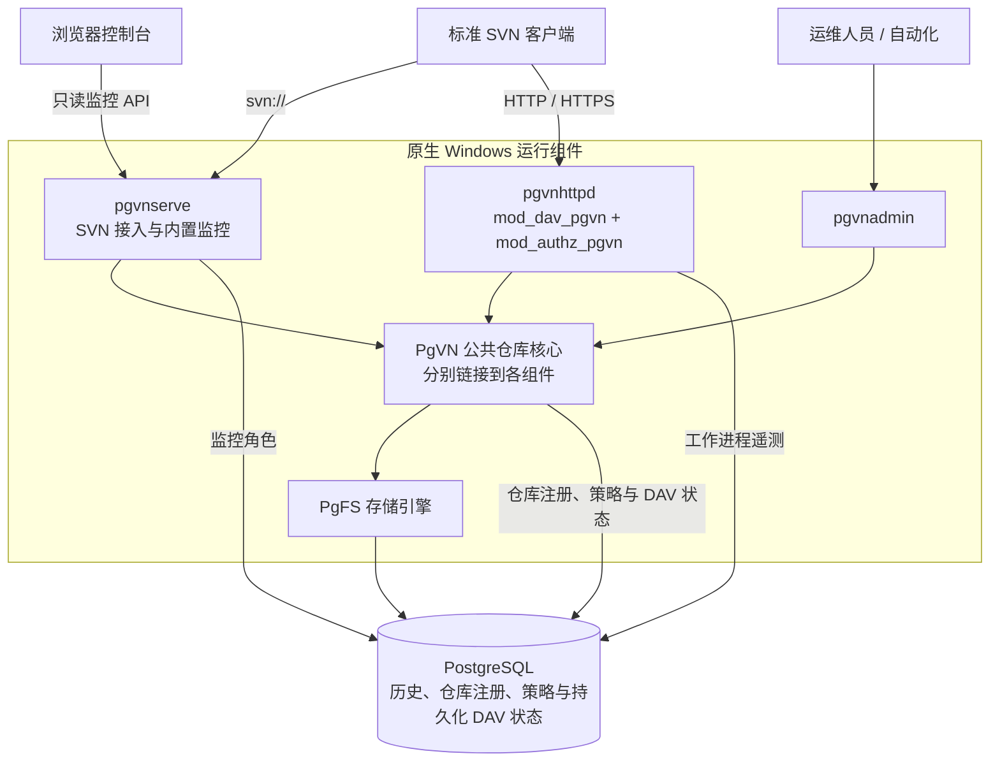

<div align="center">

# PgVN

**标准 Subversion 协议 · PostgreSQL 存储 · 无每库本地目录**

以 PostgreSQL 为存储后端的 Windows Subversion 服务端，提供原生 SVN/DAV 接入、集中式仓库管理和内置监控网页。

[](#项目状态)
[](#快速部署)
[](#环境要求)
[](#环境要求)

[English](README.md) · **简体中文**

[快速部署](#快速部署) · [产品特性](#产品特性) · [监控网页](#监控网页) · [技术架构](#技术架构) · [使用说明](#使用说明) · [文档导航](#文档导航)

</div>


*内置监控控制台，截图来自已记录的本机验证。[查看网页功能](#监控网页)。*

> [!IMPORTANT]
> **开发快照。** M0–M5 已有本机验收记录；M6 的兼容性、故障与性能验证正在推进。全新机器安装、整机重启、跨主机故障切换和 Polarion 应用验收尚待完成。各项结果的实测范围和构建身份以[进展与验证](docs/pgvn/progress.zh-CN.md)为准。

## 从这里开始

| 你的目标 | 阅读入口 |
| --- | --- |
| 了解产品与实现方式 | [产品特性](#产品特性)、[监控网页](#监控网页)和[技术架构](#技术架构) |
| 在全新 Windows 主机试部署 | 按[快速部署](#快速部署)完成数据库、仓库及服务配置 |
| 连接客户端或迁移已有历史 | [使用说明](#使用说明)与[导入步骤](#管理与迁移) |
| 参与开发或判断验证范围 | [源码构建](#源码构建)与[项目状态](#项目状态) |

## 产品特性

PgVN 将 SVN 仓库历史、配置和持久化协议状态统一保存在 PostgreSQL 中。标准 SVN 客户端继续通过 `svn://`、HTTP 或 HTTPS 接入；运维人员通过 `pgvnadmin` 管理仓库，通过内置网页查看服务状态。

PgVN 面向希望保留 SVN 客户端工作流、通过统一 PostgreSQL 后端管理仓库存储与策略的团队。产品由专用服务端、Apache 模块和管理工具组成，公共仓库核心分别链接到各组件进程。

早期 PgFS 文件系统插件 PoC 是其存储基础，部署使用完整 PgVN 运行包。Polarion 是目标集成场景，仍需完成应用层验收。

| 能力 | 当前实现 |
| --- | --- |
| 标准客户端接入 | `pgvnserve` 提供 `svn://`，`mod_dav_pgvn` 与 `mod_authz_pgvn` 提供 HTTP/HTTPS。 |
| 数据库仓库 | 按内部 ID 打开仓库，通过数据库路由解析 URL；不创建每库 `repo`、`conf` 或 `activities.d` 目录。 |
| 原生管理工具 | `pgvnadmin` 支持建库、版本化 authz/hook 策略、标准 SVN dump 导入导出、历史校验和凭据管理。 |
| 共享状态 | 历史、锁、配置及持久化 DAV 事务状态保存在 PostgreSQL 中。 |
| 运维控制台 | 内置只读监控，查看健康状态、仓库、数据库、节点、Apache 工作进程和请求错误。 |
| Windows 部署 | 完整 x64 运行依赖、PowerShell 安装工具、LocalService 服务、完整性检查及备份恢复脚本。 |

## 监控网页

网页内嵌在 `pgvnserve.exe` 中，运行时不需要 Node.js、Python 或独立前端服务。当前使用中文界面，支持明暗主题、桌面与窄屏布局、键盘导航、自动刷新及暂停。

| 视图 | 可以查看的内容 |
| --- | --- |
| 概览 | 服务就绪、可写主库、样本新鲜度、请求趋势与进程资源。 |
| 节点 | 心跳、服务实例，以及可展开的 Apache 工作进程遥测。 |
| 仓库 | 搜索与分页、仓库身份、HEAD 修订、配置代数、事务和锁。 |
| 数据库 | 监控角色可见范围内的连接使用、SQL 活动、等待及采样状态。 |
| 请求与错误 | SVN 命令结果、实例实际生效的会话容量、DAV 方法计数和关联请求错误。 |

访问使用可过期、可撤销的 `monitor:read` 令牌，页面仅在内存保存令牌。仓库、用户和策略变更通过 `pgvnadmin` 执行，连接方式见[监控网页与令牌](#监控网页与令牌)。

<details>
<summary>更多截图：请求与错误 · 窄屏节点页</summary>


<p align="center">
  
</p>

*以上截图及首页概览图来自同一次已记录的[工作副本浏览器验收](docs/pgvn/M6-network-wc-workflows.zh-CN.md#冻结构建与完整回归)。图中为隔离环境测试数据，采样数值不代表性能基准。*

</details>

## 技术架构



| 组件 | 职责 |
| --- | --- |
| `pgvnserve.exe` | 原生 SVN 接入、Windows 服务生命周期、健康探针、监控 API 和内嵌网页资源。 |
| `pgvnhttpd.exe` + `mod_dav_pgvn.so` | Apache 宿主与 Subversion DAV 协议，持久化活动、事务和提交回执。 |
| `mod_authz_pgvn.so` | 对 DAV 请求执行数据库管理的路径授权。 |
| `pgvnadmin.exe` | 仓库生命周期、策略发布、凭据、dump/load、校验与维护。 |
| PgVN 公共核心 + PgFS | 仓库解析、授权/hook 策略和 PostgreSQL 版本存储，链接到上述组件中。 |

一次仓库请求按以下路径执行：

1. **解析仓库。** 协议入口将 URL 路由解析为内部仓库 ID；内部 ID 与客户端看到的 SVN UUID 分开，一个数据库可管理多个仓库和路由。
2. **应用策略。** 公共核心读取已发布的访问配置，执行路径授权和 hook 策略。
3. **读写历史。** PgFS 访问 PostgreSQL 中的版本化数据；修订发布与授权策略复核在同一数据库事务内完成。

公共核心链接在各服务进程内部，部署时无需独立仓库 RPC 服务。网页通过只读监控接口查看状态；仓库和策略变更通过管理工具执行。

| 数据库 schema | 保存的状态 |
| --- | --- |
| `pgfs` | 仓库历史、版本化目录树、文件内容、属性、事务和锁。 |
| `pgvn` | 仓库目录、URL 路由、版本化策略、SVN 凭据、监控令牌摘要和持久化 DAV 状态。 |
| `pgvn_monitor` | 节点心跳、有界指标采样和只读监控视图。 |

**本地文件边界。** 节点仍需要程序、全局配置、受保护的密钥、证书、日志、临时文件和外部 hook 程序。“无每库目录”指仓库与每库状态不依赖本地目录，这些全局部署文件仍然存在。

**高可用边界。** 多个服务进程可连接同一 PostgreSQL 后端；数据库复制、选主、fencing 和连接路由由数据库部署负责。PgVN 不执行 PostgreSQL 选主，本机多进程验证也不代表跨主机高可用或分布式多主写入已经验收。

## 快速部署

### 环境要求

| 项目 | 要求 |
| --- | --- |
| 服务主机 | Windows x64，支持 Windows 10 1903 起的进程 UTF-8 清单机制；需在目标系统运行包检查。 |
| 安装工具 | 管理员 Windows PowerShell 5.1 或 PowerShell，用于安装服务和设置 NTFS 权限。 |
| 数据库 | 单独部署的 UTF-8 PostgreSQL 数据库，当前固定构建使用 PostgreSQL **18.6**。 |
| 运行依赖 | 同一构建的完整运行包；目标机器无需 Python、Node.js、编译器、SDK 或既有 Polarion 安装。 |
| 客户端 | 标准 SVN 客户端，包内附固定版本的 SVN CLI。 |

固定构建还使用 Subversion **1.14.5**、Apache **2.4.68**、APR **1.7.6** 和 APR-util **1.6.3**。这里列出的是实测构建依赖，其他版本的兼容矩阵尚未建立。

### 1. 校验并解压运行包

使用**同一构建的完整 Windows x64 包**，包含 DLL、Apache 宿主、模块及部署脚本。从构建输出取得 ZIP 与 SHA-256 文件，校验后解压；这里不表示项目已有正式生产发布版。只复制两个 DLL 到另一套 SVN/Apache 安装中不足以完成部署。

在管理员 PowerShell 中操作，将 `PACKAGE_ID` 替换为实际包 ID，通过可信渠道取得运行包与校验文件：

```powershell
$zip = 'C:\Transfer\PgVN-M5-windows-x64-PACKAGE_ID.zip'
$expected = (Get-Content -LiteralPath ($zip + '.sha256') -Raw).Split(' ')[0]
if ((Get-FileHash -LiteralPath $zip -Algorithm SHA256).Hash -ine $expected) {
    throw 'ZIP 摘要不符'
}
Expand-Archive -LiteralPath $zip -DestinationPath 'C:\Deploy'
$root = Join-Path 'C:\Deploy' ([IO.Path]::GetFileNameWithoutExtension($zip))
& "$root\deploy\windows\Test-PgVNPackage.ps1"
```

ZIP 内含与压缩包基本名称相同的顶层目录，`$root` 指向该目录，其中包含 `bin`、`apache`、`deploy`。包检查会核对文件摘要、x64 依赖和程序启动。自行生成快照见[源码构建](#源码构建)，包内容与本机验证见[打包指南](docs/pgvn/M7-package-local.zh-CN.md)。

### 2. 准备数据库与配置

由 DBA 创建专用 UTF-8 数据库和非超级用户角色：

```sql
CREATE ROLE pgvn_migrate LOGIN NOSUPERUSER NOCREATEDB NOCREATEROLE NOINHERIT;
CREATE ROLE pgvn_admin LOGIN NOSUPERUSER NOCREATEDB NOCREATEROLE NOINHERIT;
CREATE ROLE pgvn_service LOGIN NOSUPERUSER NOCREATEDB NOCREATEROLE NOINHERIT;
CREATE ROLE pgvn_monitor LOGIN NOSUPERUSER NOCREATEDB NOCREATEROLE NOINHERIT;
CREATE ROLE pgvn_restore LOGIN NOSUPERUSER NOCREATEDB NOCREATEROLE NOINHERIT;
CREATE DATABASE pgvn OWNER pgvn_migrate ENCODING 'UTF8' TEMPLATE template0;
```

通过 psql `\password` 交互设置各角色密码，并配置数据库访问规则。以下示例使用本机 **5432** 端口；项目故障测试使用的 **16432** 属于**另一套**专用隔离集群。

```powershell
& "$root\deploy\windows\Initialize-PgVNConfiguration.ps1" `
    -DatabaseHost '127.0.0.1' -DatabasePort 5432 -DatabaseName pgvn `
    -NodeId node-1 -SvnPort 14690 -MonitorPort 14691 -HttpPort 14980
```

填写 `admin\secrets\pgpass.conf` 中的管理员密码及 `secrets\runtime.pgpass.conf` 中的业务/监控密码，保留受保护的 NTFS 权限。远程数据库按[完整部署指南](deploy/windows/README.zh-CN.md)配置 CA 和验证主机名的 TLS。再次执行初始化会保留已有配置，新参数不会覆盖旧值。

<details>
<summary>安装目录与本机配置</summary>

```text
PgVN-M5-windows-x64-PACKAGE_ID/
├─ bin/                 pgvnserve、pgvnadmin 及配套 DLL
├─ apache/              Apache 宿主、DAV 与授权模块
├─ deploy/windows/      安装、检查、用户管理和备份恢复脚本
├─ tools/               固定版本的 SVN 与 PostgreSQL 客户端
├─ config.local/        本节点服务配置（初始化生成）
├─ admin/               管理配置、管理员密码文件和安装记录（初始化生成）
├─ secrets/             业务/监控密码文件和部署密钥（初始化后填写或创建）
├─ hooks/               外部 hook 程序的全局目录（初始化生成）
└─ logs/、state/        节点日志、临时文件及服务状态（初始化生成）
```

服务配置位于 `config.local\pgvnserve.ini`；DAV 配置位于 `config.local\pgvn-apache.ini` 与 `config.local\httpd.conf`。这些是节点级部署文件，仓库历史与每库配置保存在 PostgreSQL。

</details>

### 3. 初始化权限、凭据与仓库

```powershell
$admin = "$root\deploy\windows\Invoke-PgVNAdmin.ps1"
& $admin -Profile Migrate -Arguments @('db','init','--json')
if ($LASTEXITCODE) { throw '数据库初始化失败' }
& $admin -Profile Migrate -Arguments @('db','check','--json')
& $admin -Profile Migrate -Arguments @('db','grant','--admin-role','pgvn_admin','--service-role','pgvn_service','--monitor-role','pgvn_monitor','--json')
& $admin -Arguments @('key','create',"$root\secrets\credentials-v1.key",'deployment-v1')

$password = Read-Host 'SVN/DAV 用户 alice 的密码' -AsSecureString
& "$root\deploy\windows\Set-PgVNUser.ps1" -UserName alice -Password $password -AlsoDav
& $admin -Arguments @('repo','create','demo','--route','/svn/demo','--json')
```

`-AlsoDav` 同时设置 SVN 账号和 Apache 密码文件。两种协议分别认证身份，共用数据库中的路径授权策略。

### 4. 发布策略并启动服务

新建仓库默认拒绝访问。以下命令以 UTF-8 **无 BOM** 创建 `admin\demo.authz`，再发布访问策略：

```powershell
$authz = @'
[demo:/]
alice = rw
* =
'@
[IO.File]::WriteAllText("$root\admin\demo.authz", $authz, [Text.UTF8Encoding]::new($false))
& $admin -Arguments @('config','show','name:demo','--json')
# generation=1 仅适用于刚创建且未修改的仓库。
# 已有仓库使用上一步返回的真实 generation。
& $admin -Arguments @('config','publish','name:demo','--expected-generation','1','--authz',"$root\admin\demo.authz",'--json')
& $admin -Arguments @('authz','check','name:demo','alice','/','write','--json')
& "$root\deploy\windows\Install-PgVNServices.ps1"
& "$root\deploy\windows\Test-PgVNDeployment.ps1" `
    -RepositoryRoute /svn/demo -UserName alice -Password $password
```

安装脚本创建 `PgVN`、`PgVNDAV` 两个 LocalService 服务，默认监听回环地址：

| 入口 | 默认地址 |
| --- | --- |
| SVN | `svn://127.0.0.1:14690/svn/demo` |
| DAV | `http://127.0.0.1:14980/svn/demo` |
| 监控网页 | `http://127.0.0.1:14691/monitor/` |
| 健康探针 | `http://127.0.0.1:14691/health/live` 和 `/health/ready` |

远程客户端接入前需配置受信任 HTTPS 和网络访问规则。CRAM-MD5 不加密 SVN 数据，远程 `svn://` 应通过受信隧道访问。数据库连接必须保留 PostgreSQL 会话语义，不适用事务池连接。

### 5. 检查服务并打开网页

```powershell
Get-Service -Name PgVN, PgVNDAV
Invoke-RestMethod -Uri 'http://127.0.0.1:14691/health/live'
Invoke-RestMethod -Uri 'http://127.0.0.1:14691/health/ready'
```

默认服务应为 `Running`，探针分别返回 `live: true` 与 `ready: true`。上一步的部署检查还会验证内嵌网页及 SVN/DAV 是否指向同一公开仓库 UUID。然后按[监控令牌说明](#监控网页与令牌)签发只读令牌，在浏览器打开 `http://127.0.0.1:14691/monitor/`。

## 使用说明

### 标准 SVN 客户端

以下使用包内 CLI，也可替换为已安装的 SVN 客户端。示例沿用部署时的 PowerShell 会话和 `alice` 账号，密码由 SVN 交互询问。

```powershell
$svn = "$root\tools\svn\svn.exe"
& $svn checkout svn://127.0.0.1:14690/svn/demo demo --username alice
Set-Content -LiteralPath .\demo\hello.txt -Value 'Hello from PgVN' -Encoding UTF8
& $svn add .\demo\hello.txt
& $svn commit .\demo -m 'Initial commit' --username alice
& $svn update .\demo --username alice
& $svn log svn://127.0.0.1:14690/svn/demo --username alice
& $svn ls http://127.0.0.1:14980/svn/demo --username alice
& $svn cat http://127.0.0.1:14980/svn/demo/hello.txt --username alice
```

最后一条命令应通过 DAV 读出刚由 SVN 提交的 `Hello from PgVN`。结合部署烟测返回的一致仓库 UUID，可确认两个入口访问同一仓库；网页“仓库”视图可查看其状态。

### 管理与迁移

通过部署包装脚本加载受保护的 libpq 配置和匹配的运行依赖：

```powershell
& $admin -Arguments @('repo','list','--json')
& $admin -Arguments @('repo','show','name:demo','--json')
& $admin -Arguments @('verify','name:demo')
& $admin -Arguments @('dump','name:demo','--file','D:\Backup\demo.dump','--deltas')
```

迁移现有 SVN 历史时，先生成标准 dump，再导入**独立的空目标仓库**：

```powershell
& $admin -Arguments @('repo','create','imported','--route','/svn/imported','--json')
& $admin -Arguments @('repo','disable','name:imported','--json')
& $admin -Arguments @('load','name:imported','--file','C:\Transfer\existing.dump')
& $admin -Arguments @('verify','name:imported')
& $admin -Arguments @('config','show','name:imported','--json')
```

准备导入仓库的 authz，使用上一步返回的真实 generation 发布，再执行 `repo enable name:imported`。针对该仓库的规则段应使用 `[imported:/]`。Windows PowerShell 下通过 `--file` 保持 dump 二进制数据不变。dump/load 迁移历史，用户、授权和 hooks 另行配置，详见[管理指南](docs/pgvn/M2-admin.zh-CN.md)。

### 监控网页与令牌

```powershell
& $admin -Arguments @('monitor-token','create','--label','local-ops','--expires-in','3600')
# 打开 http://127.0.0.1:14691/monitor/，输入返回的令牌。
& $admin -Arguments @('monitor-token','list','--json')
# TOKEN_ID 使用列表中的 ID，而不是令牌原值。
& $admin -Arguments @('monitor-token','revoke','TOKEN_ID','--json')
```

令牌原值仅显示一次，权限固定为 `monitor:read`，不要放入 URL。重新加载页面需再次认证；过期或撤销后，控制台断开并清空已显示的业务数据。网页仅供只读监控，仓库和用户变更通过 `pgvnadmin` 执行。

### 节点配置

初始化后，可编辑已有的 `config.local\pgvnserve.ini` 设置 SVN 入口和会话上限。以下仅为片段，应保留生成的数据库连接与密钥设置：

```ini
[pgvn]
node-id = node-1
listen-host = 127.0.0.1
listen-port = 14690
max-connections = 64
```

`max-connections` 默认 **64**，范围为 **1–64**，修改后重启服务生效。它限制同时保持的 SVN 协议连接，一次客户端操作可能使用多个连接。网页、监控 API 和 Prometheus 显示当前实例实际生效的值。

业务数据库连接租约上限 **32** 单独计量，两个数值均不是客户端数量或吞吐承诺。多节点部署应设置不同的节点 ID，并协调密钥、hook 程序与配置。具体设置和重启行为见 [SVN 服务指南](docs/pgvn/M3-serve.zh-CN.md#服务与访问设置)。

### 备份、恢复与升级

```powershell
& "$root\deploy\windows\Backup-PgVN.ps1" -Destination 'D:\PgVN-backups\snapshot-01'
```

备份包含数据库及受保护的部署文件；使用 `Restore-PgVN.ps1` 恢复到**独立空数据库**，检查配置和历史后再启动服务。当前控制 schema 为 **6**，回退需要匹配的数据库备份、密钥及配置，尚无 schema 降级迁移。

多节点部署需协调各节点的密钥、hook 程序与配置版本，数据库的一致性备份不能替代这些外部文件的备份。完整恢复和升级流程见[部署指南](deploy/windows/README.zh-CN.md#5-备份和恢复到空数据库)。

## 故障排查

| 现象 | 优先检查 |
| --- | --- |
| 服务无法启动 | 先运行 `Test-PgVNPackage.ps1`；核对完整运行包、服务配置、密钥和运行账号的文件权限。 |
| 存活探针成功，就绪探针返回 503 | 检查 PostgreSQL 连通性、业务与监控角色权限、schema 版本、可写主库和仓库配置；按部署指南处理后再次检查。 |
| 认证成功，但仓库读写被拒绝 | 新仓库默认拒绝访问；核对已发布的 authz、仓库名及 `config show` 返回的 generation。 |
| SVN 可以访问，DAV 返回 401 | SVN 账号与 Apache 密码文件分别维护；确认建用户时使用了 `Set-PgVNUser.ps1 -AlsoDav`。 |
| URL 无法打开仓库 | 用 `repo list`、`repo show` 检查路由和启用状态，再核对客户端的完整 URL。 |
| 负载增大时，新 SVN 连接被关闭 | 核对当前会话数与实例实际生效的 `max-connections`。一个客户端可能保持多个连接，数据库租约上限单独计量。 |
| 网页重载后要求重新输入令牌 | 属于预期行为；令牌只保存在页面内存，过期或撤销后需重新认证。 |
| 重新初始化后端口没有变化 | 初始化脚本保留已有文件；核对 `config.local` 与 `admin\deployment.json`，按部署指南调整并重启相应服务。 |

部署日志位于 `$root\logs`；默认 DAV 日志为 `apache-error.log` 和 `apache-access.log`。完整步骤见 [Windows 部署指南](deploy/windows/README.zh-CN.md)。

## 常见问题

<details>
<summary>能否只复制两个 SVN DLL 到新机器？</summary>

部署需要同一构建的完整运行包，包括专用服务程序、管理工具、Apache 宿主和模块、匹配 DLL、配置模板及脚本。按[快速部署](#快速部署)初始化数据库、配置和密钥后再安装服务。

</details>

<details>
<summary>无每库目录，是否意味着完全不需要本地文件？</summary>

仓库历史、每库配置和持久化 DAV 状态在 PostgreSQL 中；程序、节点级配置、密钥、证书、日志、临时文件及外部 hook 程序仍属于节点部署文件。客户端工作副本也继续保存在客户端。

</details>

<details>
<summary>是否已经提供分布式高可用和多主写入？</summary>

当前支持多个服务进程共享同一 PostgreSQL 后端。数据库复制、选主、fencing 和连接路由需要由 PostgreSQL 部署提供；跨主机故障切换、RPO/RTO 与代表性性能仍待验证。当前没有分布式多主写入的验收结论，见[技术架构](#技术架构)和[项目状态](#项目状态)。

</details>

<details>
<summary>现在可以直接替换 Polarion 的生产 SVN 后端吗？</summary>

当前仍处于开发与隔离验证阶段。标准 SVN 协议检查已有记录，Polarion 应用级集成、全新机器安装和重启演练尚未完成；完成相应验收前，应在隔离环境评估。

</details>

## 源码构建

开发需要 Python 3、LLVM-MinGW 和固定版本的源码/SDK。复制 `config/build.example.json` 为忽略提交的 `config/build.local.json`，填写本机路径；SDK 和既有 Polarion 安装作为只读输入。

```powershell
Copy-Item -LiteralPath config/build.example.json -Destination config/build.local.json
# 编辑 config/build.local.json，填写本机实际 SDK/源码路径。
python scripts/pgvn/fetch_httpd.py
python scripts/pgvn/build.py --config config/build.local.json --configuration Release
python scripts/pgvn/package.py --development
```

`fetch_httpd.py` 显式下载并校验锁定的 Apache 宿主源码；离线构建可预先准备对应文件，通过 `apache_source` 指定目录，详见 [UTF-8 构建记录](docs/pgvn/Windows-UTF8.zh-CN.md)。构建器不隐式联网。产物位于 `runtime/pgvn`，构建身份记录在 `artifacts/pgvn/build/manifest.json`，部署包输出至 `runtime/pgvn/packages`。

测试统一使用 `scripts/pgvn` 与 `tests/pgvn`。完整 M5 需要匹配的真实浏览器证据、JDK/SVNKit 和专用测试集群，见[浏览器与测试准备](docs/pgvn/M4-monitor.zh-CN.md#验证与性能口径)和 [M5 开发记录](docs/pgvn/M5-development.zh-CN.md)。门禁会创建隔离库及临时服务，部分测试重启**测试数据库**，不要指向部署库。遗留 PgFS 脚本及结果仅作历史参考，不能作为当前 PgVN 构建的验收结论。

<details>
<summary>源码目录导航</summary>

```text
src/pgvn/             原生服务、公共核心、管理工具和 Apache 模块
src/libsvn_fs_pg/     PostgreSQL SVN 存储引擎
web/pgvn-monitor/     内嵌 HTML、CSS 与 JavaScript
sql/                  版本化数据库迁移
scripts/pgvn/         构建、依赖准备和打包
tests/pgvn/           里程碑门禁与上游兼容性夹具
deploy/windows/       Windows 配置与运维脚本
docs/pgvn/            架构、指南和验证证据
```

</details>

## 项目状态

| 里程碑 | 范围 | 状态 |
| --- | --- | --- |
| M0–M2 | 运行契约、公共仓库核心与管理工具 | 已有本机验收记录 |
| M3 | 原生 SVN 服务、凭据与 hooks | 已有本机验收记录 |
| M4–M5 | 监控、DAV、授权及工作进程遥测 | 已有本机验收记录，结果绑定具体构建 |
| M6 | 完整上游兼容性、故障场景与代表性性能 | 推进中 |
| M7 | 全新 Windows 部署、重启与 Polarion 验收 | 已有本机包验证，独立环境待准备 |

最新记录的[工作副本语义验收](docs/pgvn/M6-network-wc-workflows.zh-CN.md)覆盖 switch、depth、revert 的全部 125 个原版函数，分别在 SVN、HTTP、HTTPS 与 FSFS 差分比较，共 750 个结果：714 PASS、36 个原有 XFAIL。浏览器 15+6 项与完整 M5 门禁使用同一冻结构建。

此前已记录[仓库工作流](docs/pgvn/M6-network-workflows.zh-CN.md)、[授权](docs/pgvn/M6-network-authz.zh-CN.md)、[commit/update](docs/pgvn/M6-network-commit-update.zh-CN.md)、[copy/prop](docs/pgvn/M6-network-copy-prop.zh-CN.md)及 [log/diff](docs/pgvn/M6-network-log-diff.zh-CN.md) 验证。每份报告绑定其标明的构建，不据此宣告完整 SVN 兼容或代表性生产性能已验收；验证方法和剩余范围见[上游套件入口](docs/pgvn/M6-upstream-network.zh-CN.md)。

已知客户端差异包括 SVNKit 1.10.1 对中文仓库 URL 修改修订属性的重复编码，以及固定版本 `svnmucc` 的中文用户问题，均有原版 FSFS 对照。该 SVNKit 版本建议采用 ASCII 仓库路由，详见 [DAV 兼容性](docs/pgvn/M5-DAV.zh-CN.md)和 [Windows UTF-8 验证](docs/pgvn/Windows-UTF8.zh-CN.md)。

## 文档导航

中英文 README 的产品介绍与快速开始范围一致，详细工程及运维文档当前使用中文。

| 指南 | 内容 |
| --- | --- |
| [Windows 部署指南](deploy/windows/README.zh-CN.md) | 安装、角色、服务、TLS、备份恢复与升级 |
| [打包与本机验证](docs/pgvn/M7-package-local.zh-CN.md) | 开发快照、运行依赖与包完整性检查 |
| [管理指南](docs/pgvn/M2-admin.zh-CN.md) | 选择器、dump/load、校验与策略发布 |
| [SVN 服务指南](docs/pgvn/M3-serve.zh-CN.md) | 凭据、配置、hooks 与服务生命周期 |
| [监控指南](docs/pgvn/M4-monitor.zh-CN.md) | API、令牌、采样与网页行为 |
| [Apache DAV 指南](docs/pgvn/M5-DAV.zh-CN.md) | HTTP/HTTPS、授权、恢复与工作进程遥测 |
| [Schema 设计](docs/pgvn/schema-design.zh-CN.md) | 数据结构、存储与控制边界 |
| [兼容性验证](docs/pgvn/M6-upstream-network.zh-CN.md) | 原版 SVN 套件、FSFS 对照与三协议实测 |
| [进展与验证](docs/pgvn/progress.zh-CN.md) | 已验收构建、结果与待办 |
| [实施计划](docs/plans/2026-10-15-pgvn-implementation-plan.zh-CN.md) | 里程碑及验收要求 |
