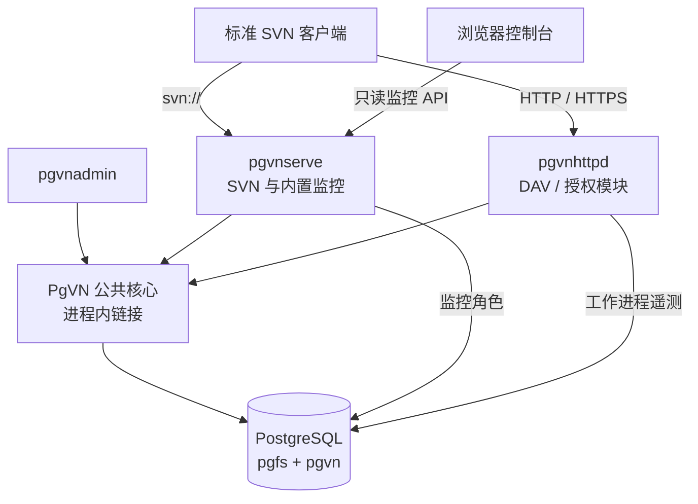

<div align="center">

# PgVN

**标准 Subversion 协议 · PostgreSQL 存储 · 无每库本地目录**

原生 Windows Subversion 服务端，提供数据库仓库管理和内置运维控制台。


[English](README.md) · **简体中文**

[产品特性](#产品特性) · [监控网页](#监控网页) · [技术架构](#技术架构) · [快速部署](#快速部署) · [文档导航](#文档导航)

</div>

<picture>
  <source media="(prefers-color-scheme: dark)" srcset="docs/pgvn/images/monitor-night-ops-dark.jpg">
  <source media="(prefers-color-scheme: light)" srcset="docs/pgvn/images/monitor-night-ops-light.jpg">
  
</picture>

*真实页面截图，来自本机隔离验证环境，图中为测试数据。*

> **当前阶段：** M0–M5 已有本机验收记录；M6 的完整兼容性、故障与性能验证正在推进。全新机器安装、整机重启、跨主机故障切换和 Polarion 应用验收尚待完成。目前部署包为开发快照，各项结果的实测范围和构建身份以[进展与验证](docs/pgvn/progress.zh-CN.md)为准。

## 产品特性

PgVN 将仓库内容与控制状态保存在 PostgreSQL 中，对客户端提供标准 Subversion 网络协议。项目以支持 Polarion 仓库后端为目标，仍需完成 Polarion 应用层验收。

| 能力 | 当前实现 |
| --- | --- |
| 标准客户端接入 | `pgvnserve` 提供 `svn://`，`mod_dav_pgvn` 与 `mod_authz_pgvn` 提供 HTTP/HTTPS。 |
| 数据库仓库 | 按内部 ID 打开仓库，通过数据库路由解析 URL；不创建每库 `repo`、`conf` 或 `activities.d` 目录。 |
| 原生管理工具 | `pgvnadmin` 支持建库、版本化 authz/hook 策略、标准 SVN dump 导入导出、历史校验和凭据管理。 |
| 共享状态 | 历史、锁、配置及持久化 DAV 事务状态保存在 PostgreSQL 中。 |
| 运维控制台 | 内置只读监控，查看健康状态、仓库、数据库、节点、Apache 工作进程和请求错误。 |
| Windows 部署 | 完整 x64 运行依赖、PowerShell 安装工具、LocalService 服务、完整性检查及备份恢复脚本。 |

## 监控网页

网页内嵌在 `pgvnserve.exe` 中，运行时不需要 Node.js、Python 或独立前端服务。当前界面使用中文，支持明暗主题、窄屏布局和键盘导航。

- 健康条集中显示服务就绪、数据库采样、可写主库、节点可见性和样本新鲜度。
- 趋势图与表格展示请求活动、仓库状态、数据库会话及近期失败。
- 展开 Apache 工作进程，可查看 HTTP 方法计数、活动请求和通过 `X-PgVN-Request-Id` 关联的错误。
- 使用可过期、可撤销的 `monitor:read` 令牌，浏览器只在当前页面内存保存令牌。

<details>
<summary>查看亮色主题</summary>


</details>

## 技术架构



公共仓库核心直接编译进对应进程与模块，不需要独立仓库 RPC 服务。内部仓库 ID 与公开 SVN UUID 分开，一个数据库可管理多个仓库及其 URL 路由。

`pgfs` schema 保存内容、修订和锁；`pgvn` 保存目录路由、策略、DAV 状态及遥测数据。

**本地文件边界。** 节点仍需要程序、全局配置、受保护的密钥、证书、日志、临时文件和外部 hook 程序。“无每库目录”指仓库与每库状态不依赖本地目录，这些全局部署文件仍然存在。

**高可用边界。** 多个服务进程可连接同一 PostgreSQL 后端；数据库复制、选主、fencing 和连接路由由数据库部署负责。PgVN 不执行 PostgreSQL 选主，本机多进程验证也不代表跨主机高可用或分布式多主写入已经验收。

## 快速部署

### 1. 准备运行包与数据库

使用**同一构建的完整 Windows x64 包**，包含 DLL、Apache 宿主、模块及部署脚本。从构建输出取得 ZIP 与 SHA-256 文件，校验后解压；这里不表示项目已有正式生产发布版。只复制两个 DLL 到另一套 SVN/Apache 安装中不足以完成部署。

当前固定依赖为 Subversion **1.14.5**、Apache **2.4.68**、APR **1.7.6**、APR-util **1.6.3** 和 PostgreSQL **18.6**。包内附 PostgreSQL 客户端，数据库服务端另行准备。Windows 需支持 Windows 10 1903 起的进程 UTF-8 清单机制，并在目标系统执行包检查。

在管理员 PowerShell 中，将 `$root` 指向解压后包含 `bin`、`apache`、`deploy` 的目录：

```powershell
$root = 'C:\PgVN'
& "$root\deploy\windows\Test-PgVNPackage.ps1"
```

由 DBA 创建专用 UTF-8 数据库和非超级用户角色：

```sql
CREATE ROLE pgvn_migrate LOGIN NOSUPERUSER NOCREATEDB NOCREATEROLE NOINHERIT;
CREATE ROLE pgvn_admin LOGIN NOSUPERUSER NOCREATEDB NOCREATEROLE NOINHERIT;
CREATE ROLE pgvn_service LOGIN NOSUPERUSER NOCREATEDB NOCREATEROLE NOINHERIT;
CREATE ROLE pgvn_monitor LOGIN NOSUPERUSER NOCREATEDB NOCREATEROLE NOINHERIT;
CREATE ROLE pgvn_restore LOGIN NOSUPERUSER NOCREATEDB NOCREATEROLE NOINHERIT;
CREATE DATABASE pgvn OWNER pgvn_migrate ENCODING 'UTF8' TEMPLATE template0;
```

通过 psql `\password` 交互设置各角色密码，并配置数据库访问规则。以下示例使用本机 **5432** 端口；项目故障测试使用的 **16432** 属于**另一套**专用隔离集群。

### 2. 初始化配置与权限

```powershell
& "$root\deploy\windows\Initialize-PgVNConfiguration.ps1" `
    -DatabaseHost '127.0.0.1' -DatabasePort 5432 -DatabaseName pgvn `
    -NodeId node-1 -SvnPort 14690 -MonitorPort 14691 -HttpPort 14980
```

填写 `admin\secrets\pgpass.conf` 中的管理员密码及 `secrets\runtime.pgpass.conf` 中的业务/监控密码，保留受保护的 NTFS 权限。远程数据库按[完整部署指南](deploy/windows/README.zh-CN.md)配置 CA 和验证主机名的 TLS。

```powershell
$admin = "$root\deploy\windows\Invoke-PgVNAdmin.ps1"
& $admin -Profile Migrate -Arguments @('db','init','--json')
& $admin -Profile Migrate -Arguments @('db','check','--json')
& $admin -Profile Migrate -Arguments @('db','grant','--admin-role','pgvn_admin','--service-role','pgvn_service','--monitor-role','pgvn_monitor','--json')
& $admin -Arguments @('key','create',"$root\secrets\credentials-v1.key",'deployment-v1')

$password = Read-Host 'SVN/DAV 用户 alice 的密码' -AsSecureString
& "$root\deploy\windows\Set-PgVNUser.ps1" -UserName alice -Password $password -AlsoDav
& $admin -Arguments @('repo','create','demo','--route','/svn/demo','--json')
```

`-AlsoDav` 同时设置 SVN 账号和 Apache 密码文件。两种协议分别认证身份，共用数据库中的路径授权策略。

### 3. 发布策略并启动服务

新建仓库默认拒绝访问。将 `admin\demo.authz` 保存为 UTF-8 **无 BOM**：

```ini
[demo:/]
alice = rw
* =
```

```powershell
# generation=1 仅适用于刚创建且未修改的仓库。
& $admin -Arguments @('config','publish','name:demo','--expected-generation','1','--authz',"$root\admin\demo.authz",'--json')
& "$root\deploy\windows\Install-PgVNServices.ps1"
& "$root\deploy\windows\Test-PgVNDeployment.ps1" `
    -RepositoryRoute /svn/demo -UserName alice -Password $password
```

安装脚本创建 `PgVN`、`PgVNDAV` 两个 LocalService 服务，默认监听回环地址：

| 入口 | 默认地址 |
| --- | --- |
| SVN | `svn://127.0.0.1:14690/svn/demo` |
| DAV | `http://127.0.0.1:14980/svn/demo` |
| 监控网页 | `http://127.0.0.1:14691/monitor/` |
| 健康探针 | `http://127.0.0.1:14691/health/live` 和 `/health/ready` |

远程客户端接入前需配置受信任 HTTPS 和网络访问规则。CRAM-MD5 不加密 SVN 数据，远程 `svn://` 应通过受信隧道访问。数据库连接必须保留 PostgreSQL 会话语义，不适用事务池连接。

## 使用说明

### 标准 SVN 客户端

```powershell
svn checkout svn://127.0.0.1:14690/svn/demo demo --username alice
Set-Content -LiteralPath .\demo\hello.txt -Value 'Hello from PgVN' -Encoding UTF8
svn add .\demo\hello.txt
svn commit .\demo -m 'Initial commit' --username alice
svn log svn://127.0.0.1:14690/svn/demo --username alice
svn ls http://127.0.0.1:14980/svn/demo --username alice
```

### 管理与迁移

```powershell
& $admin -Arguments @('repo','list','--json')
& $admin -Arguments @('repo','show','name:demo','--json')
& $admin -Arguments @('verify','name:demo')
& $admin -Arguments @('dump','name:demo','--file','D:\Backup\demo.dump','--deltas')
```

迁移现有 SVN 历史时，先生成标准 dump，创建独立目标仓库并**禁用**，通过 `load --file` 导入，校验历史、发布策略后再启用。Windows PowerShell 下使用 `--file` 保持 dump 二进制数据不变，详见[管理指南](docs/pgvn/M2-admin.zh-CN.md)。

### 监控与备份

```powershell
& $admin -Arguments @('monitor-token','create','--label','local-ops','--expires-in','3600')
# 打开 http://127.0.0.1:14691/monitor/，输入返回的令牌。
& "$root\deploy\windows\Backup-PgVN.ps1" -Destination 'D:\PgVN-backups\snapshot-01'
```

令牌仅显示一次，不要放入 URL。备份包含数据库及受保护的部署文件；使用 `Restore-PgVN.ps1` 恢复到**独立空数据库**，检查配置和历史后再启动服务。当前控制 schema 为 **6**，回退需要匹配的数据库备份、密钥及配置，尚无 schema 降级迁移。

## 源码构建

开发需要 Python 3、LLVM-MinGW 和固定版本的源码/SDK。复制 `config/build.example.json` 为忽略提交的 `config/build.local.json`，填写本机路径；SDK 和既有 Polarion 安装作为只读输入。

```powershell
python scripts/pgvn/fetch_httpd.py
python scripts/pgvn/build.py --config config/build.local.json --configuration Release
python scripts/pgvn/package.py --development
```

`fetch_httpd.py` 显式下载并校验锁定的 Apache 宿主源码；离线构建可预先准备对应文件，通过 `apache_source` 指定目录，详见 [UTF-8 构建记录](docs/pgvn/Windows-UTF8.zh-CN.md)。构建器不隐式联网。产物位于 `runtime/pgvn`，构建身份记录在 `artifacts/pgvn/build/manifest.json`，部署包输出至 `runtime/pgvn/packages`。

测试统一使用 `scripts/pgvn` 与 `tests/pgvn`。完整 M5 需要匹配的真实浏览器证据、JDK/SVNKit 和专用测试集群，见[浏览器与测试准备](docs/pgvn/M4-monitor.zh-CN.md#验证与性能口径)和 [M5 开发记录](docs/pgvn/M5-development.zh-CN.md)。门禁会创建隔离库及临时服务，部分测试重启**测试数据库**，不要指向部署库。遗留 PgFS 脚本及结果仅作历史参考，不能作为当前 PgVN 构建的验收结论。

## 项目状态

| 里程碑 | 范围 | 状态 |
| --- | --- | --- |
| M0–M2 | 运行契约、公共仓库核心与管理工具 | 已有本机验收记录 |
| M3 | 原生 SVN 服务、凭据与 hooks | 已有本机验收记录 |
| M4–M5 | 监控、DAV、授权及工作进程遥测 | 已有本机验收记录，结果绑定具体构建 |
| M6 | 完整上游兼容性、故障场景与代表性性能 | 推进中 |
| M7 | 全新 Windows 部署、重启与 Polarion 验收 | 已有本机包验证，独立环境待准备 |

已知客户端差异包括 SVNKit 1.10.1 对中文仓库 URL 修改修订属性的重复编码，以及固定版本 `svnmucc` 的中文用户问题，均有原版 FSFS 对照。该 SVNKit 版本建议采用 ASCII 仓库路由，详见 [DAV 兼容性](docs/pgvn/M5-DAV.zh-CN.md)和 [Windows UTF-8 验证](docs/pgvn/Windows-UTF8.zh-CN.md)。

## 文档导航

中英文 README 的产品介绍与快速开始范围一致，详细工程及运维文档当前使用中文。

| 指南 | 内容 |
| --- | --- |
| [Windows 部署指南](deploy/windows/README.zh-CN.md) | 安装、角色、服务、TLS、备份恢复与升级 |
| [管理指南](docs/pgvn/M2-admin.zh-CN.md) | 选择器、dump/load、校验与策略发布 |
| [SVN 服务指南](docs/pgvn/M3-serve.zh-CN.md) | 凭据、配置、hooks 与服务生命周期 |
| [监控指南](docs/pgvn/M4-monitor.zh-CN.md) | API、令牌、采样与网页行为 |
| [Apache DAV 指南](docs/pgvn/M5-DAV.zh-CN.md) | HTTP/HTTPS、授权、恢复与工作进程遥测 |
| [Schema 设计](docs/pgvn/schema-design.zh-CN.md) | 数据结构、存储与控制边界 |
| [进展与验证](docs/pgvn/progress.zh-CN.md) | 已验收构建、结果与待办 |
| [实施计划](docs/plans/2026-10-15-pgvn-implementation-plan.zh-CN.md) | 里程碑及验收要求 |
