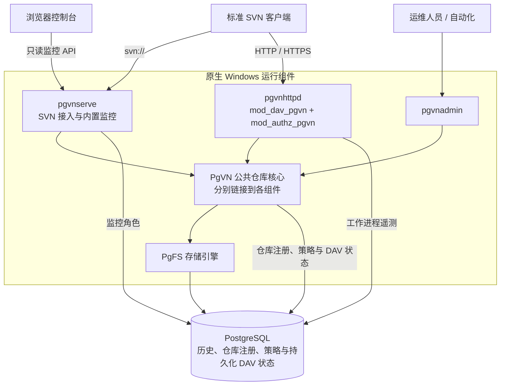

<div align="center">

# PgVN

**标准 Subversion 协议 · PostgreSQL 存储 · 无每库本地目录**

以 PostgreSQL 为存储后端的 Windows / Linux Subversion 服务端，提供原生 SVN/DAV 接入、集中式仓库管理与内置监控控制台。

[](#项目状态)
[](LICENSE)
[](docs/pgvn/linux.zh-CN.md)
[](#快速部署)
[](#环境要求)
[](#环境要求)

[English](README.md) · **简体中文**

[产品介绍](#产品介绍) · [快速部署](#快速部署) · [图形管理工具](#windows-配置与维护-gui) · [Polarion 迁移](#polarion-gui-migration) · [监控网页](#监控网页) · [技术架构](#技术架构) · [使用说明](#使用说明) · [文档导航](#文档导航)

</div>


*内置监控控制台，截图来自已记录的本机验证。[查看网页功能](#监控网页)。*

> [!IMPORTANT]
> **首个可用预览版本（Windows）。** 2026-10-17，项目维护者确认本机 Polarion 已成功使用 PgVN 运行，详见[本机运行记录](docs/pgvn/progress.zh-CN.md#first-usable-preview)。M0–M5 已完成本机验收记录；M6 兼容性、故障注入与性能验证仍在推进中。全新机器安装、整机重启恢复、跨主机故障切换及完整 Polarion 应用场景验收仍待完成，当前版本面向内部试用与验证。

Linux x86_64 开发快照已提供原生 SVN、Apache DAV、监控、CLI、受监督 Hook、打包与离线恢复。见 [Linux 构建与部署指南](docs/pgvn/linux.zh-CN.md)。Release/sanitizer 集成、真实浏览器及实际 Ubuntu VM 的 systemd、重启、升级/回退和恢复已通过，见[交付证据](docs/pgvn/linux-delivery.zh-CN.md)。Windows 验收继续暂缓。

## 从这里开始

| 你的目标 | 阅读入口 |
| --- | --- |
| 了解产品定位与实现方式 | [产品介绍](#产品介绍)、[产品特性](#产品特性)与[技术架构](#技术架构) |
| 在全新 Windows 主机试部署 | [快速部署](#快速部署)（从数据库准备到启动服务）或 [Windows 配置与维护 GUI](#windows-配置与维护-gui) |
| 用 GUI 替换单机 Polarion 的 SVN | [Windows 隔离副本迁移、验收与回退](#polarion-gui-migration) |
| 连接客户端或迁移既有历史 | [使用说明](#使用说明)与[管理与迁移](#管理与迁移) |
| 参与开发或评估验证覆盖面 | [源码构建](#源码构建)与[项目状态](#项目状态) |

## 产品介绍

PgVN 将 SVN 仓库历史、访问配置和持久化协议状态统一保存在 PostgreSQL 中。标准 SVN 客户端继续通过 `svn://`、HTTP 或 HTTPS 接入；运维人员通过 `pgvnadmin`（或 Windows 图形工具）管理仓库，并通过内置监控网页查看服务运行状态。

PgVN 面向希望保留标准 SVN 客户端工作流，同时通过统一 PostgreSQL 后端集中管理仓库存储、访问策略与运行状态的团队。产品由专用 SVN 服务端（`pgvnserve`）、Apache DAV 与授权模块（`mod_dav_pgvn`、`mod_authz_pgvn`）以及命令行管理工具（`pgvnadmin`）组成，公共仓库核心分别静态链接到各组件进程中。

早期的 PgFS 文件系统插件 PoC 是底层存储基础，实际部署使用完整的 PgVN 运行包。项目维护者已确认本机 Polarion 可配合 PgVN 正常运行；更完整的逐场景应用验收正按[验证计划](docs/pgvn/progress.zh-CN.md#first-usable-preview)持续推进。

## 产品特性

| 能力 | PgVN 提供的实现 |
| --- | --- |
| 标准客户端接入 | `pgvnserve` 提供 `svn://` 协议；`mod_dav_pgvn` 与 `mod_authz_pgvn` 提供 HTTP/HTTPS 协议。 |
| 数据库承载仓库 | 按内部 ID 打开仓库，通过数据库路由表解析 URL；磁盘上不创建每库 `repo`、`conf` 或 `activities.d` 目录。 |
| 原生管理工具 | `pgvnadmin` 支持创建仓库、发布版本化 authz/hook 策略、导入导出标准 SVN dump、校验全量历史及管理凭据。 |
| 统一持久化状态 | 仓库历史、文件锁、配置及持久化 DAV 事务状态全部保存在 PostgreSQL 中。 |
| 内置运维控制台 | 内嵌只读监控网页，集中查看服务健康、仓库列表、数据库活动、在线节点、Apache 工作进程与请求错误。 |
| Windows 部署与 GUI | 提供完整 x64 运行包、PowerShell 部署脚本、`LocalService` 低权限服务、完整性校验、备份恢复脚本及原生 **PgVN Manager** 桌面管理程序。 |

## 监控网页

监控控制台直接内嵌在 `pgvnserve.exe` 中，运行时无需安装 Node.js、Python 或额外部署前端服务。界面采用中文设计，支持明暗主题切换、桌面与窄屏自适应布局、键盘导航以及自动刷新与暂停。

| 视图 | 可查看的内容 |
| --- | --- |
| 概览 | 服务就绪状态、可写主库状态、采样新鲜度、请求趋势与进程资源占用。 |
| 节点 | 节点心跳与服务实例列表，支持展开查看 Apache 工作进程遥测明细。 |
| 仓库 | 仓库搜索与分页、仓库标识、`HEAD` 修订号、配置代数（generation）、活动事务与锁。 |
| 数据库 | 监控角色可见范围内的连接占用、SQL 活动、等待事件及采样状态。 |
| 请求与错误 | SVN 命令执行结果、当前实例实际生效的会话容量、DAV 方法计数与关联请求错误。 |

控制台使用可过期、可撤销的 `monitor:read` 只读令牌进行认证，令牌仅保留在浏览器页面内存中；仓库、用户和策略变更均通过 `pgvnadmin` 或 PgVN Manager 执行。令牌签发与撤销命令见[监控网页与令牌](#监控网页与令牌)。

<details>
<summary>更多截图：请求与错误 · 窄屏节点页</summary>


<p align="center">
  
</p>

*以上截图及文首概览图均来自同一次已记录的[工作副本浏览器验收](docs/pgvn/M6-network-wc-workflows.zh-CN.md#冻结构建与完整回归)。图中展示的是隔离测试数据，采样数值不代表性能基准。*

</details>

## 技术架构



| 组件 | 职责 |
| --- | --- |
| `pgvnserve.exe` | 原生 SVN 协议服务端、Windows 服务生命周期管理、健康探针、监控 API 与内嵌网页资源。 |
| `pgvnhttpd.exe` + `mod_dav_pgvn.so` | 定制 Apache 宿主与 Subversion DAV 协议模块，负责持久化活动（activities）、事务和提交回执。 |
| `mod_authz_pgvn.so` | 对 DAV 请求执行由数据库集中管理的路径授权。 |
| `pgvnadmin.exe` | 命令行管理工具，负责仓库生命周期、策略发布、凭据管理、dump/load、历史校验与维护。 |
| PgVN 公共核心 + PgFS | 仓库路由解析、授权/hook 策略执行以及基于 PostgreSQL 的版本化存储引擎，静态链接至上述各组件。 |

一次仓库请求的执行路径分为三步：

1. **解析仓库。** 协议入口将请求的 URL 路由解析为内部仓库 ID。内部 ID 与客户端可见的 SVN UUID 相互独立，单个 PostgreSQL 数据库可承载多个仓库与多条路由。
2. **执行策略。** 公共核心读取数据库中已发布的访问配置，执行路径授权检查与 hook 策略。
3. **读写历史。** PgFS 访问 PostgreSQL 中的版本化数据；修订发布与授权策略代数（generation）复核在同一个数据库事务内原子完成。

由于公共核心直接链接在各服务进程内，部署时无需额外运行独立的仓库 RPC 服务。监控网页通过只读监控接口读取状态，仓库与策略变更则通过管理工具完成。

| 数据库 Schema | 保存的状态 |
| --- | --- |
| `pgfs` | 仓库历史、版本化目录树、文件内容、属性、事务和文件锁。 |
| `pgvn` | 仓库目录、URL 路由、版本化策略、SVN 凭据密文、监控令牌摘要与持久化 DAV 状态。 |
| `pgvn_monitor` | 节点心跳、有界指标采样与只读监控视图。 |

**本地文件边界。** 节点仍需保存可执行程序、全局配置、受保护密钥、TLS 证书、日志、临时文件和外部 hook 可执行程序。“无每库本地目录”是指仓库数据与每库状态不依赖本地 `repo`、`conf` 或 `activities.d` 目录，但节点级全局部署文件依然保存在磁盘上。

**高可用边界。** 多个服务进程可连接同一个 PostgreSQL 后端；数据库复制、选主、隔离（fencing）和连接路由由 PostgreSQL 部署层负责。PgVN 自身不执行数据库选主，本机多进程验证也不代表跨主机高可用或分布式多主写入已完成验收。

## Windows 配置与维护 GUI


[PgVN Manager](tools/pgvn-manager/README.zh-CN.md) 是原生 Windows 桌面配置与维护工具（基于 C# / WPF 与 .NET Framework 4.8）。它提供向导式界面，集中完成 PostgreSQL 连接测试、创建专用数据库与五个非超级用户角色、初始化数据库结构与密钥、保存节点配置、安装与启停 PgVN / DAV 服务，以及仓库、用户和访问规则管理。日常维护涵盖服务健康检查、全量历史校验、SVN dump 导入导出、完整备份和日志查看。发布访问规则时会校验读取时的配置代数（generation），防止意外覆盖其他管理员的并发修改。

在已安装 .NET Framework 4.8 的 Windows x64 机器上，可直接运行完整组合包中的 `manager\PgVNManager.exe`，选择运行目录并加载配置，按中文界面的首次使用向导逐步操作。PostgreSQL 服务端需提前独立安装，修改配置与管理 Windows 服务需以管理员身份运行；完整恢复仍通过配套 PowerShell 脚本执行。项目维护者已确认本机 Polarion 成功运行，完整应用场景验收及跨主机高可用验证仍在推进中。

**完整组合包**是将 PgVN 运行组件与 Manager GUI 合并打包的单个 ZIP 归档，内含 `pgvnserve`、Apache / DAV 模块、`pgvnadmin`、配套 DLL、客户端工具、部署脚本及 `manager` 目录。本轮已构建并记录验证的产物为 `runtime/pgvn-manager-bundle-9dce96de.zip`（约 23 MiB），配套 `.zip.sha256` 校验文件，详见[交付记录](docs/pgvn/manager-validation.zh-CN.md#交付与使用)。由于二进制构建产物独立于 Git 源码分发，部署时请将 ZIP 与 `.sha256` 一并复制到目标机器，校验哈希一致后解压即可获得运行目录。解压根目录直接包含 `bin`、`apache`、`deploy`、`tools` 和 `manager`，双击或以管理员身份运行 `manager\PgVNManager.exe` 即可启动。相比之下，`pgvn-manager.zip` 仅为独立 GUI 附加包，需配合另一份完整运行包使用。两种压缩包均不包含 PostgreSQL 服务端安装程序、.NET Framework 或 Polarion 程序及数据。

如需从源码构建 PgVN Manager，可运行：

```powershell
powershell.exe -NoProfile -ExecutionPolicy Bypass -File .\tools\pgvn-manager\Build-PgVNManager.ps1
```

构建产物默认输出至 `runtime/pgvn-manager`。若额外传入 `-RuntimePackageZip <已验证运行包.zip>`，脚本会将其与 GUI 合并生成完整组合包。GUI 维护独立的构建清单（`manager-manifest.json`）。详细使用说明、测试入口与恢复边界见 [Manager 指南](tools/pgvn-manager/README.zh-CN.md)，本轮验证证据见[本机验证记录](docs/pgvn/manager-validation.zh-CN.md)。

<a id="polarion-gui-migration"></a>

## 用 GUI 迁移 Windows 单机 Polarion 的 SVN

本节适用于**同机、隔离测试副本的替换演练**：将 Polarion 默认 SVN 仓库的完整历史迁入 PostgreSQL，再将 Polarion 切换至 PgVN 的 HTTP 与 SVN 服务入口。PgVN Manager 负责 PgVN 侧的数据库初始化、历史导入与日常维护；源 SVN 仓库导出、`polarion.properties` 修改及 Polarion 应用层验收仍需手工执行。项目维护者已[确认本机 Polarion 成功运行](docs/pgvn/progress.zh-CN.md#first-usable-preview)，但下方完整应用验收清单中的各个细分场景仍需逐项记录验证结果。

### 1. 准备运行目录与回退点

请务必使用独立的 Polarion 测试副本操作。下文出现的 `C:\Polarion` 路径均指代该隔离测试副本，严禁与正在运行的原生产/主实例共用数据目录。提前准备好上文所述的[完整组合包](#windows-配置与维护-gui)、.NET Framework 4.8 以及已安装的 PostgreSQL 服务端。将组合包解压至 `C:\PgVN-PolarionEval`，同时保留原 Polarion 程序目录和旧 FSFS 仓库不动。迁移前先记录现有 Windows 服务名、启动类型、源仓库 UUID 与 `HEAD` 修订号、认证方式、授权规则、活动锁及 hooks，并备份 Polarion 配置与应用数据；正式导出前还须在彻底停写状态下完成一次一致性备份。

以下为示例参数映射（数据库端口请按实际 PostgreSQL 实例填写）：

| 项目 | 示例值 |
| --- | --- |
| 原仓库路径 / 原 DAV 地址 | `C:\Polarion\data\svn\repo` / `http://localhost:80/repo/` |
| PgVN 数据库名 / 新角色前缀 | `pgvn_polarion_eval` / `pgvn_pol_eval`（两者均须尚未存在） |
| 目标仓库名称 / 路由 | `polarion` / `/svn/polarion` |
| 目标 HTTP / SVN 地址 | `http://127.0.0.1:14980/svn/polarion/` / `svn://127.0.0.1:14690/svn/polarion` |
| 监控端口 / 新 Windows 服务名 | `14691` / `PgVN-PolarionEval`、`PgVNDAV-PolarionEval` |

### 2. 用 GUI 初始化目标环境

以管理员身份运行 `C:\PgVN-PolarionEval\manager\PgVNManager.exe` 并加载 `C:\PgVN-PolarionEval`。在「初始化与连接」页填写 PostgreSQL 主机地址、端口、新数据库名称和角色前缀，将 SVN / 监控 / HTTP 端口设为 `14690 / 14691 / 14980`。先点击「测试 DBA 连接」，重新输入测试后自动清空的 DBA 密码，再点击「创建数据库并初始化」。PgVN 使用独立的专用数据库，不会替换 Polarion 原本的内部 SQL / 索引数据库连接。

切换到「仓库与用户」页，创建名为 `polarion`、路由为 `/svn/polarion` 的仓库。此时保持目标服务处于停止状态，且不要向新仓库提交任何测试文件（GUI 仅允许向 `r0` 空仓库导入 dump）。若默认端口存在冲突，请先在 GUI 中调整端口，并同步替换下文所有对应 URL。

### 3. 停写源仓库，导出并导入完整历史

进入测试副本的维护窗口，停止 Polarion 应用服务，以及所有可能写入源仓库或修改修订属性的 HTTP / SVN 服务、定时任务和外部集成入口。按照当前 Polarion 版本的官方维护指南完成一致性备份，至少完整保留 `polarion.properties`、原 Apache SVN 配置、原 FSFS 仓库目录、认证与授权文件、hooks 脚本，以及匹配的应用数据与索引回退点。注意：仅关闭 Polarion Web 页面访问并不能阻止后台或客户端直接写入 SVN。

在管理员 PowerShell 中运行以下命令（请先创建访问受限的目录 `D:\Polarion-migration`，并按实际安装位置调整路径）。本机核对确认 Polarion 自带的 `svnadmin dump` 支持 `--file` 参数，可直接写出二进制 dump 文件：

```powershell
$SourceSvn = 'C:\Polarion\bundled\svn\bin'
$SourceRepo = 'C:\Polarion\data\svn\repo'
$Dump = 'D:\Polarion-migration\polarion-final.dump'
if (Test-Path -LiteralPath $Dump) { throw '请选择一个不存在的导出文件名' }
& "$SourceSvn\svnadmin.exe" verify $SourceRepo
if ($LASTEXITCODE) { throw '源仓库校验失败' }
$SourceHead = & "$SourceSvn\svnlook.exe" youngest $SourceRepo
if ($LASTEXITCODE) { throw '读取源 HEAD 失败' }
$SourceUuid = & "$SourceSvn\svnlook.exe" uuid $SourceRepo
if ($LASTEXITCODE) { throw '读取源 UUID 失败' }
& "$SourceSvn\svnadmin.exe" dump $SourceRepo -r "0:$SourceHead" --file $Dump
if ($LASTEXITCODE) { throw '源仓库导出失败' }
$SourceHead; $SourceUuid
Get-FileHash -LiteralPath $Dump -Algorithm SHA256
```

记录输出的 `$SourceHead`、`$SourceUuid` 以及 dump 文件的 SHA-256 摘要。若其他 SVN 发行版不支持 `dump --file`，请改在 **cmd.exe** 中使用标准输出重定向（`svnadmin dump ... > file.dump`）生成 dump；切勿使用 Windows PowerShell 5.1 的文本管道或 `>` 重定向处理二进制流，也不要用 PgVN Manager 中的「导出当前仓库」按钮去导出旧 FSFS 仓库。

回到 PgVN Manager，选中 `polarion` 仓库，打开「备份与维护」→「导入到当前空仓库」，选择刚才生成的 dump 文件。程序会先禁用该仓库，并在导入结束后继续保持禁用状态。接着点击「校验当前仓库历史」，确认仓库列表显示的 `HEAD` 与 `$SourceHead` 完全一致。若导入中途失败，请保留日志并新建一个空目标仓库重新导入，切勿向部分导入的仓库继续追加数据。

### 4. 迁移账号、有效权限与 hooks

在「仓库与用户」页，为 Polarion `polarion.properties` 中 `login` 参数指定的系统账号创建凭据，输入与 `password` 参数一致的密码，并勾选「同步 DAV / HTTP Basic 凭据」。下文示例使用默认系统账号 `polarion`（若实际配置不同请替换为真实账号名）。同时为参与测试的普通用户创建同名账号及对应凭据。请注意：SVN / DAV 业务账号与 PostgreSQL 数据库角色是两套完全独立的身份体系。

点击「读取当前规则」，对照源系统的有效路径权限编辑 `authz` 规则并点击发布。以下最小规则仅适合单管理员在隔离测试副本上做初步启动验证，并未迁移多用户或各项目的细分权限：

```ini
[/]
polarion = rw
* =
```

经本机核查，Polarion 默认的 `/repo` 入口使用 DBD（或可选 LDAP）认证，并从仓库内部的 `/.polarion/access` 文件读取路径授权（具体环境请核对自身配置）；而 PgVN 当前部署模板使用独立的 DAV 密码文件与保存在数据库中的版本化策略。**将包含 `/.polarion/access` 的 dump 导入 PgVN 并不会让 PgVN 自动读取该文件生效。** 此外，PgVN Manager 不会自动同步 Polarion 应用内后续新增的用户、密码修改、用户组或权限变更。在开展多用户验证前，需先完成有效 `authz` 规则与用户组的迁移、建立后续权限同步及原认证方式的适配，并逐路径验证允许与拒绝行为；在此之前仅限使用固定账号演练。通过 CLI 管理用户组与策略的方法见[管理指南](docs/pgvn/M2-admin.zh-CN.md#配置和授权)。

标准 SVN dump 同样不包含源仓库的 hook 脚本、服务器配置或活动文件锁，需参照 [Subversion 官方迁移 FAQ](https://subversion.apache.org/faq) 分别迁移。请将 Polarion 依赖的 hooks 适配到 PgVN 的全局 `hooks` 目录与数据库策略中：PgVN 的外部 hook 入口为 `.exe` 可执行程序，通过标准输入（`stdin`）接收 JSON 事件负载，详见[外部 hooks 说明](docs/pgvn/M3-serve.zh-CN.md#外部-hooks)。请仔细核对命令行参数与 Polarion 提交/属性通知行为，切勿直接照搬原 SVN 批处理脚本或依赖本地 FSFS 物理路径的脚本。若所需的认证、授权、hooks 或活动锁处理尚未就绪，请停在此步，不要切换 Polarion。

### 5. 启动 PgVN 并核对双协议入口

历史校验通过且策略发布就绪后，在「仓库与用户」页启用 `polarion` 仓库。切换到「服务管理」页，填入前文规划的两个独立服务名（`PgVN-PolarionEval` 与 `PgVNDAV-PolarionEval`），勾选「同时安装 HTTP / DAV 服务」，依次点击「安装服务」「启动」「运行健康检查」。随后使用系统账号交互输入密码，核对 HTTP 与 SVN 两个协议入口：

```powershell
$PgRoot = 'C:\PgVN-PolarionEval'
& "$PgRoot\tools\svn\svn.exe" info 'http://127.0.0.1:14980/svn/polarion/' --username polarion --no-auth-cache
& "$PgRoot\tools\svn\svn.exe" info 'svn://127.0.0.1:14690/svn/polarion' --username polarion --no-auth-cache
```

务必确认两个入口返回的 Repository UUID 均与导出前记录的 `$SourceUuid` 一致，且 Revision 均等于 `$SourceHead`，方可进入下一步切换。同时建议抽查历史修订、项目目录、附件与版本属性，并用受限账号验证越权访问是否按预期被拒绝。仅凭服务健康检查通过，并不代表 Polarion 应用层集成已完成验证。首次演练请使用全新的工作副本 `checkout`，避免混用仍指向旧 URL 的工作副本。

### 6. 手工切换 Polarion 的仓库地址

保持 Polarion 应用服务停止，先备份再编辑 `C:\Polarion\polarion\configuration\polarion.properties`，就地修改仓库入口配置（请在原配置行上直接修改，避免出现重复键）：

```properties
repo=http://127.0.0.1:14980/svn/polarion/
repoSystem=svn://127.0.0.1:14690/svn/polarion
```

其中 `repo` 为常规仓库访问入口，`repoSystem` 为可选的系统只读访问入口（必须与 `repo` 指向同一个仓库 UUID）。首轮演练也可先注释掉 `repoSystem`，让系统访问统一走 `repo`；若原文件中配置了 `file://...` 或旧 SVN 地址，请一并修改或注释。保持 `login` / `password` 与 PgVN Manager 中设置的凭据一致，并保留原有的 `base.url`、Tomcat 及 Polarion 内部数据库配置不变。与具体 Polarion 版本相关的维护步骤，请以 [Siemens 官方文档门户](https://support.industrysoftware.automation.siemens.com/docs_general/polarion/manuals/)对应版本的 *Deployment and Maintenance Guide* 为准。

在重新启动 Polarion 自带 Apache（用于提供 Polarion Web 界面）之前，请先在已备份的 Apache 配置中封闭旧 `/repo`、`/installrepo` 等原仓库写入口：例如将对应 `<Location>` 块中原有的授权指令直接替换为 `Require all denied`，执行 Apache 配置语法检查通过后再启动（切勿仅在原有允许规则旁并列追加拒绝规则）。同时保持其他旧 SVN 服务和写入任务处于停止状态，确保原 FSFS 仓库彻底无法承接新写入。整体启动顺序为：**PostgreSQL → PgVN / DAV 就绪 → Polarion 应用**。PgVN Manager 安装的 Windows 服务默认设为「手动」启动；如需验证整机重启恢复，请另行配置服务自动启动及依赖关系。

上述 `127.0.0.1` 地址仅适用于单机同机演练。若需供远端 SVN 客户端或浏览器访问，必须配置可达的 HTTPS 地址、受信任证书及对应 URL 参数（客户端机器上的 `127.0.0.1` 无法访问服务端仓库）。

### 7. 应用验收与回退流程

登录 Polarion，逐一验证项目列表、工作项（Work Item）读写、LiveDoc 文档、附件上传下载、历史与基线（Baseline）、文件锁、普通用户路径权限隔离，以及用户/用户组/密码/权限变更同步。按照当前版本的维护指南执行索引与重建索引流程，确认新增修订仅出现在 PgVN 中且旧 FSFS 仓库的 `HEAD` 保持冻结，随后在 PgVN Manager 中执行一次完整备份。请完整记录各项验证结果后再评估是否扩大试用范围。虽然项目维护者已确认本机 Polarion 启动与日常运行成功，但该反馈不等同于上述清单中的全部细分应用场景均已完成验收。

如需执行**回退**，请先停止 Polarion 应用及所有写入入口，并通过 PgVN Manager 停止本目录的 `PgVN-PolarionEval` 与 `PgVNDAV-PolarionEval` 服务：
- **若切换后尚无任何新写入：** 直接恢复备份的 `polarion.properties`、原 Apache 配置以及匹配的应用数据/索引回退点，再按原有顺序启动旧 SVN 与 Polarion 服务。
- **若切换后 PgVN 已产生新提交或修订属性变更：** 先保留一份完整的 PgVN 备份并导出最新历史，由管理员将更新后的完整历史迁回一个独立的 FSFS 仓库并校验无误后再切换；切勿直接启用停留在旧 `HEAD` 的原 FSFS 仓库，否则将丢失切换后产生的所有变更。

## 快速部署

在同一个管理员 PowerShell 会话中依次执行第 1–5 步。PostgreSQL 服务端需单独部署；PgVN 运行包内已附带固定版本的数据库客户端与 SVN 客户端工具。

| 步骤 | 执行操作 | 预期检查结果 |
| --- | --- | --- |
| [1. 运行包](#1-校验并解压运行包) | 校验 SHA-256 摘要，解压完整运行包，运行依赖与完整性检查。 | `Test-PgVNPackage.ps1` 执行成功。 |
| [2. 数据库](#2-准备数据库与配置) | 创建数据库及五个专用角色，生成节点配置，填写受保护的密码文件。 | 管理连接与运行连接均指向目标数据库。 |
| [3. 仓库](#3-初始化权限凭据与仓库) | 初始化数据库 schema、授予角色权限，创建加密密钥、测试用户与仓库。 | `db check` 成功，`repo create` 返回新建仓库信息。 |
| [4. 服务](#4-发布策略并启动服务) | 发布 `authz` 访问策略，安装 Windows 服务，核对双协议入口。 | 用户 `alice` 具备写权限，SVN 与 DAV 返回相同的仓库 UUID。 |
| [5. 监控](#5-检查服务并打开网页) | 检查健康探针，签发只读监控令牌，打开内嵌监控网页。 | 两个服务处于 `Running` 状态，就绪探针返回 `true`，网页成功认证令牌。 |

### 环境要求

| 项目 | 环境要求 |
| --- | --- |
| 服务主机 | Windows x64，支持自 Windows 10 1903 引入的进程级 UTF-8 代码页清单机制；部署前需在目标系统运行包检查脚本。 |
| 命令行环境 | 管理员权限的 Windows PowerShell 5.1 或 PowerShell 7+（用于注册 Windows 服务与设置 NTFS 权限）。 |
| 数据库 | 独立部署的 UTF-8 编码 PostgreSQL 数据库；当前固定构建针对 PostgreSQL **18.6**。 |
| 运行依赖 | 同一构建产出的完整运行包；目标机器无需安装 Python、Node.js、编译器、SDK 或既有 Polarion。 |
| 客户端 | 标准 SVN 客户端；运行包 `tools\svn` 目录已附带固定版本的 SVN CLI。 |

当前固定构建基线同时使用 Subversion **1.14.5**、Apache HTTP Server **2.4.68**、APR **1.7.6** 与 APR-util **1.6.3**。以上为经过实测的构建依赖组合，并非针对其他版本的广泛兼容矩阵。

### 1. 校验并解压运行包

请始终使用**同一构建产出的完整 Windows x64 运行包**（包含主程序、配套 DLL、定制 Apache 宿主、DAV 模块及部署脚本）。从可信构建产物获取 ZIP 与 `.sha256` 文件，校验哈希无误后解压。注意：此快照包不代表已发布正式生产版本，仅把两个模块 DLL 复制到其他 SVN/Apache 目录中也无法完成部署。

在管理员 PowerShell 中执行以下命令（将 `PACKAGE_ID` 替换为实际包 ID）：

```powershell
$zip = 'C:\Transfer\PgVN-M5-windows-x64-PACKAGE_ID.zip'
$expected = (Get-Content -LiteralPath ($zip + '.sha256') -Raw).Split(' ')[0]
if ((Get-FileHash -LiteralPath $zip -Algorithm SHA256).Hash -ine $expected) {
    throw 'ZIP 摘要不符'
}
Expand-Archive -LiteralPath $zip -DestinationPath 'C:\Deploy'
$root = Join-Path 'C:\Deploy' ([IO.Path]::GetFileNameWithoutExtension($zip))
& "$root\deploy\windows\Test-PgVNPackage.ps1"
```

ZIP 解压后会生成与压缩包同名的顶层目录（即 `$root`），内含 `bin`、`apache`、`deploy` 与 `tools`。`Test-PgVNPackage.ps1` 会逐一核对文件哈希、x64 PE 依赖以及进程 UTF-8 启动状态（`process_code_page=65001`）。如需自行从源码生成运行包，请参考[源码构建](#源码构建)；运行包结构与本机校验细节见[打包与本机验证指南](docs/pgvn/M7-package-local.zh-CN.md)。

### 2. 准备数据库与配置

由 DBA 在 PostgreSQL 中创建专用 UTF-8 数据库与五个非超级用户角色：

```sql
CREATE ROLE pgvn_migrate LOGIN NOSUPERUSER NOCREATEDB NOCREATEROLE NOINHERIT;
CREATE ROLE pgvn_admin LOGIN NOSUPERUSER NOCREATEDB NOCREATEROLE NOINHERIT;
CREATE ROLE pgvn_service LOGIN NOSUPERUSER NOCREATEDB NOCREATEROLE NOINHERIT;
CREATE ROLE pgvn_monitor LOGIN NOSUPERUSER NOCREATEDB NOCREATEROLE NOINHERIT;
CREATE ROLE pgvn_restore LOGIN NOSUPERUSER NOCREATEDB NOCREATEROLE NOINHERIT;
CREATE DATABASE pgvn OWNER pgvn_migrate ENCODING 'UTF8' TEMPLATE template0;
```

在 `psql` 中使用 `\password` 交互设置各角色密码，并配置 `pg_hba.conf` 访问规则。下方示例连接本机默认端口 **5432**（注：本项目破坏性故障测试使用的 **16432** 端口属于另一套专用隔离测试集群）：

```powershell
& "$root\deploy\windows\Initialize-PgVNConfiguration.ps1" `
    -DatabaseHost '127.0.0.1' -DatabasePort 5432 -DatabaseName pgvn `
    -NodeId node-1 -SvnPort 14690 -MonitorPort 14691 -HttpPort 14980
```

按提示在 `admin\secrets\pgpass.conf` 中填入迁移/管理员密码，在 `secrets\runtime.pgpass.conf` 中填入业务/监控角色密码，并保持脚本设置的受保护 NTFS 权限不变。其中 `pgvn_migrate` 持有 schema 所有权，日常管理、协议请求处理、只读监控与隔离恢复则分别使用各自的最小权限角色。若连接远程 PostgreSQL，请按 [Windows 部署指南](deploy/windows/README.zh-CN.md)配置 CA 根证书与校验主机名的 TLS（`verify-full`）。重复运行初始化脚本会保留已有配置文件，新传入的参数不会覆盖旧配置。

<details>
<summary>安装目录结构与本机配置</summary>

```text
PgVN-M5-windows-x64-PACKAGE_ID/
├─ bin/                 pgvnserve、pgvnadmin 及配套运行时 DLL
├─ apache/              定制 Apache 宿主 (pgvnhttpd)、DAV 与路径授权模块
├─ deploy/windows/      服务安装、完整性检查、用户管理与备份恢复脚本
├─ tools/               固定版本的 SVN 与 PostgreSQL 客户端工具
├─ config.local/        本节点服务配置（初始化时生成）
├─ admin/               管理端配置、管理员密码文件与服务登记记录（初始化时生成）
├─ secrets/             业务/监控密码文件与凭据加密密钥（初始化后填写或生成）
├─ hooks/               外部 hook 可执行程序的全局目录（初始化时生成）
└─ logs/、state/        节点运行日志、临时文件及服务状态目录（初始化时生成）
```

原生 SVN 服务配置位于 `config.local\pgvnserve.ini`，DAV 配置位于 `config.local\pgvn-apache.ini` 与 `config.local\httpd.conf`。以上均为节点级本地部署文件；仓库历史数据与每库策略配置全部保存在 PostgreSQL 中。

</details>

### 3. 初始化权限、凭据与仓库

```powershell
$admin = "$root\deploy\windows\Invoke-PgVNAdmin.ps1"
& $admin -Profile Migrate -Arguments @('db','init','--json')
if ($LASTEXITCODE) { throw '数据库初始化失败' }
& $admin -Profile Migrate -Arguments @('db','check','--json')
& $admin -Profile Migrate -Arguments @('db','grant','--admin-role','pgvn_admin','--service-role','pgvn_service','--monitor-role','pgvn_monitor','--json')
& $admin -Arguments @('key','create',"$root\secrets\credentials-v1.key",'deployment-v1')

$password = Read-Host 'SVN/DAV 用户 alice 的密码' -AsSecureString
& "$root\deploy\windows\Set-PgVNUser.ps1" -UserName alice -Password $password -AlsoDav
& $admin -Arguments @('repo','create','demo','--route','/svn/demo','--json')
```

`-AlsoDav` 参数会同时配置数据库中的 SVN 账号密文与 Apache 的 HTTP Basic 密码文件。两种协议各自独立完成身份认证，但共用数据库中发布的同一套路径授权策略。

### 4. 发布策略并启动服务

新建仓库默认拒绝一切访问。以下命令以 UTF-8 **无 BOM** 编码生成 `admin\demo.authz`，发布访问策略，并安装和验证 Windows 服务：

```powershell
$authz = @'
[demo:/]
alice = rw
* =
'@
[IO.File]::WriteAllText("$root\admin\demo.authz", $authz, [Text.UTF8Encoding]::new($false))
& $admin -Arguments @('config','show','name:demo','--json')
# generation=1 仅适用于刚创建且尚未修改过的仓库。
# 若为已有仓库，请替换为上一步 `config show` 返回的实际 generation。
& $admin -Arguments @('config','publish','name:demo','--expected-generation','1','--authz',"$root\admin\demo.authz",'--json')
& $admin -Arguments @('authz','check','name:demo','alice','/','write','--json')
& "$root\deploy\windows\Install-PgVNServices.ps1"
& "$root\deploy\windows\Test-PgVNDeployment.ps1" `
    -RepositoryRoute /svn/demo -UserName alice -Password $password
```

安装脚本会以 `NT AUTHORITY\LocalService` 账号注册 `PgVN` 与 `PgVNDAV` 两个 Windows 服务，默认仅监听本机回环地址：

| 入口 | 默认监听地址 |
| --- | --- |
| SVN | `svn://127.0.0.1:14690/svn/demo` |
| DAV | `http://127.0.0.1:14980/svn/demo` |
| 监控网页 | `http://127.0.0.1:14691/monitor/` |
| 健康探针 | `http://127.0.0.1:14691/health/live` 与 `/health/ready` |

在向远程客户端开放服务前，请配置受信任的 HTTPS 证书与防火墙规则。由于 CRAM-MD5 仅认证身份而不加密 `svn://` 传输内容，远程 `svn://` 接入应通过受信加密隧道承载。此外，数据库连接必须保留完整的 PostgreSQL 会话语义，切勿在 PgVN 与 PostgreSQL 之间串联事务级连接池（transaction pooling）。

### 5. 检查服务并打开网页

```powershell
Get-Service -Name PgVN, PgVNDAV
Invoke-RestMethod -Uri 'http://127.0.0.1:14691/health/live'
Invoke-RestMethod -Uri 'http://127.0.0.1:14691/health/ready'
```

此时两个默认服务均应处于 `Running` 状态，健康探针分别返回 `live: true` 与 `ready: true`。上一步运行的 `Test-PgVNDeployment.ps1` 还会自动校验内嵌监控网页可达，以及 SVN 与 DAV 两个协议入口返回相同的公开仓库 UUID。接下来可按[监控网页与令牌](#监控网页与令牌)签发只读令牌，在浏览器中打开 `http://127.0.0.1:14691/monitor/`。

## 使用说明

### 标准 SVN 客户端

以下示例使用运行包内置的 SVN CLI（也可替换为本机已安装的标准 SVN 客户端），沿用部署时的 PowerShell 会话与 `alice` 账号（执行时按提示输入密码）：

```powershell
$svn = "$root\tools\svn\svn.exe"
& $svn checkout svn://127.0.0.1:14690/svn/demo demo --username alice
Set-Content -LiteralPath .\demo\hello.txt -Value 'Hello from PgVN' -Encoding UTF8
& $svn add .\demo\hello.txt
& $svn commit .\demo -m 'Initial commit' --username alice
& $svn update .\demo --username alice
& $svn log svn://127.0.0.1:14690/svn/demo --username alice
& $svn ls http://127.0.0.1:14980/svn/demo --username alice
& $svn cat http://127.0.0.1:14980/svn/demo/hello.txt --username alice
```

最后一条 `svn cat` 命令会通过 HTTP/DAV 读取刚刚经由 `svn://` 提交的 `Hello from PgVN`。结合部署检查确认的一致仓库 UUID，即可验证两个协议入口读写的是同一个底层 PostgreSQL 仓库；同时也可在监控网页的「仓库」视图中看到更新后的 `HEAD` 修订号。

### 管理与迁移

日常管理请通过包装脚本 `Invoke-PgVNAdmin.ps1` 调用 `pgvnadmin`，以自动加载受保护的 `libpq` 连接配置与匹配的运行时依赖：

```powershell
& $admin -Arguments @('repo','list','--json')
& $admin -Arguments @('repo','show','name:demo','--json')
& $admin -Arguments @('verify','name:demo')
& $admin -Arguments @('dump','name:demo','--file','D:\Backup\demo.dump','--deltas')
```

迁移既有 SVN 仓库历史时，先从源库导出标准 SVN dump，再将其导入到一个**新建的独立空仓库**：

```powershell
& $admin -Arguments @('repo','create','imported','--route','/svn/imported','--json')
& $admin -Arguments @('repo','disable','name:imported','--json')
& $admin -Arguments @('load','name:imported','--file','C:\Transfer\existing.dump')
& $admin -Arguments @('verify','name:imported')
& $admin -Arguments @('config','show','name:imported','--json')
```

历史校验通过后，准备该仓库的 `authz` 策略文件（仓库限定规则段使用 `[imported:/]`），使用上一步 `config show` 返回的真实 generation 发布策略，最后执行 `repo enable name:imported` 启用仓库。在 Windows PowerShell 中请始终通过 `--file` 参数指定 dump 文件，避免文本管道破坏二进制字节流。注意：`dump`/`load` 仅迁移版本历史，用户凭据、访问策略和外部 hooks 需另行配置，详见[管理指南](docs/pgvn/M2-admin.zh-CN.md)。

### 监控网页与令牌

```powershell
& $admin -Arguments @('monitor-token','create','--label','local-ops','--expires-in','3600')
# 在浏览器打开 http://127.0.0.1:14691/monitor/，输入返回的令牌原值。
& $admin -Arguments @('monitor-token','list','--json')
# 下方 TOKEN_ID 请填写 `list` 返回的令牌 ID，而非令牌原值。
& $admin -Arguments @('monitor-token','revoke','TOKEN_ID','--json')
```

令牌原值仅在创建时显示一次，权限固定为 `monitor:read` 只读，请勿将令牌拼接到 URL 中。由于令牌仅保存在页面内存中，刷新页面后需重新输入；令牌一旦过期或被撤销，控制台会立即断开并清空页面上已显示的业务数据。监控网页仅用于只读观测，所有仓库与用户变更均通过 `pgvnadmin` 或 PgVN Manager 执行。

### 节点配置

完成初始化后，可编辑 `config.local\pgvnserve.ini` 调整 SVN 监听地址与并发会话上限（请保留文件中已生成的数据库连接与密钥配置项）：

```ini
[pgvn]
node-id = node-1
listen-host = 127.0.0.1
listen-port = 14690
max-connections = 64
```

`max-connections` 默认值为 **64**（有效范围 **1–64**），修改后需重启 `PgVN` 服务生效。该参数限制单节点同时保持的 `svn://` 协议连接数；注意一次客户端操作可能会并发建立多个协议连接。监控网页、监控 API 与 Prometheus 指标均会展示当前实例实际生效的容量上限。

进程内业务数据库连接租约上限（**32**）独立计量，这两个数值均不代表并发客户端数量或吞吐量承诺。多节点部署时，请为每个节点分配唯一的 `node-id`，并在各节点间同步协调加密密钥、外部 hook 程序及节点配置。配置项说明与重启排空行为详见 [SVN 服务指南](docs/pgvn/M3-serve.zh-CN.md#服务与访问设置)。

### 备份、恢复与升级

```powershell
& "$root\deploy\windows\Backup-PgVN.ps1" -Destination 'D:\PgVN-backups\snapshot-01'
```

`Backup-PgVN.ps1` 会生成一致性逻辑数据库备份，并一并归档受保护的节点配置、密钥、DAV 密码文件与全局 `hooks` 目录。恢复时请使用 `Restore-PgVN.ps1` 恢复至一个**独立的空数据库**，核对配置并完成历史校验后再启动服务。当前控制 schema 版本为 **6**；系统不提供 schema 降级迁移，版本回退必须使用匹配的数据库备份、密钥及配置文件。

多节点部署下，需在所有节点间统一协调密钥轮换、hook 程序与配置版本——仅靠数据库的逻辑快照无法替代对各节点本地外部文件的备份。完整的备份恢复与升级步骤见 [Windows 部署指南](deploy/windows/README.zh-CN.md#5-备份和恢复到空数据库)。

## 故障排查

| 现象 | 优先排查项 |
| --- | --- |
| 服务无法启动 | 先运行 `Test-PgVNPackage.ps1`；检查运行包完整性、服务配置语法、密钥文件以及 `LocalService` 账号的文件读取权限。 |
| 存活探针成功，但就绪探针返回 `503` | 检查 PostgreSQL 连通性、业务与监控角色权限、schema 版本、可写主库状态及仓库路由配置，按部署指南修复后重试。 |
| 认证成功，但仓库读写被拒绝 | 新建仓库默认拒绝一切访问；检查已发布的 `authz` 规则、仓库名称以及 `config show` 返回的当前 generation。 |
| `svn://` 可正常访问，但 DAV 返回 `401` | SVN 凭据表与 Apache HTTP Basic 密码文件分别独立维护；确认创建用户时传入了 `Set-PgVNUser.ps1 -AlsoDav`。 |
| 客户端 URL 无法打开仓库 | 使用 `repo list`、`repo show` 检查目标仓库路由与 `enabled` 状态，并核对客户端输入的完整 URL。 |
| 负载升高时，新的 `svn://` 连接被关闭 | 对照当前活跃会话数与实例生效的 `max-connections` 上限；单个客户端操作可能占用多个连接，且 32 个数据库租约独立计量。 |
| 刷新监控网页后要求重新输入令牌 | 属于预期设计：令牌仅保存在浏览器内存中，页面刷新、令牌过期或被撤销后均需重新认证。 |
| 重新运行初始化脚本后端口未改变 | 初始化脚本默认保留已有配置文件；请直接检查并修改 `config.local` 与 `admin\deployment.json`，再重启对应服务。 |

节点运行日志位于 `$root\logs` 目录下（DAV 默认日志为 `apache-error.log` 和 `apache-access.log`）。详细诊断流程请参阅 [Windows 部署指南](deploy/windows/README.zh-CN.md)。

## 常见问题

<details>
<summary>能否只复制两个 SVN DLL 到目标机器完成部署？</summary>

不能。部署必须使用同一构建产出的完整运行包，包含专用服务程序（`pgvnserve`、`pgvnhttpd`）、管理工具 `pgvnadmin`、Apache 模块、配套 DLL、配置模板及部署脚本。请按[快速部署](#快速部署)或使用 [PgVN Manager](#windows-配置与维护-gui) 完成数据库、配置与密钥初始化后再安装服务。

</details>

<details>
<summary>「无每库本地目录」是否意味着服务器上完全没有本地文件？</summary>

不是。仓库历史、每库配置与持久化 DAV 状态全部保存在 PostgreSQL 中，因此不再需要每库独立的 `repo`、`conf` 或 `activities.d` 目录；但可执行程序、节点级全局配置、密钥、TLS 证书、日志、临时文件以及外部 hook 可执行程序仍保存在节点本地磁盘上，客户端工作副本也继续保存在客户端本地。

</details>

<details>
<summary>PgVN 是否已经内置分布式高可用和多主写入？</summary>

当前支持多个 PgVN 服务进程共享同一个 PostgreSQL 后端，但数据库复制、自动选主、旧主隔离（fencing）和连接路由须由底层 PostgreSQL 集群提供。跨主机故障切换、RPO/RTO 指标与代表性生产性能仍在验证中，且不支持分布式多主写入，详见[技术架构](#技术架构)与[项目状态](#项目状态)。

</details>

<details>
<summary>现在可以直接替换 Polarion 的生产环境 SVN 后端吗？</summary>

首个可用预览版本已由项目维护者确认可配合本机 Polarion 正常运行，适合在隔离测试副本上开展内部试用验证。但完整的 Polarion 应用场景逐项验收、全新机器安装、整机重启恢复及跨主机故障切换仍待完成验收记录，具体进展见下方[项目状态](#项目状态)里程碑表。

</details>

## 源码构建

从源码构建需要 Python 3、LLVM-MinGW 以及固定版本的上游源码树与 SDK。先将 `config/build.example.json` 复制为受 Git 忽略的 `config/build.local.json`，并填入本机路径；外部 SDK 与本机已有的 Polarion 安装均仅作为只读输入使用。

```powershell
Copy-Item -LiteralPath config/build.example.json -Destination config/build.local.json
# 编辑 config/build.local.json，填入本机实际 SDK 与上游源码路径。
python scripts/pgvn/fetch_httpd.py
python scripts/pgvn/build.py --config config/build.local.json --configuration Release
python scripts/pgvn/package.py --development
```

`fetch_httpd.py` 用于显式下载并校验锁定哈希的 Apache 宿主源码；离线构建可预先准备对应源码包并通过 `apache_source` 指定本地目录（详见 [Windows UTF-8 构建说明](docs/pgvn/Windows-UTF8.zh-CN.md)），构建脚本不会隐式访问网络。编译产物输出至 `runtime/pgvn`，构建清单记录在 `artifacts/pgvn/build/manifest.json`，打包归档位于 `runtime/pgvn/packages`。

产品版本、依赖版本、schema 和能力统一来自 `src/pgvn/version.json`。源码中新增的 CLI/Apache 运行信息、包清单和 GUI 版本生成共用该来源；实际 APR/APR-util/libpq 与声明不符时拒绝冻结。新 GUI 加载时核对产品版本、API、schema 与后端能力，需要配套重建的运行包；上文历史组合包保持原有构建身份。

Linux 开发的首个前置组件可在无 SDK 环境运行：

```sh
python scripts/pgvn/build.py --metadata-only --target linux --configuration Release
python -m unittest discover -s tests/pgvn -p test_build_metadata.py -v
```

`--metadata-only` 仅生成 `build/pgvn/metadata/linux/` 下的版本头和源码/迁移清单，尚不构建 Linux 服务端或模块。完整推进顺序、包配对命令及 Windows 待验项目见[计划执行检查点](docs/plans/2026-10-17-pgvn-linux-bypass-performance.zh-CN.md#p0-version-metadata)。

此前 Linux 原生组件检查点建立了基础：schema 7 新增仅限原生 SVN 的 bypass 配置，公共上下文与协议 I/O 已接入 POSIX 计数、取消和单调时钟接口，并在 Ubuntu 24.04 + PostgreSQL 18.6 隔离组件验证。Windows 验收按本轮要求暂缓；完整 Linux 服务与协议集成现见[Linux 交付记录](docs/pgvn/linux-delivery.zh-CN.md)。现已新增固定版本 FS SDK 和 ELF 开发构建，用于隔离验证及内容传输实验，历史运行包不支持新配置。详见[本轮执行记录与复现入口](docs/plans/2026-10-17-pgvn-linux-bypass-performance.zh-CN.md#linux-bypass-components)。

固定 FS SDK、ELF 检查、内容二进制传输实验及复现命令见[Linux FS 与性能检查点](docs/plans/2026-10-17-pgvn-linux-bypass-performance.zh-CN.md#linux-fs-performance)。该历史检查点只覆盖 FS；完整产品及包现见 Linux 交付记录。

Linux 凭据组件已接入 OpenSSL EVP 和基于描述符的密钥文件校验，Release 与 ASan/UBSan 的向量、权限、真实 SQL 和轮换检查通过。[凭据检查点](docs/plans/2026-10-17-pgvn-linux-bypass-performance.zh-CN.md#linux-credentials)记录了权限策略、产物及跨 OS 待验项；完整 Linux 管理/服务主程序和恢复后实际认证现见 Linux 交付记录。

Catalog schema 8 新增版本化逻辑 Hook 声明与节点本地文件名映射。[Hook 配置检查点](docs/plans/2026-10-17-pgvn-linux-bypass-performance.zh-CN.md#linux-hook-config)记录了旧节点兼容、缺实现拒绝及原生组件验证；POSIX 子进程执行及逃逸后代回收现见 Linux 交付记录。

验证测试统一通过 `scripts/pgvn` 与 `tests/pgvn` 执行。运行完整的 M5 门禁需要真实浏览器验证环境、配置好的 JDK/SVNKit 以及专用测试 PostgreSQL 集群，详见[浏览器与测试准备](docs/pgvn/M4-monitor.zh-CN.md#验证与性能口径)和 [M5 开发记录](docs/pgvn/M5-development.zh-CN.md)。由于测试门禁会创建隔离数据库、注册临时服务，且部分故障测试会重启**测试数据库集群**，请切勿将测试脚本指向业务部署库。仓库中保留的早期 PgFS 脚本与记录仅供历史参考，不作为当前 PgVN 构建的验收依据。

<details>
<summary>源码目录结构</summary>

```text
src/pgvn/             原生 SVN 服务端、公共仓库核心、CLI 管理工具与 Apache DAV/authz 模块
src/libsvn_fs_pg/     PgFS PostgreSQL SVN 存储引擎
web/pgvn-monitor/     内嵌监控控制台的 HTML、CSS 与 JavaScript
tools/pgvn-manager/   Windows 原生配置与维护 GUI (C# / WPF)
sql/                  版本化数据库 schema 迁移脚本
scripts/pgvn/         构建编排、依赖准备与打包脚本
tests/pgvn/           里程碑验证门禁与上游 SVN 兼容性测试夹具
deploy/windows/       Windows PowerShell 配置、服务安装与备份恢复脚本
docs/pgvn/            架构规范、运维指南与验证证据归档
```

</details>

## 项目状态

**首个可用预览版本：Windows（2026-10-17）。** 项目维护者确认本机 Polarion 已配合 PgVN 成功运行，[运行记录](docs/pgvn/progress.zh-CN.md#first-usable-preview)说明了本次反馈的确认范围；既有兼容性测试结论与未完成里程碑要求继续保持不变。

| 里程碑 | 范围 | 当前状态 |
| --- | --- | --- |
| M0–M2 | 运行时契约、公共仓库核心与 `pgvnadmin` 管理工具 | 已有本机验收记录 |
| M3 | 原生 `svn://` 服务、加密凭据与外部 hooks | 已有本机验收记录 |
| M4–M5 | 内嵌监控网页、Apache DAV、路径授权与工作进程遥测 | 已有本机验收记录（结果绑定具体构建） |
| M6 | 完整上游 SVN 兼容性、故障注入与代表性性能验证 | 推进中 |
| M7 | 全新 Windows 机器部署、整机重启恢复与完整 Polarion 应用验收 | 已有本机包验证及用户确认的 Polarion 预览运行记录；干净机器、重启及完整应用验收待完成 |

近期验证记录汇总如下。每项结果严格绑定对应报告所注明的构建哈希；单次测试执行完成并不等同于完整上游兼容性或生产就绪已获验收。

| 验证记录 | 实测范围与结论 |
| --- | --- |
| [首个可用预览版本](docs/pgvn/progress.zh-CN.md#first-usable-preview) | 2026-10-17 项目维护者确认本机 Polarion 成功运行；完整应用场景逐项验收另行跟踪记录。 |
| [完整合并与 patch 矩阵](docs/pgvn/M6-network-merge-patch-matrix.zh-CN.md) | SVN、HTTP、HTTPS 三协议共 45 组测试全部执行完毕。矩阵整体仍记为 **FAIL**，保留了两后端一致复现的原版 `patch` 失败及一处严格诊断输出顺序差异。 |
| [启用 shelf 配置验证](docs/pgvn/M6-network-shelf-enabled.zh-CN.md) | 63 个原版测试函数完成三协议对照：330 `PASS`、48 个原版 `XFAIL`、0 `SKIP`。因两处状态树打印键序差异，严格诊断审计保持 **FAIL**；`XFAIL` 不计入验收通过。 |
| [真实历史往返验证](docs/pgvn/M6-history-frozen.zh-CN.md) | 对全部 638 个真实历史修订完成原生 `verify`，与标准 FSFS 对照变更路径、二进制修订属性及五个完整目录树快照一致，并通过标准 `dump`/`load` 往返校验。 |
| [有状态备份与恢复](docs/pgvn/M6-backup-frozen.zh-CN.md) | 将合成 SVN/DAV 状态恢复至独立数据库，完整核对 30 张表与序列账本、加密凭据、文件锁、提交回执以及未完成 DAV 事务的续提。 |
| [提交回包丢失探针](docs/pgvn/M6-receipt-fault-frozen.zh-CN.md) | 模拟 PostgreSQL `COMMIT` 成功后客户端回包丢失，验证仓库核心重试仅发布唯一修订并通过回执确认；SVN/DAV 客户端确认丢失与数据库主从切换仍需独立验证。 |

<details>
<summary>更多兼容性记录与覆盖范围</summary>

- **[工作副本升级验收](docs/pgvn/M6-network-upgrade-fixtures.zh-CN.md)：** 覆盖 36 个原版函数在 SVN、HTTP、HTTPS 三协议下的 FSFS/PgVN 对照（216 个结果全部通过），以及 21 项离线夹具边界检查。
- **[属性、继承与外部引用验收](docs/pgvn/M6-network-client-properties.zh-CN.md)：** 覆盖 10 个完整套件、280 个原版测试函数。各份报告均绑定各自标明的测试构建，不跨构建合并宣称同一构建验收。
- **[上游兼容性覆盖账本](docs/pgvn/M6-network-coverage.zh-CN.md)：** 梳理全部 62 个上游测试套件、1,984 个测试函数。在较早的冻结构建中已有 568 个函数取得三协议一致结果，历史构建结果与待验证函数分类列出；原版 `SKIP`/`XFAIL` 显式保留，纯客户端本地用例不计作后端存储 I/O 证明。
- **早期分项记录：** [工作副本状态](docs/pgvn/M6-network-wc-state.zh-CN.md)、[工作副本工作流](docs/pgvn/M6-network-wc-workflows.zh-CN.md)、[仓库工作流](docs/pgvn/M6-network-workflows.zh-CN.md)、[路径授权](docs/pgvn/M6-network-authz.zh-CN.md)、[commit/update](docs/pgvn/M6-network-commit-update.zh-CN.md)、[copy/prop](docs/pgvn/M6-network-copy-prop.zh-CN.md) 与 [log/diff](docs/pgvn/M6-network-log-diff.zh-CN.md)。验证方法与剩余范围见[上游网络套件总览](docs/pgvn/M6-upstream-network.zh-CN.md)。

</details>

**已知客户端边界：** SVNKit 1.10.1 在对含非 ASCII 字符的仓库 URL 修改修订属性时存在重复 URL 编码问题；固定版本的 `svnmucc` 在使用中文用户名提交时存在断连现象（在原版 `svnserve` + FSFS 上同样复现）。若需接入 SVNKit 1.10.1 客户端，请使用纯 ASCII 仓库路由。详见 [DAV 兼容性说明](docs/pgvn/M5-DAV.zh-CN.md)与 [Windows UTF-8 验证记录](docs/pgvn/Windows-UTF8.zh-CN.md)。

## 文档导航

中英文 README 的产品介绍、Polarion GUI 迁移与快速部署内容保持同步；详细的工程设计与运维指南当前使用中文维护：

| 指南 | 内容概要 |
| --- | --- |
| [Windows 部署指南](deploy/windows/README.zh-CN.md) | 安装校验、数据库角色、Windows 服务、TLS 配置、备份恢复与升级流程 |
| [PgVN Manager GUI 指南](tools/pgvn-manager/README.zh-CN.md) | 桌面配置工具使用流程、服务管理、日常维护与恢复边界说明 |
| [GUI 本机验证与交付记录](docs/pgvn/manager-validation.zh-CN.md) | 完整运行与 GUI 组合包说明、文件校验摘要与本机集成测试证据 |
| [打包与本机验证](docs/pgvn/M7-package-local.zh-CN.md) | 开发快照生成、运行包目录结构与完整性校验机制 |
| [管理指南](docs/pgvn/M2-admin.zh-CN.md) | 仓库选择器、dump/load、历史校验与版本化策略发布 |
| [SVN 服务指南](docs/pgvn/M3-serve.zh-CN.md) | 凭据加密、`pgvnserve.ini` 配置、外部 hooks 与服务生命周期 |
| [监控指南](docs/pgvn/M4-monitor.zh-CN.md) | 监控 API、`monitor:read` 令牌、后台采样与控制台行为规范 |
| [Apache DAV 指南](docs/pgvn/M5-DAV.zh-CN.md) | HTTP/HTTPS 接入、路径授权、事务恢复与工作进程遥测 |
| [Schema 设计](docs/pgvn/schema-design.zh-CN.md) | PostgreSQL 数据结构（`pgfs`、`pgvn`、`pgvn_monitor`）与存储/控制边界 |
| [兼容性验证总览](docs/pgvn/M6-upstream-network.zh-CN.md) | 原版 SVN 测试套件、FSFS 对照方法与三协议实测入口 |
| [工作副本升级验证](docs/pgvn/M6-network-upgrade-fixtures.zh-CN.md) | 旧版客户端工作副本夹具与三协议升级验收 |
| [首个可用预览版本记录](docs/pgvn/progress.zh-CN.md#first-usable-preview) | 2026-10-17 本机 Polarion 成功运行反馈记录与剩余验收范围 |
| [合并与 patch 矩阵](docs/pgvn/M6-network-merge-patch-matrix.zh-CN.md) | 全部 45 组测试、保留的原版失败及严格诊断对比分析 |
| [启用 shelf 配置验证](docs/pgvn/M6-network-shelf-enabled.zh-CN.md) | 原版 `shelf2`/`shelf3` 执行、`XFAIL` 分析与状态树打印顺序审计 |
| [真实历史验证](docs/pgvn/M6-history-frozen.zh-CN.md) | 638 个修订全量校验、FSFS 快照对照及标准 `dump`/`load` 往返 |
| [有状态备份恢复](docs/pgvn/M6-backup-frozen.zh-CN.md) | 独立数据库恢复、表与序列账本、权限保留与持久化 DAV 状态 |
| [提交回包丢失探针](docs/pgvn/M6-receipt-fault-frozen.zh-CN.md) | 仓库核心重试机制、提交回执与修订发布次数核对 |
| [兼容性覆盖账本](docs/pgvn/M6-network-coverage.zh-CN.md) | 全部 62 个套件逐函数的当前、历史与待验证状态台账 |
| [进展与验证记录](docs/pgvn/progress.zh-CN.md) | 里程碑推进记录、构建哈希与待办事项 |
| [Linux 构建与部署](docs/pgvn/linux.zh-CN.md) | 原生构建、安装、systemd、备份恢复 |
| [Linux 交付证据](docs/pgvn/linux-delivery.zh-CN.md) | Release/sanitizer/VM 结果与缓存性能决策 |
| [下一阶段计划](docs/plans/2026-10-17-pgvn-linux-bypass-performance.zh-CN.md) | Linux 交付、双平台剩余验收、原生 SVN 权限 bypass 与性能优化 |
| [实施计划](docs/plans/2026-10-15-pgvn-implementation-plan.zh-CN.md) | 各里程碑定义与退出验收标准 |

## 开源协议

PgVN 原创源代码与文档采用 [Apache License 2.0](LICENSE)（`Apache-2.0`）开源许可，署名说明见 [NOTICE](NOTICE)。第三方依赖组件继续遵循各自原有许可证；运行包在 `licenses/` 目录下完整保留各第三方许可原文（包括同时内嵌于监控网页 HTML 中的 Phosphor Icons MIT 许可声明）。
