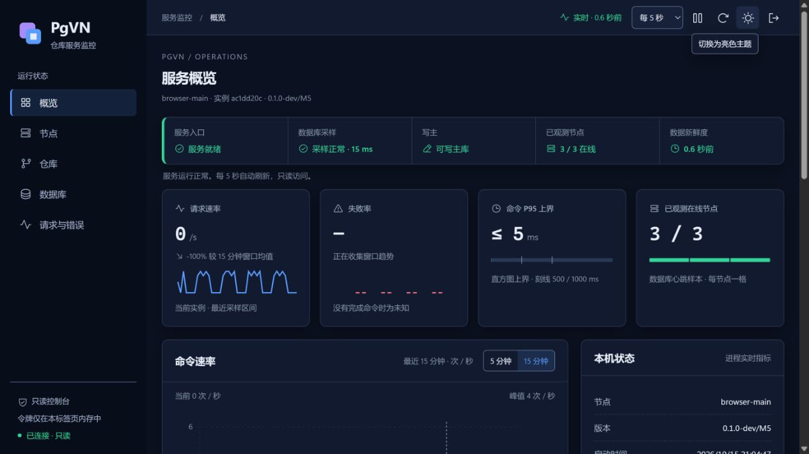
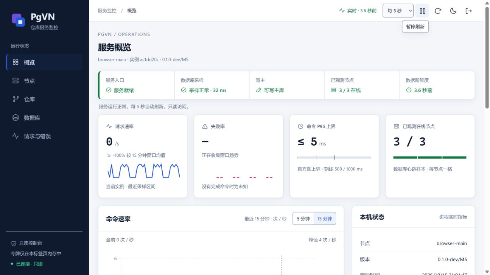

# M4 内置中文监控

本阶段交付 pgvnserve 内的只读监控：概览、节点、仓库搜索/分页/详情、数据库和请求错误页面，以及同源 API 和 Prometheus。静态 HTML/CSS/JavaScript 编译进 exe，运行无需 Node.js、前端服务、CDN 或每库目录。M4 完整门禁已通过，固定构建证据见 [M4 记录](evidence/m4.json)，当前整体范围见 [实施进展](progress.zh-CN.md)。Apache 工作进程接入为 M5；生产部署及 Polarion 应用验收为 M7。

## 配置与启动

先按 [M3 服务指南](M3-serve.zh-CN.md) 配置 SVN 账号、部署密钥、hooks 和服务账户。M4 必须显式提供独立监控读取连接；示例见 [服务配置](../../config/pgvnserve.example.ini)。

```ini
[pgvn]
connection = service=pgvn_service
monitor-connection = service=pgvn_monitor
credential-key-file = C:/PgVN/config/credentials-v1.key
identity-domain = pgvn
listen-host = 127.0.0.1
listen-port = 14690
node-id = svn-node-1
```

两个 libpq service 定义连接同一数据库，分别使用业务角色与只读监控角色。密码放入服务账户受保护的密码文件；不放在命令行、监控令牌或示例文件中。监控连接强制只读事务，若角色能读取账号密文或原始令牌表，采样拒绝继续并使 ready=503。写主检查与受控遥测发布使用另一条业务角色连接；两条监控连接均独立于业务连接额度，不给监控角色 pg_monitor 或 pg_read_all_stats 权限。

```powershell
.\pgvnserve.exe --config C:\PgVN\config\server.local.ini --monitor-url http://127.0.0.1:14691/
```

浏览器打开 `http://127.0.0.1:14691/monitor/`。监听目前仅支持回环 HTTP。低权限运行前，由安装账户预留 URL ACL，方法沿用 M3。远程展示需要另行配置受信 TLS 代理及访问范围；当前没有交付公网监听、证书安装或生产 HA 安装包。

## Schema 与访问令牌

控制 schema 为 5，存储 schema 仍为 1–4。迁移增加受限视图、活动事务索引、令牌摘要快照、节点及采样表和受控发布函数。迁移摘要编译进管理工具，已安装摘要不符会拒绝继续。

```powershell
.\pgvnadmin.exe --config C:\PgVN\admin\migration.local.ini db migrate
.\pgvnadmin.exe --config C:\PgVN\admin\migration.local.ini db grant --admin-role pgvn_admin --service-role pgvn_service --monitor-role pgvn_monitor
.\pgvnadmin.exe --config C:\PgVN\admin\admin.local.ini monitor-token create --label operations --expires-in 86400
```

创建只返回一次随机 256 bit 令牌，数据库保存 SHA-256。令牌具有 monitor:read 权限，只经 Authorization 请求头传递。页面不持久保存令牌，连接后清空输入，断开、撤销或重新加载后清除数据并要求认证。正常情况下撤销在下一次成功采样生效；数据库故障时，仅已缓存且未到期的令牌可以继续查看最后样本，离线缓存最长 15 分钟。有效令牌超过 1000 时清空认证缓存，拒绝沿用不完整的快照。

M3 二进制只认识 schema 4；本轮不声明 M3/M4 混跑兼容，也没有降级迁移。仅升级隔离库。生产升级、备份和回退演练留待 M6/M7。

## HTTP 与页面

公开探针只返回布尔状态。live 检查 HTTP 和最近 15 秒的服务主循环心跳，不访问数据库；ready 要求业务监听、可写主库、匹配的迁移摘要、启用仓库的路由与配置，以及不超过 15 秒的成功样本。数据库不可达时，静态页面和 live 继续工作；冷启动会有界重试，恢复后自动启动 SVN 服务。

| API | 参数与边界 |
| --- | --- |
| /api/monitor/v1/overview | 本机实时计数、资源及带时间戳的数据库摘要 |
| /api/monitor/v1/nodes | limit、cursor，节点实例与心跳；旧实例保留至遥测清理 |
| /api/monitor/v1/repos | limit、cursor、q；名称、ID、UUID 搜索，ASCII 忽略大小写，其余 UTF-8 按字面匹配 |
| /api/monitor/v1/repos/{id} | HEAD、配置、事务/锁有界摘要、最近 8 个修订及本机相关错误 |
| /api/monitor/v1/transactions、/locks | limit、cursor、repo；事务分页及每仓库 SVN 锁数量 |
| /api/monitor/v1/requests | 已完成的 SVN 顶层命令，按固定操作及结果分类 |
| /api/monitor/v1/events | limit、cursor、repo；200 条事件环中的分页，淘汰游标返回 409 |
| /api/monitor/v1/series | metric 白名单，window=60/300/900 秒，step=5/15/30/60 秒 |
| /metrics | 认证后的本进程 Prometheus counter、gauge、histogram；不重复汇总其他节点 |

分页默认 50、最大 200，集合快照最多 1000 项，截断明确标记。集合游标绑定采样编号；网页自动更新编号并保留页偏移，API 调用方遇到 409 需重新分页。q 最多 256 个 UTF-8 字节，只解码一次；未知、重复和非法查询参数返回 400。旧入口 /repositories、/trends 保持只读兼容。

series 白名单为 commands_per_second、error_percent、mean_latency_ms、cpu_percent、working_set_bytes、private_bytes、bytes_received、bytes_sent、sql_calls、sampler_ms。区间均值与累计值最后样本分别标记；没有观测值时返回 null。命令 P95 由耗时直方图给出上界，超过最大有限桶显示 >2000 ms，不声称精确分位数。

刷新可选 5/10/30/60 秒；隐藏标签至少 30 秒，同一轮请求不重叠。支持暂停、手动刷新、键盘导航和窄屏表格横向滚动。无样本、无结果、未授权、断连和过期均有文字提示。DB 不可达时，远端连接和配置数值显示未知；单个心跳超过 15 秒则失联。已确认正常停止的实例显示已停止。正常停止只在已有连接上尝试最多约 200 ms 的最终发布，发送失败时由其他节点按心跳失联判断。

## 指标与资源边界

SVN 完成命令、在途命令、错误、耗时，与监控 HTTP 请求分别计数。新发布 revision 和回执确认分开，响应丢失后的回执恢复不增加新修订。流量是 RA SVN socket 实际成功收发的字节，包含协议封装。SQL 调用包含结果、固定 SQLSTATE 类别及耗时桶；采样 SQL 独立计数，不混入业务调用。

打开写流、持久活动事务、SVN 锁分别显示。写流固定使用已有 FS 连接，其关闭不归还仍属于 FS 的租约。业务租约上限 32、SVN 会话上限 16；监控另用最多两条连接。同角色应用连接与锁等待为数据库快照，不声明能够读取其他角色的全部会话。

Windows CPU 时间、整机归一化 CPU 比例、工作集和私有提交由进程 API 采样，独立于数据库成功与否。错误只记录固定代码、操作、SQLSTATE 分类、仓库 ID 和请求关联 ID，不记录 SQL 参数、用户密码、锁 token 或原始错误全文。Prometheus 标签没有仓库、路径、用户名或自由文本。

| 限额 | 实现 |
| --- | --- |
| HTTP | 2 工作线程、队列 64、请求头 32 KiB；响应发送最多等待 5 秒，可取消并等待完成 |
| 后台采样 | 每 5 秒，连接超时 3 秒；SQL 1 秒、锁等待 500 ms、网络查询总等待 2 秒 |
| 缓存 | 每集合 1000 项；近期修订共 8000 项；原始 JSON 总预算 8 MiB，构建新快照后原子替换 |
| 本机历史 | 趋势最多 180 点且仅返回最近 15 分钟；事件环 200 条 |
| 共享遥测 | 最多 1000 节点，每实例每 5 秒最多一条；默认 24 小时，每次最多清理 2000 条样本和 20 个旧节点 |

由发布函数控制的 1000 节点在 24 小时内最多约 1728 万条采样；这是行数上界，不是容量建议。真实节点数与保留成本需测量后规划。直接用数据库所有者写表不受发布函数配额约束。清理与遥测写入失败只增加失败/丢弃批次，业务发布仍遵循原有事务语义。

## 验证与性能口径

完整入口为 `python tests/pgvn/run_gates.py --milestone M4`，包含同一冻结 Release 上的 M0–M3 回归、API/权限/撤销、独立 TCP 字节账本、重复提交回执及真实 COMMIT 应答丢失、冷启动恢复、LocalService 黑洞/慢响应停止、容量/保留/采样超时和浏览器证据。测试前后核对源码、内嵌资源、主产物及运行依赖摘要。浏览器用 `tests/pgvn/monitor_browser_fixture.py` 启动隔离环境，按其控制文件操作自己创建的节点和数据库，完成后停止并撤销一次性令牌。

容量组件实际插入 1000 个合成空仓库、接近 4 KiB 的节点样本、过期遥测及 1001 个有效令牌，并执行真实 SVN 提交。测量额外私有内存，验证 64 MiB 预算。短时 8 并发 CLI 读取按关闭/开启/关闭监控记录吞吐、P95、CPU 与内存；它包含客户端进程启动成本，不能作为服务容量或 5%/10% 性能预算达标结论。

M6 仍须完成固定种子的 XML/1 MiB/16 MiB/历史/复制/混合提交、1/8/32 并发、60 秒预热和 300 秒稳态、各三轮的关闭/开启/关闭对照。`--monitor-disabled` 同时关闭 HTTP、采样和进程遥测，仅供隔离基线测量；关闭浏览器页面不等于关闭监控。

## 重做浏览器验收

浏览器部分是实际界面检查，CLI 不会自行将其判为通过。在仓库根目录运行 `python tests/pgvn/monitor_browser_fixture.py`；它打印 URL、一次性令牌、session 和 control 路径，15 分钟后自动清理。用浏览器打开打印的 URL。令牌只用于该临时环境，不写入检查记录。

将检查结果保存为临时 JSON，例如 `runtime/pgvn/browser-checks.local.json`，含 checks 对象和 observations 文字。先用下表键名设为 false，逐项实测通过后改为 true；不得直接复制历史通过结果。

| checks 键 | 实测内容 |
| --- | --- |
| authentication | 无效令牌提示未授权；一次性有效令牌能连接 |
| all_views | 概览、节点、仓库、数据库、请求错误均成功加载 |
| repository_pagination | 53 个仓库显示 50/3 条；刷新保留末页 |
| repository_search | 中文名称搜索正确，无匹配时显示空状态 |
| repository_detail | 工程文档显示 r1/r0、一个事务、一个锁及相关错误 ID |
| text_only_hostile_name | 搜索 `<img`，名称保持文本，没有生成图片 |
| keyboard_focus_and_refresh | 键盘进入详情后焦点为 main；跳过导航保持视图；手动刷新保留按钮焦点 |
| configurable_refresh | 切换刷新周期后设置生效 |
| narrow_layout | 375×812 下整页不横向溢出，表格可独立滚动 |
| paused_refresh | 暂停后等待超过刷新周期，样本不变；手动刷新仍生效 |
| lost_peer_and_recovery | stop-peer 后超过 15 秒失联且数值未知；start-peer 后出现新实例 |
| stale_database_and_unknown_nodes | block-db 后样本超过 15 秒，节点状态及远端数值未知；restore-db 后恢复 |
| token_revocation_clears_data | revoke-token 后清空详情，焦点回到令牌输入 |
| reload_requires_token | 重新加载后仍需认证 |
| no_persistent_token | 页面源码不使用持久存储/URL 保存令牌，并核对重新加载行为 |

控制文件示例为 `{"sequence":1,"action":"stop-peer"}`；每次 sequence 递增，等待 session 中的 sequence/action 确认再执行依赖步骤。动作有 stop-peer、start-peer、block-db、restore-db、revoke-token、stop。完成后发送 stop，等待 fixture 退出、session.status=stopped，再保存证据。

以下 PowerShell 在仓库根目录执行。修改 session_path 与 notes_path 为本轮文件。它校验人工填写的结果和构建绑定，只负责记录，不能替代浏览器操作。

```powershell
@'
from pathlib import Path
import datetime as dt, hashlib, json, re, sys, uuid
root=Path.cwd(); sys.path.insert(0,str(root/'tests/pgvn'))
from test_m4 import BROWSER_CHECKS, build_identity
session_path=Path('runtime/pgvn/tests/本轮目录/browser-session.json')
notes_path=Path('runtime/pgvn/browser-checks.local.json')
state=json.loads(session_path.read_text(encoding='utf-8-sig'))
notes=json.loads(notes_path.read_text(encoding='utf-8-sig'))
assert state['status']=='stopped'
assert all(notes['checks'].get(k) is True for k in (*BROWSER_CHECKS,'authentication'))
assert not re.search(r'pgvn_[0-9a-f]{64}',json.dumps(notes))
manifest=build_identity()
assert state['pgvnserve_sha256']==manifest['products']['runtime/pgvn/bin/pgvnserve.exe']['sha256']
for name,value in state['assets'].items():
    assert hashlib.sha256((root/'web/pgvn-monitor'/name).read_bytes()).hexdigest()==value
result=dict(notes,test_id='m4-browser-'+uuid.uuid4().hex[:12],status='PASS',fixture_stopped=True,
    created_at=dt.datetime.now(dt.timezone.utc).isoformat(),pgvnserve_sha256=state['pgvnserve_sha256'],assets=state['assets'])
out=root/'artifacts/pgvn/tests'; out.mkdir(parents=True,exist_ok=True)
data=json.dumps(result,indent=2)+'\n'
(out/(result['test_id']+'.json')).write_text(data,encoding='utf-8')
(out/'m4-browser-latest.json').write_text(data,encoding='utf-8')
print(result['test_id'])
'@ | python -
```

再按 M3 指南设置测试 JDK/SVNKit 路径，执行 M4 完整门禁。门禁会拒绝缺失检查、未停止的 fixture、旧程序或旧页面的记录。原始结果保存在 artifacts/pgvn/tests；正式证据保留通过记录与完整构建身份。


## 本次固定构建结果

正式门禁 `m4-a9f0cf1bddb0` 的八组脚本与 15 项真实浏览器检查通过；其中 M0–M3 七组回归也重新运行。pgvnserve SHA-256 为 `f709702754af8c5bf685b7c3196e29d2e395bac53660aea190551e74050cd598`。

容量测量的额外私有内存为 7.43 MiB。短时 CLI 对照的吞吐损耗为 -1.79%，P95 增幅为 -4.64%，均相对前后关闭监控轮次的均值；原始三轮及限制写入证据。这不是 M6 的长窗口预算验收，不据此声明性能目标达标。


## 监控页面改版

M5 后续迭代已交付“夜航控制台”：默认跟随系统的明暗主题、五项健康摘要、KPI 趋势/容量条、图表键盘读数与 5/15 分钟窗口、固定表头、事件时间线、SQLSTATE/命令结果条形图及 DAV 工作进程三栏明细。≥1100px 为完整侧栏，760–1099px 为 64px 图标栏，更窄时为横向导航；移动端主要操作至少 44px。主题只保存在内存，重载后恢复系统偏好。

图表可聚焦后用左右方向键、Home、End 读取采样点，Esc 隐藏准线；下方原始数据表保持可用。切换窗口复用已取得的趋势样本。暂停只停止自动请求，本地新鲜度仍继续计时；过期与未知使用文字和图标表达。节点列表只对当前页按状态排序，实例重启前的旧心跳记录仍保留到遥测清理。

完整 M4 回归 `m4-297b2d21dc76` 八组及双主题真实浏览器 15 项、DAV 页面 6 项通过；高对比度的实际 Windows 视觉检查仍待补。实施取舍和手动边界见 [改版计划及实测](../plans/2026-10-15-pgvn-monitor-redesign.zh-CN.md)，固定构建和资源摘要见 [改版证据](evidence/m4-monitor-redesign.json)。本指南原 M4 schema 段落为历史验收快照；当前控制 schema 6 的部署配置见 [M5 DAV 指南](M5-DAV.zh-CN.md)。




