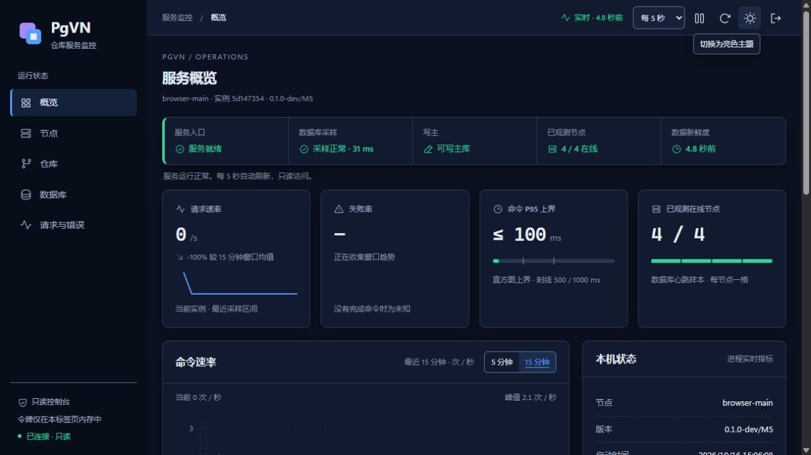
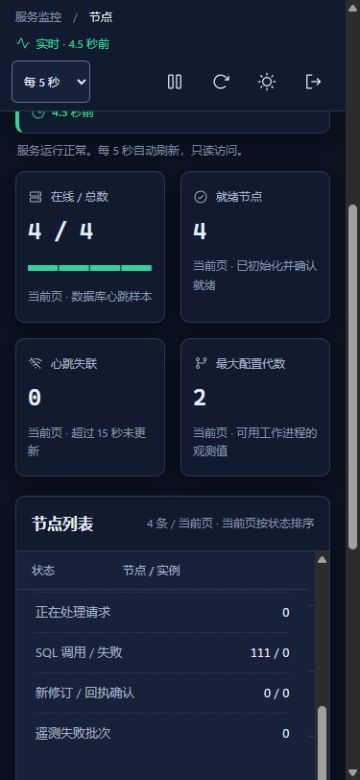

# M6 原版 commit/update：三协议本机验证

日期：2026-10-16。原版 `commit_tests` 1–74 与 `update_tests` 1–86 在 SVN、HTTP、HTTPS 上完成原版 FSFS 对照。PGVN-601、M6、M7 仍未完成；完整记录见[组件证据](evidence/m6-network-commit-update.json)。

## 可复现入口

```powershell
python scripts/pgvn/build.py --config config/build.local.json --configuration Release
python scripts/pgvn/build_upstream_network.py
python scripts/pgvn/build_upstream_helpers.py
python scripts/pgvn/build_upstream_http.py
python tests/pgvn/test_m6_hook_output.py
python tests/pgvn/test_m6_network_policy.py
$run = python tests/pgvn/test_m6_network.py --plan --protocol svn --suite commit_tests --cases 1:74 | ConvertFrom-Json
python tests/pgvn/test_m6_network.py --execute-plan $run.plan
# update_tests 使用 --cases 1:86；HTTP/HTTPS 分别生成新的 --protocol http/https 计划。
```

仅在已授权的 `127.0.0.1:16432` 专用集群及本仓库 runtime 执行。每轮新建 `pgvn_m6_net_<12位十六进制>` 库及非超级用户所有者；已执行计划不能复用，输入改变后须重新生成。固定输入与夹具总体边界见[网络入口指南](M6-upstream-network.zh-CN.md)。

## 全量结果

| 原版套件 | 传输 | 冻结运行 | PgVN 与 FSFS 各侧结果 |
| --- | --- | --- | --- |
| commit 1–74 | SVN | `m6-network-b91e5bba4a50` | 71 PASS、2 原有 XFAIL、1 原有 SKIP |
| commit 1–74 | HTTP | `m6-network-47d17fb27104` | 71 PASS、2 原有 XFAIL、1 原有 SKIP |
| commit 1–74 | HTTPS | `m6-network-7ae77f7e61d4` | 71 PASS、2 原有 XFAIL、1 原有 SKIP |
| update 1–86 | SVN | `m6-network-ca111cc90999` | 84 PASS、2 原有 XFAIL |
| update 1–86 | HTTP | `m6-network-7f4836c0a227` | 84 PASS、2 原有 XFAIL |
| update 1–86 | HTTPS | `m6-network-12755c5133cc` | 84 PASS、2 原有 XFAIL |

六轮全量共 960 个原用例结果、954 次实际进入用例（含两侧、三协议及原有 XFAIL，不含 SKIP）。commit 的原有 SKIP 为 36（`tab_test`），XFAIL 为 66、74；update 的原有 XFAIL 为 81、85。原函数、断言、装饰器和选择列表保持不变，没有新增排除；六轮定点修复确认不重复计入覆盖。另将原有 XFAIL 的异常与输出诊断在两侧逐项比较，仅消除测试工作目录差异后也一致；这项事后审计不参与修改命令输出或断言。

HTTPS 使用隔离的短期 CA，验证证书链、主机名以及拒绝未知 CA/错误主机名，没有机器信任库修改或证书例外缓存。原生仓库的全部声明别名均检查不存在。

## 从失败到修复

首轮 commit 在三协议各有 5 项额外失败（15、38、53、54、58）。原版 FSFS 各为 71 PASS/2 XFAIL/1 SKIP；PgVN 各为 66 PASS/5 FAIL/2 XFAIL/1 SKIP。首轮 update 的 SVN 已与对照一致；HTTP/HTTPS 各在 76 额外失败。原始报告、日志、源码和二进制都保留在不可覆盖的基线归档中。

生产修复有两处：

- hook 非零退出采用标准 SVN 的动作、hook 名称、退出码和有/无输出后缀，保留调用方需要显示的诊断。既有输出上限、非文本处理、超时、取消和 Job 生命周期保持不变。
- DAV 创建事务时保留 `SVN_ERR_REPOS_HOOK_FAILURE` 对应的公开文本并返回 HTTP 500。只复制该类型的单个原因，清理阶段的其他错误不会带入客户端响应；数据库故障继续脱敏。第一处修复后的定点测试还曾在 HTTP/HTTPS 的 53 失败，明确暴露了这一层覆盖，原始 FAIL 也保留。

与上轮授权组件相比，`pgvnserve`、`pgvnadmin` 和 `mod_dav_pgvn` 发生变化；`mod_authz_pgvn`、`pgvnhttpd` 和三个网页资源未变。

## 夹具边界

原用例的 Python hook 在仓库别名下读写 `hooks.log`，PgVN 没有该物理目录。夹具仅把已登记原生仓库的这一个临时文件移到全局测试输出目录，保留原 Python hook 正文、原 argv 和原断言，每次 open/exists/unlink 都记录审计事件。其他文件、未知仓库、错误 UUID、错误根目录或已物化的别名不会得到这项映射。10 项离线边界检查通过，未连接数据库或启动子进程。

Windows update 76 为了构造含反斜杠的仓库路径，原版 HTTP 夹具先通过本地 `file://` 执行 `svnmucc`。PgVN 夹具将精确已登记别名、默认可写策略且没有 hook 的这一步准备写入，交给同一数据库、身份域和凭据的额外回环 SVN 服务。写入真实 PgVN 数据；原测试中的 HTTP/HTTPS 更新命令、地址和预期输出照常执行。这个服务仅用于测试准备，不进入生产部署。

SVN 每轮 4 个自有 Job，HTTP/HTTPS 每轮 5 个；六轮全量及六轮定点各共 28 个 Job，结束后全部活跃进程为 0。M6 网络组件不创建监控令牌或 Windows 服务，隔离库、所有者及数据保留供诊断。额外的策略夹具 11 项离线检查也通过。

## 匹配构建的回归

冻结清单：`8f094d1e6502bc53fd099e989b8b004e3b236a8ef101e892bbd1cb9d7dd5faa5`。构建基于 `964145d`，包含当时工作区中的修复；按源码与产品摘要冻结并在提交前验证，是开发构建。

新的真实浏览器记录为 `m4-browser-commit-update-fefee7587bd7`（15 项）及 `m5-browser-commit-update-fefee7587bd7`（6 项），均绑定本次产品和网页摘要。检查包含五个视图、分页/搜索/详情、恶意名称文本化、暂停与刷新周期、窄屏、两个 DAV 详情的自动刷新/焦点保持、节点失联/新实例、数据库过期/未知/恢复、重载清空认证及撤销后清空数据并将焦点移回令牌框。桌面及 375×812 窄屏截图实际导出，图片摘要在证据与归档内；不是高对比度验收。

<details>
<summary>本轮实际浏览器截图（隔离测试数据）</summary>





</details>

完整 M5 `m5-d2be426ed5d1` 的 10 组及其内含 M0–M4 全部通过；耗时 600.047 秒。真实数据库故障仍返回 503 并能恢复至 200。短期浏览器令牌及本轮门禁令牌均已撤销，临时服务及自有进程已清理，数据库保留。

已同步生成开发部署包 `PgVN-M5-windows-x64-7ed4abd2a273bd16.zip`（23,318,581 字节），SHA-256 为 `3012be2033240378287233037e3cb9c13ae9c36399ba7b41e142319bca19f526`。203 个包文件及 ZIP 内 205 个条目全部核对，五个生产产品与本轮冻结构建一致；95 个原生镜像通过 x64 位数检查；三个主入口、svn 和 pg_dump 通过清空 PATH 后的版本启动检查。包仍标记为 `development-snapshot`，并未执行新的干净机器安装或 Polarion 验收。

以上为本机固定构建的兼容性与故障回归。部分网络用例与独立监控夹具并发执行，耗时仅用于诊断，不代表吞吐、延迟或监控开销基准。

本组件不完成 PGVN-601、M6 或 M7。其余套件与完整适用性、全部维护语义、最终产品上的早期套件/真实历史/备份复核、跨故障域与确认账本、持续性能及独立 Windows/Polarion 验收继续推进。较早基本命令/授权结果仍绑定原构建；Windows hook 的 `cmd_alternative` 仍未由 Python hook 桥执行。
