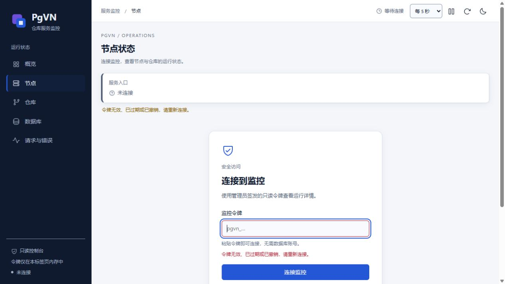

# M6 原版 copy/prop：三协议本机验证

日期：2026-10-16。原版 `copy_tests` 1–118 与 `prop_tests` 1–46 在 SVN、HTTP、HTTPS 上完成原版 FSFS 对照。完整 M5 与浏览器证据绑定同一冻结构建；PGVN-601、M6、M7 仍未完成，见[结构化证据](evidence/m6-network-copy-prop.json)。

## 可复现入口

```powershell
python scripts/pgvn/build.py --config config/build.local.json --configuration Release
python scripts/pgvn/build_upstream_network.py
python scripts/pgvn/build_upstream_helpers.py
python scripts/pgvn/build_upstream_http.py
python tests/pgvn/test_m6_network_copy.py
python tests/pgvn/test_m6_hook_output.py
python tests/pgvn/test_m6_network_policy.py
$copy = python tests/pgvn/test_m6_network.py --plan --protocol svn --suite copy_tests --cases 1:118 | ConvertFrom-Json
python tests/pgvn/test_m6_network.py --execute-plan $copy.plan
$props = python tests/pgvn/test_m6_network.py --plan --protocol svn --suite prop_tests --cases 1:46 | ConvertFrom-Json
python tests/pgvn/test_m6_network.py --execute-plan $props.plan
# HTTP/HTTPS 各生成新的 --protocol http/https 计划；已执行计划不能复用。
```

仅在获批的 `127.0.0.1:16432` 专用集群和本仓库 runtime 中执行；每轮新建 `pgvn_m6_net_<12位十六进制>` 及对应非超级用户所有者。输入变化后重新生成计划。客户端、辅助工具和原版 Python 快照均固定来源；原断言、装饰器和测试列表保持不变，入口边界见[网络指南](M6-upstream-network.zh-CN.md)。

## 全量结果

| 原版套件 | 传输 | 冻结运行 | PgVN 与 FSFS 各侧结果 |
| --- | --- | --- | --- |
| copy 1–118 | SVN | `m6-network-de4b15a7a393` | 116 PASS、1 原有 SKIP、1 原有 XFAIL |
| copy 1–118 | HTTP | `m6-network-38c82e3523a5` | 116 PASS、1 原有 SKIP、1 原有 XFAIL |
| copy 1–118 | HTTPS | `m6-network-ee27f1d686c3` | 116 PASS、1 原有 SKIP、1 原有 XFAIL |
| prop 1–46 | SVN | `m6-network-e1baeb913bb0` | 45 PASS、1 原有 SKIP |
| prop 1–46 | HTTP | `m6-network-a41ccd4d5711` | 45 PASS、1 原有 SKIP |
| prop 1–46 | HTTPS | `m6-network-671195c95bad` | 45 PASS、1 原有 SKIP |

共 984 个结果、972 次实际进入（两侧、三协议，包含原有 XFAIL，不含 SKIP）；唯一原测试函数为 164 个，每侧每协议实际进入 162 个。原有 SKIP 为 copy 10 `copy_preserve_executable_bit` 和 prop 23 `perms_on_symlink`，均要求 POSIX；copy 105 `copy_and_move_conflicts` 为原有 XFAIL（Issue 3899）。没有新增排除。原有 XFAIL 的诊断仅消除工作目录差异后与 FSFS 一致；比较发生在运行后，不修改命令输出。

HTTPS 验证证书链与主机名，拒绝未知 CA 和错误主机名，例外缓存为空，未改变机器信任库。全部原生仓库声明别名和克隆别名均检查未生成本地目录。SVN 每轮 4 个 Job、HTTP/HTTPS 每轮 5 个，六轮共 28 个，最终活跃进程均为 0。网络组件不创建监控令牌或 Windows 服务，数据库、所有者和测试数据保留。

## 原始失败与修复

首轮三协议 copy 均仅在 114 `copy_relocate` 额外失败：原用例用 `shutil.copytree` 准备物理仓库副本，PgVN 的仓库别名不对应本地目录。三协议 prop 均仅在 12 `revprop_change` 额外失败：拒绝缺少显式 revprop hook 的行为与错误码正确，但诊断未包含原断言要求的 `pre-revprop-change` 名称。初始报告、日志、源码和二进制均已冻结保留。

生产变更只补全 revprop 拒绝消息中的 hook 名称，保留 `SVN_ERR_REPOS_DISABLED_FEATURE` 和原策略行为。复制准备由严格约束的测试夹具完成：

- 仅接受已登记源、显式声明目标、同一原生仓库挂载父目录、默认策略，且两侧别名均不存在；核对单次运行计划、数据库名、所有者、端口、数据目录和构建摘要。
- 通过生产 `maintenance hotcopy` 创建目标，不直接复制数据库表、不构造虚假命令输出。目标具有独立内部 ID，同一公开 UUID、同一 HEAD；目标初始禁用并完成完整 verify 后配置并启用。
- 本轮 copy 114 每次克隆的 HEAD 为 r1，完整校验 r0–r1 共两修订，随后原版 relocate 与后续断言正常执行。普通工作副本的 `copytree` 不改变。
- 13 项复制边界、10 项 hook 输出边界及 11 项策略边界离线检查通过；这 34 项检查不连接数据库，也不启动子进程。

## 监控输入清理与完整浏览器验收

完整浏览器流程发现：重载后再连接、从 DAV 详情内撤销令牌时，数据和焦点正确恢复，但密码输入框仍显示自动填充内容。仅在断开入口清空 `value` 的候选曾通过定点 smoke，却在完整流程再次失败；原始 FAIL、定点结果与未完成会话分开保存，没有将其提升为最终验收。

最终修复保留早期清空，并在显示登录表单和恢复焦点后调用原生表单 `reset()`，清理该次输入的自动填充状态，不阻止粘贴和键盘输入。最终真实浏览器完成 15 项 M4 与 6 项 DAV 检查，另验证了重载后手动断开。在完整故障/恢复/重载流程后，自动撤销前后均观察到输入为空、占位符显示、自动填充标记为 false、数据清空且焦点为令牌框；AX 观察前后结果一致。这里只据布尔状态和实际截图判定，不将工具返回的密码长度当作真实令牌长度。

浏览器记录为 `m4-browser-copy-prop-539cd1eb81fe` 和 `m5-browser-copy-prop-539cd1eb81fe`。检查覆盖五视图、50/3 分页、匹配/无匹配/恶意名称搜索、仓库 r1/r0/配置/事务/锁、两个 DAV 工作进程的方法计数及 403 请求 ID、真实采样时间更新后的焦点和展开保持、375×812 窄屏、暂停与刷新周期、节点失联/新实例、数据库过期/未知/恢复及重载认证。数据库故障仅阻断本次浏览器数据库。

<details>
<summary>本轮真实页面截图（隔离测试数据）</summary>




</details>

## 匹配构建的完整回归与部署包

冻结清单为 `dff1a26e649812903ce70f054fadc37a149ab9baa6424c419c21f4fe6e5dc7af`，151 项本仓库源码/网页/SQL/构建测试输入；基于 `a38611f` 加当时工作区修复，以源码和产物摘要冻结。相较上一已验收组件，`pgvnserve`、`pgvnadmin`、`mod_dav_pgvn` 变化，授权模块和 Apache 宿主不变；没有 schema 迁移。

完整 M5 `m5-279992c5cea3` 的 10 组通过，耗时 560.437 秒；其中 M4 `m4-32a12d8202c5` 八组、M3 `m3-27a08f1333ea` 七组通过。真实数据库故障仍返回 503 并恢复至 200。全部网络测试进程停止后才执行会中断专用集群的完整门禁，没有与网络回归交叠。

门禁 22 个隔离库的 7 枚令牌均已撤销，本组件五次浏览器夹具的五枚令牌也均再次只读核对为已撤销。自有运行进程与临时 Windows 服务均为 0；隔离库和角色保留。各次原始 FAIL、修复定点、未完成会话与最终 PASS 的构建身份及归档摘要见结构化证据。

开发部署包为 `PgVN-M5-windows-x64-789ce2453389afee.zip`，23,415,025 字节，SHA-256 为 `417dadaf9c9d8742ee3d280e81574c7f0f8c8176e8b460868812e419569c6f10`。独立比对 207 个负载文件、209 个 ZIP 条目（含清单及其摘要）、95 个 x64 原生镜像及五个生产产物；主入口、svn、pg_dump 通过清空 PATH 版本启动。初版独立检查器遗漏清单摘要 sidecar，已保留并修正期望集合，包的字节没有修改。包仍为 `development-snapshot`，未声称干净机器或 Polarion 验收。

本轮网络运行与独立浏览器夹具存在并发；执行耗时仅作功能诊断，不作为吞吐、延迟或监控开销基准。实际 Windows 高对比度视觉仍待补验。

## 剩余出口

继续完成其余原版套件、完整适用性台账、最终产品的早期套件复跑、维护语义和固定 638 修订/30 表备份恢复复核；之后完成确认提交账本、跨故障域主备/fencing、代表性持续性能与监控预算，以及独立 Windows 安装重启和 Polarion 隔离验收。上述项目未据本组件结果提前勾选。
