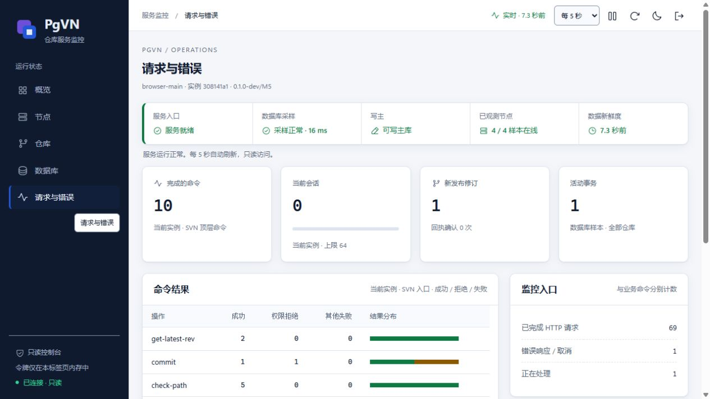
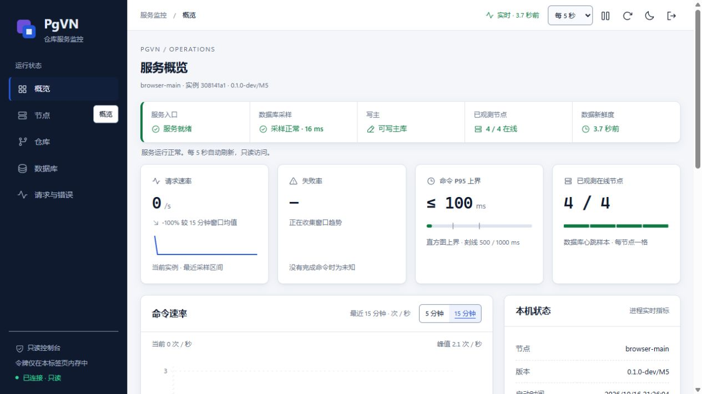

# M6 仓库工作流、SVN 接纳容量与监控一致性

日期：2026-10-16。本组件验证 checkout、export、import、cat、blame、history、info 的网络适用范围，并修复原版冲突合并暴露的 SVN 会话容量问题。结果见[结构化证据](evidence/m6-network-workflows.json)；PGVN-601、M6、M7 仍未完成。

## 原版用例与适用性

| 原版套件 / 范围 | SVN | HTTP | HTTPS |
| --- | --- | --- | --- |
| checkout 1–13 | 13 PASS (`b605936379d8`) | 13 PASS (`2971b05ad763`) | 13 PASS (`57f9f4d15f5e`) |
| export 1–31 | 30 PASS / 1 XFAIL (`bb41c7140caf`) | 30 PASS / 1 XFAIL (`f3a484e0d561`) | 30 PASS / 1 XFAIL (`8a53982b378c`) |
| import 1–7 | 6 PASS / 1 SKIP (`ee705fe7e4ad`) | 6 PASS / 1 SKIP (`91aa538a30d0`) | 6 PASS / 1 SKIP (`832deb6d86b9`) |
| cat 1–9 | 9 PASS (`fc81c33031aa`) | 9 PASS (`da72363ffcc0`) | 9 PASS (`157cfd38aa82`) |
| blame 1–19 | 18 PASS / 1 XFAIL (`f68468a5eee4`) | 18 PASS / 1 XFAIL (`cc0cc5d90b16`) | 18 PASS / 1 XFAIL (`06c4087005cb`) |
| history 1–2 | 2 PASS (`8663b8dcc583`) | 2 PASS (`1ce7a37db0be`) | 2 PASS (`ba79c9edc855`) |
| info 1–21 | 21 PASS (`caafa2dfc4ff`) | 21 PASS (`bf5e8177cae4`) | 21 PASS (`724db0d0482c`) |

表中每项均包含 FSFS 与原生 PgVN 两侧。共 612 个原版结果，其中 606 次实际进入用例（包括原有 XFAIL、不包括 SKIP）；102 个唯一被选函数，每侧每协议实际进入 101 个。七份源码静态共 103 个函数，checkout14 的本地文件边界单独记录。

export 11、blame 15 为原版 XFAIL，import 1 为 Windows 上原有的 POSIX 条件 SKIP。原函数、装饰器、test_list、客户端输出和预期断言均未修改。六组完整套件及 checkout 的 13 项网络用例均保留 FSFS 对照；不能将这项结果描述为七组原版套件所有分支都已通过。

checkout 14 `checkout_wc_from_drive` 是单独记录的本地文件提供器边界：它将 `sbox.repo_dir` 用 SUBST 映射成盘符，三个实际断言的源 URL 分别为 `file:///盘符:/`、`/A`、`/A/D`，不使用配置的 SVN/HTTP/HTTPS URL。首轮原版 FSFS 为 14 PASS，原生 PgVN 为 13 PASS、该项 FAIL；缺失仓库别名、原始错误与清理记录均保留。该项没有被改写成 SKIP 或 PASS，也没有用临时 FSFS 伪装成原生仓库。

PgVN 的原生服务按数据库 ID/路由打开仓库，没有可映射为盘符的每库目录；传统 PgFS `file://` 入口也不等于 PgVN 策略入口。后续三协议网络选择明确为 checkout 1–13；内容与工作副本行为由这些原用例验证，仓库别名缺失由入口前后检查验证。这不认证 checkout 14 的本地文件提供器行为。该判定绑定固定源码摘要、具体调用位置及真实首轮结果，其他用例不据此自动排除。

## 发现与修复

首轮 info 1–21 在 SVN 下为 FSFS 21 PASS、PgVN 20 PASS/1 FAIL；单独复现 21 仍失败，HTTP 的原版完整套件通过。失败发生在构造文本、属性及树冲突的合并过程中，客户端报告连接意外关闭。

旧监听器固定为 16 个会话。独立诊断保持 17 个连接，只收到 16 份协议欢迎消息。修复后，原版 info 21 在三协议两侧均通过。另一次只读 TCP/数据库诊断在 `d428` 历史候选中记录到至少 18 个同时连接；它与最终候选的协议复测分别绑定各自构建，不将该计数表述为最终构建测量。观察只统计连接，不改写请求、程序或断言；诊断不计入原版用例数量。

新增配置：

```ini
[pgvn]
max-connections = 64
```

缺省为 64，可设为 1–64；配置在数据库初始化前校验，修改后重启节点生效。接纳、停止排空和取消均使用该上限；上限与 Windows 单次等待的句柄边界一致。超过上限的新连接被关闭，已接纳会话继续运行；释放后可重新接纳。它限制协议连接，同一客户端可能保持多个连接，不能据此承诺 64 个客户端或吞吐水平。

实际接纳诊断分别观察到配置 64 时接纳 64、拒绝第 65 个，配置 2 时接纳 2、拒绝第 3 个。新增 M3 检查还覆盖缺省 64、显式 1/2、释放后的认证命令、七类非法配置，以及 64 个空闲会话下 LocalService 的正常排空、SCM 进度和同端口重启。完整结果以本轮匹配构建的 M5 门禁为准。

### 网页与实际容量

首轮监听修复后的浏览器检查发现网页仍写死“上限 16”；该次浏览器记录明确保留为 FAIL，夹具停止且临时令牌撤销，未将未执行的页面检查记为通过。

监听器现只在成功启动后发布实际生效的 `sessions_limit`，停止后清空。实时 API、节点心跳及 Prometheus `pgvn_sessions_limit` 使用该值；缺失时返回 `null` 或省略指标样本，网页显示未知并隐藏无依据的比例条。会话预警按实际容量的 75% 判断，满额显示危险状态；数据库业务连接租约上限单独计量。

真实 API 集成检查核对默认 64、显式 2，及配置文件改为 8 后的行为：未重启的实例仍报告并执行上限 2，重启后的新实例报告并执行上限 8，API、Prometheus 和节点心跳一致。各值均以实际协议欢迎消息和额外连接拒绝验证，原有字节/SQL 独立账本和完整仓库校验继续通过。

### 外层进程 Job 的自然排空

新候选首轮网络队列的一组原版断言为两侧 21 PASS，但驱动退出瞬间外层 Job 计数为 1，随后被清理。原队列保持 FAIL，该组未用于最终接纳结果；以新隔离库完整重跑该组，并继续执行此前未开始的计划，已通过且正常关闭的七组保留。

独立诊断只运行 100 个自有空 Python 进程：均观察到驱动退出后计数短暂非零，并在 16 毫秒内自然归零；诊断不访问数据库或启动 SVN，也不能追溯确定首轮那一组的残留 PID。Windows 的计数语义见[微软说明](https://learn.microsoft.com/windows/win32/api/winnt/ns-winnt-jobobject_basic_accounting_information)。后续队列增加最多 5 秒的自然排空观察并记录 PID；关闭 Job 前仍须计数为 0，超时仍失败，不把强制清理后的 0 作为正常退出通过。

最终 21 组结果由两阶段已通过的独立执行及真实调度日志核对产生；首轮 FAIL、被排除尝试、替代计划及诊断均单独归档，没有改写原版断言或重启已执行计划。

## 冻结构建与完整回归

冻结清单 `fb66ece247011e7940fdbd991a09397786b04c906204c5587051498ef6387611` 含 154 项输入。匹配此构建的浏览器 15 项监控和 6 项 DAV 检查通过；默认实例网页显示上限 64，显式配置实例显示上限 2。完整 M5 `m5-ba210e325efc` 十组通过，耗时 587.594 秒，其中 M4 `m4-d4c29065dec3` 八组及 M0–M3 回归全部通过。64 个空闲会话的 LocalService 正常排空为 12.250 秒，SCM 进度与重启检查通过。





截图为隔离测试数据；窄屏节点页见[原始截图](images/m6-workflows-nodes.jpg)，宽表格可在自身容器内滚动，截图数值不作为性能基准。

原版 XFAIL 的完整预期/实际输出与异常只精确归一各自工作目录及已记录的监听地址后比较；原始客户端输出和断言不变。HTTPS 使用私有 CA 验证证书链与主机名，拒绝未知 CA 和错误主机名；没有改变机器信任库。所有原生仓库别名均未生成本地目录。

最终接纳的网络运行关闭 98 个内层 Job、21 个外层 Job；定点运行另关闭 14 个内层及 3 个外层 Job，未接纳尝试的 4 个内层及 1 个外层 Job 也已清理。浏览器夹具已停止、令牌已撤销；本轮完整门禁结束后撤销 5 枚尚未撤销的测试监控令牌，剩余为 0。最终只读检查确认 PgVN runtime 进程及临时服务均为 0；测试库、角色与诊断记录保留。

## 可复现入口

以下命令只用于已获批的 `127.0.0.1:16432` 专用集群和本仓库 runtime。每个执行计划使用新的 `pgvn_m6_net_<12位十六进制>` 数据库及非超级用户所有者，已执行计划不得复用。

```powershell
python scripts/pgvn/build.py --config config/build.local.json --configuration Release
python scripts/pgvn/build_upstream_network.py
python scripts/pgvn/build_upstream_helpers.py
python scripts/pgvn/build_upstream_http.py
$run = python tests/pgvn/test_m6_network.py --plan --protocol svn --suite info_tests --cases 1:21 | ConvertFrom-Json
python tests/pgvn/test_m6_network.py --execute-plan $run.plan
# 其余套件与 HTTP/HTTPS 各生成全新计划。
# checkout 网络范围为 1:13；14 的 file:// 边界和原始 FAIL 单独记录。
```

浏览器验证须先针对同一二进制完成 15 项监控和 6 项 DAV 页面观察，停止夹具并撤销令牌，再运行：

```powershell
$env:PGVN_TEST_JAVA_HOME = 'C:\Program Files\Eclipse Adoptium\jdk-21.0.11.10-hotspot'
$env:PGVN_TEST_SVNKIT_PLUGINS = 'C:\Polarion\polarion\plugins'
python tests/pgvn/run_gates.py --milestone M5
```

上述 SDK 路径来自本机验证环境，其他开发机应配置自己的只读 SDK 路径。部署使用完整离线运行包，不需要 Java/Python 构建环境。

## 归档与部署包

- network：`runtime/pgvn/baselines/m6-repo-workflows-effective-full-724db0d0482c`，索引 `c3265024c5e20d6f2252783138757003b18f6e3b4e48579c76428b079bf33bfa`，683 个文件。
- target：`runtime/pgvn/baselines/m6-repo-workflows-effective-target-310f1379d00b`，索引 `c09c4dc4eeade10f4e70da96dcad8e5966ed14ea568bb3308eb5683bf3017237`，323 个文件。
- first_phase：`runtime/pgvn/baselines/m6-repo-workflows-effective-first-2971b05ad763`，索引 `5b13a7cef3e95706de3df4ca3e9c46362571cc9136c43cafeb4a730f1740bdd1`，382 个文件。
- browser：`runtime/pgvn/baselines/m6-repo-workflows-browser-1c96e7bd0640`，索引 `5fab42f28a93d4f2bf97f3637f63d3f83c43cf05969d846872b247872a061204`，14 个文件。

开发包完整性、95 个 x64 镜像及最小 PATH 启动检查见[包旁记录](evidence/m7-package-workflows.json)，该记录随 ZIP 单独提供。包状态仍为 `development-snapshot`，不宣告独立机器或 Polarion 应用验收。并发运行的网络套件耗时只作为功能诊断，不作为性能基准。

## 剩余范围

其余原版套件和完整适用性台账、最终产品上的早期套件复跑、维护语义、固定 638 修订/30 表备份恢复复核、确认提交账本、跨故障域主备与 fencing、代表性持续性能及监控预算继续推进。实际 Windows 高对比度视觉、独立 Windows 安装重启和 Polarion 隔离验收也仍待完成。
