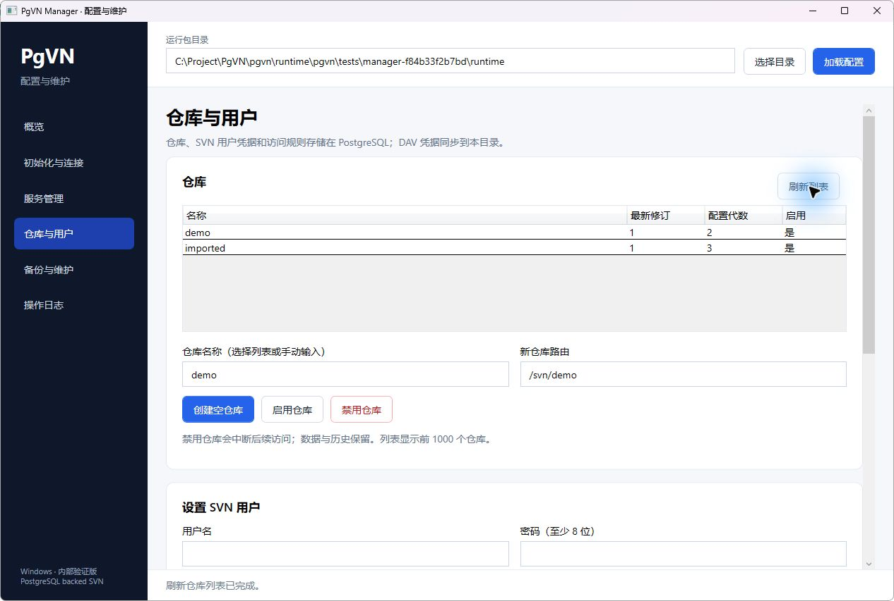

# PgVN Manager 本机验证记录

日期：2026-10-17。版本：`0.1.0-internal`，Windows x64 / WPF / .NET Framework 4.8。

本轮交付可用于内部隔离验证。验证对象是新增 Manager 及其调用的部署流程；未重新执行原生 PgVN 的完整 M5 / M6 门禁，也未完成全新 Windows 机器、重启或 Polarion 应用接入验收。

## 交付与使用

- 源码和使用指南：[tools/pgvn-manager](../../tools/pgvn-manager/README.zh-CN.md)。
- 本机可执行文件：`runtime/pgvn-manager/PgVNManager.exe`。需保留同目录的后台脚本、配置和说明文件，不能只复制 exe。
- GUI 附加包：`runtime/pgvn-manager.zip`，适合已有完整 PgVN 运行包的部署。
- 本轮验证的完整组合包：`runtime/pgvn-manager-bundle-9dce96de.zip`，解压后运行 `manager/PgVNManager.exe`，程序自动识别运行包根目录。
- ZIP 旁的 `.sha256` 为传输完整性检查；不等于发布者签名。运行包与 Manager 各自保留独立清单。

本版本连接已经安装的 PostgreSQL，可以创建新的专用数据库和五个非超级用户角色，初始化 PgVN、修改当前部署连接的 SSL / CA 和监听端口，安装及启停 PgVN / DAV 服务，管理仓库、用户及访问规则，校验历史、导入导出和备份。PostgreSQL 服务安装、`pg_hba.conf`、防火墙、对外 TLS 与完整恢复继续使用部署指南。

## 验证结果

| 范围 | 结果与证据 |
| --- | --- |
| 构建 | 系统 C# 编译器构建成功，警告视为错误，无额外 SDK / NuGet 下载。源码及产物摘要见 [Manager 清单](../../tools/pgvn-manager/evidence/manager-manifest-2026-10-17.json)。 |
| 基础回归 | `Test-PgVNManager.ps1` 通过：实际 C# 后台协议、运行包身份、错误目标与操作白名单、继承模块路径隔离、公共脚本在执行前的摘要检查、嵌入 WPF XAML、真实 Windows 参数解析（空值、空格、引号、末尾反斜杠及中文）。 |
| 隔离集成 | `Test-PgVNManager.Integration.ps1` 最终构建通过，编号 `ff6a4126f04d`。使用 `127.0.0.1:16432` 和新库 `pgvn_m6_net_ff6a4126f04d`。完整结果见 [集成报告](../../tools/pgvn-manager/evidence/integration-2026-10-17.json)。 |
| 桌面实测 | 最终 exe 已启动，六个页面完成显示核对；加载已初始化的隔离目录，正确显示两项服务、两个真实仓库及修订号；读取当前访问规则和 Apache 日志成功，操作结束后控件恢复可用。见 [UI 记录](../../tools/pgvn-manager/evidence/ui-2026-10-17.json)。 |

集成测试覆盖新库及角色创建、最小权限检查、重复创建拒绝、续建不覆盖密钥、配置保存保留密码文件、服务安装 / 启动 / 重启 / 停止 / 卸载、实际 SVN r1 提交与 DAV 读取、两次用户密码及 DAV 更新、访问规则校验和过期代数拒绝、仓库启停、历史校验、dump / load、完整备份和日志读取。导入只允许空仓库，并验证导入后保持禁用；导出拒绝覆盖已有文件。

最终集成报告中 `failure` 和 `cleanup_failure` 均为空。临时 Windows 服务已清理，隔离数据库及角色保留供诊断；没有创建监控令牌，没有重启 PostgreSQL。桌面实测复用了此前成功测试的隔离目录 `manager-f84b33f2b7bd/runtime`，仅进行读取和页面导航。

实测期间发现并修复了 Windows 原生密码输入的 CRLF、Windows PowerShell 5.1 的原子替换空值、从 PowerShell 7 启动时的模块路径继承，以及 JSON 数组在 .NET `ArrayList` 与 CLR 数组间的差异。此前失败构建不作为交付依据，最终完整回归与桌面实测对应下列摘要。

## 交付摘要（SHA-256）

| 文件 | SHA-256 |
| --- | --- |
| `PgVNManager.exe` | `9f03870b387ef5839b88b8765ab75aec8c32a99de75eb901ba895cbcafd25c45` |
| `Invoke-PgVNManager.ps1` | `15bc8f2e1697cce4f0c728ded194112bc875c4b5dd1c9fc1e45773665587a077` |
| `manager-manifest.json` | `843b8cb87f7cb213e634e7058648b0cfe630a95eb49ee128cc39f6cf5478caa3` |
| `pgvn-manager-bundle-9dce96de.zip` | `0c0a98af156d6f3876105b005d17b8aac064e60421c8bd6bd263b9571255f2a6` |

组合包复用原生包 `PgVN-M5-windows-x64-fa6fd390be872efa.zip`，原包 SHA-256 为 `97b9fefa4a0f3ac5aef94d614ebdf3af14bd0ad72f04bee997e907674f158304`。未修改其原生程序和冻结清单；新增 GUI 不继承原包的验收结论。

## 界面

## 验证边界

本轮自动化通过真实后台执行有状态操作；桌面自动化验证页面及只读操作，没有逐个点击所有写入确认框。未验证普通账户 UAC、最小窗口 / 不同 DPI、远程 PostgreSQL TLS、新装机器、机器重启、HA 切换、大规模历史性能及完整恢复。完整恢复需要核对自定义角色映射，仍按使用指南执行 CLI。
