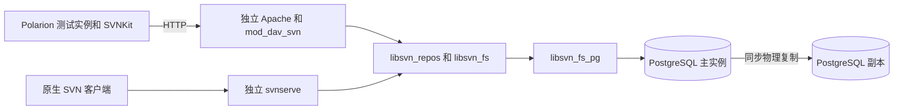

# PostgreSQL FS PoC 计划

目标是开发 Windows x64 原生 Subversion 存储后端，通过原生 SVN 服务供 Polarion 2606 使用，并判断是否值得继续投入产品化。PoC 要分别回答三个问题：SVN 版本语义是否正确，Polarion 的关键流程是否可用，保持持久化保证后性能和故障恢复是否满足要求。

技术路线采用 C、APR、libpq 和 Apache Subversion 1.14.5 的 FS 模块接口。仓库内容和版本元数据存入 PostgreSQL；协议、认证授权和 hooks 继续由原生 SVN 服务承担。先取得可重复的正确性证据，再评估性能与高可用。

日期为 2026 年 10 月 14 日。用户已选择 Windows 原生后端。下文的阶段、目录、表结构和阈值是实施设计，尚未创建后端、数据库或测试服务。

## 验证目标与边界

PoC 的完成条件是同时通过 SVN 兼容性、Polarion 接入、性能和故障恢复四项验收。一次成功的 checkout 或保存只能证明对应调用链成立。

| 必须覆盖 | 验证方式 |
| --- | --- |
| 修订快照、目录与文件、二进制内容、节点属性 | 与 FSFS 对照读取，逐修订核对内容和结构 |
| 原子提交、撤销、暂存事务、并发冲突 | 多客户端并发与故障注入 |
| 复制、移动、删除后重建、节点谱系、copyfrom | 对照 log、历史追踪、节点关系和增量更新 |
| 修订属性修改、文件锁、hooks、路径授权 | 原生服务集成测试 |
| dump、load、verify、UUID 保留 | FSFS 到 PG 再回到 FSFS 的往返验证 |
| HTTP 与 svn 协议、SVNKit 1.10.1 | 原生客户端和 SVNKit 客户端测试 |
| Polarion 工单、LiveDoc、附件、基线、权限和完整索引重建 | 独立 Polarion 测试实例 |
| PostgreSQL 故障恢复、同步副本接管、备份恢复 | 已确认提交账本与恢复后仓库核对 |

PoC 不承担所有 SVN 客户端版本、FSFS 磁盘格式兼容、SVNKit 的 file 协议、自定义对象存储、多主 PostgreSQL、跨地域离线多活和在线迁移现有 Polarion 主库。mergeinfo 的保存、读取及相关历史接口属于范围；完整 merge 与 blame 行为在兼容性清单中单独标记，不能在尚未验证时宣称全兼容。

## 现有环境与隔离安排

| 项目 | 本会话已确认的事实 | 对计划的影响 |
| --- | --- | --- |
| 项目目录 | C:\Project\PgFS 为空 | 按新项目组织源码和测试 |
| Polarion | 2606，插件版本 3.26.6 | 固定此版本进行接入测试 |
| 原生 SVN | Polarion 捆绑 1.14.5，x64 | 先验证对应 FS 模块加载与 ABI |
| SVNKit | 1.10.1.r10777 | 固定客户端兼容性目标 |
| 当前仓库访问 | repo 使用 HTTP；repoSystem 未启用 | 测试 HTTP，并另测系统用户 svn 入口 |
| 当前仓库 | FSFS format 8，逻辑寻址；抽样约 30 MiB、610 个 revision | 可作小规模功能样本，不能代表生产容量 |
| PostgreSQL | 独立安装的二进制版本为 18.6 | 以 PostgreSQL 18 开发和测试；实例连接待检查 |
| libpq SDK | 已找到 libpq-fe.h、libpq.lib、libpq.dll | 可用于 Windows 原生模块链接 |
| 编译环境 | 当前 shell 未发现 cl、cmake、ninja | P0 确认 MSVC、Windows SDK 和 SVN 依赖构建环境 |
| 硬件 | 当前进程报告 32 个逻辑处理器 | 内存、磁盘性能和虚拟化资源限制仍需记录 |

原环境入口见 [Polarion 仓库配置](C:/Polarion/polarion/configuration/polarion.properties:9) 和 [Apache SVN 配置](C:/Polarion/bundled/apache/conf/extra/polarionSVN.conf:43)。这些路径作为现状证据；测试服务使用项目内的独立配置。

拟使用如下布局，实施时先检查路径和端口是否已被使用：

```text
C:\Project\PgFS\
  docs\plans\                 本计划与后续决策
  vendor\subversion-1.14.5\   固定版本的上游源码
  src\libsvn_fs_pg\          FS 适配、版本树、事务与 libpq 访问
  sql\                        schema 与数据库迁移
  tests\                      FS API、协议、对照、并发与故障测试
  bench\                      数据生成器、负载和测量
  scripts\                    Windows 构建与独立测试环境管理
  runtime\svn\               独立原生 SVN 程序与依赖 DLL
  runtime\apache\            独立 Apache 配置和程序
  runtime\repos\             FSFS 基线与 PG 仓库外壳
  runtime\pg-primary\        测试 PostgreSQL 数据目录
  runtime\pg-standby\        仅用于本机逻辑故障验证
  artifacts\                  原始数据、日志、指标和最终报告
```

拟分配 PG 主实例 15432、测试副本 15433、HTTP 服务 18080 与 18081、svnserve 13690。开发阶段绑定回环地址；跨主机 HA 阶段另行确定地址和服务账户。数据库名称采用 pgfs_poc，避免与 Polarion 原有 SQL 索引数据库混用。

本机双 PostgreSQL 实例可以检查复制和进程崩溃逻辑。验证主机故障恢复需要至少两个独立 Windows 故障域，例如不同物理主机或不同宿主机上的虚拟机，并能隔离旧主。自动选主还需要有明确的仲裁机制。

## 模块与访问架构



后端名暂定 pg，Windows DLL 暂定 libsvn_fs_pg-1.dll，入口为 svn_fs_pg__init。Subversion 的第三方 FS 加载受 SVN_USE_DSO 和 APR_HAS_DSO 构建选项控制，并检查模块版本；P0 必须验证实际二进制行为。模块接口使用固定版本的内部头文件，不能将其当作跨版本稳定 ABI。[Subversion 加载器源码](https://github.com/apache/subversion/blob/1.14.5/subversion/libsvn_fs/fs-loader.c#L129)

仓库外壳保留 format、conf、hooks 和 db/fs-type，并通过后端配置关联数据库中的 repository。连接信息采用 libpq service 配置或受控测试配置，报告与日志不输出密码。只有已发布 revision 的根节点对普通仓库读取可见。

P0 首先将测试程序和依赖放入项目 runtime 目录，尝试加载模块。若 Polarion 捆绑程序的动态加载或链接条件不满足，就在项目目录内构建同版本、同架构的独立 SVN、APR 和 Apache SVN 模块组合；Polarion 通过网络访问该组合。不能将不同 APR、CRT 或 SVN 私有结构版本混合使用。

每个回调建立实现状态与对应测试。不支持的操作返回明确错误，不能返回空结果或成功来掩盖缺失能力；对外能力声明也必须与已实现的接口一致。

## 存储模型

采用永久保存的版本树与持久化 SVN 暂存事务。PostgreSQL 的 MVCC 快照用于短 SQL 事务隔离；历史 revision 的保留由以下显式数据结构完成。

| 拟建表 | 核心数据与约束 |
| --- | --- |
| repositories | repository_id、公开 UUID、format_version、head_rev、缓存 generation；每库一行 |
| revisions | repository_id、rev、root_node_revision、origin_txn_id；主键为库和 rev，origin_txn_id 在库内唯一 |
| revision_properties | rev、名称、二进制值、变更版本；支持原生修订属性的可变语义和条件修改 |
| node_revisions | 节点身份、谱系和复制上下文、前驱、种类、属性集、内容表示、目录表示、创建与修改修订 |
| directory_sets | 基础目录表示、覆盖层深度、只读表示标识 |
| directory_entries | 目录表示、名称、子节点引用或删除标记 |
| property_sets 与 properties | 不可变属性集；值使用 bytea，保留空值与属性删除的差别 |
| representations 与 content_chunks | 长度、MD5 与 SHA1 校验、内部 SHA256、内容块序号与数据 |
| svn_transactions | txn_id、base_rev、暂存根、变更代数、状态、最后活动时间和提交回执 |
| transaction_changes 与 changed_paths | add、modify、delete、replace、copyfrom、文本与属性变化，保留库内规范路径 |
| locks | 规范路径、锁 token、所有者、创建与过期时间、注释 |

所有跨表引用都包含 repository_id 或可证明全局唯一的对象标识，禁止跨库串读。仅将 repo.head_rev 加一作为下一次成功修订号；内部对象 ID 可以使用 sequence，revision 号不能用会在回滚后留下空洞的 sequence。[PostgreSQL sequence 与回滚语义](https://www.postgresql.org/docs/18/transaction-iso.html#XACT-READ-COMMITTED)

目录使用写时复制：修改路径只生成必要的新节点和祖先引用。目录项首先用覆盖层保存增删，避免每次修改复制大目录全部条目。覆盖层解析以最近记录为准，删除标记不能回落到更早记录。层数初始上限设为 32，超过上限生成新的不可变检查点；其读放大、整理成本和尾延迟在 P4 测量后决定是否改为其他持久化索引。

复制目录共享原子树，并记录新的复制上下文。history 和 node relation 必须解释这种上下文；仅保存 copyfrom 字段不能替代节点谱系实现。P2 对深层复制后修改、复制源删除、移动和同路径重建做专门对照。

第一版内容使用 PostgreSQL 内的全量流和分块表示，块大小先设为 1 MiB 并在 P4 调整；原生 libsvn_delta 处理线上的差分。大附件按块流式传输，不在一个 bytea 或内存缓冲中累积整个附件。内部版本差分和内容去重是后续测量驱动的优化项，必须记录全量存储的 WAL 与容量代价。[PostgreSQL TOAST 机制](https://www.postgresql.org/docs/18/storage-toast.html)

SVN 路径大小写敏感，目录名使用可确定的字节顺序，保留 Unicode 的原始规范形式。Windows 磁盘路径处理与 SVN 库内路径处理分开；不能把库内路径改为小写或按 Windows 文件名规则归一化。

## 事务与提交过程

SVN 暂存事务可跨多次请求和多个服务进程存在。每次请求用短 SQL 事务保存完成的变更，上传中的内容块标记为未完成；只有校验通过的完整表示可以进入提交候选根。连接池连接回收前必须回滚未结束 SQL 事务，PGconn 不能被多个线程同时使用。

失败但尚未撤销的 SVN 事务保留其可继续操作的状态。清理程序只处理已撤销或确认失活的暂存对象，不能依据一个固定存活时间删除正在上传的数据，更不能删除被任何历史 revision 引用的内容。dump/load 需要保留 svn:author、svn:date 与 svn:log，并处理原生事务的客户端日期标志。

初版提交按以下顺序实现：

1. 在持久化暂存区完成内容、属性和变更清单，准备候选节点；此阶段不持有全库发布锁。
2. 开始短的 READ COMMITTED SQL 事务，按统一顺序锁 repositories，再锁对应 SVN 暂存事务。
3. 读取最新 HEAD，对 base、暂存变更和 HEAD 执行 SVN 语义的三方合并。无交集修改要保留双方结果；真实路径或属性冲突返回相应 SVN 错误与冲突路径。
4. 校验暂存代数、文件锁 token、完成的内容表示和路径变更。P1 中 lock、unlock 与发布使用同一仓库短锁，避免检查与新增锁的竞态。
5. 用 HEAD 加一生成 revision，原子插入 revision、变更路径、最终属性和提交回执，并更新 head_rev。rollback 后 HEAD 与 revision 号保持原值。
6. 等待选定持久化等级的 COMMIT 结果，再向 libsvn_repos 返回新 revision。发布成功后的清理失败不改变已提交事实。

P4 再测量是否将三方合并移到锁外：候选树注明准备时的 HEAD 与暂存代数，锁内只验证、发布；HEAD 变化就退出短事务重新合并。SQL serialization failure、deadlock 和乐观冲突必须与 SVN 内容冲突区分，内部重试有次数与时间上限。数据库隔离级别本身不能替代 SVN 合并规则。[PostgreSQL 锁与隔离](https://www.postgresql.org/docs/18/explicit-locking.html)

提交结果不确定时，先按原 txn_id 查询持久化回执。重复的内部发布请求只能对应同一个 revision。原生客户端断线后若创建了新的 SVN txn_id，后端不能推断两次请求属于同一操作，也不能盲目重放提交。恢复结果必须区分“未提交”“已提交”和“尚不能确认”。

svn_fs_commit_txn 的 new_rev 有效时表示提交已成功，即使另有后续错误；pre-commit 拒绝不得发布 revision，post-commit 失败不得撤销 revision。外部 hook 的副作用不承诺恰好一次。[原生提交返回语义](https://github.com/apache/subversion/blob/1.14.5/subversion/include/svn_fs.h#L1141)

普通读取固定一个 revision 根，默认从 PG 主实例读取。缓存仅保存不可变且已提交的对象，键包含库、generation 与表示或节点 ID。HEAD、可变修订属性、锁和权限状态需要一致性检查。第一版不做从库读分流；后续若增加读分流，要等待相应 WAL 重放位置。[PostgreSQL 副本一致性](https://www.postgresql.org/docs/18/runtime-config-wal.html#GUC-SYNCHRONOUS-COMMIT)

## 实施阶段与验收

各阶段天数按一名熟悉 C、APR 和存储的主开发估算，测试与 DBA 协助另外安排。合计约 35 至 54 个主开发工作日，完整 PoC 日历预算为 8 至 12 周；Windows 依赖重编译或 SVN 隐含接口差异可能延长该预算。

| 阶段 | 工作内容 | 交付与通过条件 | 估算 |
| --- | --- | --- | --- |
| P0 原生加载 | 固定 1.14.5 源码；建立 MSVC x64 构建；枚举模块、FS、root、txn、history 和 ID 回调；验证 libpq 与 DLL 搜索路径 | 独立 svnadmin 能加载 pg，建立仅含 r0 的 PG 库，重启后读取 UUID 与 r0；输出可复现构建说明和接口清单 | 3 至 5 日 |
| P1 版本树与核心事务 | 建表；实现文件目录、属性、暂存与提交；通过原生 FS API 操作；补足基本远程编辑所需回调 | 原生客户端完成增改删、撤销、历史读取和多文件原子提交；两个非交集修改都保留，同路径冲突与 FSFS 一致 | 7 至 10 日 |
| P2 SVN 兼容性 | 实现复制谱系、history、changed paths、修订属性、文件锁和校验；接入 HTTP、svn、hooks、authz；打通 dump/load/verify | 必须场景全通过；FSFS 到 PG 到 FSFS 往返语义相等；SVNKit 可读写；每个缺失接口有明确状态 | 10 至 15 日 |
| P3 Polarion 接入 | 从原库只读导出测试样本；独立 Polarion 2606 实例接入 PG 仓库；执行 UI、REST 和重建索引场景 | 工单、LiveDoc、附件、基线和权限正常；完整重建索引后业务结果可核对；没有未经解释的未实现回调 | 5 至 8 日 |
| P4 性能与优化 | 批处理、缓存、目录覆盖层整理、连接池、内容分块；对照 FSFS 压测；测量容量增长与长期运行 | 达到下文性能门槛，报告 p95、p99、吞吐与资源成本；优化后重跑受影响的正确性测试 | 5 至 8 日 |
| P5 故障与恢复 | PG 同步副本、两前端、提交故障注入、隔离旧主后接管、备份恢复、跨前端缓存检查 | 已确认提交无丢失，无双主发布，无同一 txn 重复 revision；恢复后 verify 与账本一致 | 5 至 8 日 |

P0 的创建命令候选为下面形式，runtime 程序是待准备的独立构建，当前未执行：

```powershell
& 'C:\Project\PgFS\runtime\svn\bin\svnadmin.exe' create `
  'C:\Project\PgFS\runtime\repos\pg-smoke' --fs-type pg
```

1.14.5 的 svnadmin 将 fs-type 参数传给底层配置，帮助文本中的内置类型列表不代表禁止第三方名称；实际创建仍须通过 P0。[svnadmin 参数处理](https://github.com/apache/subversion/blob/1.14.5/subversion/svnadmin/svnadmin.c#L2984)

P0 最多投入五个工作日确认直接加载路线。若需重编译，先完成最小链接样例并重新估算，不进入大规模 schema 和性能优化。P2 连续发现历史谱系、冲突或锁语义不一致时，先修复正确性再接入 Polarion。

## 正确性测试清单

统一测试驱动向 FSFS 与 PG 执行相同的事件序列，比较文件字节、属性、目录结构、revision 顺序、copyfrom、历史和协议结果。对象内部 ID 可以不同；节点相同、相关和不相关的关系必须一致。只对事先列明的服务器生成时间、随机 token 等字段做限定归一化，不能归一化文件内容或路径来掩盖差异。

| 场景 | 必须观察的结果 |
| --- | --- |
| 多文件提交中途报错 | 无部分发布，旧 revision 保持完整 |
| checkout、update、switch、export、peg revision 与不同 depth | 返回的目标树、删除和增量变更与 FSFS 一致 |
| 两个客户端同一 base 修改不同文件 | 双方变更都保留，不能仅因 HEAD 前进就拒绝 |
| 同文件与同属性冲突 | 冲突路径、错误种类和提交状态与 FSFS 一致 |
| 删目录并发修改其子文件 | 不能静默覆盖或丢失变更 |
| 删除后以同名创建新节点 | 新节点不继承错误的历史关系 |
| 深层复制、复制后修改、移动与复制源删除 | log、copyfrom 和追踪历史正确 |
| 二进制属性、空属性、属性删除、目录属性和继承属性 | 按字节与语义核对 |
| 大小写不同路径、中文、NFC 与 NFD 名称、空目录 | 规范路径与节点种类保留 |
| 锁获取、过期、强制解锁、错误所有者与无 token 提交 | 不能绕过锁，锁不随服务进程结束消失 |
| pre-commit、post-commit、revprop hooks | 拒绝、已提交后报错和条件属性修改符合原生语义 |
| 权限受限的目录枚举、历史、diff 与读取 | 受限对象不能通过其他读取接口暴露 |
| 提交后立即在第二个前端读取 | 看见同一完整 revision，权限与可变属性不滞后 |
| 重启后重开暂存事务与中断的内容流 | 已完成部分可核对，未完成表示不能被发布 |
| dump/load/verify 往返 | UUID、rev0、全部 revision、文件、属性和复制历史一致 |

原生 Subversion 的 FS 与协议测试集是补充验证。P0 记录该 tag 的实际测试入口和后端选择方法，不能先假定所有测试驱动天然支持 pg；对尚不能运行的测试记录原因，并用上述对照场景覆盖。

## Polarion 接入场景

使用独立 Polarion 测试实例、数据目录和测试账户。测试仓库外壳、hooks、权限配置和服务 URL 一起形成可复现部署。核对原生认证与 Polarion 用户身份的映射，避免只使用管理员账户通过测试。

1. 工单创建、字段修改、状态转换、链接与删除；核对对应 SVN revision 和历史页面。
2. LiveDoc 创建、批量修改、复制、移动和历史版本读取；核对文档及引用工单。
3. 1 MiB、10 MiB、100 MiB 附件的上传、下载和历史版本，核对完整哈希。
4. 项目与文档基线、历史 revision 定位、权限允许与拒绝；检查库内 .polarion/access 更新传播。
5. repo 走 HTTP；repoSystem 走测试 svnserve；完整重建索引及历史索引创建后，比较约定的查询、工单数量和关系。
6. 外部客户端新增 revision 后，检查 Polarion pulling 与索引可见性；记录从提交到业务查询可见的时间。

原库导出只用于制作副本。邮件、外部集成和有外部副作用的 hooks 在独立测试配置中替换为记录型实现。回退恢复独立测试实例的 FSFS 副本与配套索引；有测试写入时不能只改 URL 后把两个已分叉仓库当作同一状态。

## 性能数据与测量方法

所有数据集使用固定随机种子和同一事件流，保留读写比例、文件尺寸分布、目录深度、历史热点和附件压缩率。合成数据不能全部由高度重复的零字节组成。

| 数据集 | 拟定规模 | 用途 |
| --- | --- | --- |
| D0 语义样本 | 数十条含复制、冲突、属性、锁和二进制内容的事件 | 快速回归与故障定位 |
| D1 本机副本 | 会话抽样约 30 MiB、610 个 revision；导出前重新记录规模 | Polarion 功能接入与全历史往返核对 |
| D2 元数据负载 | 10 万个 4 至 32 KiB 文件，1 万次成功 revision | 小对象、历史查询和并发提交 |
| D3 扩展负载 | 100 万个文件，10 万次 revision，按实验容量分级生成 | 缓存外负载、索引规模与容量增长 |
| D4 目录与附件 | 单目录 10 万条目，目录深度 32；附件 1、10、100 MiB | 目录覆盖层、流式传输、读写放大与 p99 |

D0 与 D1 做完整语义核对。D2 与 D3 对每个 revision 的规范目录树摘要及全部变化文件进行增量核对，再抽样历史读取、复制和删除路径；大规模遍历不能只核对 HEAD。

测量分三种拓扑，避免把持久化等级变化算作后端性能提升：

- A：FSFS 本地持久化对 PG 单实例本地持久化，前端协议与逻辑服务的 CPU、总内存预算相同。
- B：PG 单实例对 PG 同机房同步主备，记录增加的确认延迟；此项只评价 HA 成本。
- C：若有可验证的 FSFS 高可用存储，再加入相同故障保证的 HA 对比。没有此基线时不宣称 PG 比 FSFS HA 更快。

每种拓扑跑并发 1、8、32、128，分别测纯读、小提交、批量提交、附件和混合业务。闭环负载测吞吐曲线；另用固定到达率测排队和延迟，计入发送排队、超时与内部重试，避免遗漏排队时间。p95 对比使用双方都未饱和的同一到达率，峰值吞吐单独报告。

每轮热缓存预热五分钟，稳定采样十五分钟，重复三次。冷启动与超过可用缓存的数据集单独报告；重启 PostgreSQL 不代表 Windows 文件缓存已清空。任何清缓存或故障操作只作用于独立实验环境。

保留以下原始指标：端到端与 FS 层 p50、p95、p99，成功 revision 每秒，错误与冲突数量，每请求 SQL 次数、耗时和返回字节，HEAD 锁等待与持有时间，连接池等待，CPU、RSS、磁盘吞吐、WAL 字节、复制确认与重放延迟、缓存命中、表与索引大小、暂存垃圾和清理耗时。

建议冻结的性能验收线如下，数值为项目取舍门槛而非实测预测：

P0 核对可用资源与负载后将门槛定版，开始对比测试后不通过改变门槛来掩盖退化。

| 指标 | 建议通过条件 |
| --- | --- |
| D2 热缓存小文件读取与小提交 | A 拓扑中 p95 不超过 FSFS 的 1.5 倍，峰值成功吞吐不少于 FSFS 的 80% |
| D2 历史和目录读取 | 不得因逐节点 SQL 呈现可避免的串行往返增长；报告 p95 与执行计划 |
| 发布锁 | D2 小提交的锁持有 p95 目标不超过 10 ms；等待时间另报 |
| 同机房 HA 成本 | 实测主备 RTT 不超过 1 ms 时，小提交 FS 层 p95 增量目标不超过 20 ms |
| 大附件与重建索引 | 超过 FSFS 耗时两倍或资源两倍时必须解释主要成本，并重新评估架构 |
| 持续运行 | 八小时混合负载无不一致、连接泄漏和无界内存增长；revision 历史增长计入正常数据增长 |

目录检查点整理和后台维护必须纳入长时间测量。WAL 放大按 WAL 字节除以逻辑变化内容字节报告，附元数据开销；容量比较同时列出 FSFS 差分压缩与 PG 全量存储策略。性能优化不能删除应保留的历史 revision。

## 故障与高可用验证

PG 物理同步复制以 synchronous_commit=on 且有实际同步副本为第一组配置。remote_apply 另测重放等待成本；异步复制可测性能与损失窗口，但不能作为零丢失验收结果。fsync 和 full_page_writes 保持启用。[PostgreSQL 持久化配置](https://www.postgresql.org/docs/18/runtime-config-wal.html#GUC-SYNCHRONOUS-COMMIT)

由客户端在仓库外记录每次得到成功回复的 revision、运行标识与预期内容摘要。注入故障后用独立客户端核对全部成功回执与恢复的 revision 树；连接断开造成的不确定结果另列，不计作成功或失败来掩盖异常。

| 故障点 | 恢复后的验收 |
| --- | --- |
| 上传内容中断、杀死 SVN 工作进程 | 无部分 revision；暂存数据能清理，已发布 revision 完整 |
| COMMIT 前杀死 PG 连接或主进程 | 根据数据库实际提交结果核对，不能出现空洞或半提交 |
| COMMIT 已完成但响应丢失 | 原 txn 的回执可定位，内部重试不产生第二个 revision |
| 主库磁盘空间不足或权限错误 | 明确报错，不返回虚假成功；已有 revision 可读 |
| 同步副本停止或复制链路中断 | 按零丢失策略等待或报超时，不自动降为异步并返回成功 |
| 主机故障后接管 | 旧主先被隔离；选择包含成功提交的副本，恢复新主写服务 |
| 两个 SVN 前端与主库切换 | 新连接重新验证可写主库，丢弃可变缓存，旧事务结果先核对 |
| 备份加 WAL 恢复到独立实例 | 恢复仓库外壳与 hooks；清除前端缓存并切换 generation，verify 与目标时间账本匹配 |

每类关键进程或连接故障至少重复二十次，并覆盖同路径与不同路径并发。同步零丢失验收要求客户端已确认提交的 RPO 为零。隔离旧主后，从开始接管到新客户端成功提交的 RTO 目标为两分钟；手工接管与自动故障检测分别报告。

单副本不可用时，保持同步保证可能暂停写入。这一结果不能同时被解释为“零丢失且任意故障下可继续写”。若要验证丢失一个 PG 节点后继续保持同步写入，需要主库加两个可用副本及经过测试的切换策略。

P5 初期采用有旧主隔离的受控接管，验证数据库和 FS 恢复语义。自动切换作为独立扩展：选择 Windows 可运行且具备仲裁与隔离能力的编排方案，再验证检测、路由、连接池刷新与双主防护。未通过该扩展时只能报告受控故障恢复，不能报告自动高可用。

备份使用 PostgreSQL 原生基础备份与 WAL 流，并包含仓库外壳、后端配置和 hooks。svnadmin hotcopy 在其独立一致副本语义实现前显式报未支持，不能只复制数据库连接配置后返回成功。[pg_basebackup 文档](https://www.postgresql.org/docs/18/app-pgbasebackup.html)

## 交付与继续投入条件

PoC 交付包括原生模块与构建清单、schema 迁移、可重复的独立测试环境、FSFS 对照测试、Polarion 场景结果、性能原始数据、故障恢复账本、备份恢复步骤和按操作划分的兼容性清单。每项结果标记通过、失败或未运行，保留可复现输入。

满足四项条件才建议进入产品化：

1. 必须场景正确性零差异，已确认提交在规定的故障模型中零丢失。
2. Polarion 2606 的关键流程及完整重建索引通过，网络访问不需要修改其业务代码。
3. 性能达到冻结的门槛，目录结构、WAL 和版本存储增长有可解释的成本。
4. Windows 打包、恢复与升级路径可复现，并列清支持的 SVN、APR、PostgreSQL 和客户端版本。

正式产品化另行安排完整原生测试覆盖、全部 merge 与 blame 行为、hotcopy 与其他管理接口、长期容量和垃圾回收、自动 HA、升级迁移、生产负载验证及 Siemens 支持范围确认。

最先执行 P0。其成果是可加载、可重启、能读 r0 的原生后端和完整回调清单；达成后再实施版本树与提交语义。
