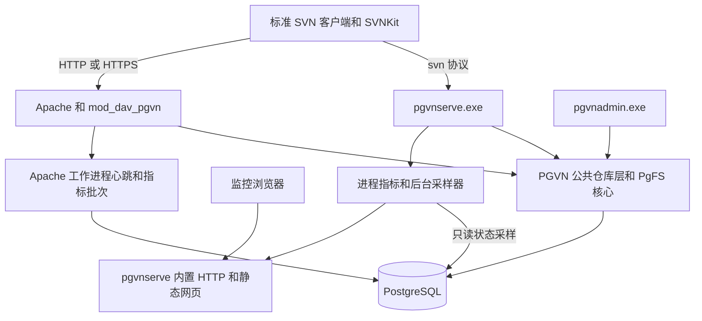

# PgVN 开发推进计划

日期：2026 年 10 月 15 日。状态：实施中，M0、M1、M2、M3、M4 已完成，M5 进行中。

PgVN 在现有 PgFS 存储核心上构建专用 SVN 服务端，交付 `pgvnserve.exe`、`mod_dav_pgvn.so` 和 `pgvnadmin.exe`。`pgvnserve` 内置只读监控网页，随服务启动。仓库按数据库 ID 打开，SVN 服务节点无需创建、复制或备份本地仓库目录。

第一个可用版本交付“无本地仓库目录的 svn 协议服务、管理工具和监控网页”，随后完成 Apache 接入、多节点、恢复与 Polarion 隔离验收。M0 已交付构建骨架与验证，M1 已交付按 ID 仓库核心、路由与配置控制表；M2 已交付正式管理命令；M3 已交付原生 svn 协议；M4 已交付完整的首版中文监控，当前进展见 [实施记录](../pgvn/progress.zh-CN.md)。

## 1 目标与完成边界

| 目标 | 完成标准 |
| --- | --- |
| 构建 pgvnserve | Windows x64 可执行文件，支持前台运行及 Windows 服务；标准客户端通过 `svn://` 访问数据库仓库 |
| 构建 mod_dav_pgvn | 配套 Apache 模块，通过 HTTP 和 HTTPS 提供 SVN DAV 协议；包含配套路径授权适配 |
| 构建 pgvnadmin | 按仓库名称或 ID 执行创建、注册、dump/load、verify、历史查询及维护，无需本地仓库路径 |
| 内置监控网页 | 随 pgvnserve 启动，展示节点、仓库、数据库、事务、锁、请求和错误状态；安装及运行无需 Node.js |
| 移除本地仓库目录 | 创建、打开、提交、查询、热复制和维护均不读取 `format`、`db/fs-type`、`pgfs.conf`，不生成每库目录 |
| 保持 SVN 语义 | 在固定版本范围内重跑客户端与协议回归，验证授权、hooks、历史及故障后的提交结果 |

“无本地仓库目录”指服务节点没有每个仓库必须保留的目录或数据。程序、进程配置、数据库凭据、日志、证书和受控临时文件仍可存在；这些文件不能承载唯一的仓库历史或协议状态。

网络协议继续使用 `svn://`、`http://`、`https://`，保留原 URL 路径及公开 SVN UUID。原版 `svnadmin`、`svnlook` 的本地路径接口由 pgvnadmin 提供替代功能。依赖本地仓库路径的任意旧 hooks、SVNKit 的 `file://` 和其他直接读取 FSFS 的调用，需要单独适配。

本轮包含基础多节点与数据库故障验证；生产 PostgreSQL 自动选主、跨地域多活、内容去重和版本间增量压缩另列后续工作。生产切换以 Polarion 实际应用和恢复验收通过为条件。

## 2 可复用的当前基线

当前 PgFS 已在 Windows x64、SVN 1.14.5、APR 1.7.6、APR-util 1.6.3、PostgreSQL 18.6 上完成以下验证：

| 证据 | 当前结果 |
| --- | --- |
| 自定义集成检查 | 33 项通过 |
| 原生 FS 与仓库检查 | 94 项通过，4 项上游跳过，4 项存储或版本假设排除 |
| 官方命令与协议回归 | 51 组完整适用套件，1891 PASS、69 SKIP、54 XFAIL，无非预期失败 |
| 真实 Polarion 历史 | r0–r637，共 638 个修订版本完整性校验通过；全部变更路径和修订属性一致；5 个完整历史快照一致 |

基线模块 SHA-256：`a06a79ba5efb9cf9bace026fdda1dfe820e3df13f23ae1f3f08403a2b121bb5c`。旧 PgFS 兼容性记录位于工作区外的 `C:\Project\PgFS\artifacts\tests\compatibility-evidence.json`，旧实现背景见[实现状态](../implementation-status.md)。这些结果不随 PgVN 发布，属于旧 PgFS 基线；PgVN 各产物单独记录构建身份、测试 ID、跳过项和结果。

继续复用版本树、目录 COW、内容分块、历史关系、事务暂存、原子发布、修订属性 CAS、锁和提交回执。现有源码仍存在的目录入口包括 PgFS 创建与打开配置、FS 加载器后端识别、仓库层格式检查、hooks 路径，以及 Apache DAV activity 文件。

开发语言继续使用 C 和 APR，数据库访问使用 libpq。首轮固定当前 SVN、APR、PostgreSQL 和 Apache 2.4.68 组合；新增产物分别检查依赖、数据导出 ABI 和符号，升级另行建立验证基线。

## 3 组件与部署架构



公共核心是源码模块和静态库，分别链接进三个入口，不独立部署一个仓库服务进程。协议适配器继续复用上游 SVN 的编辑器、报告、历史及授权检查流程，通过新增的仓库打开接口取得 SVN 仓库和 FS 对象。

| 发布组件 | 内部职责 |
| --- | --- |
| pgvnserve.exe | svn 协议、仓库路由、公共核心、Windows 服务生命周期、监控 HTTP、状态采样和内嵌网页资源 |
| mod_dav_pgvn.so | Apache DAV provider、数据库仓库打开、HTTP SVN 协议、DAV 状态和本进程指标 |
| mod_authz_pgvn.so | 随 HTTP 组件同包交付的路径授权模块；读取数据库配置，沿用 SVN authz 解析与检查语义 |
| pgvnadmin.exe | 数据库引导和升级、仓库管理、历史查看、导入导出、校验、维护及监控访问令牌管理 |

HTTP 组件注册独立 provider `pgvn` 和模块符号，所有修改过的私有动态库采用独立名称或静态链接。首轮使用隔离 Apache 实例；同进程与原版 SVN 模块共存需另测符号和 provider 隔离。

### 拟建目录

```text
src/libsvn_fs_pg/             现有存储核心及传统文件配置适配
src/pgvn/core/                仓库注册、按 ID 打开、配置、权限、hooks、指标
src/pgvn/serve/               svnserve 协议适配与 Windows 服务入口
src/pgvn/dav/                 DAV 和路径授权适配
src/pgvn/admin/               管理命令与历史查看
src/pgvn/monitor/             HTTP.sys 监听、JSON API、采样与资源服务
web/pgvn-monitor/             中文网页 HTML、CSS、JavaScript 源文件
patches/pgvn/subversion-1.14.5/ 固定版本上游适配补丁
sql/pgvn/                     PgVN 控制及监控 schema 迁移
scripts/pgvn/                 构建、资源嵌入、打包与新机部署
tests/pgvn/                   单元、协议、网页、并发和恢复验收
build/pgvn/                   应用补丁后的上游构建副本和生成文件
runtime/pgvn/                 隔离程序、Apache、测试数据库、日志与临时文件
artifacts/pgvn/               构建清单、原始结果、性能和兼容性证据
```

保留固定版本 vendor 原始源码，补丁应用到构建副本，分别记录原始源码与补丁摘要。传统 PgFS 插件与 PgVN 使用同一存储实现和不同打开适配器，相关改动需回归已有插件模式。

## 4 公共核心与数据库改造

### 按 ID 打开仓库

拟建立以下内部接口；签名在 M0 固定：

```text
pgvn_catalog_resolve       URL 路径映射到仓库 ID 和库内路径
pgvn_repos_open            按仓库 ID 与配置版本打开仓库上下文
pgvn_repo_svn              提供保留的上游逻辑所需的 svn_repos_t
pgvn_fs_bind              直接构建 PgFS 句柄，不读取后端识别文件
pgvn_repo_create          原子创建存储记录和仓库路由
pgvn_policy_acquire       获取同一版本的配置、authz 和 hooks 定义
pgvn_status_snapshot      获取有时间戳、来源与新鲜度的只读状态
```

仓库 ID、公开 SVN UUID、URL 名称分别管理。URL 名称映射和仓库创建在同一数据库事务完成，失败不得留下可访问的半成品。路由按已注册的最长前缀匹配，独立处理库内路径；UTF-8、大小写、NFC/NFD、转义分隔符和非法路径与 FSFS 基线对照。

审计并适配 FS 加载器、仓库层、PG 后端及管理操作里的文件访问，不只修改 create/open。后端类型、格式、配置版本和诊断标识由对象或数据库取得，hotcopy、删除和配置列举也使用 ID。逻辑标识不能再被传给本地文件操作。

连接采用有界租约和明确生命周期。持有写流的会话级 advisory lock 时，连接固定给该上下文，释放前不得返回通用池；监控采样使用独立连接与超时。首轮直接连接可写 PostgreSQL，不引入事务级连接池。会话锁的生命周期依据[PostgreSQL 锁说明](https://www.postgresql.org/docs/18/explicit-locking.html)。

### 拟建控制数据

现有 `pgfs` schema 继续存储仓库历史，新控制数据进入独立 `pgvn` schema。遥测放入独立 `pgvn_monitor` schema，与业务状态分开清理。

| 拟建数据 | 主要字段与约束 |
| --- | --- |
| 仓库注册与路由 | repository_id 外键、规范名称、路由前缀、授权名称、启用状态、版本；路由唯一 |
| 配置版本 | repository_id、generation、配置内容、发布人和时间；原子发布同一版配置与权限 |
| authz 与组定义 | 原始规则文本、组文本、校验结果；通过 SVN 的流解析接口加载，不生成 authz 文件 |
| hooks 定义 | 事件、处理器类型、版本、超时和参数；同步拒绝与提交后处理分开 |
| DAV activity 映射 | repository_id、activity 或虚拟事务 ID、SVN txn_id、状态；复合键防止跨库串用 |
| 监控令牌 | 高熵随机令牌的摘要、只读 scope、过期和撤销状态；不保存可读原令牌 |
| 节点心跳 | node_id、启动 instance_id、组件、版本、进程、数据库时间、配置版本和状态 |
| 遥测采样 | instance_id、采样时间、有界指标和来源；采用可配置保留期限及批量清理 |

PgVN 迁移单独维护版本表与显式顺序。已有 pgfs 迁移 1–4 与新增迁移在新数据库引导流程中分别执行，避免目录通配排序造成混淆。业务角色、迁移所有者、监控只读角色分别授权，不要求服务以 PostgreSQL 超级用户运行。

### 配置与 hooks 语义

配置和授权按版本缓存，每个命令或请求使用明确的版本。通知只作加速，仍需版本复核；提交发布前复核授权，撤权及配置过期行为必须有测试。数据库或权限元数据不可确认时，不继续使用无限期的旧写权限。

认证优先沿用可验证的 Apache 身份提供者及 svn 协议认证机制；PostgreSQL 角色与 SVN 用户保持独立。M0 固定 svn 客户端支持的认证方案、内存中的账号提供接口及跨节点凭据管理，不能留下对每库 passwd 文件的隐式依赖，也不能将 PostgreSQL SCRAM 凭据直接当作 SVN CRAM-MD5 所需的密码。路径授权复用 `svn_repos_authz_parse2` 和现有检查逻辑，覆盖递归权限、复制源、历史、mergeinfo 和属性继承。

hooks 接收仓库 ID、事务或修订 ID、用户及事件上下文。pre 类保持同步拒绝语义；post 类失败不能回滚已发布 revision，返回及重试行为需与协议约定一致。外部程序放在程序或部署配置目录，历史查看通过 pgvnadmin 的 look 子命令。依赖旧仓库路径的脚本逐项移植，不声明任意旧脚本原样兼容。

## 5 三个入口的具体功能

### pgvnserve

保留 SVN 握手、能力协商、编辑器、提交、更新、复制、日志、合并和锁协议。将 `find_repos` 的磁盘搜索替换为注册表解析，所有连接共用版本化配置入口；保留已验证的原子发布和提交回执。

支持前台运行、Windows 服务、优雅排空、连接上限、结构化日志和明确的启动错误。唯一性状态进入数据库或受控配置。首轮不依赖 sticky session 声明跨进程事务正确；节点中断后明确报告失败或已确认提交，重试不得重复发布同一事务。

结构性配置错误给出明确退出码。数据库暂时不可达时保持监控和 live 探针运行，以有界退避重连，ready 返回 503；依赖恢复并通过校验后再接纳仓库业务。

### mod_dav_pgvn

保留既有 HTTP SVN 请求、REPORT、MERGE、COPY/MOVE、锁及能力协商。仓库定位使用名称或 ID 指令，不使用 SVNPath/SVNParentPath 扫描磁盘。

内部 provider 和模块名称可采用 PgVN 命名；协议 XML 命名空间、capability token、特殊 URI 和响应语义继续按原 SVN 实现处理，不能通过全局替换 SVN 字符串改名。

activity、虚拟事务及事务映射读写改为数据库操作，处理唯一性、竞态、已提交和已删除状态。事务建立与映射发布需原子完成或有可验证的恢复步骤。仅清理被证明可回收的记录，不能单凭创建时间删除仍在使用的长事务。

Windows Apache 在实际工作进程初始化时注册指标和心跳，并在退出时清理本进程资源。配套 mod_authz_pgvn 复用仓库身份解析与数据库规则。HTTPS 由 Apache 处理，证书与反向代理路径纳入集成验收。

### pgvnadmin

以下为拟建命令面，不是当前可执行命令：

| 命令组 | 功能 |
| --- | --- |
| db | init、migrate、check；显示兼容 schema 和数据库身份 |
| repo | create、list、show、register-existing、enable、disable；管理名称、路由和既有存储绑定 |
| dump 与 load | 使用标准 SVN dump 流，按 ID 导入导出，保留 UUID 与修订属性，文件模式二进制安全 |
| verify 与 maintenance | 版本范围校验、pack、recover 校验、freeze、同库完整及增量 hotcopy |
| look | youngest、uuid、tree、cat、changed、属性及事务查看，供运维和 hooks 使用 |
| config 与 authz | 校验、查看和发布版本化配置；发布前解析全部规则 |
| monitor-token | 创建、撤销和设置过期的只读监控令牌；原令牌只在创建时返回 |
| diagnose | 配套版本、依赖、连接和权限诊断；输出脱敏报告 |

目录模式的删除改为明确的数据库仓库生命周期操作，先禁用和排空，再按引用约束维护；物理清除另设维护命令。命令提供稳定退出码和 `--json` 输出，密码不进入命令参数、报告或日志。

## 6 pgvnserve 内置监控网页

### 运行方式

监控 HTTP 监听和 SVN 监听在同一个 pgvnserve 进程内运行，独立调度、超时和资源配额。网页静态资源编译进可执行文件，原始 HTML、CSS、JavaScript 留在 web 目录；构建时生成资源及内容摘要。默认无外部 CDN、前端服务、Node.js 运行时或独立监控数据库。

Windows 首版选择 HTTP Server API，封装在 `http_win.c`，不自行实现 HTTP 报文解析。M0 必须验证当前工具链、低权限服务账户、URL namespace、关闭与重启行为。该 API 可供 C/C++ 程序独立提供 HTTP；非管理员账户需要安装阶段预留 URL 权限。见 [HTTP Server API](https://learn.microsoft.com/en-us/windows/win32/http/http-api-start-page) 和 [URL namespace 权限](https://learn.microsoft.com/en-us/windows/win32/http/namespace-reservations-registrations-and-routing)。

默认仅监听回环地址。远端开放时使用 HTTPS 或可信反向代理，显式配置允许的监听地址和来源；安装脚本负责正确服务账户的 URL 权限与证书绑定，服务运行期间不要求管理员权限。

### 页面与信息层级

首版为中文只读监控，管理操作通过 pgvnadmin 执行。首页第一屏能够判断“服务是否可用、数据库是否可用、是否有节点或请求异常”。

| 页面 | 主要内容 |
| --- | --- |
| 概览 | 当前节点、版本与启动时间；存活和就绪状态；数据库连通性；在线节点数；请求速率、失败率和延迟趋势 |
| 节点 | pgvnserve 与 Apache 工作进程的 instance_id、版本、最后心跳、连接数、配置版本、当前状态 |
| 仓库 | 可分页和搜索的名称、ID、UUID、HEAD、启用状态、最近提交时间、事务与锁摘要 |
| 仓库详情 | HEAD 和配置代数、活动事务、业务锁、近期提交摘要与脱敏错误；高成本统计显示采样时间 |
| 数据库 | 当前连接状态、应用连接使用与等待、SQL 延迟和错误分类、数据库占用及采样状态 |
| 请求与错误 | 按入口和操作分类的次数、耗时和错误；有限长度的近期事件及请求关联 ID |

桌面界面使用导航、状态卡片、趋势和表格；窄屏保持核心状态可读。页面包含加载、无仓库、无样本、未授权、数据库不可达、节点失联和数据过期状态。异常同时使用文字、图标和颜色，键盘可操作，不能只用颜色传达健康状态。依据 [W3C 颜色使用说明](https://www.w3.org/WAI/WCAG22/Understanding/use-of-color.html)。

趋势默认查看最近 15 分钟；表格默认每页 50 项、最大 200 项。页面默认每 5 秒刷新可见摘要，后台标签页降低频率；单次请求未完成时不叠加新请求。刷新间隔均可配置。

### 拟建 HTTP API

所有业务状态 API 使用同源认证，公开健康探针只返回最小状态。

| 入口 | 返回及边界 |
| --- | --- |
| GET /monitor/ | 内嵌网页入口，无业务数据的静态页面 |
| GET /health/live | 本进程 HTTP 和服务主循环是否存活；不访问数据库 |
| GET /health/ready | 基于有时效的后台采样检查可写数据库、业务 schema、仓库路由与配置可用性；未就绪返回 503 |
| GET /api/monitor/v1/overview | 节点和集群摘要，包含 sampled_at、age_seconds 和 freshness |
| GET /api/monitor/v1/nodes | 节点和工作进程状态，不把失联节点的缺失值算成零 |
| GET /api/monitor/v1/repos | 分页仓库摘要和搜索 |
| GET /api/monitor/v1/repos/{id} | 指定仓库状态、事务及锁摘要 |
| GET /api/monitor/v1/series | 受限时间窗、指标白名单及聚合粒度 |
| GET /api/monitor/v1/events | 分页脱敏近期事件，数量有上限 |
| GET /metrics | 受认证保护的 Prometheus 指标，首版默认导出本进程，避免跨节点重复统计 |

数据库或采样失败时，存活探针和本地静态页仍能响应；数据库相关数值保留最后时间戳并标为过期或未知。监控写入或汇总失败单独降级，不改变业务事务结果。

### 指标口径与采集

| 类别 | 首版口径 |
| --- | --- |
| 请求 | 已完成的 SVN 命令或 HTTP 请求数量、失败数量、在途数量、耗时直方图；注明统计粒度 |
| 提交 | 新发布 revision 的次数和回执确认次数分开；协议重试不重复计为新修订 |
| 流量 | 本进程协议层发送和接收字节数，标明计量层次 |
| 数据库 | 本应用连接和队列、SQL 次数、延迟、SQLSTATE 分类；不展示 SQL 参数或完整连接串 |
| 事务与锁 | 持久化 SVN 暂存事务、打开写流、SVN 业务锁及等待摘要分别计量 |
| 仓库容量 | 数据库总占用及后台估算值明确区分；不把累计历史逻辑内容量称为物理磁盘占用 |
| 采样器 | 成功时间、采样耗时、失败次数、丢弃的遥测批次和新鲜度 |

热路径只更新进程内计数、直方图及有界事件缓冲；后台线程每 5 秒发布心跳和指标批次。遥测保留默认 24 小时，本地趋势缓冲 15 分钟、近期事件缓冲 200 条；均设置明确内存与行数上限。容量等昂贵统计低频或按后台任务执行，普通刷新不扫描全部历史节点和内容块。

节点由稳定 node_id 和每次启动的新 instance_id 共同标识。不同启动实例的 counter 分开计算，不能把进程重启产生的归零解释为负吞吐。心跳采用数据库时间；连续 3 个采样周期未更新时标记失联。数据库本身不可达时，远端节点状态显示未知，避免误报全部节点宕机。

Apache 指标由其工作进程采集并批量写入共享遥测表，pgvnserve 页面读取汇总。不能仅凭 pgvnserve 自身计数推算 Apache 的请求量。标注数据来自本节点还是集群、哪些节点过期、统计是否完整。

请求耗时和计数使用有限操作与结果标签；仓库列表、用户、路径、错误文本不作为默认 Prometheus 标签。每仓库细节使用分页 API。指标类型、采集成本和标签设计参考 [Prometheus 仪表化规范](https://prometheus.io/docs/practices/instrumentation/)。

### 访问与故障隔离

浏览器输入仅有 `monitor:read` 权限的令牌，令牌只放在页面内存并通过 Authorization 请求头发送；不写入 URL、静态资源或浏览器持久存储。支持撤销和过期，刷新页面需重新认证。默认不开跨域读取，响应采用明确的 JSON 编码、内容安全策略和不缓存业务状态的设置。

仓库名、日志片段等不可信文本以文本节点显示。页面不提供修改仓库、执行 SQL、运行 hooks 或控制服务的入口。监控读取使用独立只读连接和受限视图，避免赋予广泛数据库管理权限。

采样查询默认 1 秒超时，业务就绪样本超过 15 秒则判定过期；监控监听使用有界请求队列与连接数。具体资源上限在 M0 冻结并在 M4 测量。单实例 pgvnserve 退出时，其内置网页也不可达；多实例可通过另一节点查看其失联状态，独立外部探针负责检测单机进程退出。

## 7 分阶段实施与验收

下列工作量按一名熟悉 C、SVN 和 Windows 原生开发的工程师估算，复用现有 PgFS，包含每阶段开发和针对性验证，不含等待新机器或外部环境。M0 完成后重新估算；这些是规划区间，不是固定交付日期。

| 阶段 | 工作量 | 前置 | 阶段出口 |
| --- | --- | --- | --- |
| M0 固定接口与构建验证 | 3–5 人日 | 当前基线 | 三个产物构建骨架、HTTP.sys 低权限验证、路径依赖清单、接口与资源上限记录 |
| M1 无目录公共核心 | 8–12 人日 | M0 | 注册、创建和打开均按 ID；版本树和事务不依赖本地 repo；核心回归通过 |
| M2 pgvnadmin | 5–8 人日 | M1 | 创建、标准 dump/load、verify、look、维护和配置管理可用 |
| M3 pgvnserve | 7–10 人日 | M1、M2 基础命令 | 原版 SVN 与 SVNKit 的 svn 协议、授权、hooks、锁及恢复验收通过 |
| M4 内置监控网页 | 6–10 人日 | M0 HTTP 验证、M3；指标契约从 M1 接入 | 中文网页和 API 可用，数据库断连时仍可查看本机状态，指标与负载账本一致 |
| M5 Apache DAV 与授权 | 12–18 人日 | M1、M2；M3 作为语义基线 | mod_dav_pgvn 和配套授权模块，HTTP/HTTPS、多节点 DAV 状态与监控汇总通过 |
| M6 全面回归与故障测量 | 10–15 人日 | M4、M5 | 新兼容性证据、并发与故障结果、监控开销及代表性性能报告 |
| M7 发布与应用演练 | 4–6 人日 | M6 | 干净 Windows 机器部署、备份恢复、升级回退和 Polarion 隔离验收记录 |

M0–M4 的首个可用版本约 29–45 人日；完整本轮约 55–84 人日。单人按每周 5 个有效开发日约为 6–9 周和 11–17 周。监控页面布局和 API 契约可提前进行，完整网页须在 M4 交付，不能被推迟到 Apache 工作之后。

### M0 任务

- [x] PGVN-001 记录现有构建、源文件、SQL 和依赖摘要，建立 PgVN 独立产物清单与测试数据库配置。
- [x] PGVN-002 固定公共核心、路由、配置快照、hooks、状态 API 和退出码接口。
- [x] PGVN-003 验证 pgvnserve 和 pgvnadmin 构建骨架，以及 Apache 模块的加载、卸载和导出符号。
- [x] PGVN-004 盘点 svnserve 私有 RA API、仓库层及 FS 加载器导出依赖，确定需从固定源码重编译的模块。
- [x] PGVN-005 验证 HTTP.sys 在普通服务账户下的注册、并发、超时和关闭；记录 URL 权限与证书安装要求。
- [x] PGVN-006 固定监控页面字段、指标口径、默认限额及数据库 schema 迁移设计。

### M1 任务

- [x] PGVN-101 提取 PgFS 按 ID 绑定和创建接口，传统文件适配器继续工作。
- [x] PGVN-102 新建仓库注册、路由、配置版本及数据库引导迁移。
- [x] PGVN-103 实现无目录仓库对象，清理 FS 类型、格式检查、info、hotcopy、删除等路径访问。
- [x] PGVN-104 实现内存中的 authz 规则解析、配置版本缓存、授权复核及 hooks 处理器接口。
- [x] PGVN-105 接入指标回调和有界快照，验证不会改变事务与锁生命周期。

### M2 任务

- [x] PGVN-201 实现数据库引导、迁移检查、仓库创建和既有 ID 注册，保持 ID 与 UUID 的区别。
- [x] PGVN-202 实现标准 dump/load、版本范围 verify 和 look 子命令；对照 FSFS 读取结果。
- [x] PGVN-203 实现 pack、recover 校验、freeze、同库完整和增量 hotcopy。
- [x] PGVN-204 实现版本化配置、授权发布、监控令牌和脱敏诊断，固定 JSON 与退出码。

### M3 任务

- [x] PGVN-301 将 svnserve 的仓库定位和配置加载替换为公共核心，保留协议处理流程。
- [x] PGVN-302 完成身份认证、路径授权、hooks、错误映射与 Windows 服务排空。
- [x] PGVN-303 验证两节点共享仓库、提交与修订属性可见性、锁和进程中断后的结果确认。

### M4 任务

- [x] PGVN-401 实现原生 HTTP 监听、认证、健康探针、分页状态 API 和资源嵌入。
- [x] PGVN-402 完成概览、节点、仓库、数据库及请求错误页面和全部异常状态。
- [x] PGVN-403 完成采样、趋势、指标导出和节点心跳；为 Apache 汇总预留同一指标契约。
- [x] PGVN-404 测试认证、文本转义、资源上限、断连降级、计数正确性和监控开销。

### M5 任务

- [x] PGVN-501 构建独立 DAV provider 和数据库仓库入口，复用 SVN HTTP 协议。
- [x] PGVN-502 迁移 activity 与虚拟事务映射，测试创建、读写、提交、取消和清理竞态。
- [x] PGVN-503 构建 mod_authz_pgvn，验证路径、复制源、历史、mergeinfo 和继承属性授权。
- [x] PGVN-504 完成 HTTP/HTTPS、工作进程心跳和指标汇总，验证每个请求切换节点的提交序列。

### M6 与 M7 任务

- [ ] PGVN-601 建立新协议及原生测试入口，适配 fixture，不修改原用例的断言来绕过差异。
- [ ] PGVN-602 完成历史对照、故障账本、备份恢复和性能测量，记录每个排除项。
- [ ] PGVN-701 生成可校验的离线运行包、依赖清单、Windows 服务与 HTTP URL 权限安装脚本。
- [ ] PGVN-702 在干净 Windows 机器完成部署、重启和恢复；执行隔离 Polarion 应用演练并形成切换条件。

当前组件进展：固定 638 个修订的历史对照与跨所有者逻辑备份恢复已通过，见 [M6 记录](../pgvn/M6-validation.zh-CN.md)。PGVN-701 已生成开发快照，并完成中文、emoji 和组合字符安装路径、中文账号配合标准 svn 的本机服务、双协议与备份恢复检查，见 [部署记录](../pgvn/M7-package-local.zh-CN.md) 和 [UTF-8 记录](../pgvn/Windows-UTF8.zh-CN.md)；正式包仍等待 M6 完整验收。固定 SDK svnmucc 的中文账号差异仍保留，窄屏已在前一轮完成复验；本轮多实例焦点组件通过，完整浏览器验收仍有授权待验项，见 [焦点记录](../pgvn/evidence/m4-monitor-focus.json)。新增原生上游 C 入口完成 PgVN 87 PASS/4 SKIP 与 FSFS 对照，11 项架构边界逐项记录，见 [原生验证](../pgvn/M6-native.zh-CN.md)；PGVN-601 的完整上游网络协议入口仍待完成。 已锁定 62 个上游套件、1,984 个静态测试编号并生成无旧字节码快照，见 [网络入口记录](../pgvn/M6-upstream-network.zh-CN.md)；当前执行数为 0，未自动生成排除项。上述任务未据组件结果提前勾选完成。

## 8 测试与测量方案

### 兼容性与无目录验收

| 场景 | 必须证明 |
| --- | --- |
| 无仓库路径 | 在不存在 repo 根目录、工作目录受限的环境创建和访问仓库；服务不偷偷生成外壳目录 |
| 路由与身份 | URL 路由、UUID、ID、中文及大小写正确，不串库，不通过路径穿越访问其他仓库 |
| 历史与二进制 | 文件、属性、空值、复制谱系、变更路径与 revision 属性和 FSFS 一致 |
| 并发与锁 | 并发提交冲突正确，打开写流互斥，SVN 锁跨两个入口及两个节点生效 |
| 授权与 hooks | 普通读取、历史、复制源和继承信息不越权；pre 拒绝阻止发布；post 错误不撤销已提交修订 |
| 管理功能 | 标准 dump/load 往返、版本范围 verify、freeze、恢复校验、pack 及热复制语义正确 |
| 多节点 HTTP | 同一次 DAV 提交的连续请求分发到不同工作进程及机器，activity 和虚拟事务均可解析 |
| 断连与提交回执 | 提交前、提交中、提交响应丢失和进程退出有明确结果，无半发布和同一事务重复发布 |
| 真实历史 | 继续在已授权范围复用固定历史样本；新产物单独验证，保留完整检查与抽样范围区别 |

复用现有基本命令、复制、提交、日志、合并、更新、属性、锁、授权、svnsync、svnrdump 和管理测试；为管理命令替换编写薄 fixture 适配器。涉及本地物理格式的原版工具测试明确分类，同时为 PgVN 数据结构建立对应检查。

### 监控验收

| 场景 | 必须证明 |
| --- | --- |
| 正常负载 | 固定数量请求、成功提交、拒绝写入和锁操作，与监控账本对应；重试不多算新 revision |
| 数据库断连 | 页面和 live 响应可用；ready 在约定时效内返回 503；数值显示过期或未知 |
| 节点停止与重启 | 区分停止、失联和数据库未知；instance_id 更新，counter 归零不产生负速率 |
| Apache 汇总 | 同时驱动两种入口，能看到分别计数及完整性，不重复汇总同一工作进程 |
| 访问边界 | 未认证、过期和撤销令牌被拒绝；监控令牌没有写权限；响应与日志没有凭据和 SQL 参数 |
| 输入与资源 | 恶意仓库名正确转义；非法分页、超大时间窗、慢客户端和大量请求不能耗尽服务资源 |
| 大量仓库 | 使用 1000 个合成注册仓库检查分页、采样和标签数量；不随每次刷新扫描全部历史 |
| 独立性 | 遥测表不可写或采样超时只影响监控新鲜度；业务提交与已有锁不受其错误改变 |

监控默认配置下，使用同一 Release 二进制、硬件、数据库与数据，按关闭、开启、关闭顺序各运行稳态窗口并重复，比较吞吐、p95 延迟、CPU、内存和额外 SQL。关闭状态停用监控采样、遥测和 HTTP，不能只关闭浏览器页面。暂定新增吞吐损耗不超过 5%、p95 增幅不超过 10%、监控额外内存不超过 64 MiB；这些是待验证预算，M0 固定负载后复核。未满足时先降采样成本或调整设计，不能将目标写成已有性能结果。

固定负载至少包含小型 XML 文件、1 MiB 和 16 MiB 附件、历史读取、复制与混合提交；并发级别先覆盖 1、8、32 客户端，再按目标硬件扩展。记录数据集种子、读写比例、缓存状态、预热、测量窗口、重复次数及全部资源配置。

### 应用与故障域

两进程测试用于并发逻辑，双 Windows 主机或不同故障域虚拟机用于节点故障。数据库主备切换验证另记录同步方式、隔离旧主的机制、已确认提交账本、恢复时间及允许的数据丢失目标，不能由本机双进程结果推断主机 HA。

Polarion 隔离实例检查项目与工作项、LiveDoc、附件、历史、基线、权限、索引重建及所需系统入口；先核实服务调用路径是否全部进入网络服务。当前生产仓库和 Polarion 配置不作为开发 fixture。

## 9 构建与实施入口

拟建 `scripts/pgvn/build.py`、`scripts/pgvn/embed_assets.py`、`scripts/pgvn/package.py` 和 `tests/pgvn/run_gates.py`，全部读取统一配置和固定依赖清单。运行包携带完整依赖与许可证说明，验证 DLL 位数、导入、导出、资源摘要和版本。

Debug 与 Release 分别记录编译选项和摘要。实际发布的 Release 二进制必须执行兼容性与故障门禁，不能沿用另一个构建的结果。每份证据包含 PgVN 产品版本、SVN 基线版本、源码和补丁摘要、schema 范围及功能开关。

现有构建脚本可参考，但新入口不沿用其中写死的 Polarion 路径。构建输入显式配置 SVN/Apache SDK、APR、libpq 和工具链；既有服务测试中原版客户端、JDK 和 SVNKit 的路径也迁入新 fixture 配置。

拟使用独立开发 PostgreSQL `127.0.0.1:16432`、数据库 `pgvn_poc`，数据目录 `runtime/pgvn/pg-primary`；svn 测试端口 14690、监控 14691、Apache HTTP 14980，HTTPS 端口按隔离证书 fixture 分配。启动前检查占用及实际数据库目录，测试进程只停止自己创建的服务。新 fixture 不改用现有 `pgfs_poc` 作为故障注入目标。

### 已核对的源码入口

| 当前入口 | 改造用途 |
| --- | --- |
| `src/libsvn_fs_pg/pgfs.c:87,117,151,314` | 连接、创建、打开、配置文件列举；抽取按 ID 绑定接口 |
| `src/libsvn_fs_pg/pgfs_hotcopy.inc:111,158` | 去掉热复制与删除的目录读写 |
| `src/libsvn_fs_pg/pgfs_receipts.inc` 与 `pgfs_streams.inc` | 保留提交回执与会话写流锁，接入指标时检查生命周期 |
| `vendor/subversion-1.14.5/subversion/libsvn_fs/fs-loader.c:321,511,553,2188` | 后端类型、FS 对象创建、打开和 info 的路径依赖 |
| `vendor/subversion-1.14.5/subversion/libsvn_repos/repos.c:1253,1284,1366` | 格式检查、仓库对象初始化和打开 |
| `vendor/subversion-1.14.5/subversion/libsvn_repos/repos.h:108` | 现有仓库私有结构的适配边界 |
| `vendor/subversion-1.14.5/subversion/libsvn_repos/hooks.c:545,590` | pre/post 提交 hooks 的语义和上下文 |
| `vendor/subversion-1.14.5/subversion/libsvn_repos/authz.c:1701` | 从流解析 authz，复用原始规则语义 |
| `vendor/subversion-1.14.5/subversion/svnserve/serve.c:3882` | URL 仓库定位和配置加载 |
| `vendor/subversion-1.14.5/subversion/mod_dav_svn/repos.c:2469` | DAV 仓库打开入口 |
| `vendor/subversion-1.14.5/subversion/mod_dav_svn/activity.c:191` | activity 的本地文件存储 |
| `vendor/subversion-1.14.5/subversion/mod_authz_svn/mod_authz_svn.c:449` | 授权模块对本地仓库路径的依赖 |
| `scripts/build.py`、`tests/test_services.py`、`tests/run_gates.py` | 当前 ABI 适配、隔离服务及完整测试编排 |

行号用于启动实施时定位，应随源文件再次核对。当前 `pgfs.c` SHA-256 为 `4e1d0f1148f91038046132b3b081a4d200b56062b33994ff5c81439d1579604e`，`scripts/build.py` 为 `f095a160fdcc52496da3dbee4fe5e405df1b0f92ba728b8753222c49de3286fe`。

## 10 主要风险与处理

| 风险 | 处理与退出条件 |
| --- | --- |
| SVN 私有 ABI、私有 RA 导出或 CRT 差异 | M0 验证全部入口和模块加载，必要库从固定源码构建，记录 ABI；未通过不推进业务适配 |
| 目录依赖遗漏 | 按生命周期审计加载器、仓库层、FS、DAV、hooks 和管理工具，并以不存在仓库路径的环境验证 |
| 原 hooks 或 Polarion 依赖本地路径 | 盘点并移植到 ID 接口，保留具体不适用项，应用验收前不安排生产切换 |
| DAV 状态跨进程竞态 | 使用数据库唯一性、状态转换和恢复测试，逐请求切换节点，而非只测两个独立会话 |
| 连接复用破坏会话锁 | 连接租约固定、释放顺序和断连清理测试；禁止事务池替换会话语义 |
| 监控拖慢或暴露业务 | 进程内轻量计数、独立超时、受限视图、只读认证、有界缓冲及开启关闭对照测量 |
| 权限缓存或监控数据失真 | 配置版本复核；采样时间、实例身份、过期和未知状态作为 API 契约 |
| 首轮性能达不到业务需求 | 先保留持久化与正确性，测量 SQL、连接和目录解析，再确定优化；增量压缩另列计划 |

## 11 发布与迁移安排

运行包包含三个主入口、HTTP 配套授权模块、依赖 DLL、内置监控资源清单、数据库迁移、安装脚本和运维文档。新机无需 Python、Node.js、编译器或安装 Polarion；外部 hooks 依赖按部署清单另行提供。

安装顺序为：准备依赖与服务账户、配置数据库凭据、引导 schema、按 ID 注册或导入仓库、安装 pgvnserve 和监控 URL 权限、配置独立 Apache、执行烟测与重启验收。默认在回环地址验收，远端开放前配置 TLS 与访问范围。

迁移可选择将已有 PgFS 存储 ID 注册到 PgVN，或向独立数据库执行标准 dump/load。注册既有 ID 保留存储和公开 UUID；导入路线保留公开 UUID 并生成独立存储 ID。先在隔离数据上演练，原目录和数据库备份保留至验收完成。

备份覆盖 pgfs 业务数据、pgvn 配置和 DAV 状态，以及进程配置、凭据和 hooks 程序版本；pgvn_monitor 遥测可按恢复目标舍弃并重新采样。升级先检查 schema 兼容范围，执行受控迁移；不能假定旧插件能读取新控制数据。目标接受新提交后的回退必须保全增量，不能直接指回旧副本。

## 12 整体验收清单

- [ ] 三个主产物及配套授权模块可从固定输入重复构建，具有独立版本、依赖和摘要清单。
- [x] pgvnserve 与公共核心合并部署，未新增独立仓库服务进程。
- [ ] 仓库创建、服务访问和管理全过程不依赖或自动生成本地 repo 目录。
- [ ] 原版 SVN 与 SVNKit 完成 svn、HTTP 和 HTTPS 的适用协议及语义回归。
- [ ] dump/load、verify、历史查询、维护、授权和 hooks 具有明确结果及兼容性记录。
- [x] 内置中文监控页面及 API 随 pgvnserve 安装运行，无 Node.js 或外部静态资源依赖。
- [ ] 页面能区分本节点、Apache 节点、集群汇总、过期和未知状态，计数与独立账本一致。
- [ ] 数据库中断、遥测失败、节点重启及恶意监控请求不造成错误提交或锁语义变化。
- [ ] 跨节点 DAV 提交、提交回执、权限更新、备份恢复及故障测试通过。
- [ ] 监控开销和代表性性能有原始测量结果，未将目标值当作已实现性能。
- [ ] 干净 Windows 机器完成部署、重启和恢复，安装及回退步骤可复现。
- [ ] Polarion 隔离验收完成，未完成或不适用的调用路径明确记录后再判断生产切换。

执行从 PGVN-001 开始，以 M0 出口确认技术假设和工程估算，再依次推进 M1、M2、M3 与 M4。Apache 和生产切换依赖前置阶段的可重复证据。
