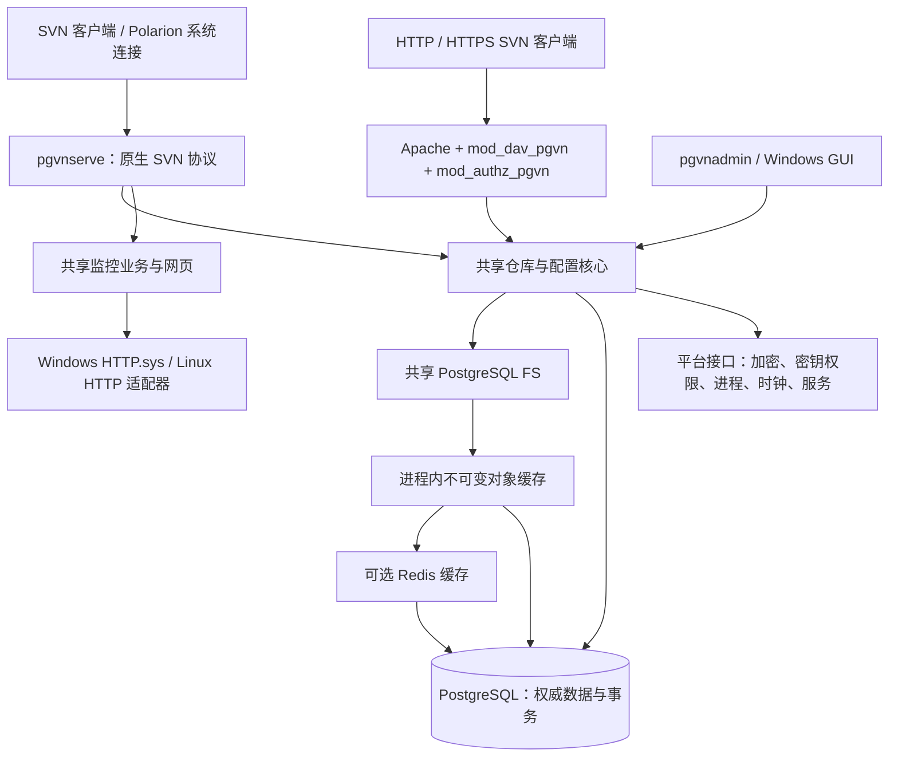

# PgVN 下一阶段计划：Linux、双平台同版本、SVN 权限 bypass 与性能优化

日期：2026-10-17

状态：待执行的工程计划；本文不代表功能已经实现或验收通过。

源码基线：`c718a6319830853c4218d8241f66c712705c29aa`。

关联计划：[原 PgVN 实施计划](2026-10-15-pgvn-implementation-plan.zh-CN.md)、[监控网页改版计划](2026-10-15-pgvn-monitor-redesign.zh-CN.md)。

## 1. 目标与推进顺序

本轮形成一条同时交付 Windows、Linux 的 PgVN 开发线，服务端、管理 CLI、Apache 模块及监控网页保持相同的协议和配置语义。先在 Windows 完成可回退的功能检查点，再把日常开发迁移到 Linux；迁移后持续保留 Windows 构建与验收能力。

推荐顺序：**契约与基线冻结 → W1：Windows bypass 与交接包 → Linux 原生移植 → Linux 部署及跨平台互通 → 基础性能优化 → Redis 收益决策 → W2：同版本双平台验收。**

Redis 是可选优化项，Linux 支持和基础功能不依赖 Redis。性能结论由对照实验决定，目前没有足够数据承诺加速倍数。

本文采用新的任务编号 `PX-*` 和里程碑 `P0/W1/L1/L2/P1/P2/W2`，不覆盖原计划的 M0–M7，也不把新里程碑通过解释为旧 M6/M7 已经完成。

## 2. 当前基线及范围

源码声明的产品版本为 `0.1.0-dev`，里程碑为 `M5`，Subversion 基础版本为 `1.14.5`，控制目录 schema 为 `6`。现有构建、打包、服务部署和测试进程管理主要面向 Windows。

目前已有 `pgvnserve`、`pgvnadmin`、`mod_dav_pgvn`、`mod_authz_pgvn` 和监控网页；Windows 维护 GUI 使用 .NET Framework 4.8/WPF。已有 Windows M0–M5 验收记录；截至本计划基线，原 M6、M7 及 PGVN-601/602 仍未完成，三协议 merge/patch 矩阵和 shelf 严格诊断检查仍保留 FAIL。详见[进度记录](../pgvn/progress.zh-CN.md)。

已记录的冻结构建、638 修订真实历史对照和部分故障探针可作为回归输入。它们不能替代新二进制的验收、性能测量、干净机器安装或 Polarion 应用验证。任何修改构建输入的工作，都要重新生成对应构建清单和证据。

首轮范围：

| 项目 | 本轮交付边界 |
| --- | --- |
| Windows | 保留现有 x64 支持、服务管理、GUI、Apache 集成和监控；新增 bypass 配置入口 |
| Linux | 原生 x86_64，规划默认 Ubuntu 24.04 LTS + systemd；部署目标在 P0 固定，不自动声称支持全部发行版 |
| 产品组件 | `pgvnserve`、`pgvnadmin`、两个 Apache 模块、同一份监控网页与 API |
| GUI | 继续交付 Windows GUI；Linux 首轮使用 CLI、部署脚本、systemd 和监控网页，不包含 GUI 跨平台重写 |
| 上游及数据库 | 先保留 SVN 1.14.5 基础及相同补丁；PG 主版本沿用现有验证线，精确依赖版本与摘要在 P0 固定 |
| 数据迁移 | 验证逻辑备份/恢复、密钥及配置迁移；不复制 Windows PostgreSQL 数据目录到 Linux |
| HA | 验证 PgVN 节点共享 PG 时的状态一致性；完整 PostgreSQL 自动故障切换和隔离旧主继续按原 HA 范围单独验收 |

Ubuntu 24.04 LTS 的官方维护周期覆盖首轮验证需求；选用它是本计划的默认工程选择，不表示已在该系统通过测试。[Ubuntu 官方发行周期](https://ubuntu.com/about/release-cycle)

## 3. 双平台架构与版本约束



图中缓存只用于符合条件的读取；写入、认证、配置代次和事务发布直接以 PostgreSQL 为准。缓存关闭时读取直接访问 PG。

双平台一致性的定义：

1. 同一开发分支、同一 Git 提交、同一产品版本和同一组 SVN 补丁；不维护各自演进的 Windows/Linux 功能分支。
2. 统一配置字段、SQL 迁移及其校验值、CLI JSON 输出、退出码、监控 API、权限与提交语义。平台路径、服务安装方式可以不同。
3. 统一构建元数据，至少包含产品版本、Git SHA、源码清单摘要、目标 OS/架构、上游版本、控制面及 FS schema、API 版本、功能能力与缓存格式版本。运行时和包清单输出相互可核对。
4. 单一版本来源生成各产品的版本信息；Windows GUI 增加相同产品版本和后端能力检查。`M5` 等历史验收标签不充当产品版本。
5. 最终发布必须由同一提交生成 Windows/Linux 两个包。平台二进制摘要可以不同；源码和迁移来源必须一致。Apache 模块还必须匹配其宿主 Apache/APR ABI。
6. 新节点检查 schema 和必需能力；旧节点不能静默忽略 bypass 等新字段。升级采用先部署支持能力的节点、再迁移/启用配置的顺序；不兼容时停止旧节点。未证明可逆的 SQL 迁移不提供原地降级承诺。

平台层建议新增到 `src/pgvn/platform/`，先定义窄接口，再迁移调用点。仓库数据结构、权限决策、SQL、协议业务和网页资源保持共用，避免复制一套 Linux 核心。

| 领域 | 当前实现 | Linux 目标及关键验收 |
| --- | --- | --- |
| 服务与停止 | Windows SCM、事件及线程 | systemd、SIGTERM、可取消 I/O、限时排空；停止时不遗留事务或工作线程 |
| 通用线程/时间 | Win32 线程、事件、`GetTickCount64` 等 | 优先复用 APR；平台封装单调时钟、取消信号、同步与进程 ID，业务计时不依赖墙上时钟 |
| 监控 HTTP | `monitor/http_win.c` 的 HTTP.sys | 增加 Linux 适配器，首选 libevent `evhttp`；网页、令牌验证和响应业务共用，复现现有请求上限、超时、响应头和关闭行为 |
| 凭据加密 | Windows CNG AES-256-GCM | OpenSSL EVP；保持现有密文字节格式、12 字节 nonce、16 字节 tag、AAD 和 key ID 语义一致 |
| 密钥文件 | 受保护 DACL、句柄校验 | 明确服务 UID/受限组、最小权限及符号链接防护；校验已打开文件的属主、权限和类型 |
| 外部 Hook | `hooks_win.c`、CreateProcess、Job Object | 不经 shell 解释的 argv 执行、输出限制、超时、停止取消及子进程清理；需要隔离逃离进程组的后代时使用专用 cgroup，不能仅靠 kill 主进程 |
| Hook 配置 | SQL 校验要求 `.exe` 文件名 | 增加兼容迁移，支持无扩展名的逻辑 Hook 名及受控平台映射；不允许把任意命令行当作可执行文件 |
| Apache 模块 | Windows SDK、PE 导入库及专用宿主 | 固定宿主 SDK，使用 apxs/构建参数检查，验证 ELF 依赖、模块装载、APR 和 SVN 私有 ABI |
| 安装包/测试 | DLL、EXE、PowerShell、Windows Job | Linux ELF/.so、受控安装脚本、systemd、进程清理适配；测试内容与断言保持一致 |

Linux HTTP 适配器需要明确设置头部、正文及时间限制；libevent 提供相关 HTTP 服务接口。[libevent HTTP API](https://libevent.org/doc/http_8h.html) Apache 模块应查询并匹配目标宿主的编译参数。[Apache apxs 文档](https://httpd.apache.org/docs/2.4/programs/apxs.html)

## 4. SVN 权限 bypass 契约

### 4.1 配置和使用边界

建议在仓库的版本化 `settings` 中新增以下字段，**这是拟新增配置，当前版本尚不支持**：

```json
{
  "identity_domain": "pgvn",
  "anonymous_access": "none",
  "authenticated_access": "write",
  "svn_authz_mode": "bypass"
}
```

`svn_authz_mode` 仅允许 `enforce` 和 `bypass`，缺省为 `enforce`。按仓库配置，通过现有配置发布流程、预期 generation 比较和审计发布；不允许客户端通过参数、请求头或用户名开启。

本计划把“关闭权限管控”定义为：**原生 `svn://` 通道对已认证账号不再计算仓库和路径访问权限；账号认证继续存在。** 未要求开放匿名访问，首轮 bypass 固定要求认证，`anonymous_access` 必须为 `none`。若未来需要匿名 bypass，应另立功能和验收，避免配置含义含糊。

在 bypass 下，已认证用户的原生 SVN 读写访问不再受 `authenticated_access` 或路径 authz 限制。进程级维护只读、仓库禁用、Hook 拒绝、锁令牌约束以及提交完整性属于运行和事务约束，仍然生效。配置发布和管理接口继续要求原有管理权限。

Polarion 只有在请求经过其应用逻辑时才能执行应用权限。直接连接 bypass SVN 端点的已认证客户端会取得该仓库的完整读写能力。因此推荐将该端点限定为回环或受控内部网络，供 Polarion 系统连接使用；保留 HTTP/DAV 的原有认证与权限策略。启用 bypass 不会自动同步 Polarion 账号，也不会把 Polarion 动态权限转化为 PgVN 规则。

### 4.2 实现范围

需要沿三条路径完成，不能只设置全仓库 `rw`：

1. **协议层**：调整 `serve/protocol.c` 和固定 SVN server 补丁，使认证后访问级别、读回调、历史过滤、目录遍历、复制来源及递归操作均遵循 bypass 契约；强制认证，保留真实提交作者。
2. **共享仓库层**：为仓库实例增加由服务入口赋予的协议上下文，仅原生 SVN 实例可携带 bypass 能力。不要在公共 `pgvn_policy_check()` 中根据仓库配置无条件放行，否则同仓库的 DAV、管理检查可能一并失效。
3. **数据库写入边界**：`pgvn_guard_mutation()`、`pgvn_guard_publish()` 在 bypass 时跳过授权判断，继续执行同一数据库事务中的凭据代次和仓库配置代次检查，以及生命周期与事务约束。不能提前返回而漏掉这些 guard。

发布开关必须产生新 generation。正在使用旧代次的命令/事务按已有失效机制拒绝并要求重连；提交与配置切换之间用现有数据库 guard 串行化。账号禁用、改密和密钥轮换后仍不得靠旧连接继续写入。已经向客户端发送的数据无法撤回，验收明确关注后续命令和事务发布边界。

管理 CLI 通过现有配置发布能力暴露新字段；Windows GUI 增加明确的“SVN 权限模式”选项，显示适用协议、认证要求、当前 generation。监控 API/网页显示该模式及原生会话信息，便于判断当前行为；不把监控网页扩展成新的管理写接口。GUI 仍走管理 CLI，防止出现两套配置逻辑。

现有 authz/group 内容保留并在发布时校验，便于恢复 `enforce` 及继续支持 DAV；是否可省去原生连接中的无用解析，在行为正确后单独测量。

### 4.3 必测用例

| 编号 | 场景 | 预期 |
| --- | --- | --- |
| B01 | 相同账号、拒绝其路径访问的 authz，分别使用 enforce/bypass | enforce 拒绝；bypass 的原生 SVN 读写成功 |
| B02 | 原生 `info/list/cat/log/blame/diff/checkout/update`，隐藏祖先、复制历史和 mergeinfo | bypass 不再因路径 authz 截断或隐藏结果；内容和历史与标准基线一致 |
| B03 | commit、空提交、跨目录 copy、递归 delete、merge、锁/解锁、修订属性修改 | 不受路径授权限制；Hook、锁和事务约束按标准语义工作 |
| B04 | bypass + `authenticated_access=none/read` | 已认证原生用户仍可读写；进程级只读仍拒绝写入 |
| B05 | 未认证、错误密码、已禁用/已撤销账号 | 拒绝访问，不开放匿名通道 |
| B06 | 同仓库同时通过 SVN、HTTP、HTTPS 和管理 authz check | bypass 只影响原生 SVN；其余仍按各自原策略判定 |
| B07 | 长连接、在途提交中切换模式、禁用仓库或变更账号代次 | 旧状态不能越过提交 guard；无额外修订或半提交 |
| B08 | 两节点观察不同配置时刻，切换 enforce/bypass | 节点均以 PG 的代次为准；不依赖进程缓存或 Redis 通知保证生效 |
| B09 | 配置缺省、未知值、旧节点、新 schema | 缺省 enforce；错误配置拒绝；不兼容旧节点不能继续提供错误语义 |
| B10 | GUI 发布、CLI 查询、网页展示、回退到 enforce | 各端一致；操作可追溯，恢复后原 authz 立即按代次规则生效 |

原生标准 SVN CLI 和实际 Polarion 使用的 SVNKit 版本都要进入客户端矩阵，不能仅用自研客户端证明兼容。

## 5. 性能路线：先减少工作量，再决定共享缓存

### 5.1 已发现的候选点

以下是源码观察，不是已测得的性能瓶颈或收益：

| 候选点 | 当前源码行为 | 第一轮改进 |
| --- | --- | --- |
| 路径查找 | `pgfs_lookup_at()` 逐层加载节点，多次数据库往返 | 按操作复用已解析路径；评估批量或递归查询，保持版本根和路径语义 |
| 目录枚举 | `pgfs_dir_entries()` 枚举后逐个 `pgfs_load_node()`，存在 N+1 形态 | 一次批量读取必要子节点信息，避免每个条目再发查询 |
| 内容读取 | 1 MiB 块用 `encode(data,'hex')` 传输并在客户端解码 | 专用 bytea 二进制查询；验证 `PQgetlength()`、边界块、空值和流式生命周期 |
| 重复元数据读取 | 缺少跨请求的有界不可变元数据缓存 | 先做进程内 LRU，缓存已提交版本中的节点、目录信息及固定版本路径映射 |
| 控制面调用 | 每命令重验配置和凭据，提交另有事务 guard | 合并可合并的查询，保留撤销与提交边界；不能用 TTL 换取授权正确性 |
| 并发与 PG | 同步调用及连接锁会影响有效并发 | 测量连接等待、SQL 次数和慢查询，再决定连接复用/有界池及索引；保留事务与锁的连接归属 |

libpq 的参数查询支持二进制结果；具体收益仍需测量。改动应限定到内容读取，不把现有所有文本字段统一切成二进制后误解码。[PostgreSQL libpq 命令执行文档](https://www.postgresql.org/docs/18/libpq-exec.html)

首轮不把 PgBouncer 事务池或异步 pipeline 当作直接替换方案，需要先验证同连接事务、会话状态、advisory lock 及 guard 的语义。目录缓存按内存预算控制，不能把整个仓库无界装入进程。

### 5.2 Redis 的收益假设与准入

| 负载/部署 | Redis 的潜在收益 | 对照方案 |
| --- | --- | --- |
| 单节点 + 本机 PG + 小仓库 | 增加一次网络和序列化成本，可能无收益 | 优先批量 SQL、PG 自身热缓存、进程内 LRU |
| 多 PgVN 节点 + 重复访问相同历史/目录 | 共享热点、降低各节点重复预热与 PG 读压力 | Redis 元数据 L2，对照各节点独立 L1 |
| PG 远端 + 高频路径/节点查询 | 可能减少远端 PG 往返 | 先消除 N+1，再测 Redis；避免每个节点查询都同步多次 GET |
| 大附件重复读取 | 可能降低 PG 字节流量，也可能被网络和内存成本抵消 | 默认只缓存元数据；内容块须单独测量并设置对象/总内存上限 |
| 全量历史扫描、冷仓库首次索引 | 复用率可能低，缓存可能被大量一次性对象污染 | 优先批量读取、顺序预取和 PG/存储吞吐优化 |
| commit/锁/权限变更 | 写入串行点和正确性仍在 PG | 优化 SQL 与事务持锁时间，Redis 不承担提交确认或权限真相 |

建议先把 Redis 用作**可关闭的二级不可变元数据缓存**，实现 cache-aside、批量读取、短超时和熔断。C 客户端依赖、协议能力、TLS、许可证及构建来源在 P2 固定，Windows/Linux 使用相同客户端契约；Windows 客户端可连接 Linux 上的 Redis，不要求交付 Windows Redis 服务端。

### 5.3 缓存正确性约束

1. PostgreSQL 始终是唯一写入和提交确认来源。提交成功及回执消歧完成前，不向共享缓存发布本次事务的对象。
2. 首轮只缓存从已发布修订可达且不可变的对象。事务根、`owner_txn` 节点、未发布内容、HEAD、锁、凭据、账号状态、权限判定、配置代次、可修改的 revision properties 和 DAV 事务状态均不进入该缓存。
3. `HEAD` 从 PG 解析为确定修订，再读取该固定版本对象；不得按“最新路径 + TTL”返回旧内容。缓存命中仍须通过当前请求的认证/授权和仓库状态检查。
4. Key 至少包含缓存格式版本、存储 incarnation/epoch、内部 repository ID、不可变对象 ID，或固定 revision + 规范路径。公开 SVN UUID 不是独立环境的缓存隔离标识。
5. 逻辑恢复、PITR、克隆/热复制等可能重用历史标识时，发布新的存储 epoch，清空/切换本机及共享缓存命名空间。更新 epoch 的恢复流程必须在允许对外服务前完成，回滚包也使用正确命名空间。
6. 缓存值采用平台无关的显式序列化，不保存结构体内存或指针；L1 对象拥有独立、受限的内存生命周期，不引用已销毁的 APR pool。缓存记录含格式和完整性信息；损坏、未知版本、缺字段均视为 miss。Redis 断连、重启、超时或驱逐后自动回源，设置有界等待/熔断和同键回源合并，避免大量慢超时或击穿拖垮请求。
7. 缓存中断只影响性能；PG 不可用时不能靠缓存承诺正常认证、权限生效或写入。失效通知只能辅助预热/清理，不能成为正确性的唯一依据。
8. 配置显式支持 `off/local/redis`；默认先为 `off` 或已验证的 `local`。监控区分 L1/L2 hit/miss、回源、错误/超时、内存、淘汰和请求耗时，不记录敏感数据或高基数路径标签。

Redis Pub/Sub 是 at-most-once 传递，断线可能丢消息，因此不能只靠它传播账号撤销、权限模式或 HEAD 失效。[Redis 官方 Pub/Sub 语义](https://redis.io/docs/latest/develop/pubsub/)

### 5.4 对照实验与决策门槛

使用隔离库和已授权冻结数据副本，分别准备小文件/深路径、大目录、二进制附件和代表性 Polarion 访问。另加可重复生成的规模数据，避免用几百修订直接外推大规模容量。记录生成种子、数据量、PG 配置、硬件、网络 RTT、依赖、客户端和包摘要。

按增量设置比较：A 原始基线；B 批量查询/二进制传输；C 在 B 上增加本机缓存；D 在 C 上增加 Redis 元数据；E 按需增加内容块缓存。每项保留独立开关，以便归因和回退。

测试维度包括 SVN/HTTP/HTTPS、enforce/bypass、1/8/32 并发、单/双 PgVN 节点、PG 本机/远端、冷/暖缓存、冷启动与稳定态。冷/暖对比要说明 PG 和 Redis 各自状态，禁止用“冷 PG 对暖 Redis”报告常态收益。每个平台单独与自身基线比较，不把不同硬件的 Windows/Linux 差值当作代码优化收益。

收集吞吐、P50/P95/P99、错误率、每操作 SQL 次数、PG CPU/I/O/返回字节、客户端与服务器 CPU、内存、连接等待、缓存命中及回源。每组至少三次稳定测量，记录波动；性能采样和故障注入分开。全仓库 verify、dump/历史/内容对照属于正确性检查，不能用更少的返回数据换速度。

拟定准入目标（P0 可按测量噪声调整，尚未达成）：代表性重复读取负载 P95 至少改善 20%，或在吞吐/P95 基本不退步时 PG 查询量/CPU 至少降低 30%；关键提交及其他负载 P95 退化控制在 5% 内。变化必须超出测量噪声。Redis 还须在已做基础优化和 L1 的版本上满足收益目标、通过故障回源，并有可接受的内存/运维成本，否则记录“不采用”，继续交付无 Redis 版本。

## 6. 里程碑及退出条件

下列为单名熟悉现有代码的开发者的初始工作量估算，单位为工程日，不是日历承诺；不含原 M6/M7 全部遗留问题修复，也不含等待新增设备。P0 后按 Linux 依赖和测试适配复杂度重估。

| 里程碑 | 环境 / 依赖 | 主要交付 | 退出条件 | 估算 |
| --- | --- | --- | --- | --- |
| P0 契约与基线 | 当前 Windows | 固定版本/依赖/平台边界、bypass 契约、已知失败清单、构建/性能基线和 W1 清单 | 任务有对应代码入口、测试与回退方式；Linux 目标及 Windows 回归运行方式明确 | 2–3 |
| **W1 Windows 迁移前检查点** | **必须在迁往 Linux 前完成** | **原生 bypass、CLI/GUI/网页展示、Windows 开发快照与交接材料** | **新增 bypass 矩阵通过，完整 M5 及受影响回归无新增失败；本机安装/启停/回退通过；全部证据与新包摘要匹配** | **6–10** |
| L1 Linux 原生构建与平台实现 | W1 完成 | ELF 产品、平台层、加密/Hook/监控适配、可重复构建 | 从干净 Linux 工作区可构建，组件可启动；核心和协议测试通过；凭据跨 OS 互解 | 8–12 |
| L2 Linux 部署与互通 | L1 | 安装/升级/备份恢复脚本、systemd、Apache 示例、Linux 接入文档 | 干净 Linux 安装、重启、自启动、停止排空、跨 OS 备份和混合节点功能矩阵通过 | 4–6 |
| P1 基础性能 | L2，可提前做 P0/W1 基线 | 批量 SQL、二进制内容传输、有界本机缓存、指标和实验报告 | 双平台正确性通过；有可重复收益，或有据回退不收益的子项 | 4–7 |
| P2 Redis 决策 | P1 | 可关闭 PoC、故障回源、与优化后基线的对照报告 | 满足收益/成本门槛才采用；不满足则保留关闭并记录决定，不阻塞核心发布 | 3–5 |
| **W2 同版本双平台验收** | L2/P1/P2 结论 | **同提交的两个包、Windows GUI 组合包、配套文档和验收清单** | **Windows 重新验证全部共享代码改动；平台间语义一致，所有新失败解决，旧 M6/M7 状态如实保留** | **4–6** |

合计约 **31–49 工程日**；P0–W1 约 **8–13 工程日**。Redis 不进入交付时，可压缩其实现投入，仍需完成书面收益决策。多平台新依赖、完整 HA、原 M6 遗留失败和真实 Polarion 应用差异可能增加工作量。

### 6.1 W1：切换开发环境前必须留下什么

W1 是用户要求的 Windows 里程碑，必须完成实物交付，不能仅留移植设计：

- `PX-W01`：完成并验证 B01–B10 中的本机可执行部分，重点是路径绕过、认证保留、HTTP 不受影响、在途提交/撤销；双节点场景可使用同一 Windows 上的两个隔离 PgVN 进程。
- `PX-W02`：CLI、GUI、网页一致显示模式；CLI/GUI 发布时保留原 authz/groups/hooks/settings，使用 generation 防止覆盖并发变更。新增字段采用新迁移，不修改既有迁移文件及摘要。
- `PX-W03`：冻结新构建，执行完整 M5（含 M0–M4）和受影响 M6 定向测试，生成匹配的浏览器/GUI 证据；原矩阵的已知 FAIL 单独列明，不重分类为 PASS，不复用旧二进制证据。
- `PX-W04`：本机隔离目录安装、初始化、启动/停止、服务重启、bypass 开关回退、数据库备份/恢复及包回退。若无干净 Windows VM，明确只完成本机安装验证，原 M7 继续待验。
- `PX-W05`：封存一个可返回的 Windows 源码检查点、构建/组合包、依赖清单、标准测试夹具、初始性能数据、命令和日志、已知问题列表。依赖下载来源和摘要可复现；真实密钥和密码单独保护，不放入 Git/普通交接包。
- `PX-W06`：迁走前准备 Windows 回归路径：优先保留当前机器作为受控 runner，或准备可恢复的 VM/构建环境及明确的人工回归时段。Linux 可以继续开发，但缺少 Windows 实测时不能发布“Windows/Linux 双平台已验收”的版本。

W1 可以交付清楚标识的 `development-snapshot`。原 release 包的 M6 完成条件继续保留，不能为了交接包而绕过或降低正式发布门禁。

### 6.2 L1/L2：Linux 任务分解

- `PX-L01`：盘点所有 Windows 头文件/API、路径、运行时加载及测试启动点，抽出平台头；编译公共部分时不再依赖 `<windows.h>`。现有 Windows 实现先保持行为，逐接口接入 Linux。
- `PX-L02`：拆分 `scripts/pgvn/build.py` 的共用源准备和 Windows 工具链；引入 Linux 配置、原生 GCC/Clang 构建及 ELF 检查。采用一套顶层构建入口，可按 target 选择实现；是否引入 CMake 在 P0 固定，避免同时迁移协议和重写全部构建系统。
- `PX-L03`：固定 SVN/APR/APU/libpq/httpd 源码或 SDK、补丁和来源；对私有结构体和符号做匹配校验。设置受控库搜索路径，检查 SONAME/RPATH/动态依赖及符号，不能偶然链接另一套系统 SVN。
- `PX-L04`：完成凭据与密钥权限适配，以跨平台固定测试向量验证 CNG/OpenSSL 的 AAD、编码、nonce/tag 和错误拒绝；从 Windows 导入后认证，Linux 改密/轮换后回到 Windows 再认证。UTF-8 用户名/路径、大小写、CRLF/LF 读取和错误码都进入测试。
- `PX-L05`：完成 Hook 平台适配及版本化声明/节点映射，覆盖不存在、不可执行、输出超限、超时、孙进程、服务停止、非 ASCII 参数；多节点缺少所需 Hook 实现时拒绝提供该仓库服务，不能无声跳过。
- `PX-L06`：Linux 监控使用与 Windows 相同资源、API 和令牌语义；验证过期/撤销、Origin、头部及正文限制、慢请求、队列、停止和浏览器关键流程。
- `PX-L07`：新增 `deploy/linux/`，提供幂等初始化、配置校验、服务安装、启停、诊断、备份和恢复。拟采用 `/opt/pgvn/<version>`、`/etc/pgvn`、`/var/lib/pgvn` 及 journald/日志目录；目录用于配置、密钥和运行状态，仓库历史数据继续在 PG。
- `PX-L08`：以专用非 root 账号运行，systemd 发出停止信号后先排空再限时结束；验证开机启动、崩溃重启、PG 晚启动、配置/密钥错误和安装路径权限。容器可用于构建/组件测试，systemd 与重启验收要有真正 Linux 主机或 VM。
- `PX-L09`：提供受支持 Apache 宿主的模块包和认证示例；验证 `apachectl -t`、装载、重载及 SVN/HTTP/HTTPS 互通。Linux 不必照搬 Windows 专用 `pgvnhttpd.exe` 宿主，但模块行为及版本信息一致。
- `PX-L10`：以逻辑数据库备份 + 受保护密钥/配置恢复验证 Windows→Linux→Windows。校验完整历史、控制面、凭据、锁/回执及 DAV 状态；SVN dump/load 只证明历史可迁移，不能替代完整状态备份。恢复后先切换缓存 epoch，再允许对外服务。

### 6.3 W2：Linux 开发后仍必须返回 Windows 验收

W1 只证明迁移前的 Windows 检查点；Linux 阶段修改的公共 FS、配置、加密格式、缓存、Hook 和构建元数据都必须在 W2 重新编译并验证。不能仅给旧 Windows 包修改版本号来配对 Linux 包。

W2 至少覆盖：

- Windows M5 完整门禁及本轮新用例；Linux 对等功能门禁。原 Windows 专项服务/ACL/GUI 测试与 Linux systemd/权限测试分别保留，不把不适用项伪造为共同通过。
- 单 Windows、单 Linux、Windows/Linux 混合节点共享 PG 的 SVN/HTTP/HTTPS 行为；交叉提交/读取、冲突、锁、配置切换、账号撤销、DAV 跨节点状态、提交回执和连接中断。
- 缓存 off/local/redis 的结果一致性、并发提交、Redis 重启/超时/驱逐/损坏、恢复后命名空间隔离；Redis 启用时 Windows 客户端也执行真实连接测试。
- 标准 SVN CLI、实际 SVNKit、非 ASCII 路径、二进制属性、历史/copy/merge、Hook、管理工具和备份恢复；原有严格差分断言不因平台迁移而放宽。
- 两个平台各自完成安装和升级/回退；Windows GUI 操作不回退。最终源码、构建、网页和测试报告摘要对应同一提交，双平台报告及已知问题进入发布清单。

缺少 Windows runner 或某项验收失败时，可继续产出标识清楚的 Linux 开发快照；该轮双平台验收保持未完成。整体对外状态仍受原 M6/M7 约束，不能因 W2 通过就宣称生产就绪。

## 7. 代码落点、任务依赖和回退

| 任务 | 现有主要入口 | 拟新增/调整内容 | 验证与回退 |
| --- | --- | --- | --- |
| PX-V01 版本 | `core/pgvn.h`、`core/build_info.c`、`scripts/pgvn/build.py`、`package.py` | 单一版本来源、平台/能力/schema 清单；配对包检查 | 对比运行时与包元数据，禁止来源不一致的双平台发布 |
| PX-B01 bypass 配置 | `core/policy_protocol.c`、`admin/policy.c`、`sql/pgvn/004_protocol.sql`（历史定义位置） | **新增**迁移扩展 settings 校验；CLI 与 GUI 发布能力 | 缺省 enforce；未知值拒绝；回退为 enforce 并保留原规则，不回写历史迁移 |
| PX-B02 原生协议 | `serve/protocol.c`、`scripts/pgvn/prepare_protocol.py`、`core/internal.h`、`repository.c` | 服务入口协议上下文、原生授权跳过、认证和命令重验 | B01–B10，尤其 DAV 与原生同时连接同一仓库 |
| PX-B03 提交保护 | `core/policy.c` 的 mutation/publish guard | 保留 PG 代次/凭据保护，条件跳过授权部分 | 配置/凭据并发切换、空提交、复制及递归写入 |
| PX-L* 平台移植 | `serve/main.c`、`listener.c`、`monitor/http_win.c/.h`、`core/credentials.c`、`hooks_win.c` | 新平台接口及 Linux 实现；原 Windows 实现并行保留 | 每接口共享契约测试 + 两平台各自系统测试 |
| PX-P01 SQL/传输 | `libsvn_fs_pg/pgfs_tree.inc`、`pgfs_streams.inc`、`pgfs.c` | 批量读、bytea 二进制、有界缓存接口和观测 | 子项独立开关；历史/内容对照及每操作 SQL 指标 |
| PX-P02 缓存 | `libsvn_fs_pg/`、提交/恢复入口、监控数据层 | 拟新增缓存模块、epoch 生命周期、可选 Redis provider | off 立即回源；回退使用兼容命名空间，Redis 无数据库权威角色 |
| PX-T01 测试适配 | `tests/pgvn/`、`scripts/pgvn/build_*` | 把进程、路径、服务、SDK 定位抽成平台适配 | 原始断言不变，缺失/未实现门禁明确失败；不以空测试代替验收 |
| PX-D01 部署与说明 | `deploy/windows/`、`tools/pgvn-manager/`、双语 README | 新增 Linux 部署与双平台/Polarion 使用说明 | 按打包产物操作验证，说明开发快照与正式包的区别 |

以上文件路径相对仓库根目录，拟新增模块/字段并非当前已经存在的功能。

依赖主线为 `PX-V01/契约 → PX-B01/02/03 → W1 → PX-L* → L2 → PX-P01 → PX-P02 决策 → W2`。性能设计和数据集准备可在 W1 前完成；缓存实现不能与 bypass 正确性验证混为一个不可拆分改动。

回退分三层：功能上把 bypass 发布回 enforce、把缓存改为 off；程序上保留上一套完整包和配置快照；数据库上只采用已验证的兼容迁移或受控备份恢复。恢复过程隔离旧服务、防止两份数据分叉写入，并生成新的缓存 epoch。不得假设新 schema 能由旧程序直接读取。

## 8. 环境与验收记录要求

规划阶段仅生成本文，不变更当前 Polarion、Apache、PgVN 服务、账号、数据库或部署配置。执行时优先使用现有明确授权范围内的隔离资源；新增 Linux 机器、外部 Redis、真实 Polarion 应用写入和其他范围变更按实际授权处理，旧隔离测试授权不自动扩大到生产环境。

每个里程碑记录源码与包摘要、平台、依赖、数据集、预期/实际结果、原始失败、遗留问题和回退结果。新报告链接原 M6/M7 待办；新通过项不得覆盖历史失败。若没有干净 Windows 环境，明确保留其安装/重启验收缺口；若没有 Linux 主机，不能把交叉编译或 WSL/容器启动等同于目标部署完成。

本轮的第一个可执行检查点是 **P0 后在当前 Windows 完成 W1**。迁移 Linux 日常开发环境以 W1 交付为前提；最终“Windows/Linux 同版本可用于内部验证”以 W2 及适用的原项目验收条件为准。
