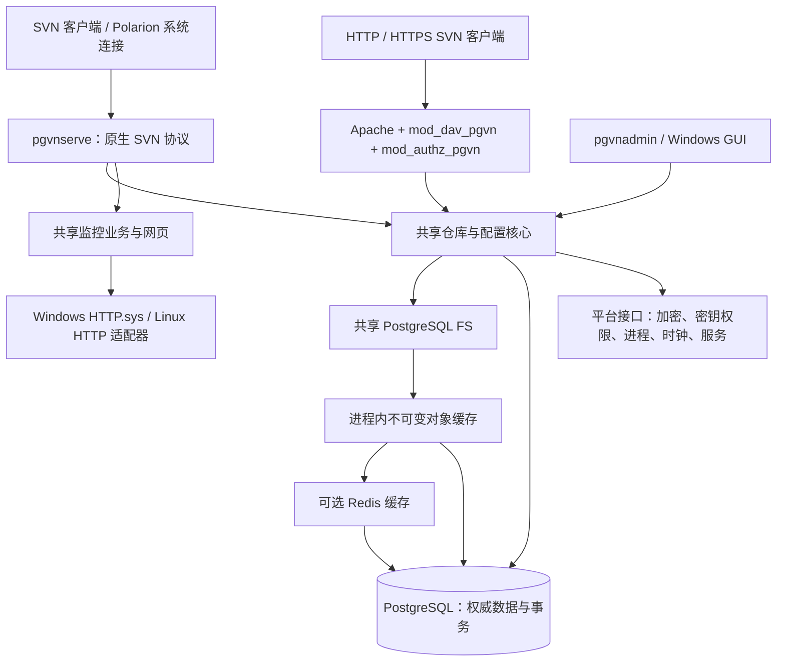

# PgVN 下一阶段计划：Linux、双平台同版本、SVN 权限 bypass 与性能优化

日期：2026-10-17

状态：执行中；共享版本、bypass、固定 FS SDK、内容传输探索及 Linux 凭据组件已推进，详见第 9–12 节。按用户最新要求先跳过 Windows 验收，继续 Linux 开发；W1/W2 保留未验状态。

源码基线：`c718a6319830853c4218d8241f66c712705c29aa`。

关联计划：[原 PgVN 实施计划](2026-10-15-pgvn-implementation-plan.zh-CN.md)、[监控网页改版计划](2026-10-15-pgvn-monitor-redesign.zh-CN.md)。

## 1. 目标与推进顺序

本轮形成一条同时交付 Windows、Linux 的 PgVN 开发线，服务端、管理 CLI、Apache 模块及监控网页保持相同的协议和配置语义。原先安排先完成 Windows 检查点再迁移日常开发；用户于 2026-10-17 明确要求“先跳过 windows 的验收”。当前直接推进 Linux 开发，Windows 构建与回归清单保留，待后续补验。

推荐顺序：**契约与基线 → bypass 源码及组件验证 → Linux 原生移植 → Linux 部署及互通 → 基础性能优化 → Redis 收益决策 → 补做 Windows W1 / W2 同版本双平台验收。**

Redis 是可选优化项，Linux 支持和基础功能不依赖 Redis。性能结论由对照实验决定，目前没有足够数据承诺加速倍数。

本文采用新的任务编号 `PX-*` 和里程碑 `P0/W1/L1/L2/P1/P2/W2`，不覆盖原计划的 M0–M7，也不把新里程碑通过解释为旧 M6/M7 已经完成。

## 2. 当前基线及范围

本计划起始源码基线的产品版本为 `0.1.0-dev`，里程碑为 `M5`，Subversion 基础版本为 `1.14.5`，控制目录 schema 为 `6`。当前开发源码已进入 schema 7，执行记录见第 10、11 节。现有构建、打包、服务部署和测试进程管理主要面向 Windows。

目前已有 `pgvnserve`、`pgvnadmin`、`mod_dav_pgvn`、`mod_authz_pgvn` 和监控网页；Windows 维护 GUI 使用 .NET Framework 4.8/WPF。已有 Windows M0–M5 验收记录；截至本计划基线，原 M6、M7 及 PGVN-601/602 仍未完成，三协议 merge/patch 矩阵和 shelf 严格诊断检查仍保留 FAIL。详见[进度记录](../pgvn/progress.zh-CN.md)。

已记录的冻结构建、638 修订真实历史对照和部分故障探针可作为回归输入。它们不能替代新二进制的验收、性能测量、干净机器安装或 Polarion 应用验证。任何修改构建输入的工作，都要重新生成对应构建清单和证据。

首轮范围：

| 项目 | 本轮交付边界 |
| --- | --- |
| Windows | 保留现有 x64 支持、服务管理、GUI、Apache 集成和监控；新增 bypass 配置入口 |
| Linux | 原生 x86_64，规划默认 Ubuntu 24.04 LTS + systemd；部署目标在 P0 固定，不自动声称支持全部发行版 |
| 产品组件 | `pgvnserve`、`pgvnadmin`、两个 Apache 模块、同一份监控网页与 API |
| GUI | 继续交付 Windows GUI；Linux 首轮使用 CLI、部署脚本、systemd 和监控网页，不包含 GUI 跨平台重写 |
| 上游及数据库 | 先保留 SVN 1.14.5 基础及相同补丁；PG 主版本沿用现有验证线，精确依赖版本与摘要在 P0 固定 |
| 数据迁移 | 验证逻辑备份/恢复、密钥及配置迁移；不复制 Windows PostgreSQL 数据目录到 Linux |
| HA | 验证 PgVN 节点共享 PG 时的状态一致性；完整 PostgreSQL 自动故障切换和隔离旧主继续按原 HA 范围单独验收 |

Ubuntu 24.04 LTS 的官方维护周期覆盖首轮验证需求；选用它是本计划的默认工程选择，不表示已在该系统通过测试。[Ubuntu 官方发行周期](https://ubuntu.com/about/release-cycle)

## 3. 双平台架构与版本约束



图中缓存只用于符合条件的读取；写入、认证、配置代次和事务发布直接以 PostgreSQL 为准。缓存关闭时读取直接访问 PG。

双平台一致性的定义：

1. 同一开发分支、同一 Git 提交、同一产品版本和同一组 SVN 补丁；不维护各自演进的 Windows/Linux 功能分支。
2. 统一配置字段、SQL 迁移及其校验值、CLI JSON 输出、退出码、监控 API、权限与提交语义。平台路径、服务安装方式可以不同。
3. 统一构建元数据，至少包含产品版本、Git SHA、源码清单摘要、目标 OS/架构、上游版本、控制面及 FS schema、API 版本、功能能力与缓存格式版本。运行时和包清单输出相互可核对。
4. 单一版本来源生成各产品的版本信息；Windows GUI 增加相同产品版本和后端能力检查。`M5` 等历史验收标签不充当产品版本。
5. 最终发布必须由同一提交生成 Windows/Linux 两个包。平台二进制摘要可以不同；源码和迁移来源必须一致。Apache 模块还必须匹配其宿主 Apache/APR ABI。
6. 新节点检查 schema 和必需能力；旧节点不能静默忽略 bypass 等新字段。升级采用先部署支持能力的节点、再迁移/启用配置的顺序；不兼容时停止旧节点。未证明可逆的 SQL 迁移不提供原地降级承诺。

平台层建议新增到 `src/pgvn/platform/`，先定义窄接口，再迁移调用点。仓库数据结构、权限决策、SQL、协议业务和网页资源保持共用，避免复制一套 Linux 核心。

| 领域 | 当前实现 | Linux 目标及关键验收 |
| --- | --- | --- |
| 服务与停止 | Windows SCM、事件及线程 | systemd、SIGTERM、可取消 I/O、限时排空；停止时不遗留事务或工作线程 |
| 通用线程/时间 | Win32 线程、事件、`GetTickCount64` 等 | 优先复用 APR；平台封装单调时钟、取消信号、同步与进程 ID，业务计时不依赖墙上时钟 |
| 监控 HTTP | `monitor/http_win.c` 的 HTTP.sys | 增加 Linux 适配器，首选 libevent `evhttp`；网页、令牌验证和响应业务共用，复现现有请求上限、超时、响应头和关闭行为 |
| 凭据加密 | Windows CNG AES-256-GCM | OpenSSL EVP；保持现有密文字节格式、12 字节 nonce、16 字节 tag、AAD 和 key ID 语义一致 |
| 密钥文件 | 受保护 DACL、句柄校验 | 明确服务 UID/受限组、最小权限及符号链接防护；校验已打开文件的属主、权限和类型 |
| 外部 Hook | `hooks_win.c`、CreateProcess、Job Object | 不经 shell 解释的 argv 执行、输出限制、超时、停止取消及子进程清理；需要隔离逃离进程组的后代时使用专用 cgroup，不能仅靠 kill 主进程 |
| Hook 配置 | SQL 校验要求 `.exe` 文件名 | 增加兼容迁移，支持无扩展名的逻辑 Hook 名及受控平台映射；不允许把任意命令行当作可执行文件 |
| Apache 模块 | Windows SDK、PE 导入库及专用宿主 | 固定宿主 SDK，使用 apxs/构建参数检查，验证 ELF 依赖、模块装载、APR 和 SVN 私有 ABI |
| 安装包/测试 | DLL、EXE、PowerShell、Windows Job | Linux ELF/.so、受控安装脚本、systemd、进程清理适配；测试内容与断言保持一致 |

Linux HTTP 适配器需要明确设置头部、正文及时间限制；libevent 提供相关 HTTP 服务接口。[libevent HTTP API](https://libevent.org/doc/http_8h.html) Apache 模块应查询并匹配目标宿主的编译参数。[Apache apxs 文档](https://httpd.apache.org/docs/2.4/programs/apxs.html)

## 4. SVN 权限 bypass 契约

### 4.1 配置和使用边界

schema 7 在仓库的版本化 `settings` 中新增以下字段。**开发源码已接入，既有 Windows 历史包不支持；完整协议矩阵仍待验证**：

```json
{
  "identity_domain": "pgvn",
  "anonymous_access": "none",
  "authenticated_access": "write",
  "svn_authz_mode": "bypass"
}
```

`svn_authz_mode` 仅允许 `enforce` 和 `bypass`，缺省为 `enforce`。按仓库配置，通过现有配置发布流程、预期 generation 比较和审计发布；不允许客户端通过参数、请求头或用户名开启。

本计划把“关闭权限管控”定义为：**原生 `svn://` 通道对已认证账号不再计算仓库和路径访问权限；账号认证继续存在。** 未要求开放匿名访问，首轮 bypass 固定要求认证，`anonymous_access` 必须为 `none`。若未来需要匿名 bypass，应另立功能和验收，避免配置含义含糊。

在 bypass 下，已认证用户的原生 SVN 读写访问不再受 `authenticated_access` 或路径 authz 限制。进程级维护只读、仓库禁用、Hook 拒绝、锁令牌约束以及提交完整性属于运行和事务约束，仍然生效。配置发布和管理接口继续要求原有管理权限。

Polarion 只有在请求经过其应用逻辑时才能执行应用权限。直接连接 bypass SVN 端点的已认证客户端会取得该仓库的完整读写能力。因此推荐将该端点限定为回环或受控内部网络，供 Polarion 系统连接使用；保留 HTTP/DAV 的原有认证与权限策略。启用 bypass 不会自动同步 Polarion 账号，也不会把 Polarion 动态权限转化为 PgVN 规则。

### 4.2 实现范围

需要沿三条路径完成，不能只设置全仓库 `rw`：

1. **协议层**：调整 `serve/protocol.c` 和固定 SVN server 补丁，使认证后访问级别、读回调、历史过滤、目录遍历、复制来源及递归操作均遵循 bypass 契约；强制认证，保留真实提交作者。
2. **共享仓库层**：为仓库实例增加由服务入口赋予的协议上下文，仅原生 SVN 实例可携带 bypass 能力。不要在公共 `pgvn_policy_check()` 中根据仓库配置无条件放行，否则同仓库的 DAV、管理检查可能一并失效。
3. **数据库写入边界**：`pgvn_guard_mutation()`、`pgvn_guard_publish()` 在 bypass 时跳过授权判断，继续执行同一数据库事务中的凭据代次和仓库配置代次检查，以及生命周期与事务约束。不能提前返回而漏掉这些 guard。

发布开关必须产生新 generation。正在使用旧代次的命令/事务按已有失效机制拒绝并要求重连；提交与配置切换之间用现有数据库 guard 串行化。账号禁用、改密和密钥轮换后仍不得靠旧连接继续写入。已经向客户端发送的数据无法撤回，验收明确关注后续命令和事务发布边界。

管理 CLI 通过现有配置发布能力暴露新字段；Windows GUI 增加明确的“SVN 权限模式”选项，显示适用协议、认证要求、当前 generation。监控 API/网页显示该模式及原生会话信息，便于判断当前行为；不把监控网页扩展成新的管理写接口。GUI 仍走管理 CLI，防止出现两套配置逻辑。

现有 authz/group 内容保留并在发布时校验，便于恢复 `enforce` 及继续支持 DAV；是否可省去原生连接中的无用解析，在行为正确后单独测量。

### 4.3 必测用例

| 编号 | 场景 | 预期 |
| --- | --- | --- |
| B01 | 相同账号、拒绝其路径访问的 authz，分别使用 enforce/bypass | enforce 拒绝；bypass 的原生 SVN 读写成功 |
| B02 | 原生 `info/list/cat/log/blame/diff/checkout/update`，隐藏祖先、复制历史和 mergeinfo | bypass 不再因路径 authz 截断或隐藏结果；内容和历史与标准基线一致 |
| B03 | commit、空提交、跨目录 copy、递归 delete、merge、锁/解锁、修订属性修改 | 不受路径授权限制；Hook、锁和事务约束按标准语义工作 |
| B04 | bypass + `authenticated_access=none/read` | 已认证原生用户仍可读写；进程级只读仍拒绝写入 |
| B05 | 未认证、错误密码、已禁用/已撤销账号 | 拒绝访问，不开放匿名通道 |
| B06 | 同仓库同时通过 SVN、HTTP、HTTPS 和管理 authz check | bypass 只影响原生 SVN；其余仍按各自原策略判定 |
| B07 | 长连接、在途提交中切换模式、禁用仓库或变更账号代次 | 旧状态不能越过提交 guard；无额外修订或半提交 |
| B08 | 两节点观察不同配置时刻，切换 enforce/bypass | 节点均以 PG 的代次为准；不依赖进程缓存或 Redis 通知保证生效 |
| B09 | 配置缺省、未知值、旧节点、新 schema | 缺省 enforce；错误配置拒绝；不兼容旧节点不能继续提供错误语义 |
| B10 | GUI 发布、CLI 查询、网页展示、回退到 enforce | 各端一致；操作可追溯，恢复后原 authz 立即按代次规则生效 |

原生标准 SVN CLI 和实际 Polarion 使用的 SVNKit 版本都要进入客户端矩阵，不能仅用自研客户端证明兼容。

## 5. 性能路线：先减少工作量，再决定共享缓存

### 5.1 已发现的候选点

以下是源码观察，不是已测得的性能瓶颈或收益：

| 候选点 | 当前源码行为 | 第一轮改进 |
| --- | --- | --- |
| 路径查找 | `pgfs_lookup_at()` 逐层加载节点，多次数据库往返 | 按操作复用已解析路径；评估批量或递归查询，保持版本根和路径语义 |
| 目录枚举 | `pgfs_dir_entries()` 枚举后逐个 `pgfs_load_node()`，存在 N+1 形态 | 一次批量读取必要子节点信息，避免每个条目再发查询 |
| 内容读取 | 1 MiB 块用 `encode(data,'hex')` 传输并在客户端解码 | 专用 bytea 二进制查询；验证 `PQgetlength()`、边界块、空值和流式生命周期 |
| 重复元数据读取 | 缺少跨请求的有界不可变元数据缓存 | 先做进程内 LRU，缓存已提交版本中的节点、目录信息及固定版本路径映射 |
| 控制面调用 | 每命令重验配置和凭据，提交另有事务 guard | 合并可合并的查询，保留撤销与提交边界；不能用 TTL 换取授权正确性 |
| 并发与 PG | 同步调用及连接锁会影响有效并发 | 测量连接等待、SQL 次数和慢查询，再决定连接复用/有界池及索引；保留事务与锁的连接归属 |

libpq 的参数查询支持二进制结果；具体收益仍需测量。改动应限定到内容读取，不把现有所有文本字段统一切成二进制后误解码。[PostgreSQL libpq 命令执行文档](https://www.postgresql.org/docs/18/libpq-exec.html)

首轮不把 PgBouncer 事务池或异步 pipeline 当作直接替换方案，需要先验证同连接事务、会话状态、advisory lock 及 guard 的语义。目录缓存按内存预算控制，不能把整个仓库无界装入进程。

### 5.2 Redis 的收益假设与准入

| 负载/部署 | Redis 的潜在收益 | 对照方案 |
| --- | --- | --- |
| 单节点 + 本机 PG + 小仓库 | 增加一次网络和序列化成本，可能无收益 | 优先批量 SQL、PG 自身热缓存、进程内 LRU |
| 多 PgVN 节点 + 重复访问相同历史/目录 | 共享热点、降低各节点重复预热与 PG 读压力 | Redis 元数据 L2，对照各节点独立 L1 |
| PG 远端 + 高频路径/节点查询 | 可能减少远端 PG 往返 | 先消除 N+1，再测 Redis；避免每个节点查询都同步多次 GET |
| 大附件重复读取 | 可能降低 PG 字节流量，也可能被网络和内存成本抵消 | 默认只缓存元数据；内容块须单独测量并设置对象/总内存上限 |
| 全量历史扫描、冷仓库首次索引 | 复用率可能低，缓存可能被大量一次性对象污染 | 优先批量读取、顺序预取和 PG/存储吞吐优化 |
| commit/锁/权限变更 | 写入串行点和正确性仍在 PG | 优化 SQL 与事务持锁时间，Redis 不承担提交确认或权限真相 |

建议先把 Redis 用作**可关闭的二级不可变元数据缓存**，实现 cache-aside、批量读取、短超时和熔断。C 客户端依赖、协议能力、TLS、许可证及构建来源在 P2 固定，Windows/Linux 使用相同客户端契约；Windows 客户端可连接 Linux 上的 Redis，不要求交付 Windows Redis 服务端。

### 5.3 缓存正确性约束

1. PostgreSQL 始终是唯一写入和提交确认来源。提交成功及回执消歧完成前，不向共享缓存发布本次事务的对象。
2. 首轮只缓存从已发布修订可达且不可变的对象。事务根、`owner_txn` 节点、未发布内容、HEAD、锁、凭据、账号状态、权限判定、配置代次、可修改的 revision properties 和 DAV 事务状态均不进入该缓存。
3. `HEAD` 从 PG 解析为确定修订，再读取该固定版本对象；不得按“最新路径 + TTL”返回旧内容。缓存命中仍须通过当前请求的认证/授权和仓库状态检查。
4. Key 至少包含缓存格式版本、存储 incarnation/epoch、内部 repository ID、不可变对象 ID，或固定 revision + 规范路径。公开 SVN UUID 不是独立环境的缓存隔离标识。
5. 逻辑恢复、PITR、克隆/热复制等可能重用历史标识时，发布新的存储 epoch，清空/切换本机及共享缓存命名空间。更新 epoch 的恢复流程必须在允许对外服务前完成，回滚包也使用正确命名空间。
6. 缓存值采用平台无关的显式序列化，不保存结构体内存或指针；L1 对象拥有独立、受限的内存生命周期，不引用已销毁的 APR pool。缓存记录含格式和完整性信息；损坏、未知版本、缺字段均视为 miss。Redis 断连、重启、超时或驱逐后自动回源，设置有界等待/熔断和同键回源合并，避免大量慢超时或击穿拖垮请求。
7. 缓存中断只影响性能；PG 不可用时不能靠缓存承诺正常认证、权限生效或写入。失效通知只能辅助预热/清理，不能成为正确性的唯一依据。
8. 配置显式支持 `off/local/redis`；默认先为 `off` 或已验证的 `local`。监控区分 L1/L2 hit/miss、回源、错误/超时、内存、淘汰和请求耗时，不记录敏感数据或高基数路径标签。

Redis Pub/Sub 是 at-most-once 传递，断线可能丢消息，因此不能只靠它传播账号撤销、权限模式或 HEAD 失效。[Redis 官方 Pub/Sub 语义](https://redis.io/docs/latest/develop/pubsub/)

### 5.4 对照实验与决策门槛

使用隔离库和已授权冻结数据副本，分别准备小文件/深路径、大目录、二进制附件和代表性 Polarion 访问。另加可重复生成的规模数据，避免用几百修订直接外推大规模容量。记录生成种子、数据量、PG 配置、硬件、网络 RTT、依赖、客户端和包摘要。

按增量设置比较：A 原始基线；B 批量查询/二进制传输；C 在 B 上增加本机缓存；D 在 C 上增加 Redis 元数据；E 按需增加内容块缓存。每项保留独立开关，以便归因和回退。

测试维度包括 SVN/HTTP/HTTPS、enforce/bypass、1/8/32 并发、单/双 PgVN 节点、PG 本机/远端、冷/暖缓存、冷启动与稳定态。冷/暖对比要说明 PG 和 Redis 各自状态，禁止用“冷 PG 对暖 Redis”报告常态收益。每个平台单独与自身基线比较，不把不同硬件的 Windows/Linux 差值当作代码优化收益。

收集吞吐、P50/P95/P99、错误率、每操作 SQL 次数、PG CPU/I/O/返回字节、客户端与服务器 CPU、内存、连接等待、缓存命中及回源。每组至少三次稳定测量，记录波动；性能采样和故障注入分开。全仓库 verify、dump/历史/内容对照属于正确性检查，不能用更少的返回数据换速度。

拟定准入目标（P0 可按测量噪声调整，尚未达成）：代表性重复读取负载 P95 至少改善 20%，或在吞吐/P95 基本不退步时 PG 查询量/CPU 至少降低 30%；关键提交及其他负载 P95 退化控制在 5% 内。变化必须超出测量噪声。Redis 还须在已做基础优化和 L1 的版本上满足收益目标、通过故障回源，并有可接受的内存/运维成本，否则记录“不采用”，继续交付无 Redis 版本。

## 6. 里程碑及退出条件

下列为单名熟悉现有代码的开发者的初始工作量估算，单位为工程日，不是日历承诺；不含原 M6/M7 全部遗留问题修复，也不含等待新增设备。P0 后按 Linux 依赖和测试适配复杂度重估。

| 里程碑 | 环境 / 依赖 | 主要交付 | 退出条件 | 估算 |
| --- | --- | --- | --- | --- |
| P0 契约与基线 | 当前 Windows | 固定版本/依赖/平台边界、bypass 契约、已知失败清单、构建/性能基线和 W1 清单 | 任务有对应代码入口、测试与回退方式；Linux 目标及 Windows 回归运行方式明确 | 2–3 |
| **W1 Windows 检查点（暂缓）** | **按用户指示后续补验** | **原生 bypass、CLI/GUI/网页展示、Windows 开发快照与交接材料** | **新增 bypass 矩阵通过，完整 M5 及受影响回归无新增失败；本机安装/启停/回退通过；全部证据与新包摘要匹配** | **6–10** |
| L1 Linux 原生构建与平台实现 | 共享契约及 bypass 源码；W1 验收暂缓 | ELF 产品、平台层、加密/Hook/监控适配、可重复构建 | 从干净 Linux 工作区可构建，组件可启动；核心和协议测试通过；凭据跨 OS 互解 | 8–12 |
| L2 Linux 部署与互通 | L1 | 安装/升级/备份恢复脚本、systemd、Apache 示例、Linux 接入文档 | 干净 Linux 安装、重启、自启动、停止排空、跨 OS 备份和混合节点功能矩阵通过 | 4–6 |
| P1 基础性能 | L2，可提前做 P0/W1 基线 | 批量 SQL、二进制内容传输、有界本机缓存、指标和实验报告 | 双平台正确性通过；有可重复收益，或有据回退不收益的子项 | 4–7 |
| P2 Redis 决策 | P1 | 可关闭 PoC、故障回源、与优化后基线的对照报告 | 满足收益/成本门槛才采用；不满足则保留关闭并记录决定，不阻塞核心发布 | 3–5 |
| **W2 同版本双平台验收** | L2/P1/P2 结论 | **同提交的两个包、Windows GUI 组合包、配套文档和验收清单** | **Windows 重新验证全部共享代码改动；平台间语义一致，所有新失败解决，旧 M6/M7 状态如实保留** | **4–6** |

合计约 **31–49 工程日**；P0–W1 约 **8–13 工程日**。Redis 不进入交付时，可压缩其实现投入，仍需完成书面收益决策。多平台新依赖、完整 HA、原 M6 遗留失败和真实 Polarion 应用差异可能增加工作量。

### 6.1 W1：Windows 补验与交接清单（本轮暂缓）

W1 继续作为 Windows 实物交付与验收清单保留。按 2026-10-17 的新指示先跳过 Windows 验收，Linux 开发继续；暂缓不计作验收通过：

- `PX-W01`：完成并验证 B01–B10 中的本机可执行部分，重点是路径绕过、认证保留、HTTP 不受影响、在途提交/撤销；双节点场景可使用同一 Windows 上的两个隔离 PgVN 进程。
- `PX-W02`：CLI、GUI、网页一致显示模式；CLI/GUI 发布时保留原 authz/groups/hooks/settings，使用 generation 防止覆盖并发变更。新增字段采用新迁移，不修改既有迁移文件及摘要。
- `PX-W03`：冻结新构建，执行完整 M5（含 M0–M4）和受影响 M6 定向测试，生成匹配的浏览器/GUI 证据；原矩阵的已知 FAIL 单独列明，不重分类为 PASS，不复用旧二进制证据。
- `PX-W04`：本机隔离目录安装、初始化、启动/停止、服务重启、bypass 开关回退、数据库备份/恢复及包回退。若无干净 Windows VM，明确只完成本机安装验证，原 M7 继续待验。
- `PX-W05`：封存一个可返回的 Windows 源码检查点、构建/组合包、依赖清单、标准测试夹具、初始性能数据、命令和日志、已知问题列表。依赖下载来源和摘要可复现；真实密钥和密码单独保护，不放入 Git/普通交接包。
- `PX-W06`：迁走前准备 Windows 回归路径：优先保留当前机器作为受控 runner，或准备可恢复的 VM/构建环境及明确的人工回归时段。Linux 可以继续开发，但缺少 Windows 实测时不能发布“Windows/Linux 双平台已验收”的版本。

W1 可以交付清楚标识的 `development-snapshot`。原 release 包的 M6 完成条件继续保留，不能为了交接包而绕过或降低正式发布门禁。

### 6.2 L1/L2：Linux 任务分解

- `PX-L01`：盘点所有 Windows 头文件/API、路径、运行时加载及测试启动点，抽出平台头；编译公共部分时不再依赖 `<windows.h>`。现有 Windows 实现先保持行为，逐接口接入 Linux。
- `PX-L02`：拆分 `scripts/pgvn/build.py` 的共用源准备和 Windows 工具链；引入 Linux 配置、原生 GCC/Clang 构建及 ELF 检查。采用一套顶层构建入口，可按 target 选择实现；是否引入 CMake 在 P0 固定，避免同时迁移协议和重写全部构建系统。
- `PX-L03`：固定 SVN/APR/APU/libpq/httpd 源码或 SDK、补丁和来源；对私有结构体和符号做匹配校验。设置受控库搜索路径，检查 SONAME/RPATH/动态依赖及符号，不能偶然链接另一套系统 SVN。
- `PX-L04`：完成凭据与密钥权限适配，以跨平台固定测试向量验证 CNG/OpenSSL 的 AAD、编码、nonce/tag 和错误拒绝；从 Windows 导入后认证，Linux 改密/轮换后回到 Windows 再认证。UTF-8 用户名/路径、大小写、CRLF/LF 读取和错误码都进入测试。
- `PX-L05`：完成 Hook 平台适配及版本化声明/节点映射，覆盖不存在、不可执行、输出超限、超时、孙进程、服务停止、非 ASCII 参数；多节点缺少所需 Hook 实现时拒绝提供该仓库服务，不能无声跳过。
- `PX-L06`：Linux 监控使用与 Windows 相同资源、API 和令牌语义；验证过期/撤销、Origin、头部及正文限制、慢请求、队列、停止和浏览器关键流程。
- `PX-L07`：新增 `deploy/linux/`，提供幂等初始化、配置校验、服务安装、启停、诊断、备份和恢复。拟采用 `/opt/pgvn/<version>`、`/etc/pgvn`、`/var/lib/pgvn` 及 journald/日志目录；目录用于配置、密钥和运行状态，仓库历史数据继续在 PG。
- `PX-L08`：以专用非 root 账号运行，systemd 发出停止信号后先排空再限时结束；验证开机启动、崩溃重启、PG 晚启动、配置/密钥错误和安装路径权限。容器可用于构建/组件测试，systemd 与重启验收要有真正 Linux 主机或 VM。
- `PX-L09`：提供受支持 Apache 宿主的模块包和认证示例；验证 `apachectl -t`、装载、重载及 SVN/HTTP/HTTPS 互通。Linux 不必照搬 Windows 专用 `pgvnhttpd.exe` 宿主，但模块行为及版本信息一致。
- `PX-L10`：以逻辑数据库备份 + 受保护密钥/配置恢复验证 Windows→Linux→Windows。校验完整历史、控制面、凭据、锁/回执及 DAV 状态；SVN dump/load 只证明历史可迁移，不能替代完整状态备份。恢复后先切换缓存 epoch，再允许对外服务。

### 6.3 W2：Linux 开发后仍必须返回 Windows 验收

W1 只证明迁移前的 Windows 检查点；Linux 阶段修改的公共 FS、配置、加密格式、缓存、Hook 和构建元数据都必须在 W2 重新编译并验证。不能仅给旧 Windows 包修改版本号来配对 Linux 包。

W2 至少覆盖：

- Windows M5 完整门禁及本轮新用例；Linux 对等功能门禁。原 Windows 专项服务/ACL/GUI 测试与 Linux systemd/权限测试分别保留，不把不适用项伪造为共同通过。
- 单 Windows、单 Linux、Windows/Linux 混合节点共享 PG 的 SVN/HTTP/HTTPS 行为；交叉提交/读取、冲突、锁、配置切换、账号撤销、DAV 跨节点状态、提交回执和连接中断。
- 缓存 off/local/redis 的结果一致性、并发提交、Redis 重启/超时/驱逐/损坏、恢复后命名空间隔离；Redis 启用时 Windows 客户端也执行真实连接测试。
- 标准 SVN CLI、实际 SVNKit、非 ASCII 路径、二进制属性、历史/copy/merge、Hook、管理工具和备份恢复；原有严格差分断言不因平台迁移而放宽。
- 两个平台各自完成安装和升级/回退；Windows GUI 操作不回退。最终源码、构建、网页和测试报告摘要对应同一提交，双平台报告及已知问题进入发布清单。

缺少 Windows runner 或某项验收失败时，可继续产出标识清楚的 Linux 开发快照；该轮双平台验收保持未完成。整体对外状态仍受原 M6/M7 约束，不能因 W2 通过就宣称生产就绪。

## 7. 代码落点、任务依赖和回退

| 任务 | 现有主要入口 | 拟新增/调整内容 | 验证与回退 |
| --- | --- | --- | --- |
| PX-V01 版本 | `core/pgvn.h`、`core/build_info.c`、`scripts/pgvn/build.py`、`package.py` | 单一版本来源、平台/能力/schema 清单；配对包检查 | 对比运行时与包元数据，禁止来源不一致的双平台发布 |
| PX-B01 bypass 配置 | `core/policy_protocol.c`、`admin/policy.c`、`sql/pgvn/004_protocol.sql`（历史定义位置） | **新增**迁移扩展 settings 校验；CLI 与 GUI 发布能力 | 缺省 enforce；未知值拒绝；回退为 enforce 并保留原规则，不回写历史迁移 |
| PX-B02 原生协议 | `serve/protocol.c`、`scripts/pgvn/prepare_protocol.py`、`core/internal.h`、`repository.c` | 服务入口协议上下文、原生授权跳过、认证和命令重验 | B01–B10，尤其 DAV 与原生同时连接同一仓库 |
| PX-B03 提交保护 | `core/policy.c` 的 mutation/publish guard | 保留 PG 代次/凭据保护，条件跳过授权部分 | 配置/凭据并发切换、空提交、复制及递归写入 |
| PX-L* 平台移植 | `serve/main.c`、`listener.c`、`monitor/http_win.c/.h`、`core/credentials.c`、`hooks_win.c` | 新平台接口及 Linux 实现；原 Windows 实现并行保留 | 每接口共享契约测试 + 两平台各自系统测试 |
| PX-P01 SQL/传输 | `libsvn_fs_pg/pgfs_tree.inc`、`pgfs_streams.inc`、`pgfs.c` | 批量读、bytea 二进制、有界缓存接口和观测 | 子项独立开关；历史/内容对照及每操作 SQL 指标 |
| PX-P02 缓存 | `libsvn_fs_pg/`、提交/恢复入口、监控数据层 | 拟新增缓存模块、epoch 生命周期、可选 Redis provider | off 立即回源；回退使用兼容命名空间，Redis 无数据库权威角色 |
| PX-T01 测试适配 | `tests/pgvn/`、`scripts/pgvn/build_*` | 把进程、路径、服务、SDK 定位抽成平台适配 | 原始断言不变，缺失/未实现门禁明确失败；不以空测试代替验收 |
| PX-D01 部署与说明 | `deploy/windows/`、`tools/pgvn-manager/`、双语 README | 新增 Linux 部署与双平台/Polarion 使用说明 | 按打包产物操作验证，说明开发快照与正式包的区别 |

以上文件路径相对仓库根目录。任务表包含已落地和待实现内容，以后续执行检查点及证据区分，不能把全部任务视为已经交付。

依赖主线为 `PX-V01/契约 → PX-B01/02/03 → PX-L* → L2 → PX-P01 → PX-P02 决策 → Windows W1/W2 补验`。性能设计和数据集准备可在 W1 前完成；缓存实现不能与 bypass 正确性验证混为一个不可拆分改动。

回退分三层：功能上把 bypass 发布回 enforce、把缓存改为 off；程序上保留上一套完整包和配置快照；数据库上只采用已验证的兼容迁移或受控备份恢复。恢复过程隔离旧服务、防止两份数据分叉写入，并生成新的缓存 epoch。不得假设新 schema 能由旧程序直接读取。

## 8. 环境与验收记录要求

规划阶段仅生成本文，不变更当前 Polarion、Apache、PgVN 服务、账号、数据库或部署配置。执行时优先使用现有明确授权范围内的隔离资源；新增 Linux 机器、外部 Redis、真实 Polarion 应用写入和其他范围变更按实际授权处理，旧隔离测试授权不自动扩大到生产环境。

每个里程碑记录源码与包摘要、平台、依赖、数据集、预期/实际结果、原始失败、遗留问题和回退结果。新报告链接原 M6/M7 待办；新通过项不得覆盖历史失败。若没有干净 Windows 环境，明确保留其安装/重启验收缺口；若没有 Linux 主机，不能把交叉编译或 WSL/容器启动等同于目标部署完成。

**执行调整：用户已要求先跳过 Windows 验收，Linux 日常开发继续，W1 不再作为本轮开发前置阻塞。** 最终“Windows/Linux 同版本已验收”仍以实际 W1/W2 和适用的原项目验收条件为准；本轮 Linux 组件检查不充当 Windows 结果。

<a id="p0-version-metadata"></a>

## 9. 执行检查点：P0 / PX-V01（2026-10-17）

本轮开发基线为 `d6ded91998d3a64500a3450a3646304c41fa1b08`，工作区改动尚未提交。组件检查在 Debian 13.6 x86_64 云工作区执行；本环境不替代本计划默认 Ubuntu 24.04 LTS 目标机或 Windows runner。

| 项目 | 本轮落地内容 | 验证边界 |
| --- | --- | --- |
| 单一版本来源 | `src/pgvn/version.json` 集中产品版本、历史里程碑、依赖版本、schema、API/缓存格式及能力 | 保持 `0.1.0-dev`、M5、控制面 schema 6、FS schema 4；bypass/local/redis 能力仍为 false |
| 共用构建准备 | `build_metadata.py` 生成 C 头和 `build-inputs.json`；顶层构建入口支持 `--target windows/linux --metadata-only` | 无 SDK 可生成两平台输入；不编译产品。生成头检查编译器 OS/架构，未实现的 Linux 产品构建明确失败 |
| 运行时及包来源 | `--version`、DAV bootstrap 和 Windows Apache 宿主携带 Git SHA、源码/迁移摘要、目标及能力；构建和打包核对实际运行信息 | APR/APR-util/libpq 版本不符时拒绝冻结；扩展原有 1 KiB 输出缓冲区。旧二进制及旧验收记录未重用 |
| GUI | 从同一 JSON 生成程序集/进程版本；GUI 显示产品版本，发布包携带版本描述，加载前检查平台、版本、API、schema 和能力 | 版本生成及兼容性函数在 Linux PowerShell 组件测试通过；Windows PowerShell 5.1、.NET Framework 4.8/WPF 和完整 GUI 验收待 Windows 执行。新 GUI 需配套重建的运行包 |
| 包配对检查 | `check_pair.py` 核对解包目录的清单、文件/产品摘要、版本描述、SQL、运行信息及同提交的干净 Release 来源 | 使用合成包完成正反例测试；未生成真实 Linux 包。来源一致不表示 W2 或功能验收通过 |

可在任一开发平台运行的准备与检查命令：

```sh
python scripts/pgvn/build.py --metadata-only --target linux --configuration Release
python scripts/pgvn/build.py --metadata-only --target windows --configuration Release
python -m unittest discover -s tests/pgvn -p test_build_metadata.py -v
# 需要已安装的 PowerShell；WorkDirectory 必须不存在。
pwsh -NoProfile -File tests/pgvn/Test-VersionMetadata.ps1 -WorkDirectory build/version-component-check
```

元数据位于 `build/pgvn/metadata/<target>/`。这些文件是构建输入，不是可发布的 Linux 二进制或包。迁移摘要来自显式 SQL 列表，新增/遗漏迁移或 schema 数量不一致均拒绝。源码清单补入原 `scripts/build.py` 和补丁规格，防止只改构建辅助输入而保留旧身份。

将来两平台实际包均可用后，从各自 ZIP 解压所得的部署根目录执行：

```sh
python scripts/pgvn/check_pair.py --windows /path/to/windows-package --linux /path/to/linux-package
```

检查成功只报告 `provenance_match=true`、`functional_acceptance=not_checked`；开发中脏工作区、Debug、不同 Git SHA/源码/SQL/schema/能力/依赖版本均不允许作为配对发布来源。Windows 与 Linux 的二进制文件本身不要求具有相同摘要。

本轮 **20 项 Python/C 组件测试及 16 项 PowerShell 检查通过**，结果与原始检查输出位置见 [P0 组件证据](../pgvn/evidence/p0-version-metadata.json)。C 检查实际编译运行生产 JSON 格式化代码与 HTTP 宿主的运行信息分支，APR/APR-util/libpq/Windows API 使用显式测试替身；它们不构成 Windows 原生二进制或完整 Linux 产品验收。

下一步仍按依赖主线完成 `PX-B01/02/03` 的配置迁移、原生协议上下文和提交 guard，再在受控 Windows runner 执行 W1。P0 的实际 Windows 构建/性能基线、Windows 回归路径、W1 交接包，以及 Linux 工具链与 ELF/ABI 验证继续待办。原 M6/M7、PGVN-601/602 和严格差分 FAIL 保持原状态。

<a id="linux-bypass-components"></a>

## 10. 执行检查点：bypass 与 Linux 平台基础（2026-10-17）

**执行顺序已按用户“先跳过 windows 的验收”调整。** Windows W1/W2 保留待验，当前 Linux 开发继续；不把暂缓或 Linux 组件通过写成双平台验收完成。

本轮落实的源码及组件边界：

| 任务 | 已落地 | 尚未据此验收 |
| --- | --- | --- |
| PX-B01 配置 | 新增 `007_svn_authz_mode.sql`，控制面 schema 为 7；缺省 enforce，bypass 只允许 `anonymous_access=none`，允许保留 authenticated_access=none/read | 真实部署升级、旧二进制重连及完整回退演练 |
| 新旧节点边界 | 新节点调用双参数 settings 校验器；旧单参数校验器拒绝显式 mode 字段，防止已有旧连接静默忽略。既有 1–6 迁移及摘要不改 | Windows 旧/新节点混合进程矩阵 |
| PX-B02 原生协议 | 原生入口赋予私有 repository 上下文；仅该上下文跳过 authz/历史过滤，固定要求认证，保留进程维护只读。公共 `pgvn_policy_check()` 继续执行原 authz | 标准 SVN CLI、实际 SVNKit、复制历史/mergeinfo/三协议全矩阵 |
| PX-B03 写入保护 | mutation/publish 先执行凭据与配置代次 guard，再跳过路径授权；提交作者必须等于认证身份。SQL 行锁继续持有至发布事务结束 | 完整 FS 提交、故障回执、锁与 Hook 子进程系统场景 |
| PX-W02 入口 | GUI 新增 SVN 权限模式及 generation；发布合并当前 settings 并保留 groups/hooks，bypass 固定关闭匿名。监控 API/仓库详情显示原生模式 | Windows WPF 界面及实际 GUI/浏览器操作，按本轮指示暂缓 |
| PX-L01 初步 | 新增 `src/pgvn/platform/platform.h`，抽出取消信号、原子计数和单调时钟。公共上下文、遥测头及原生协议 I/O 取消/计时不再直接依赖 Win32；Windows 分支保留原 API | 其余 Windows API 迁移、服务进程、OpenSSL、Hook、监控 HTTP 及完整 ELF 产品 |

共享上下文、policy、protocol、catalog 的生产 C 文件已在 **Ubuntu 24.04 x86_64** 中直接编译运行，最终检查不使用 Win32 模拟头。验证包括四线程原子计数、跨线程取消、单调时钟、真实 APR 回环收发、阻塞读取取消及取消后写入拒绝；数据库使用隔离的 **PostgreSQL 18.6**。生产 SQL 驱动、APR 控制互斥锁和 schema 校验也进入该组件探针。

本轮最终结果：36 项编排/迁移检查、96 项 C 探针断言、20 项元数据测试及 20 项 PowerShell 组件检查通过；管理 C 源码通过 GCC 语法检查，网页通过 Node 语法检查。结构化记录见 [Linux / bypass 组件证据](../pgvn/evidence/linux-bypass-components.json)，其中保留首次失败、修正原因、镜像/输入摘要和原始输出位置。

测试替身仍用于 FS 仓库绑定、访问身份、凭据读取适配和遥测输出；未执行 CRAM/AES、完整 SVN 线协议、真实 FS 提交或完整 GUI。工具链采用 Ubuntu 发行版 APR 1.7.2、APR-util 1.6.3、SVN 1.14.3 和 libpq 16.15，配合固定 SVN 1.14.5 协议头/补丁输入；这是**组件工具链，不是产品 SDK，也不是私有 ABI 验收**。产品声明的 SVN 1.14.5 / APR 1.7.6 / libpq 18.6 等固定依赖仍须在 PX-L02/03 建立原生构建。

本次仅在自有容器中初始化临时数据库，无宿主映射端口、无持久数据卷，结束后容器及 tmpfs 数据已清理。原有部署、账号及服务未修改；历史 P0、M5/M6/M7 记录保留各自构建身份。

Linux 组件复现入口（已具备本地 Docker 和经过信任的系统 CA bundle）：

```sh
docker pull postgres:18.6
docker build --secret id=proxy_ca,src=/etc/ssl/certs/ca-certificates.crt \
  -t pgvn-bypass-builder:ubuntu24 -f tests/pgvn/bypass-builder.Dockerfile tests/pgvn
python tests/pgvn/run_bypass_components.py
python -m unittest discover -s tests/pgvn -p test_build_metadata.py -v
pwsh -NoProfile -File tests/pgvn/Test-VersionMetadata.ps1 -WorkDirectory build/new-version-check
```

组件 runner 固定访问本地 Docker socket，构建工具链需先准备；它不会隐式下载 SDK 或连接现有数据库。受管云环境沿用会话代理和 CA，通过 `BUILDX_CONFIG` 指定可写的 Buildx 目录，保留原 Docker registry 配置。

下一步进入 **PX-L02/03 的固定依赖与实际 Linux 构建**，随后接入 OpenSSL 凭据/密钥权限、POSIX Hook、服务与监控 HTTP 适配。截至本节检查点，顶层 Linux 构建只提供 metadata-only；后续 FS ELF 进展见第 11 节。完整 Linux 服务端、CLI、Apache 模块与安装包均未交付；不得用本轮组件探针替代 L1/L2 或 W2。原 M6/M7、PGVN-601/602 和严格差分 FAIL 继续保持原状态。

<a id="linux-fs-performance"></a>

## 11. Linux FS 原生构建与内容传输探索（2026-10-17）

继续按用户指示暂缓 Windows 验收。本检查点推进 PX-L02/03 的 **FS 构建范围**，并提前验证 PX-P01 的内容传输候选；完整 L1/L2、P1 和 W2 均未验收。

### 11.1 固定 SDK 和实际 ELF

新增 `scripts/pgvn/linux-dependencies.json`，固定 APR 1.7.6、APR-util 1.6.3、SVN 1.14.5 和 libpq 18.6 的来源及归档 SHA-256；APR/APU/PG 同时记录 tag 对应 commit。`prepare_linux_sdk.py` 校验归档及产品版本，在独立前缀内构建，不安装系统库、不修改 vendor 源码。其余 Ubuntu 工具和间接依赖的实际包版本、编译器及 SDK 文件摘要进入 `sdk-manifest.json`；尚未据此承诺跨构建路径的字节级可复现，也未包含 Apache 宿主 SDK。

顶层入口新增 `--target linux --components fs --linux-sdk PATH`。构建会复核 SDK 清单，从同一 SVN 私有头生成回调表，使用 GCC C17 编译生产 FS，检查实际 APR/APU/libpq/SVN 版本、ELF64 x86_64、SONAME、导出和主依赖解析路径。复制的 SDK 动态库设置 `$ORIGIN` 搜索路径；新目录中运行及主依赖解析检查通过。输出位于 `build/pgvn/linux/release-binary/`，包含 `libsvn_fs_pg-1.so.0`、FS 探针及所需开发运行库/上游 CLI。默认完整 Linux 构建仍明确报未实现，避免把 FS 子集当作完整产品。

FS vtable 一次性初始化改为共享初始化体加 Windows InitOnce / POSIX pthread_once；Windows 分支保留原 API。修正了一处阻挡 GCC `-Werror` 的缩进告警。没有修改历史 SQL 或 FS 存储格式。

### 11.2 优化、正确性与测量边界

内容块读取由 `encode(data,'hex')` 改为专用 `SELECT data` 的 libpq 二进制结果；其他查询仍走文本，避免把元数据字段误当成网络序整数。读取显式校验行/列、NULL、bytea OID、结果格式和准确块长，并在 `PQclear()` 前复制到流的 scratch pool；仍只保留一个有界块。`--fs-content-transfer hex` 保留相同移植与长度检查下的旧传输对照分支，默认 binary。它不是配置、认证或缓存开关。

两分支各通过 **500 项 C 断言**，覆盖 8 线程重复初始化、错误 SVN 版本拒绝、空文件、1 字节、1 MiB 前后边界、多块尾部、全部二进制字节、UTF-8 路径、seek/EOF、目录 ID、二进制属性、复制、终止及 verify；测试数据由真实 FS 写入并提交。独立故障阶段验证缺失/截断块拒绝并恢复后复验。探针没有 FS/SQL 测试替身，通过实际 ELF 和 libpq 调用 PostgreSQL；测量 interposer 只观察返回列长度并原样委托真实 libpq。

性能比较使用相同固定种子的 **8 MiB + 31 字节** 已提交文件。1/8/32 个独立 FS 连接、每 worker 预热一次再同步开始、每轮各测 10 次，AB/BA 交替，共三轮；每分支分别有 30/240/960 个计时样本，均核对完整 SHA1。PG 和 worker 使用固定容器资源预算；计时不含建库、进程启动或故障注入。查询次数和内容列返回字节由真实调用观测，后者不包含 TCP/libpq 协议开销。

| 并发 | 样本/分支 | hex P95 (ms) | binary P95 (ms) | P95 降低 | 客户端平均 CPU 降低 |
| --- | --- | --- | --- | --- | --- |
| 1 | 30 | 224.38 | 48.13 | 78.6% | 76.3% |
| 8 | 240 | 600.00 | 144.98 | 75.8% | 75.1% |
| 32 | 960 | 2410.45 | 584.56 | 75.7% | 75.5% |

本机三轮样本表明该候选减少了重复十六进制编码/解码工作和返回字节，值得保留为开发默认；这是 **本机暖数据、直接 FS API** 的探索结果，不外推 SVN/DAV/Polarion 吞吐或生产加速倍数。客户端 CPU 包含 SHA1；尚未采集 PG CPU/I/O、远端 PG、完整服务协议、提交 P95、Windows 或真实应用负载，未完成 P1 的跨负载回归门槛。Redis 和进程内缓存仍未实现、能力为 false，本轮不依赖它们。

最终输入、每轮分布、失败历史、镜像/SDK/产物摘要和原始日志位置见 [FS / 性能证据](../pgvn/evidence/linux-fs-performance.json)。首次 SDK 配置判定错误、预备编译问题、探针缺少版本头，以及首次实验末尾审计 SQL 列名错误均保留；失败没有改写为通过。最终自有数据库容器和 tmpfs 已清理，不使用宿主映射端口或持久库。

### 11.3 复现和下一步

需要 Linux x86_64、Python、Docker 和经过信任的 CA bundle。在同一绝对工作区路径构建 SDK，SDK 输出必须为空或属于相同输入；下面使用新的 `linux-sdk-repro` 目录。受管云环境访问本地 socket，保留原 registry/proxy 配置；Buildx 使用可写目录。

```sh
python scripts/pgvn/prepare_linux_sdk.py --fetch-only
# 受管云环境先清除远程 daemon 选择器；不清除 DOCKER_CONFIG 或代理。
unset DOCKER_HOST DOCKER_CONTEXT DOCKER_TLS DOCKER_TLS_VERIFY DOCKER_CERT_PATH
export BUILDX_CONFIG=/tmp/pgvn-buildx

docker --host=unix:///var/run/docker.sock build \
  --secret id=proxy_ca,src=/etc/ssl/certs/ca-certificates.crt \
  -t pgvn-linux-builder:ubuntu24 \
  -f scripts/pgvn/linux-builder.Dockerfile scripts/pgvn

docker --host=unix:///var/run/docker.sock run --rm --network none \
  --user "$(id -u):$(id -g)" \
  --mount type=bind,src=/workspace/pgvn,dst=/workspace/pgvn \
  -w /workspace/pgvn pgvn-linux-builder:ubuntu24 \
  python3 scripts/pgvn/prepare_linux_sdk.py \
  --output build/pgvn/linux-sdk-repro --jobs 4

docker --host=unix:///var/run/docker.sock pull postgres:18.6
python tests/pgvn/run_linux_fs.py --sdk build/pgvn/linux-sdk-repro --repetitions 10
python -m unittest discover -s tests/pgvn -p test_build_metadata.py -v
```

`run_linux_fs.py` 会构建两分支、使用独立非超级用户所有者初始化临时库、执行正确性/故障/三轮比较并清理容器；完整报告在 `artifacts/pgvn/tests/linux-fs-*/report.json`。若只需单独构建 FS，可在上述 builder 内运行 `python3 scripts/pgvn/build.py --target linux --components fs --configuration Release --linux-sdk build/pgvn/linux-sdk-repro`。

本节之后 PX-L04 的凭据组件进展见第 12 节；其后接入 POSIX Hook、listener/服务停止、监控 HTTP、实际 pgvnadmin/pgvnserve/Apache 宿主和部署包。FS 探针不验证通用 SVN DSO 插件装载、线协议或授权边界，也不能替代服务端回归；后续应扩大真实历史/提交/协议负载，再探索目录 N+1 等候选。Windows W1/W2、M6/M7、PGVN-601/602 和原有严格差分 FAIL 保持待验或原状态。


<a id="linux-credentials"></a>

## 12. Linux 凭据、密钥权限及 OpenSSL 组件（2026-10-17）

PX-L04 已完成 Linux 侧的共享凭据组件及隔离验证；按用户指示继续暂缓 Windows W1/W2，不把固定向量通过写成 CNG/OpenSSL 实机互导验收。完整 L1/L2 继续待验。

### 12.1 实现与兼容边界

新增 `platform/credentials.h` 窄接口和 `credentials_win.c` / `credentials_posix.c`。共享 `core/credentials.c` 不再直接包含 CNG/DACL/Win32 API；SQL、AAD 拼接、身份校验、账号启禁用、双密钥读取、CAS 轮换及同事务 credential guard 继续共用。Windows 构建显式编入抽出的 CNG/DACL 源文件，保留原加密算法和 ACL 策略；Windows 编译及执行尚未补验。

Linux 使用 OpenSSL EVP AES-256-GCM、`RAND_priv_bytes()` 和 `OPENSSL_cleanse()`。密文保持 32 字节密钥、12 字节 nonce、16 字节 tag，AAD 仍为 `domain + LF + username + LF + key_id` 的原始 UTF-8 字节；不做大小写或 Unicode 归一化。认证失败清空全部候选明文，不发布密码或 generation。数据库 schema/密文存储格式及历史 SQL 未变。

`PGVNKEY1` 输出仍为原来的 LF 格式；共享解析器兼容完整 LF 或 CRLF 输入，拒绝混合换行、BOM、内嵌 NUL、尾随记录、非法 ID/十六进制和不完整文件。此为密钥文本读取的兼容扩展，不改变 32 字节密钥本身。

Linux 首轮密钥策略：

- 仅接受由服务有效 UID 所有、0400/0600、单链接的普通文件；不启用组可读密钥。
- 逐路径组件使用 `openat()` / `O_NOFOLLOW`，拒绝符号链接、点路径段及重复分隔符；相对路径从已打开的当前目录解析。父目录须为 root 或服务 UID 所有，且不可被组/其他用户写入；root 的 sticky 目录只可作为中间遍历点。
- 打开后用 `fstat()` 校验属主、模式、类型、链接数和大小，再作有界读取，并复核 inode/大小/权限/时间信息。FIFO 使用非阻塞打开后拒绝；所有描述符设置 close-on-exec。
- 以 0600 和 `O_EXCL` 独占创建，完成文件及父目录 fsync；已有文件不会替换。失败清理只删除仍指向本次创建 inode 的目录项。密钥备份/恢复应复制为符合权限的独立普通文件，不能用硬链接或符号链接部署。

这些约束使用打开后的描述符作判断，避免先检查路径、随后打开另一文件。服务 UID/root 属于受信身份；本组件不声称能隔离已控制同一 UID 或 root 的攻击者。

### 12.2 实际验证及证据

在 Ubuntu 24.04 x86_64、固定 APR 1.7.6 / APR-util 1.6.3 / SVN 1.14.5 / libpq 18.6 SDK 和隔离 PostgreSQL 18.6 上完成两套检查：Release，以及 Debug + ASan/UBSan（泄漏检查与遇错终止已启用）。每套 **573 项 C 断言**：向量 162、密钥/路径 318、属主 8、真实凭据数据库 85；另有 **28 项编排/迁移检查和 20 项元数据测试**通过。

验证包括 AES-256-GCM 已知答案（含空明文）、UTF-8 AAD 固定向量、逐字节 tag/nonce 篡改及失败明文清零，0400/0600 和非法权限、非当前属主、符号链接/硬链接/FIFO/目录、路径替换竞态、八进程竞争创建只产生一个成功者、密钥文本边界和 CRLF/LF。数据库场景包括独立参考密文导入、生产加密写入、4096 字节边界、账号及 key ID 绑定、有效 tag 但非法 UTF-8/NUL 明文、禁用、旧代次拒绝、双密钥、并发轮换只成功一次、轮换保留禁用状态，以及真实 guard 行锁阻挡撤销直至事务结束。

参考实现为 Python `cryptography 50.0.0`（其 OpenSSL 为 4.0.1），实际 Linux C 组件使用 Ubuntu OpenSSL **3.0.13-0ubuntu3.16**。双向检查验证参考密文可由生产代码读取，生产输出可由参考库解密；CNG 未实际执行。OpenSSL 的包版本、头/运行时版本、`libcrypto.so.3` 摘要和构建镜像均记录；这里使用受控 Ubuntu 系统 OpenSSL，并未把它描述成自建的源码 SDK。

探针的遥测输出为显式适配器；加密、文件权限、共享 SQL 驱动/互斥锁、数据库权限和 guard 都使用实际实现。尚未测试完整 CRAM/SVN/DAV 会话或部署主程序。结构化结果见 [Linux 凭据组件证据](../pgvn/evidence/linux-credentials-components.json)，原始日志、181 项实际源输入、两套构建清单及可运行产物均已冻结。初次特性宏/遥测适配器构建错误保留在预检记录；最终临时数据库容器及 tmpfs 已清理。

公共构建入口增加凭据组件和 sanitizer 选项，FS 分支亦完成一次构建回归；生产 FS `.so` 摘要与第 11 节完全相同。因此没有重跑未改变的 FS 性能测量，也没有把旧性能报告改成新身份；旧 FS 输入和清单已另行冻结。

### 12.3 复现和后续

复用第 11 节的 builder 镜像与已准备的 SDK；Python 参考库只属于测试依赖，不进入运行时。

```sh
# 此工作区已准备的 SDK 为 build/pgvn/linux-sdk-v2。
python tests/pgvn/run_linux_credentials.py --sdk build/pgvn/linux-sdk-v2
python -m unittest discover -s tests/pgvn -p test_build_metadata.py -v
```

runner 固定连接本地 Docker socket，自动构建 Release 和 ASan/UBSan 两套组件、建立专用非超级用户测试角色及数据库、执行并清理；不会连接已有部署库。单独构建时在同一 Ubuntu builder 内运行：

```sh
python3 scripts/pgvn/build.py --target linux --components credentials \
  --configuration Release --linux-sdk build/pgvn/linux-sdk-v2
python3 scripts/pgvn/build.py --target linux --components credentials \
  --configuration Debug --sanitize --linux-sdk build/pgvn/linux-sdk-v2
```

产物为 `libpgvn_credentials.a` 与开发用 `credential_probe`，不是正式 Linux `pgvnadmin`。下一项是 PX-L05 的 POSIX Hook 与兼容配置迁移，随后 listener/信号排空、监控 HTTP、主程序、Apache 和部署。实际 Windows 导入后认证、Linux 改密/轮换再回到 Windows，以及完整服务协议测试保留待验；M6/M7、PGVN-601/602 和既有严格差分 FAIL 不变。


<a id="linux-hook-config"></a>
## 13. PX-L05 检查点：版本化 Hook 声明与节点映射（2026-10-17）

此前 FS、凭据、bypass 与构建来源工作已提交为 `55f1996`。本节推进 Hook 的配置兼容部分，**不代表 POSIX 子进程执行器或 PX-L05 整体通过**。产品版本仍为 `0.1.0-dev` / M5；新增 `008_hook_declarations.sql` 将 catalog 升至 8，FS 仍为 4。此前 11 个 storage/catalog 迁移文件与该提交逐字节相同。

### 13.1 共享声明与本地实现

仓库配置新增显式版本 1 的逻辑声明，例如：

```json
{"pre-commit":{"version":1,"name":"check-policy","arguments":["中文 参数"],"timeout_seconds":30}}
```

`name` 必须匹配 `[a-z][a-z0-9_-]{0,63}`；未知版本、事件或字段均拒绝。参数继承旧契约：最多 16 个 UTF-8 字符串、每个最多 2048 字节，完整 hooks JSON 最多 16384 字节；超时为 1–60 秒，默认 30 秒。旧 `allow` / `reject` 和 Windows `.exe` 对象声明继续有效；Linux 对旧 `.exe` 对象拒绝加载，要求显式迁移声明与节点映射，不会自动删除扩展名。

节点的进程配置使用 `[pgvn-hooks]`，值是 `hook-root` 下的单个文件名。例如 Linux：

```ini
[pgvn]
hook-root = /opt/pgvn/hooks

[pgvn-hooks]
check-policy = check-policy-linux
```

同一逻辑声明在 Windows 节点可映射为 `check-policy = check-policy.exe`，使用该节点的绝对 `hook-root`。Linux 文件名只允许 ASCII 字母、数字、`_`、`-`，最多 128 字节；Windows 保留旧 `.exe` 文件名规则。映射不接受路径、空格或命令行，最多 128 项。listener、管理 CLI 与 DAV 的配置初始化已接入公共映射快照；无效快照不会替换已验证的旧快照，正常配置变更通过进程重新加载生效。

新声明在真实 policy 加载时解析节点映射；缺映射、缺文件、目录、末级符号链接、相对根路径或 Linux 文件不可执行都会返回配置错误，且不会发布部分 policy。不同节点可选择各自的实现；一节点缺文件不影响另一节点的独立加载。这是**可用性预检**：执行器仍须在启动时安全重开/验证文件并处理替换竞态，预检不构成执行隔离或对父目录链接的安全保证。

### 13.2 旧节点与发布约束

新增 `pgvn.valid_hooks(jsonb,boolean)`；旧单参数校验器保持原实现，因此已经连接的旧节点也会拒绝新声明。新节点按 catalog 版本选择校验器，schema 8 的连接检查要求新校验器存在；监控的全局配置健康视图同步识别版本 1，但不代表每个节点的本地文件都可用。

配置发布继续使用 generation CAS 与同一数据库事务；旧发布者、未知声明版本及过期 generation 均不能推进代次或覆盖配置。映射只属于节点本地，发布全局声明不要求发布者所在机器安装该 Hook。现有 Windows 包不能通过修改版本号接入 schema 8；Windows 重编译及 W1/W2 按用户指示继续暂缓。

### 13.3 复现与后续

在当前工作区使用已有本地 Ubuntu builder、PostgreSQL 镜像和固定 SDK：

```sh
python3 tests/pgvn/run_linux_hook_config.py --sdk build/pgvn/linux-sdk-v2
```

runner 构建 Release 与 ASan/UBSan 两套 `libpgvn_hook_config.a` 和开发探针，冻结源输入、生成头、迁移摘要、运行库和产物；在隔离数据库中以非超级用户执行全部迁移。探针使用真实 context、policy、配置解析、SQL 校验/发布/加载代码；遥测及进程分派是明确适配器，所需外部 Hook 到达分派时返回不支持，不能将其当作实际执行成功。复现单独构建：

```sh
python3 scripts/pgvn/build.py --target linux --components hook-config \
  --configuration Release --linux-sdk build/pgvn/linux-sdk-v2
python3 scripts/pgvn/build.py --target linux --components hook-config \
  --configuration Debug --sanitize --linux-sdk build/pgvn/linux-sdk-v2
```

最终通过 **69 项编排/迁移检查**，Release 与 ASan/UBSan **各 114 项 C 断言**；185 个源文件及两套实际产物已冻结，搬移后依赖仍来自固定 SDK。另有 Python 元数据 20 项、便携 PowerShell 元数据 20 项通过；bypass 组件回归为 37 项编排和 96 项 C 断言，其发行版依赖及独立构建身份单独记录。隔离数据库容器已删除。预备运行中的 FK 事务、UTF-8 初始化、tmpfs 执行位及依赖路径归一化问题与修复日志保留在证据中。

本节验证结果与原始日志索引见 [Hook 配置证据](../pgvn/evidence/linux-hook-config-components.json)。源输入和产物保留构建时的 `55f1996` + dirty 身份；后续提交不会将它们改称 clean 构建。

下一步接入 POSIX 进程执行器：共享事件 JSON、无 shell argv、环境白名单、输入/输出上限、单调超时、停止取消与后代清理。逃离进程组的后代必须采用专用 cgroup 等已验证边界，不能用仅终止主进程的检查替代。随后推进 listener/信号排空、监控 HTTP、实际主程序/Apache 和部署。完整 Linux 服务、线协议、Windows W1/W2、M6/M7、PGVN-601/602 及原严格差分 FAIL 状态不变。

<a id="linux-hook-runtime"></a>
## 14. PX-L05 检查点：POSIX 外部 Hook 执行器（2026-10-18）

本节完成第 13 节后续的**进程执行组件**，不是完整 Linux 产品或 PX-L05 服务级验收。产物为 `libpgvn_hooks.a` 和开发探针 `hook_runner_probe`；公共构建入口支持 `--target linux --components hooks`，完整产品仍未实现。

### 14.1 执行边界

Windows 与 Linux 共享事件 JSON、失败结果及 pre-lock token 解析。Linux 使用字面 argv（无 shell）、明确环境白名单、固定输入/输出上限、单调时钟超时及停止取消。启动时逐级拒绝符号链接，安全重开并固定可执行文件描述符；FIFO、目录、不可执行文件及无效 UTF-8/超限输入拒绝执行。

外部 Hook 要求节点配置绝对路径 `hook-cgroup-root`，在可写 cgroup v2 委派目录中建立独立子组，必须支持 `cgroup.kill`。父进程在释放启动门之前完成入组；所有返回路径执行有界清理，不能确认组内进程清空时返回失败。没有仅杀主进程、仅进程组或 shell 回退。cgroup 是可信运维 Hook 的生命周期边界，不是恶意代码沙箱。详见 [配置与运行边界](../pgvn/linux-hook-runtime.md)。

审查补齐了重复 `waitpid` 意外收割其他子进程、启动门写入 SIGPIPE、持续输出饿死超时/取消检查，以及 FIFO 打开阻塞等边界；回归覆盖并发 Hook 与无关子进程退出状态隔离。

### 14.2 验证与证据

固定 SDK、GCC 13.3.0，Ubuntu **24.04.5 构建/测试容器**中 Release 与 Debug + ASan/UBSan **各 26/26 项行为检查通过**；外层主机是 Ubuntu **22.04.5**，不将容器验证称为 Ubuntu 24.04 主机部署验收。使用 host cgroup namespace 的特权测试容器，但实际探针以 uid 1000 执行，专用测试 slice 授权可写；每项结束后的子组均为空。此设置不替代正式服务账号及 systemd 委派验收。

场景包括真实进程 JSON/UTF-8/二进制属性、字面参数、环境及文件描述符泄漏检查、拒绝和输出截断、锁 token、文件及 cgroup 失败关闭、setsid/double-fork 后代清理、超时/取消、持续输出和并发。另有元数据 **20/20**、Python 语法检查通过；未知 `--case` 确认拒绝，不能以零测试报成功。

结构化结果及原始日志索引见 [POSIX Hook 证据](../pgvn/evidence/linux-hook-runtime-components.json)。每套冻结 190 个源文件、12 个迁移、生成元数据、SDK 清单和 53 个运行文件；保留实际构建时的 `f384f8c` + dirty 身份，不改称后续提交的 clean 构建。源输入、运行文件与清单摘要已核对；旧性能和配置证据未重新计算或改写身份。

**未运行的回归：** 固定 `postgres:18.6` 及 bypass-builder 的 Ubuntu 基础镜像拉取均遭遇 Docker Hub HTTP 429。数据库 Hook 配置与 bypass 回归本轮未执行，不能沿用第 13 节旧结果充当本轮通过。Windows 公共 Hook 代码有抽取变更，但 Windows 编译及 W1/W2 未执行。

### 14.3 复现与下一步

在准备好的 Ubuntu 24.04 builder 与固定 SDK 内运行：

```sh
python3 scripts/pgvn/build.py --target linux --components hooks \
  --configuration Release --linux-sdk build/pgvn/linux-sdk
python3 scripts/pgvn/build.py --target linux --components hooks \
  --configuration Debug --sanitize --linux-sdk build/pgvn/linux-sdk
# 以非 root 服务账号运行；CGROUP_ROOT 为已委派、可写且独占的真实 cgroup v2 目录。
python3 tests/pgvn/run_linux_hooks.py --sdk build/pgvn/linux-sdk \
  --probe build/pgvn/linux/release-hooks/bin/hook_runner_probe \
  --cgroup-root "$CGROUP_ROOT" --output artifacts/pgvn/tests/hooks-release
```

sanitizer 改用 `debug-hooks-sanitized/bin/hook_runner_probe` 和独立输出目录。完整 Docker/临时 slice 设置、镜像 ID 和失败日志保留在证据索引中的 `reproducibility.md`；测试特权容器设置不可直接当生产部署模板。

先补跑受阻的配置/bypass 数据库回归；后续仍为 listener/信号排空、监控 HTTP、原生 pgvnserve/pgvnadmin、Apache、部署/systemd、备份恢复和实际 SVN CLI/SVNKit/DAV 协议矩阵。**Linux 整体开发与验收尚未完成**；Windows W1/W2、M6/M7、PGVN-601/602 及原严格差分 FAIL 保持原状态。
